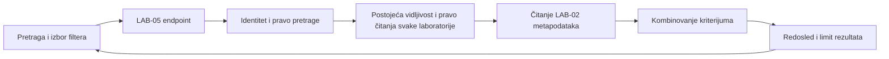

# LAB-05: kombinovanje, uklanjanje i reset filtera

**Zahtev:** Kao korisnik, želim da kombinujem postojeće filtere, uklanjam pojedinačne filtere ili resetujem sve filtere, kako bih lakše suzio ili proširio rezultate pretrage laboratorija.

## Odgovornosti

Proširen je postojeći LAB-05 tok iz [LAB-05-search.md](LAB-05-search.md). LAB-02 ostaje jedini vlasnik definicije i čuvanja težine, tipa i oznaka. LAB-05 koristi postojeće `LaboratoryDifficulty`, `LaboratoryType`, `LaboratoryMetadata` i samo operaciju čitanja `ILaboratoryMetadataStore.GetAsync`. Ne uvodi nove osobine, oznake, validaciju metapodataka, upis, migracije niti drugi izvor podataka.

## Ponašanje korisničkog interfejsa

- Korisnik može da izabere jednu postojeću težinu, jedan postojeći tip i više postojećih oznaka, uz opcioni naziv ili deo naziva laboratorije.
- Svi izabrani kriterijumi se kombinuju logičkim **I**: laboratorija mora da ima izabranu težinu, tip i svaku izabranu oznaku. Neizabrani kriterijum ne ograničava rezultate.
- Aktivni izbori imaju zasebne komande za uklanjanje. Uklanjanje jednog izbora čuva ostale kriterijume i odmah ponavlja pretragu na serveru.
- „Resetuj sve filtere” uklanja težinu, tip i sve oznake, zadržava tekst pretrage i odmah osvežava rezultate. Korisnik može zasebno da obriše naziv i pretraži sve dostupne laboratorije.
- Promena kriterijuma uklanja prethodne rezultate do ponovnog slanja pretrage. Zastareli odgovori ne smeju da prepišu novije rezultate, uključujući reset i promenu korisnika.
- Oznake se biraju iz osobina dostupnih laboratorija; interfejs ne omogućava njihovo kreiranje ili izmenu.

## HTTP ugovor

Kanonske putanje su ispod `/api/laboratories`; isti handleri postoje i preko `/api/labs`.

```http
GET /api/laboratories/search?q=pristup&difficulty=Easy&type=AccessControl&tag=security&tag=access
```

`q`, `difficulty` i `type` mogu da se pojave najviše jednom. `q` je opcion i može biti prazan. Za težinu i tip koriste se nazivi postojećih LAB-02 enum vrednosti, bez razlikovanja velikih i malih slova. Brojčane ili nepoznate enum vrednosti se odbijaju. Parametar `tag` se ponavlja za svaku izabranu oznaku; oznake se porede kao cele vrednosti, nakon uklanjanja rubnih razmaka i bez razlikovanja velikih i malih slova. Kontrolni znakovi, predugačak tekst i nepoznati parametri daju `400 INVALID_QUERY`.

Oblik rezultata je nepromenjen: `{ items, truncated }`, sa najviše 50 rezultata. Laboratorija bez metapodataka može biti u pretrazi bez filtera; kada postoji filter po osobinama, takva laboratorija ne zadovoljava filter.

```http
GET /api/laboratories/search/filters
```

Odgovor sadrži `{ difficulties, types, tags, metadataAvailable }`. Težine i tipovi potiču iz postojećih LAB-02 enum vrednosti, a oznake samo iz metapodataka laboratorija koje pozivalac sme da čita. Opcije ne zavise od trenutno izabrane kombinacije, pa korisnik može da proširi pretragu uklanjanjem izbora.

## Tok i provera pristupa



I pretraga i učitavanje opcija prolaze postojeću serversku proveru pristupa i vraćaju `Cache-Control: no-store`. Metapodaci skrivenih laboratorija se ne čitaju i njihove oznake ne ulaze u opcije. Filteri se primenjuju pre ograničavanja rezultata i računanja `truncated`. LAB-05 koristi postojeće `ICourseMembership` i `LabOpenPolicy`, kao otvaranje laboratorije, uz `laboratory.read`. Članstvo se čita za sačuvani kurs u svakom zahtevu; laboratorije bez kursa i rezultati posle oduzimanja članstva ostaju skriveni i nakon uklanjanja ili resetovanja filtera. LAB-05 ne menja pravila, upis ili izvor članstva drugih komponenti.

## Dostupnost metapodataka

Postojeći PostgreSQL metadata store se registruje kada je podešen `ConnectionStrings:Authoring`. Bez tog izvora LAB-05 ne pravi zamensko skladište: opcije vraćaju `metadataAvailable: false`, interfejs onemogućava filtere po osobinama, a pretraga po nazivu ili bez filtera ostaje dostupna. Direktan zahtev sa filterima tada daje `503 FILTERS_UNAVAILABLE`. Greška čitanja postojećeg izvora ne sme da se pretvori u nefiltrirane ili delimične rezultate.

## Provera

Serverski testovi pokrivaju kombinovanje osobina, uklanjanje kriterijuma i reset, pretragu bez naziva, neispravan unos, nedostajuće metapodatke, prava pristupa, opcije samo iz dostupnih laboratorija i limit nakon filtriranja. Frontend testovi proveravaju slanje kombinacije, uklanjanje pojedinačnih izbora, reset koji zadržava naziv, nedostupnost filtera i zaštitu od zastarelih odgovora.

```powershell
dotnet test backend/Laboratories.Tests/Laboratories.Tests.csproj --configuration Release
cd frontend
npm test
npm run build
```

Rezultat provere 7. novembra 2026:

- Frontend: svih **91 testova prolazi**, kao i produkcioni build.
- Serverska aplikacija i `Laboratories.Tests` uspešno su kompajlirani u Release konfiguraciji.
- Direktnim NUnit izvršavanjem svih **236 serverskih testova**, **235 prolazi**. Svi LAB-05 testovi prolaze. Jedini pad je `ReviewAuthorizationTests.Approve_WithoutRegisteredPolicy_DeniesBeforeDatabase(True,Forbidden)` (očekivano 403, dobijeno 401), već evidentiran u prethodnoj [LAB-05 dokumentaciji](LAB-05-search.md).
- Standardni VSTest u ovom ograničenom okruženju nije uspeo da se poveže sa svojim test procesom. Zato je za proveru korišćen privremeni NUnit runner unutar ignorisanog `obj` direktorijuma; projektne zavisnosti i izvorni kod testova nisu menjani radi tog pokretanja. Paketi su obnovljeni iz postojećeg lokalnog NuGet keša.
