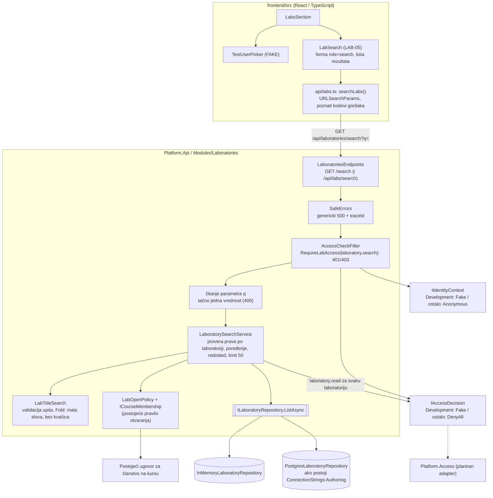
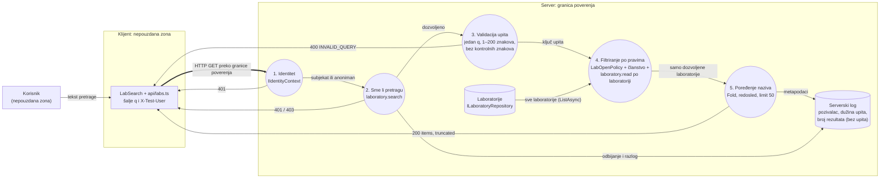

# Komponenta projekta: LAB-05, pretraga i filtriranje laboratorija

**Tim:** 19

**Aktuelno:** pretraga i opcije oznaka koriste postojeće članstvo na sačuvanom kursu i `LabOpenPolicy`, uz `laboratory.read`. Raniji datirani zapisi o ograničenju „samo autor” opisuju stanje pre ove integracije.

**Student:** Zorana Jošić PR57/2023

**Zahtevi iz specifikacije:** LAB-05 (Pretraga i filtriranje, nivo J). Kriterijum prihvatanja: *„Rezultati poštuju prava pristupa korisnika.”* Ovaj deo pokriva dve korisničke priče iz LAB-05:

- *„Kao korisnik, želim da pretražujem laboratorije po nazivu ili delu naziva, kako bih lakše pronašao vežbu.”*
- *„Kao korisnik, želim da u rezultatima pretrage vidim samo laboratorije kojima imam pravo pristupa.”* (Bezbedan pristup rezultatima pretrage)

Zajednički zahtevi koje deo pokriva: SEC-01 (serverska autorizacija, nema IDOR-a kroz pretragu), SEC-05 (validacija ulaza i bezbedan prikaz teksta), LAB-04 (student ne vidi nacrt, ni kroz pretragu), ACC-05 (podrazumevano odbijanje nepoznate radnje), OPS-02 (pozitivni i negativni automatski testovi), OPS-07 (pristupačnost i poruke o grešci bez tajni).

**Grane:** `feature/LAB-05-search-by-name` (pretraga po nazivu), `feature/LAB-05-secure-search-results` (bezbedan pristup rezultatima, nastavlja se na prethodnu)

## Odgovornosti i granice

- **Procesi i scenariji:**
  - Korisnik unese naziv ili deo naziva: `GET /api/laboratories/search?q=<tekst>` (isto i preko aliasa `/api/labs/search`).
  - Server vraća `200 { "items": [...], "truncated": false }`. Stavka sadrži samo ono što je potrebno za prikaz rezultata: `id`, `title`, `status`, `createdAt`. Interni ID autora (`createdBy`) se ne šalje u rezultatima pretrage. Odgovor ima `Cache-Control: no-store`, pa ga browser i proxy ne čuvaju.
  - Poređenje ne razlikuje velika i mala slova, kvačice (`sifr` nalazi „Šifrovanje”, `kljuc` nalazi „ključevi”, `đ` = `d`) ni višestruke razmake. Upit se traži kao podniz naziva (deo naziva), a ne kao šablon: `%`, `*` i `' OR '1'='1` su običan tekst.
  - Redosled: prvo nazivi koji počinju upitom, zatim abecedno; najviše 50 rezultata (`truncated: true` kad ih ima više).
  - Frontend: panel „Pretraga laboratorija” (oznaka LAB-05) u `LabsSection`, ispod forme za kreiranje i prikaza.
- **Proširenje LAB-05:** kombinovanje postojeće težine, tipa i oznaka, uklanjanje pojedinačnih izbora i reset svih filtera opisani su u [LAB-05-filtering.md](LAB-05-filtering.md). Tekst naziva je sada opcion: prazan upit vraća dostupne laboratorije koje zadovoljavaju izabrane filtere, a bez filtera sve dostupne laboratorije, uz isti limit rezultata.
- **Granica odgovornosti:** LAB-02 definiše i čuva osobine; LAB-05 ih samo čita preko postojećeg `ILaboratoryMetadataStore.GetAsync`. Ne menja model, enum vrednosti, validaciju, skladište ni migracije LAB-02, niti pravila Identity/Access modula. Raniji primeri i rezultati testova u ovom dokumentu opisuju prethodne faze pretrage po nazivu; aktuelni ugovor za opcioni naziv i filtere je u povezanom dokumentu.
- **Ugovori sa drugim delovima:**

| Veza | Svrha | Stanje |
| --- | --- | --- |
| `IIdentityContext` (lokalni port LAB modula) | ko je pozivalac | razvoj: `FakeIdentityContext` (`X-Test-User`); van Development-a `AnonymousIdentityContext` |
| `IAccessDecision` (lokalni port LAB modula) | (1) sme li se pretraga pozvati: radnja `laboratory.search`; (2) sme li pozivalac da čita **svaku konkretnu** laboratoriju: radnja `laboratory.read` sa ID-em laboratorije | razvoj: `FakeAccessDecision`; van Development-a `DenyAllAccessDecision`. Planiran adapter na `Platform.Access` (predlog u `LAB-01-LAB-07.md`) |
| `ICourseMembership` + `LabOpenPolicy` (postojeći ugovori) | isto pravilo konteksta kursa kao pri otvaranju laboratorije | LAB-05 čita članstvo za sačuvani `CourseId`, primenjuje postojeću odluku i dodatno proverava `laboratory.read`; ne menja pravila članstva |
| `ILaboratoryRepository.ListAsync` | izvor laboratorija | koristi se postojeći ugovor bez izmena (radi i sa `InMemory` i sa `Postgres` adapterom) |
| Frontend `api/labs.ts` → `searchLabs` | jedino mesto za poziv pretrage | prevodi `INVALID_QUERY`, 401, 403 i greške mreže u naše poruke |

- **Stanje implementacije:** endpoint, servis, pravila upita, frontend panel i testovi su implementirani. Pretraga se radi u servisu nad `ListAsync` (dovoljno za KT1). Spuštanje upita u bazu je naredni korak koji zahteva dogovor sa timom za skladište, a provera prava po laboratoriji ostaje u servisu.

## Matrica odluka o pristupu (Subject – Action – Resource)

| Subjekat | Radnja | Resurs | Odluka |
| --- | --- | --- | --- |
| anoniman / neispravno `X-Test-User` / više zaglavlja | `laboratory.search` | pretraga | Deny, 401 (pre servisa) |
| Student, Nastavnik, Asistent, Administrator | `laboratory.search` | pretraga | Allow: poziv je dozvoljen, ali rezultat se filtrira po laboratoriji |
| Nastavnik, autor i nastavnik na kursu laboratorije | `laboratory.read` | sopstvena laboratorija | u rezultatu, ako naziv odgovara upitu |
| Autor bez članstva na kursu / laboratorija bez kursa | `laboratory.read` | sopstvena laboratorija | nije u rezultatu; njene oznake nisu u opcijama filtera |
| Nastavnik, nije autor | `laboratory.read` | tuđa laboratorija | nije u rezultatu (ni naslov ni ID se ne pojavljuju) |
| Student (ista osoba i kad je autor u drugoj ulozi) | `laboratory.read` | nacrt | nije u rezultatu (LAB-04) |
| Asistent, Administrator (i kad je ista osoba autor) | `laboratory.read` | nacrt | nije u rezultatu; tehnička uloga ne daje automatski pristup sadržaju (specifikacija, pogl. 2) |
| bilo ko, posle oduzimanja prava | `laboratory.read` | ta laboratorija | u sledećoj pretrazi više nije u rezultatu; prava se proveravaju u svakom zahtevu |
| bilo ko, van Development okruženja | bilo koja | bilo koji | Deny, 401 |

Ključno pravilo: **laboratorija je u rezultatu pretrage samo ako bi je isti korisnik mogao i da otvori preko `GET /api/laboratories/{id}`.** Zato pretraga koristi postojeće `ICourseMembership` i `LabOpenPolicy`, uz radnju `laboratory.read`. Ista provera se primenjuje pre čitanja oznaka za opcije filtera. To proveravaju `Search_EveryResultCanBeOpenedBySameCaller` i testovi oduzimanja članstva.

## Dijagram arhitekture

Puna strelica označava postojeću vezu, isprekidana planiranu integraciju.



## DFD sa granicom poverenja klijent–server



Sve što dolazi preko granice poverenja je nepouzdano: parametar `q`, eventualni dodatni parametri i `X-Test-User`. Tuđe laboratorije se uklanjaju **pre** poređenja naziva, pa nijedan podatak o njima ne stiže do koraka 5 ni do odgovora. Upit se ne vraća klijentu u poruci o grešci i ne upisuje se u log.

## Model pretnji: imovina → zloupotreba → kontrola → test

| Imovina | Moguća zloupotreba | Kontrola | Test |
| --- | --- | --- | --- |
| Tuđi nacrti (naslov, ID) | nastavnik pretragom „prelista” tuđe laboratorije (IDOR preko liste) | `LabOpenPolicy`, članstvo i `laboratory.read` pre poređenja | `Search_DoesNotReturnLabsOfAnotherTeacher` (HTTP i servis) |
| Nacrti pred studentima (LAB-04) | student pretragom otkrije nacrt | ista politika `laboratory.read` kao za `GET /{id}`: student ne čita nacrt | `Search_WhenStudentSearches_DoesNotSeeDrafts`, `Search_WhenSameUserHasStudentRole_DoesNotSeeOwnDraft` |
| Doslednost prava | pretraga pokaže nešto što se ne može otvoriti | zajedničko pravilo vidljivosti i ista radnja čitanja | `Search_EveryResultCanBeOpenedBySameCaller`, `Search_ChecksReadPermissionForEachLaboratory` |
| Razvojni identitet | `X-Test-User: marko:Teacher` u produkciji | fake samo u Development-u; drugde `Anonymous` + `DenyAll` | `OutsideDevelopment_TestTeacherHeaderDoesNotGrantSearch` |
| Integritet upita | `?q=a&q=b`, prazan, predug ili upit sa `\n`/`\0` | tačno jedan `q`, 1–200 znakova posle `Trim()`, kontrolni znakovi se odbijaju | `Search_WithMissingBlankOrInvalidQuery_Returns400WithoutInternalDetails`, `LabTitleSearchTests` |
| Svi zapisi | „džoker” upit (`%`, `*`, `' OR '1'='1`) vrati sve | upit je običan podniz, nije SQL ni šablon | `Search_WithWildcardOrInjectionLikeText_TreatsItAsPlainText`, `Search_WithInjectionLikeQuery_...` |
| Prikaz u browseru (XSS) | naslov `` izvrši skriptu | JSON odgovor; React prikazuje naslov kao tekst, bez `dangerouslySetInnerHTML` | `Search_HtmlInTitle_IsReturnedAsJsonData`, `LabSearch.test.tsx` „HTML u nazivu se prikazuje kao tekst” |
| Interni detalji servera | greška skladišta otkrije connection string ili stack trace | `SafeErrors`: generički 500 + `traceId` | `Search_WhenStorageFails_Returns500WithoutInternalDetails` |
| Resursi servera | ogroman odgovor za širok upit | najviše 50 rezultata, `truncated` | `Search_ReturnsAtMostMaxResultsAndMarksTruncated` |
| Rezultati prethodnog korisnika | posle promene korisnika na ekranu ostanu tuđi rezultati | `LabSearch` briše rezultate pri promeni korisnika i posle odbijanja | `LabSearch.test.tsx` „promena korisnika briše rezultate”, „posle odbijanja (401)…” |
| Identitet autora | rezultati pretrage otkriju interni ID drugog korisnika | stavka pretrage (`LaboratorySearchItem`) nema `createdBy` | `Search_ResultsDoNotExposeAuthorId` |
| Rezultati na deljenom računaru | browser ili proxy sačuva rezultate i pokaže ih sledećem korisniku | `Cache-Control: no-store` na svakom odgovoru pretrage (i 200 i 400) | `Search_ResponseIsNeverCached` |
| Nacrti pred tehničkim ulogama | asistent ili administrator pretragom vidi tuđi nacrt | ista politika `laboratory.read`: samo nastavnik-autor čita nacrt | `Search_WhenAssistantOrAdministratorSearches_DoesNotSeeDrafts` (HTTP i servis) |
| Oduzeto pravo | posle oduzimanja prava laboratorija i dalje stiže u rezultatima | provera prava u svakom zahtevu, bez keširanja odluke | `Search_RechecksAccessOnEveryRequest` |
| Broj skrivenih laboratorija | `truncated` ili broj rezultata otkrije da postoje tuđe laboratorije sa istim nazivom | limit i `truncated` se računaju tek posle filtriranja po pravima | `Search_HiddenLaboratoriesDoNotAffectLimitOrTruncation` |
| Delimični rezultati | greška pri proveri prava za jednu laboratoriju vrati ostale bez provere | greška prekida celu pretragu; klijent dobija generički 500 bez rezultata | `Search_WhenAccessCheckFails_ReturnsNoPartialResults`, `Search_WhenAccessCheckFails_Returns500WithoutResults` |

## Bezbednosni zahtevi

- **Provere na serveru:** ruta ima `RequireLabAccess(laboratory.search)` (401/403 pre servisa). Servis ponovo proverava identitet i za svaku laboratoriju traži `laboratory.read` od `IAccessDecision` sa ID-em te laboratorije. Frontend ne filtrira po pravima; on samo prikazuje ono što server vrati (specifikacija, pogl. 1: „Klijentski interfejs nije bezbednosna granica”).
- **Validacija ulaza:** parametar `q` se čita ručno: tačno jedna vrednost, posle `Trim()` od 1 do 200 znakova (najduži dozvoljeni naslov), bez ijednog kontrolnog znaka. Inače `400 INVALID_QUERY` sa fiksnom porukom koja ne ponavlja upit.
- **Osetljivi podaci:** odgovor ne sadrži tuđe laboratorije ni broj tuđih pogodaka. Stavka rezultata nema interni ID autora. Odgovor se ne kešira (`Cache-Control: no-store`). Log beleži pozivaoca, dužinu upita i broj rezultata, ali ne i sam upit (proizvoljan korisnički tekst).
- **Odbijanje u slučaju greške:** ako provera prava za bilo koju laboratoriju ne uspe, pretraga se prekida i ne vraća delimične rezultate; klijent dobija generički 500 sa `traceId`.
- **Poznata ograničenja:**
  - Pretraga koristi postojeću politiku otvaranja i izvor članstva. Trenutni razvojni `FakeAccessDecision` dopušta `laboratory.read` samo nastavniku; LAB-05 ne proširuje dozvole drugih uloga. Laboratorije učitane bez kursa ostaju skrivene.
  - `X-Test-User` je simulacija identiteta (isto ograničenje kao LAB-01).
  - Pretraga čita sve laboratorije kroz `ListAsync` i filtrira u memoriji. Za veliki broj laboratorija upit treba spustiti u skladište (npr. normalizovana kolona i indeks), uz dogovor sa timom za skladište.
  - Ograničenje broja zahteva (SEC-04) za pretragu nije dodato: postojeći rate limiter pripada Identity modulu (IDN-05), pa je politiku za pretragu potrebno dogovoriti sa tim timom.

## Dokaz rada

- **Fajlovi (backend):**
  - `backend/Platform.Api/Modules/Laboratories/Application/LaboratorySearchService.cs` (slučaj upotrebe, provera prava po laboratoriji, redosled, limit)
  - `backend/Platform.Api/Modules/Laboratories/Application/LabTitleSearch.cs` (validacija upita i normalizacija)
  - `backend/Platform.Api/Modules/Laboratories/Application/LaboratoryVisibility.cs` (zajedničko pravilo vidljivosti; `LaboratoryService` ga sada koristi umesto privatne metode, bez promene ponašanja)
  - `backend/Platform.Api/Modules/Laboratories/Application/LabActions.cs` (`laboratory.search`)
  - `backend/Platform.Api/Modules/Laboratories/Infrastructure/FakeAccessDecision.cs` (politika za `laboratory.search`)
  - `backend/Platform.Api/Modules/Laboratories/Api/LaboratoriesEndpoints.cs` (ruta `GET /search`), `LaboratoryContracts.cs` (`LaboratorySearchResponse`, `INVALID_QUERY`)
  - `backend/Platform.Api/Modules/Laboratories/LaboratoriesModule.cs` (registracija servisa)
- **Fajlovi (frontend):** `frontend/src/api/labs.ts` (`searchLabs`), `frontend/src/components/labs/LabSearch.tsx`, `labSearch.css`, `LabsSection.tsx` (novi panel).
- **Testovi:**
  - `backend/Laboratories.Tests/LabTitleSearchTests.cs`, `LaboratorySearchServiceTests.cs`, `LaboratorySearchHttpTests.cs`
  - `frontend/src/components/labs/labSearchApi.test.ts`, `LabSearch.test.tsx`
- **Pokretanje testova** (iz korena repozitorijuma):

```powershell
dotnet test backend/Laboratories.Tests/Laboratories.Tests.csproj --configuration Release
dotnet test backend/SecurityLab.slnx --configuration Release
cd frontend; npm ci; npm run build; npm test
```

- **Ručna demonstracija** (Development, API na portu 5080):

```powershell
$env:ASPNETCORE_ENVIRONMENT = 'Development'
dotnet run --project backend/Platform.Api/Platform.Api.csproj --no-launch-profile --urls http://localhost:5080

# drugi terminal: dve laboratorije nastavnika marko, jedna nastavnice jelena
curl.exe -s -X POST http://localhost:5080/api/laboratories -H "X-Test-User: marko:Teacher" -H "Content-Type: application/json" -d '{\"title\":\"RBAC i kontrola pristupa\"}'
curl.exe -s -X POST http://localhost:5080/api/laboratories -H "X-Test-User: marko:Teacher" -H "Content-Type: application/json" -d '{\"title\":\"Analiza logova\"}'
curl.exe -s -X POST http://localhost:5080/api/laboratories -H "X-Test-User: jelena:Teacher" -H "Content-Type: application/json" -d '{\"title\":\"RBAC - Jelenin nacrt\"}'

# 1) marko trazi deo naziva -> 200, samo "RBAC i kontrola pristupa"
curl.exe -i "http://localhost:5080/api/laboratories/search?q=rbac" -H "X-Test-User: marko:Teacher"
# 2) jelena isti upit -> 200, samo njen nacrt (Markov se ne vidi)
curl.exe -i "http://localhost:5080/api/laboratories/search?q=rbac" -H "X-Test-User: jelena:Teacher"
# 3) student -> 200, prazna lista (nacrti nisu za studente)
curl.exe -i "http://localhost:5080/api/laboratories/search?q=rbac" -H "X-Test-User: ana:Student"
# 4) bez identiteta -> 401; prazan upit -> 400 INVALID_QUERY
curl.exe -i "http://localhost:5080/api/laboratories/search?q=rbac"
curl.exe -i "http://localhost:5080/api/laboratories/search?q=" -H "X-Test-User: marko:Teacher"
```

### Izvršena lokalna provera

Provera je izvršena 5. novembra 2026. nad lokalnim izmenama, .NET SDK 10.0.301 i Node.js 24.14.1. To su lokalni rezultati, ne GitHub CI provera.

- `dotnet build backend/SecurityLab.slnx --configuration Release`: uspešno, bez upozorenja.
- `dotnet test backend/Laboratories.Tests/...`: 191 test prošao (112 postojećih + 79 novih za LAB-05), nema neuspešnih.
- `npm run build` (TypeScript + Vite) prošao; `npm test`: 69 testova prošlo (13 novih za LAB-05).
- Ručni HTTP smoke test na `http://127.0.0.1:5080` (Development, skladište u memoriji):

| Zahtev | X-Test-User | Dobijeno |
| --- | --- | --- |
| `GET /api/laboratories/search?q=rbac` | `marko:Teacher` | 200, samo Markova „RBAC i kontrola pristupa” |
| `GET /api/laboratories/search?q=rbac` | `jelena:Teacher` | 200, samo Jelenin „RBAC - Jelenin nacrt” |
| `GET /api/laboratories/search?q=rbac` | `ana:Student` | 200, `items: []` |
| `GET /api/laboratories/search?q=rbac` | nema | 401 |
| `GET /api/laboratories/search?q=` | `marko:Teacher` | 400 `INVALID_QUERY` |
| `GET /api/laboratories/search?q=a&q=b` | `marko:Teacher` | 400 `INVALID_QUERY` |
| `GET /api/laboratories/search?q=' OR '1'='1` | `marko:Teacher` | 200, `items: []` |
| `GET /api/laboratories/search?q=sifr` i `?q=KLJUC` | `marko:Teacher` | 200, „Šifrovanje i ključevi” |
| `GET /api/labs/search?q=analiza` | `marko:Teacher` | 200, „Analiza logova” (alias) |

- Frontend je proveren u browseru (`npm run dev`): nastavnik pronalazi svoju laboratoriju, a posle prelaska na studenta rezultati nestaju i pretraga vraća poruku da nema dostupnih laboratorija.

### Bezbedan pristup rezultatima pretrage

- **Fajlovi:** `backend/Platform.Api/Modules/Laboratories/Api/LaboratoryContracts.cs` (`LaboratorySearchItem` bez `createdBy`), `LaboratoriesEndpoints.cs` (`ToSearchItem`, `Cache-Control: no-store`).
- **Novi testovi (11):**
  - `LaboratorySearchServiceTests`: `Search_WhenAssistantOrAdministratorSearches_DoesNotSeeDrafts` (2), `Search_RechecksAccessOnEveryRequest`, `Search_HiddenLaboratoriesDoNotAffectLimitOrTruncation`, `Search_WhenAccessCheckFails_ReturnsNoPartialResults`
  - `LaboratorySearchHttpTests`: `Search_ResultsDoNotExposeAuthorId`, `Search_ResponseIsNeverCached` (2), `Search_WhenAssistantOrAdministratorSearches_DoesNotSeeDrafts` (2), `Search_WhenAccessCheckFails_Returns500WithoutResults`
- **Provera 6. novembra 2026** (grana spojena sa `main`, lokalno):
  - `Laboratories.Tests`: 210 od 211 prolazi; svih 90 LAB-05 testova prolazi. Jedini pad je `ReviewAuthorizationTests.Approve_WithoutRegisteredPolicy_DeniesBeforeDatabase` (REV-05), koji pada i na čistom `main`.
  - Frontend: `npm run build` i `npm test` 73/73.
- **Šta ova priča ne može dok ne postoji LAB-03:** prava po kursu i članstvu (npr. student vidi objavljene laboratorije svog kursa). LAB-01 laboratorija još nema kurs ni stanje „objavljena”; kad ih dobije, menja se samo `LaboratoryVisibility`, a pretraga i ovi testovi ostaju isti.

## Minimalna dorada bezbednog pristupa (7. novembar 2026)

- `LaboratorySearchService` proverava `laboratory.search` i pri direktnom pozivu servisa, pre validacije upita i čitanja skladišta. Isto važi za opcije filtera. Odbijanje vraća prazan rezultat: `Unauthenticated` (HTTP 401) ili `Forbidden` (HTTP 403).
- Usklađen je `GetFilterOptionsAsync` sa postojećim API ugovorom. Oznake se čitaju samo iz laboratorija koje prođu postojeće pravilo vidljivosti i `laboratory.read`; skriveni metapodaci ne ulaze u opcije.
- `LaboratorySearchAuthorizationTests` dodaje 12 slučajeva za odbijanje pretrage uz dozvoljeno čitanje, oduzimanje prava pri narednom pozivu i odbijanje u servisu nakon početne HTTP provere, na obe putanje pretrage i opcija.
- Provera ove dorade: Release build API-ja i `Laboratories.Tests` prolazi bez upozorenja i grešaka; svih **127 odabranih LAB-05 testova prolazi** (uključujući 12 novih). Testovi su izvršeni direktnim NUnit runnerom u ignorisanom `obj/lab05-security-check` direktorijumu, sa izborom samo `LaboratorySearch*Tests`, `LaboratoryFilter*Tests` i `LabTitleSearchTests`. Izvorni test projekat i njegove zavisnosti nisu menjani radi pokretanja.
- Obim: servis pretrage, dva LAB-05 HTTP handlera, LAB-05 testovi i ovaj dokument. Registracije identiteta, politike pristupa, model laboratorije i skladišta drugih komponenti nisu menjani. Postojeće ograničenje razvojnog identiteta i pravila „samo autor” ostaje; ova dorada ne predstavlja integraciju sa stvarnom sesijom, kursom ili članstvom.

## Provera članstva u pretrazi

Provera članstva u LAB-05 koristi postojeće `ICourseMembership` i `LabOpenPolicy` bez izmene njihovih pravila ili implementacija. Dodati su testovi dozvoljenog i odbijenog pristupa, članstva na drugom kursu, oduzimanja članstva uz naziv/filtere/reset, skrivenih oznaka, zapisa bez kursa i greške izvora članstva. HTTP provera na obe putanje potvrđuje da nakon oduzimanja članstva pretraga i opcije ne izlažu podatke, a otvaranje vraća 404.

Provera: Release build API-ja i test projekta prolazi; svih **134 odabrana LAB-05 testa prolazi**, uključujući 7 novih slučajeva za članstvo. Izvršavanje je obavljeno istim direktnim NUnit runnerom u ignorisanom `obj/lab05-security-check` direktorijumu. Ostali moduli i njihove politike nisu menjani.

## Sledeći koraci

- Kombinovanje i uklanjanje postojećih filtera proširuje isti endpoint i servis; detalji su u [LAB-05-filtering.md](LAB-05-filtering.md). Novi kriterijumi i definisanje osobina nisu deo ovog proširenja.
- Pozitivan scenario objavljene laboratorije za studenta, kada postojeći ugovori čitanja i vidljivosti obezbede tu dozvolu.
- Dogovor sa timom za skladište oko pretrage u bazi i sa Identity timom oko rate limit politike za pretragu (SEC-04).
