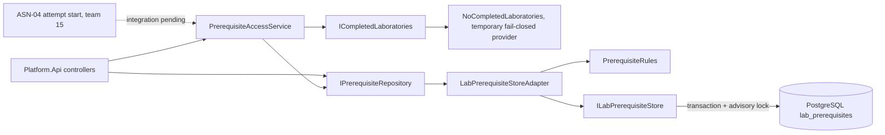
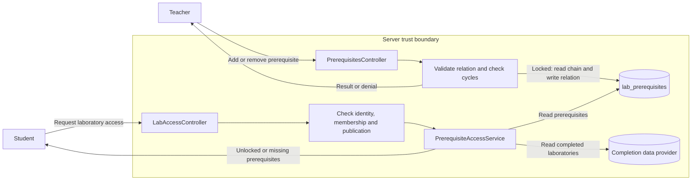

# Project component: LAB-06, prerequisites and logical learning path

**Team:** 20

**Specification requirements:** LAB-06; ASN-07 (server-side condition, integration pending)

## Responsibilities and boundaries

- Stores prerequisite relations between laboratories through `IPrerequisiteRepository`.
- Rejects a laboratory as its own prerequisite, duplicate relations, and direct or indirect cycles.
- Runs the cycle check and database write in one PostgreSQL transaction under a transaction-scoped advisory lock, preventing concurrent additions from creating a cycle.
- `PrerequisiteAccessService` determines whether a student has unlocked a laboratory and returns the missing prerequisites.
- `Platform.Api` exposes endpoints for prerequisite management and laboratory access checks.
- LAB-06 does not take over ASN-04 or modify `StartAttemptService`. Team 15 owns the attempt-start flow.
- **Implementation status:** Domain rules, access decision, storage adapter, concurrency-safe writes, API controllers, and API routing are implemented.
- **Integration status:** Real completion data is not connected, and prerequisite enforcement in the attempt-start flow remains pending agreement and integration with Team 15.

## Contracts

| Contract | Direction | Status |
|---|---|---|
| `IPrerequisiteRepository` | Used by the LAB-06 access decision and API | Implemented through `LabPrerequisiteStoreAdapter` and an in-memory test implementation |
| `ILabPrerequisiteStore` | Provided by `Platform.LaboratoryPersistence` | Used through the adapter; prerequisite writes are serialized through `RunInPrerequisiteLockAsync` |
| `ICompletedLaboratories` | Should be provided by attempts or results data | `NoCompletedLaboratories` is currently registered in `Platform.Api`; it returns no completed laboratories and is a temporary fail-closed implementation |
| `IPrerequisiteAccessService` | Used by the API and offered for ASN-04 integration | Implemented; the integration contract and call point in the attempt-start flow still need to be agreed with Team 15 |

## Component architecture



The API controllers expose the functionality, but the attempt-start integration is still a separate responsibility owned by Team 15.

## API endpoints

The following endpoints are implemented in `Platform.Api`:

| Method | Endpoint | Purpose |
|---|---|---|
| `GET` | `/api/laboratories/{laboratoryId}/access` | Checks laboratory access and returns whether it is unlocked and which prerequisites are missing |
| `GET` | `/api/laboratories/{id}/prerequisites` | Reads the prerequisite relations for a laboratory |
| `POST` | `/api/laboratories/{id}/prerequisites` | Adds a prerequisite relation |
| `DELETE` | `/api/laboratories/{id}/prerequisites/{requiredLaboratoryId}` | Removes a prerequisite relation |

`LabAccessController` checks the authenticated subject, laboratory availability and course membership before returning the access result. Teachers receive access; students receive the prerequisite decision for published laboratories.

`PrerequisitesController` performs subject and access-decision checks before allowing prerequisite management operations.

The API controllers and routes are mapped in `Platform.Api`. The availability of prerequisite persistence still depends on the configured persistence implementation. `UnavailablePrerequisiteRepository` fails explicitly when Authoring persistence is not configured.

## Data flow diagram



Everything sent by a client is untrusted. The prerequisite decision must be made on the server. Client-side checks must not be treated as an authorization or access-control mechanism.

## Security requirements

- **Server-side access checks:** `PrerequisiteAccessService` makes the prerequisite decision. The API exposes an access-check endpoint, but enforcement in the attempt-start flow is not complete until ASN-04 integration is agreed and implemented with Team 15.
- **Input validation:** Empty identifiers and self-prerequisites are rejected. The domain model and API validate the relevant identifiers and relations.
- **Persistence safety:** Cycle detection and relation insertion execute within one PostgreSQL transaction protected by a transaction-scoped advisory lock.
- **Sensitive data:** The prerequisite component stores laboratory identifiers and relations; it does not store student completion records.
- **Fail-closed completion provider:** `NoCompletedLaboratories` currently returns no completed laboratories. It does not represent real student completion data.
- **Negative scenarios:** Self-prerequisite, empty ID, duplicate relation, two-laboratory cycle, three-laboratory cycle, concurrent opposite additions, and unmet prerequisite.

| Threat | Control | Test | Evidence |
|---|---|---|---|
| A circular chain locks laboratories forever | Chain traversal and `WouldCreateCycle` | `AddAsync_TwoLaboratoryCycle_IsRejected`, `AddAsync_ThreeLaboratoryCycle_IsRejected` | Result is `WouldCreateCycle` and no relation is written |
| Two teachers add opposite prerequisites at the same time | Cycle check and write run in one PostgreSQL transaction under `pg_advisory_xact_lock` | `AddAsync_TwoTeachersAtSameTime_OnlyOneDirectionIsSaved`, `AddAsync_CycleInDatabase_IsRejected` | One request is `Added`, the other is `WouldCreateCycle`; exactly one row is stored |
| A student has not completed a required laboratory | `PrerequisiteAccessService` checks completed laboratories | `CheckAccessAsync_PrerequisiteNotCompleted_ReturnsLocked` | `IsUnlocked` is false and the missing prerequisite is returned |
| An invalid identifier is used | Domain and service ID validation | `CheckAccessAsync_EmptyStudentId_ThrowsArgumentException`, `CheckAccessAsync_EmptyLaboratoryId_ThrowsArgumentException` | `ArgumentException` is thrown |
| A client attempts to bypass the prerequisite decision | Server-side access decision through the API; attempt-start enforcement remains pending ASN-04 integration | API access and prerequisite service tests | API does not rely on client-provided completion claims; full attempt-start enforcement is pending Team 15 integration |

## Requirement to code to test

| Requirement | Code | Tests |
|---|---|---|
| LAB-06: no laboratory is its own prerequisite | `LabPrerequisite` | `Constructor_SameLaboratory_IsRejected` |
| LAB-06: no duplicate prerequisites | `PrerequisiteRules.IsDuplicate`, `LabPrerequisiteStoreAdapter` | `IsDuplicate_SamePairExists_ReturnsTrue`, `AddAsync_Duplicate_IsRejected` |
| LAB-06: no direct or indirect cycles | `PrerequisiteRules.WouldCreateCycle`, `LabPrerequisiteStoreAdapter` | `AddAsync_TwoLaboratoryCycle_IsRejected`, `AddAsync_ThreeLaboratoryCycle_IsRejected`, `AddAsync_CycleInDatabase_IsRejected` |
| LAB-06: concurrent additions cannot create a cycle | `PostgresLaboratoryStore.RunInPrerequisiteLockAsync` | `AddAsync_TwoTeachersAtSameTime_OnlyOneDirectionIsSaved` |
| LAB-06: removal deletes the stored relation | `PostgresLaboratoryStore.RemoveAsync` | `RemoveAsync_ExistingPrerequisite_IsDeletedFromDatabase` |
| LAB-06: locked laboratory shows missing prerequisites | `PrerequisiteAccessService` | `CheckAccessAsync_PrerequisiteNotCompleted_ReturnsLocked` |
| LAB-06: API exposes prerequisite management | `PrerequisitesController` | API/controller tests, where configured |
| LAB-06: API exposes laboratory access decision | `LabAccessController` | API/controller tests, where configured |

## Known limitations and pending integration

- Real student completion data is not connected. `NoCompletedLaboratories` is currently registered as a temporary fail-closed provider.
- Prerequisite enforcement in the attempt-start flow is pending. Team 15 owns ASN-04 and the integration point must be agreed before modifying that flow.
- The API controllers and routes are implemented, but prerequisite persistence requires the appropriate Authoring persistence configuration.
- The current access endpoint does not replace server-side enforcement in the attempt-start operation.

## Running the PostgreSQL tests

The PostgreSQL integration tests are skipped unless `ConnectionStrings__Authoring` is set. Use a local test database only, never shared credentials.

```powershell
docker run -d --name lab06-postgres -e POSTGRES_USER=lab06 -e POSTGRES_PASSWORD=<local-test-password> -e POSTGRES_DB=lab06 -p 127.0.0.1:5433:5432 postgres:17-alpine

$env:ConnectionStrings__Authoring = "Host=127.0.0.1;Port=5433;Database=lab06;Username=lab06;Password=<local-test-password>"

dotnet test backend/Platform.Prerequisites.Tests
```

To run the complete solution test suite:

```powershell
dotnet test backend/SecurityLab.slnx
```

## Evidence of work

- Pull requests: #79 (merged). Earlier work: #41.
- Concurrency-safe writes: branch `feature/LAB-06-bezbedan-upis-preduslova`.
- Relevant test command: `dotnet test backend/SecurityLab.slnx`.
- **Latest reported local result:** Build succeeded. Test summary: 68 total, 63 succeeded, 0 failed, 5 skipped.
- The five skipped tests should not be reported as passed. Their skip reason depends on the test-run configuration and should be verified separately.
- Historical PostgreSQL test result: `Platform.Prerequisites.Tests` — 28 passed, 0 skipped. This is a previous result and should not be presented as the latest run unless reproduced.

## Next steps

1. Agree the `IPrerequisiteAccessService` integration contract and call point with Team 15.
2. Connect `ICompletedLaboratories` to real student completion data.
3. Complete and verify prerequisite enforcement in the attempt-start flow as part of ASN-04.
4. Verify the PostgreSQL test configuration and investigate the five skipped tests in the latest full test run.
5. Keep this document updated when the cross-team integration is completed.
