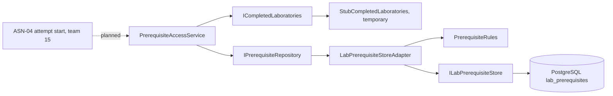
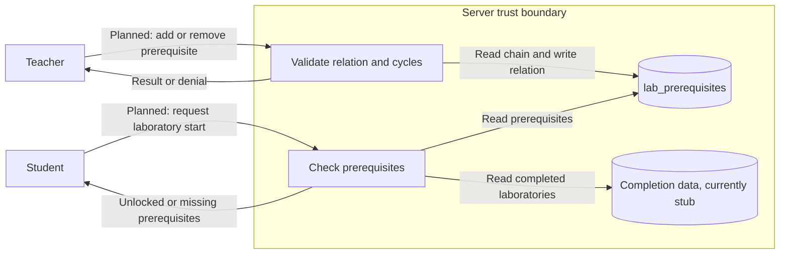

# Project component: LAB-06, prerequisites and logical learning path

**Team:** 20

**Specification requirements:** LAB-06; ASN-07 (server-side condition, integration pending)

## Responsibilities and boundaries

- Stores prerequisite relations between laboratories through `IPrerequisiteRepository`.
- Rejects a laboratory as its own prerequisite, duplicate relations, and direct or indirect cycles.
- `PrerequisiteAccessService` decides whether a student has unlocked a laboratory and returns the missing prerequisites.
- LAB-06 does not take over ASN-04 or change `StartAttemptService`. Team 15 owns attempt start.
- Implementation status: domain rules, access decision and storage adapter are implemented. HTTP endpoints and composition in `Platform.Api` are not implemented yet.

## Contracts

| Contract | Direction | Status |
|---|---|---|
| `IPrerequisiteRepository` | Used by the LAB-06 access decision and future API | Implemented by `LabPrerequisiteStoreAdapter` and an in-memory test version |
| `ILabPrerequisiteStore` | Provided by `Platform.LaboratoryPersistence` | Used through the adapter |
| `ICompletedLaboratories` | Should be provided by attempts or results data | `StubCompletedLaboratories` is temporary |
| `IPrerequisiteAccessService` | Offered to ASN-04 | Contract must be agreed with team 15 |

## Component architecture

## Data flow diagram

Everything sent by a client is untrusted. The decision must be made on the server.

## Security requirements

- Server-side access checks: `PrerequisiteAccessService` makes the decision, but it is not enforced in the attempt flow until ASN-04 integration is complete.
- Input validation and sensitive data: empty IDs and self-prerequisites are rejected. The component stores only laboratory IDs.
- Negative scenarios: self-prerequisite, empty ID, duplicate, two-laboratory cycle, three-laboratory cycle and unmet prerequisite.

| Threat | Control | Test | Evidence |
|---|---|---|---|
| A circular chain locks laboratories forever | Chain traversal and `WouldCreateCycle` | `AddAsync_TwoLaboratoryCycle_IsRejected`, `AddAsync_ThreeLaboratoryCycle_IsRejected` | Result is `WouldCreateCycle` and nothing is written |
| A student has not completed a required laboratory | `PrerequisiteAccessService` | `CheckAccessAsync_PrerequisiteNotCompleted_ReturnsLocked` | `IsUnlocked` is false |
| An invalid identifier is used | ID validation | `CheckAccessAsync_EmptyStudentId_ThrowsArgumentException`, `CheckAccessAsync_EmptyLaboratoryId_ThrowsArgumentException` | `ArgumentException` |

## Known limitations

- Real completion data is not connected.
- Prerequisites are not enforced at attempt start until the contract with team 15 is agreed.
- No HTTP endpoint or `Platform.Api` registration exists yet.
- Two concurrent additions could still create a cycle, because the check and write are not one database transaction.

## Evidence of work

- Pull request: #79. Earlier work: #41.
- Run instructions: `dotnet test backend/SecurityLab.slnx`
- Latest local result: 616 tests, 592 passed, 0 failed, 24 skipped.
- Next steps: agree the ASN-04 contract, connect completion data, add API and composition, and make the cycle check and write transactional.