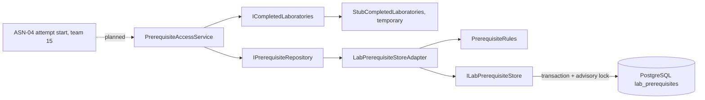
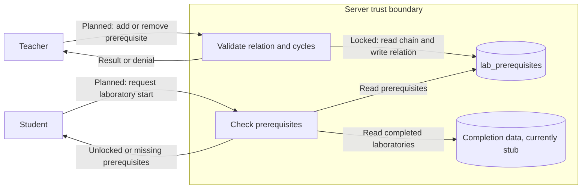

# Project component: LAB-06, prerequisites and logical learning path

**Team:** 20

**Specification requirements:** LAB-06; ASN-07 (server-side condition, integration pending)

## Responsibilities and boundaries

- Stores prerequisite relations between laboratories through `IPrerequisiteRepository`.
- Rejects a laboratory as its own prerequisite, duplicate relations, and direct or indirect cycles.
- Runs the cycle check and the database write in one PostgreSQL transaction, so concurrent additions cannot create a cycle.
- `PrerequisiteAccessService` decides whether a student has unlocked a laboratory and returns the missing prerequisites.
- LAB-06 does not take over ASN-04 or change `StartAttemptService`. Team 15 owns attempt start.
- Implementation status: domain rules, access decision, storage adapter and concurrency-safe writes are implemented. HTTP endpoints and composition in `Platform.Api` are not implemented yet.

## Contracts

| Contract | Direction | Status |
|---|---|---|
| `IPrerequisiteRepository` | Used by the LAB-06 access decision and future API | Implemented by `LabPrerequisiteStoreAdapter` and an in-memory test version |
| `ILabPrerequisiteStore` | Provided by `Platform.LaboratoryPersistence` | Used through the adapter; `RunInPrerequisiteLockAsync` serializes prerequisite writes |
| `ICompletedLaboratories` | Should be provided by attempts or results data | `StubCompletedLaboratories` is temporary |
| `IPrerequisiteAccessService` | Offered to ASN-04 | Contract must be agreed with team 15 |

## Component architecture



## Data flow diagram



Everything sent by a client is untrusted. The decision must be made on the server.

## Security requirements

- Server-side access checks: `PrerequisiteAccessService` makes the decision, but it is not enforced in the attempt flow until ASN-04 integration is complete.
- Input validation and sensitive data: empty IDs and self-prerequisites are rejected. The component stores only laboratory IDs.
- Negative scenarios: self-prerequisite, empty ID, duplicate, two-laboratory cycle, three-laboratory cycle, concurrent opposite additions and unmet prerequisite.

| Threat | Control | Test | Evidence |
|---|---|---|---|
| A circular chain locks laboratories forever | Chain traversal and `WouldCreateCycle` | `AddAsync_TwoLaboratoryCycle_IsRejected`, `AddAsync_ThreeLaboratoryCycle_IsRejected` | Result is `WouldCreateCycle` and nothing is written |
| Two teachers add opposite prerequisites at the same time | Cycle check and write run in one PostgreSQL transaction under `pg_advisory_xact_lock` | `AddAsync_TwoTeachersAtSameTime_OnlyOneDirectionIsSaved`, `AddAsync_CycleInDatabase_IsRejected` | One request is `Added`, the other `WouldCreateCycle`; exactly one row is stored |
| A student has not completed a required laboratory | `PrerequisiteAccessService` | `CheckAccessAsync_PrerequisiteNotCompleted_ReturnsLocked` | `IsUnlocked` is false |
| An invalid identifier is used | ID validation | `CheckAccessAsync_EmptyStudentId_ThrowsArgumentException`, `CheckAccessAsync_EmptyLaboratoryId_ThrowsArgumentException` | `ArgumentException` |

## Requirement to code to test

| Requirement | Code | Tests |
|---|---|---|
| LAB-06: no laboratory is its own prerequisite | `LabPrerequisite` | `Constructor_SameLaboratory_IsRejected` |
| LAB-06: no duplicate prerequisites | `PrerequisiteRules.IsDuplicate`, `LabPrerequisiteStoreAdapter` | `IsDuplicate_SamePairExists_ReturnsTrue`, `AddAsync_Duplicate_IsRejected` |
| LAB-06: no direct or indirect cycles | `PrerequisiteRules.WouldCreateCycle`, `LabPrerequisiteStoreAdapter` | `AddAsync_TwoLaboratoryCycle_IsRejected`, `AddAsync_ThreeLaboratoryCycle_IsRejected`, `AddAsync_CycleInDatabase_IsRejected` |
| LAB-06: concurrent additions cannot create a cycle | `PostgresLaboratoryStore.RunInPrerequisiteLockAsync` | `AddAsync_TwoTeachersAtSameTime_OnlyOneDirectionIsSaved` |
| LAB-06: removal deletes the stored relation | `PostgresLaboratoryStore.RemoveAsync` | `RemoveAsync_ExistingPrerequisite_IsDeletedFromDatabase` |
| LAB-06: locked laboratory shows missing prerequisites | `PrerequisiteAccessService` | `CheckAccessAsync_PrerequisiteNotCompleted_ReturnsLocked` |

## Known limitations

- Real completion data is not connected.
- Prerequisites are not enforced at attempt start until the contract with team 15 is agreed.
- No HTTP endpoint or `Platform.Api` registration exists yet.

## Running the PostgreSQL tests

The database tests are skipped unless `ConnectionStrings__Authoring` is set. Use a local test database only, never shared credentials.

```powershell
docker run -d --name lab06-postgres -e POSTGRES_USER=lab06 -e POSTGRES_PASSWORD=<local-test-password> -e POSTGRES_DB=lab06 -p 127.0.0.1:5433:5432 postgres:17-alpine
$env:ConnectionStrings__Authoring = "Host=127.0.0.1;Port=5433;Database=lab06;Username=lab06;Password=<local-test-password>"
dotnet test backend/Platform.Prerequisites.Tests
```

## Evidence of work

- Pull requests: #79 (merged). Earlier work: #41. Concurrency-safe writes: branch `feature/LAB-06-bezbedan-upis-preduslova`.
- Run instructions: `dotnet test backend/SecurityLab.slnx`
- Latest local result with PostgreSQL: `Platform.Prerequisites.Tests` 28 tests, 28 passed, 0 skipped.
- Next steps: agree the ASN-04 contract, connect completion data, add API and composition.