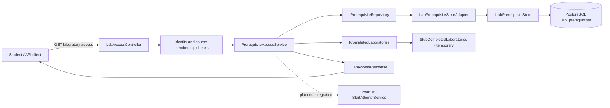

# Project component: LAB-06, prerequisites and logical learning path

**Team:** 20

**Specification requirements:** LAB-06; ASN-07 (server-side condition)

## Responsibilities and boundaries

- Stores prerequisite relations between laboratories through `IPrerequisiteRepository`.
- Rejects a laboratory as its own prerequisite, duplicate relations, and direct or indirect cycles.
- `PrerequisiteAccessService` decides whether a student has unlocked a laboratory and returns the missing prerequisites.
- Exposes a server-side access-status endpoint through `LabAccessController`.
- LAB-06 owns prerequisite rules and the access decision. It does not own the attempt-start workflow (`StartAttemptService`); that integration belongs to Team 15 and remains pending.
- Implementation status: domain rules, access decision, persistence adapter, API access-status endpoint and controller tests are implemented. End-to-end enforcement in the actual attempt-start operation is not yet complete.

## Contracts

| Contract | Direction | Status |
|---|---|---|
| `IPrerequisiteRepository` | Used by the LAB-06 access decision and API | Implemented by `LabPrerequisiteStoreAdapter` and an in-memory test version |
| `ILabPrerequisiteStore` | Provided by `Platform.LaboratoryPersistence` | Used through `LabPrerequisiteStoreAdapter` |
| `ICompletedLaboratories` | Supplies the student's completed laboratory IDs | `StubCompletedLaboratories` is currently used; a real completion/results source is still required |
| `IPrerequisiteAccessService` | Used by the API to evaluate access | Implemented by `PrerequisiteAccessService` |
| `LabAccessController` | HTTP access-status endpoint | Implemented at `GET /api/laboratories/{laboratoryId}/access` |
| Attempt-start integration | Consumes the server-side access decision before starting an attempt | Pending agreement and integration with Team 15 |

## Component architecture

The diagram shows the implemented access-status path. The dotted connection to the attempt-start workflow is planned, not yet enforced.



### API behaviour

`GET /api/laboratories/{laboratoryId}/access` returns the access decision and missing prerequisite IDs.

- An unauthenticated or invalid subject is rejected with `401`.
- A laboratory that does not exist or is not visible to the student is returned as `404`.
- Course membership is checked on the server.
- A teacher receives an unlocked result.
- A student can access only a published laboratory; the prerequisite service then determines whether all required laboratories have been completed.
- The response contains `isUnlocked` and `missingPrerequisites`.

This endpoint reports the access status. It does **not**, by itself, protect the separate operation that starts a laboratory attempt. That operation must call the same server-side decision before LAB-06 can be considered fully enforced.

## Data flow diagram

```mermaid
flowchart TD
  S[Student] -->|GET /api/laboratories/{id}/access| API[LabAccessController]
  subgraph SERVER[Server trust boundary]
    API --> ID[Validate authenticated subject]
    ID --> LAB[Read laboratory and check visibility]
    LAB --> MEMBER[Check course membership and role]
    MEMBER --> ACCESS[PrerequisiteAccessService]
    ACCESS -->|Read required laboratory IDs| PR[(PostgreSQL lab_prerequisites)]
    ACCESS -->|Read completed laboratory IDs| COMPLETED[Completion source - currently stub]
    PR --> ACCESS
    COMPLETED --> ACCESS
    ACCESS --> DECISION{All prerequisites completed?}
    DECISION -->|Yes| OPEN[isUnlocked = true]
    DECISION -->|No| LOCKED[isUnlocked = false + missing IDs]
  end
  OPEN --> S
  LOCKED --> S
  START[Attempt-start operation - Team 15] -. must enforce same decision .-> ACCESS
```

Everything sent by a client is untrusted. The access decision is calculated on the server. The frontend may display the result, but it is not the security boundary.

## Security requirements

- Server-side access-status checks are implemented in `LabAccessController`; the actual attempt-start flow still needs integration with Team 15.
- The controller checks the subject, laboratory visibility, course membership and role before returning a student's prerequisite status.
- Empty IDs and self-prerequisites are rejected. Duplicate relations and direct or indirect cycles are rejected by prerequisite validation.
- The access service returns missing prerequisite IDs when a student has not completed all required laboratories.
- Completion data is currently supplied by a temporary stub. It must be replaced by a trusted source from the attempts/results component before production use.
- The temporary completion stub must not be treated as production-ready. Its registration and environment restrictions must be resolved before deployment.

| Threat | Control | Test | Evidence |
|---|---|---|---|
| A circular chain locks laboratories indefinitely | Chain traversal and `WouldCreateCycle` | `AddAsync_TwoLaboratoryCycle_IsRejected`, `AddAsync_ThreeLaboratoryCycle_IsRejected` | Cycle is rejected and relation is not written |
| A student has not completed a required laboratory | `PrerequisiteAccessService` | `CheckAccessAsync_PrerequisiteNotCompleted_ReturnsLocked` | `IsUnlocked` is false and missing prerequisite is returned |
| An invalid identifier is used | ID validation | `CheckAccessAsync_EmptyStudentId_ThrowsArgumentException`, `CheckAccessAsync_EmptyLaboratoryId_ThrowsArgumentException` | `ArgumentException` |
| An unauthenticated caller requests access status | Controller subject validation | `LabAccessControllerTests` – unauthenticated/invalid subject case | HTTP `401` |
| A student requests a non-existent or unpublished laboratory | Server-side visibility and publication checks | `LabAccessControllerTests` – not-found and draft-laboratory cases | HTTP `404` |
| A student from another course requests access | Server-side membership check | `LabAccessControllerTests` – course membership case | HTTP `404` |
| A client tries to rely only on frontend locking | Server-side access decision; attempt-start integration still required | Access endpoint tests; future Team 15 attempt-start negative test | Endpoint reports locked status; actual attempt-start rejection remains an integration test to add |

## Known limitations and remaining work

- Real completion data is not connected; `StubCompletedLaboratories` is temporary.
- The access-status endpoint is implemented, but the actual attempt-start operation is not yet enforcing the prerequisite decision. Agree the contract with Team 15 and integrate it into `StartAttemptService`.
- Production registration of the temporary completion stub must be replaced or explicitly disabled outside development/testing.
- Two concurrent prerequisite additions could still create a cycle if the cycle check and write are not protected by one database transaction.
- Add an integration test proving that a direct API attempt-start request is rejected when prerequisites are not met.
- Verify DI registration and the real completion-data persistence/source as part of integration.

## Evidence of work

- Earlier prerequisite/domain work: PR #41 and PR #79.
- Persistence for LAB-02/LAB-06: PR #56.
- Server-side access-status endpoint and controller tests: PR #152.
- Teacher prerequisite editor: PR #155.
- Student laboratory catalog and locked-state display: PR #159.
- Controller tests cover unauthenticated/invalid subject, missing laboratory, unpublished laboratory, course membership, teacher access, completed prerequisites and missing prerequisites.
- The route is also included in the delegated-route coverage allowlist, so the route-coverage test recognises the protected endpoint.
- Run the backend tests from the repository root with:

  ```powershell
  dotnet test backend/SecurityLab.slnx --configuration Release
  ```

- Run the frontend checks from `frontend/` with:

  ```powershell
  npm test
  npm run build
  ```

Test results should be reported from the latest local or CI run; earlier test counts in older documentation are not evidence for the current branch.
