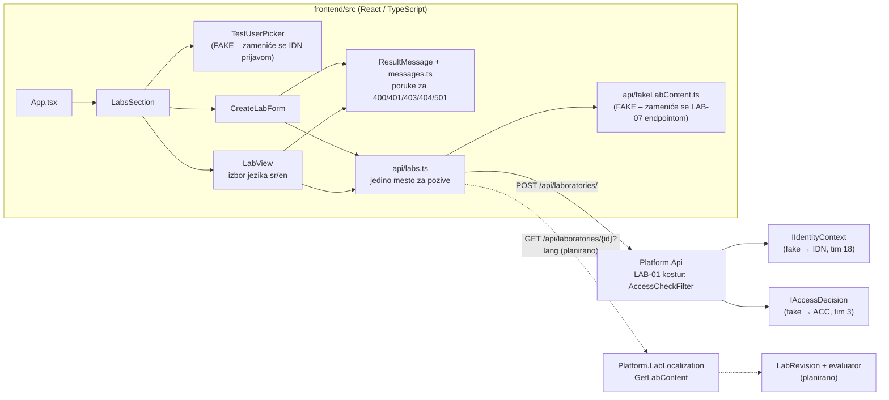
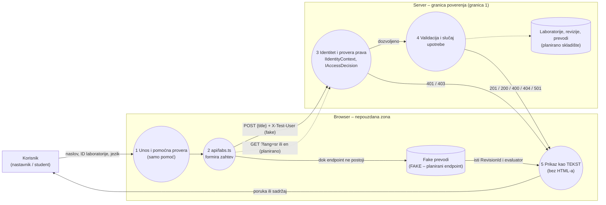

# Komponenta projekta: LAB-07, frontend i pristupačnost

**Tim:** 14

**Student:** Marija Krsmanović / PR 45/2023 (GitHub: marijjak)

**Zahtevi iz specifikacije:** LAB-07 (lokalizacija i pristupačne varijante), frontend deo. Forma za kreiranje poziva LAB-01. Zajednički zahtevi koje deo pokriva: SEC-05 (bezbedan prikaz teksta) i OPS-07 (pristupačnost i jasne poruke o grešci).

**Kriterijum prihvatanja LAB-07:** obe jezičke varijante pokazuju istu reviziju i isti evaluator.

## Odgovornosti i granice

- **Procesi i scenariji:**
  - Nastavnik unosi naslov nove laboratorije. Forma šalje samo naslov, a ID dodeljuje server.
  - Korisnik otvara laboratoriju i bira jezik (`sr` ili `en`). Ako prevod ne postoji, jasno piše da je prikazan podrazumevani srpski tekst (LAB-19).
  - Greške sa servera (400, 401, 403, 404, 501) prikazuju se kao razumljive poruke, bez internih detalja.
  - Sve radi tastaturom i sa čitačem ekrana.
- **Šta ovaj deo NE radi:** ne odlučuje o pravima, ne čuva podatke i nije bezbednosna granica. Provera u browseru je samo pomoć korisniku. Prava i validaciju proverava server (specifikacija, poglavlje 1: „Klijentski interfejs nije bezbednosna granica”).
- **Ugovori sa drugim delovima:**

| Veza | Svrha | Stanje |
| --- | --- | --- |
| `POST /api/laboratories/` (LAB-01, kostur u `main`) | kreiranje laboratorije, telo `{ "title": "..." }` | **urađeno**, poziva se pravi server. Kostur danas vraća 401/403 ili 501 dok LAB-01 API ne bude gotov |
| `GET /api/laboratories/{id}?lang=sr\|en` (LAB-07 backend, `Platform.LabLocalization`) | tekst laboratorije na jeziku, isti oblik kao `LabContentView` | **planirano**, do tada `fakeLabContent.ts` (fake – zameniće se pravim endpointom) |
| zaglavlje `X-Test-User` (fake identitet iz LAB-01 kostura) | izbor test korisnika u razvoju | **fake** – zameniće se pravom prijavom (IDN modul). Šalje se samo u razvojnom buildu |
| `IIdentityContext`, `IAccessDecision` na serveru | ko je korisnik i sme li radnju | na serveru, frontend ih ne poziva direktno |

- **Stanje implementacije:**
  - Implementirano i testirano: `api/labs.ts` (jedino mesto za pozive ka serveru), forma za kreiranje, prikaz laboratorije sa izborom jezika, poruke o greškama, izbor test korisnika, 22 automatska testa.
  - Planirano: prelazak sa fake čitanja na pravi endpoint (jedna konstanta `USE_FAKE_LAB_CONTENT`; fake radi samo u razvojnom režimu, kao i fake identitet na serveru), prava prijava umesto `X-Test-User`, uključivanje u rute kad se spoji frontend za prijavu (IDN-02).

## Arhitektura komponente

Puna strelica označava ono što je urađeno, a isprekidana ono što je planirano.



Komponente nikad ne zovu `fetch` direktno, nego samo funkcije iz `api/labs.ts`. Kad Lanin endpoint bude povezan sa API-jem, menja se samo taj fajl, a komponente ostaju iste.

## Dijagram toka podataka

Granice su iste kao na Slici 7.1.1 u specifikaciji: klijent je nepouzdan ulaz, a API radi autorizaciju i validaciju.



Sve što stiže iz browsera je nepouzdano, pa i `X-Test-User`: klijent može sam da pošalje `marko:Teacher`. Zato je to samo razvojna simulacija koju server prihvata isključivo u Development režimu.

## Bezbednosni zahtevi

- **Provera prava na serveru:**
  - Frontend ne sakriva radnje kao zamenu za proveru. Student može da pošalje formu, a server vraća 403 i forma to prikazuje.
  - Posle odbijanja (401, 403, 404) ne ostaje prikazan sadržaj iz prethodnog zahteva.
  - Klijent nikad ne šalje ID laboratorije pri kreiranju; ID dodeljuje server (LAB-01).
  - `X-Test-User` se šalje samo kada je `import.meta.env.DEV` tačno, a izbor test korisnika se ne prikazuje u produkcijskom buildu.
- **Validacija ulaza i osetljivi podaci:**
  - Naslov: obavezan, najviše 200 znakova, kao `Laboratory.MaxTitleLength` u LAB-01. Prazan naslov se ne šalje, ali je server taj koji odlučuje.
  - Jezik se bira iz ponuđenih (`sr`, `en`). Nepodržan jezik vraća 400, a poruka je naša.
  - Tekst se uvek prikazuje kao **tekst**. U celom delu nema `dangerouslySetInnerHTML` ni `innerHTML`, a React sam escapuje vrednosti u JSX-u (SEC-05).
  - Poruke o greškama su fiksne. Proizvoljan tekst sa servera se ne prikazuje, nego se prevode samo poznati kodovi (`INVALID_TITLE`, `INVALID_LANGUAGE`...), da poruka ne bi otkrila interne detalje (OPS-07). Prikazuje se samo ID zahteva (`traceId`), ako postoji.
- **Pristupačnost (LAB-07 „pristupačne varijante”, OPS-07):**
  - Svako polje ima `label`. Jezik je `fieldset` sa `legend` i pravim radio dugmadima. Opisi su vezani preko `aria-describedby`, a neispravno polje dobija `aria-invalid`.
  - Uspeh se najavljuje kao `role="status"`, a greška kao `role="alert"`.
  - Prikazani sadržaj ima atribut `lang` (`sr` ili `en`), pa ga čitač ekrana izgovara na pravom jeziku.
  - Tastatura: redosled Tab-a je test korisnik → naslov → Kreiraj → primeri → ID → jezik (strelice levo/desno) → Prikaži. Enter šalje formu. Fokus ima vidljiv tamnoplavi okvir (10:1 prema beloj). Provereno u pregledaču (Chrome).
  - Kontrast (WCAG AA traži najmanje 4.5:1): tekst 13.3:1, pomoćni tekst 5.3:1, dugmad i izabrani jezik 6.9:1, oznaka FAKE 8.5:1, poruka o grešci 11.5:1, obaveštenje 11.0:1.
- **Pretnje, kontrole i testovi** (specifikacija 7.1 traži ovakvu tabelu):

| Pretnja | Kontrola | Test |
| --- | --- | --- |
| Ubacivanje skripte kroz naslov ili opis (XSS) | prikaz kao tekst, bez `dangerouslySetInnerHTML` | `SEC-05: naslov <script>alert(1)</script> prikazuje se kao običan tekst...` |
| Student kreira laboratoriju preko interfejsa | server vraća 403; frontend samo prikazuje | `student: server vraća 403 i forma prikazuje zabranu` |
| Klijent podmeće svoj ID | telo zahteva sadrži samo `title` | `šalje samo naslov, bez ID-ja, na serversku putanju` |
| Poruka o grešci otkriva interne detalje | samo poznati kodovi i fiksne poruke | `400 ne prikazuje proizvoljan tekst sa servera` |
| Jezik menja reviziju ili ocenjivanje | prikazuju se `revisionId` i evaluator sa servera | `sr i en imaju istu reviziju i isti evaluator...` |

- **Negativni scenariji (pokriveni testovima):** student kreira → 403; neispravan naslov → 400 i `aria-invalid`; prazan naslov → ništa se ne šalje; nepodržan jezik `xx` → 400; nepostojeća laboratorija → 404; anonimni korisnik → 401 bez sadržaja; mreža nedostupna → opšta poruka.

## Otvorena pitanja i zavisnosti

- **Putanja:** kostur u `main` koristi `/api/laboratories`, a timski plan `/api/labs`. Ako tim izabere `/api/labs`, menja se samo `LABS_BASE_PATH` u `api/labs.ts`.
- **Ko pravi GET za laboratoriju po jeziku:** treba dogovoriti između LAB-01 API i LAB-07 backend dela. Frontend očekuje oblik `LabContentView` (`revisionId`, `evaluatorVersion`, `language`, `title`, `description`, `instructions`).
- **Odgovor na kreiranje:** frontend očekuje `201` i `{ "id": "..." }`.
- **Jezik u odgovoru:** `LabLanguage` je C# enum, a u API-ju nije uključen `JsonStringEnumConverter`, pa server šalje broj (`0` = sr, `1` = en). Frontend prihvata i broj i tekst (`parseLanguage`), tako da radi u oba slučaja.
- **Drugi timovi:** grane za prijavu (IDN-02, US-07/US-08) i revizije (REV-05) prepravljaju `App.tsx` i `package.json`. Ovaj deo u `App.tsx` dodaje samo dve linije (`import` i `<LabsSection />`), a stilovi su u zasebnom `labs.css`, ne u zajedničkom `style.css`. Vitest je podešen isto kao u REV-05 grani (isti `vitest.config.ts` i iste verzije), da se izmene ne sudaraju.
- **CI:** frontend posao u CI-ju trenutno samo gradi aplikaciju. Predlog za tim: dodati korak `npm test`.

## Dokazi rada

- **Grana:** `feature/LAB-07-frontend`
- **Pull request:** link se dodaje kada se PR otvori
- **Fajlovi:**
  - `frontend/src/api/labs.ts`, `frontend/src/api/fakeLabContent.ts`
  - `frontend/src/components/labs/` (`LabsSection`, `TestUserPicker`, `CreateLabForm`, `LabView`, `ResultMessage`, `messages.ts`, `labs.css` i testovi)
  - `frontend/vitest.config.ts`, `frontend/package.json` (skripta `test`, Vitest, Testing Library, jsdom)
  - dve linije u `frontend/src/App.tsx`
- **Pokretanje** (PowerShell, iz korena repozitorijuma):

```powershell
# terminal 1: API u razvojnom režimu (fake identitet radi samo u Development)
$env:ASPNETCORE_ENVIRONMENT = 'Development'
dotnet run --project backend/Platform.Api/Platform.Api.csproj --no-launch-profile --urls http://localhost:5080

# terminal 2: frontend
cd frontend
npm ci
npm run dev
```

Otvoriti <http://localhost:5173> i sići do sekcije „Laboratorije i jezičke verzije”.

- **Kratka demonstracija za KT1:**
  1. Izabrati „ana – Student”, uneti naslov i kliknuti Kreiraj: server vraća **403** i prikazuje se poruka o zabrani.
  2. Izabrati „marko – Nastavnik” i ponoviti: server je proverio prava i vraća **501** (plavo obaveštenje „Prava su proverena”), jer kreiranje u LAB-01 kosturu još nije napravljeno.
  3. Kliknuti „Primer: veb server” na `sr`, pa preći na `English`: menja se tekst, a revizija i evaluator ostaju isti (kriterijum LAB-07).
  4. Kliknuti „Primer: tekst sa HTML-om”: naslov `<script>alert(1)</script>` se vidi kao običan tekst i ništa se ne izvršava. Na `English` piše da je prikazan srpski tekst.
  5. Proći kroz sve tastaturom (Tab, strelice, Enter).
  6. Poruka za KT1: „Frontend samo pomaže korisniku; sva prava proverava server.”
- **Testovi:**

```powershell
cd frontend
npm test
npm run build
```

Rezultat: 3 test fajla, 22 testa, svi prolaze (Vitest 5.1, jsdom). `npm run build` (TypeScript provera i Vite build) prolazi.

- **Sledeći koraci:** kad LAB-07 endpoint bude u `Platform.Api`, postaviti `USE_FAKE_LAB_CONTENT = false` i proveriti tok sa pravim serverom; kad LAB-01 API vrati 201, forma automatski prikazuje novi ID; posle spajanja frontenda za prijavu, zameniti izbor test korisnika pravom sesijom i uključiti sekciju u rute.
