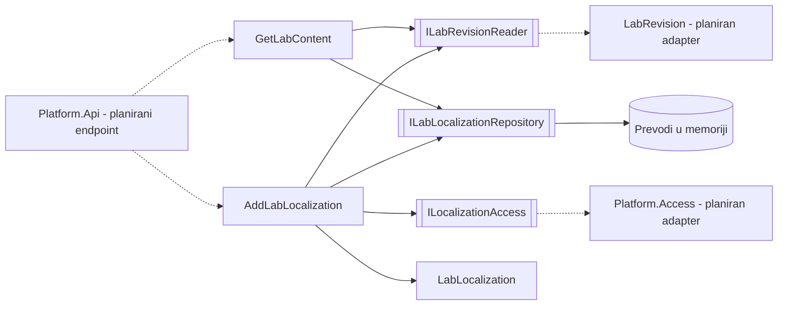
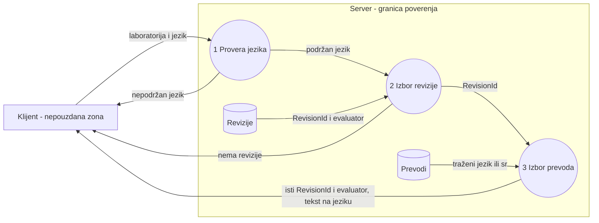

# Komponenta projekta: LAB-07, lokalizacija laboratorija

**Tim:** 14

**Student:** Lana Gojković / PR46/2023

**Zahtevi iz specifikacije:** LAB-07 (lokalizacija i pristupačne varijante), backend deo za jezičke verzije.

**Kriterijum prihvatanja:** obe jezičke varijante pokazuju istu reviziju i isti evaluator.

## Odgovornosti i granice

- **Procesi i scenariji:**
  - Čitanje laboratorije na izabranom jeziku (`sr` ili `en`). Ako prevod ne postoji, vraća se srpski.
  - Dodavanje prevoda za konkretnu reviziju, samo za nastavnika.
- **Ugovori sa drugim modulima:**

| Ugovor | Svrha | Stanje |
| --- | --- | --- |
| `ILabRevisionReader` | daje reviziju i verziju evaluatora | u testovima fake, adapter ka pravoj reviziji je planiran |
| `ILocalizationAccess` | odlučuje ko sme da doda prevod, podrazumevano odbija | u testovima fake, veza sa `IAccessDecision` je planirana |
| `ILabLocalizationRepository` | čuva prevode | implementacija u memoriji, baza je planirana |

- **Stanje implementacije:**
  - Implementirano i testirano: `LabLanguage`, `LabLocalization`, `GetLabContent`, `AddLabLocalization`, `InMemoryLabLocalizationRepository`.
  - Nije implementirano: HTTP endpoint, povezivanje sa pravom revizijom, pravim ulogama, audit dnevnikom i bazom. Modul još nije povezan sa `Platform.Api`.

## Arhitektura komponente

Odnos podataka: `LabRevision 1 — 1..* LabLocalization`. Evaluator je na reviziji, a prevod sadrži samo tekst.

Slojevi u `backend/Platform.LabLocalization`: `Domain` (pravila), `Application` (slučajevi upotrebe i interfejsi), `Infrastructure` (skladište u memoriji).

## Dijagram toka podataka

Revizija se bira pre jezika, pa jezik ne može da utiče na reviziju ni na ocenjivanje. Menja se samo tekst.

## Bezbednosni zahtevi

- **Provera prava na serveru:**
  - `AddLabLocalization` prvo proverava pravo, pre čitanja bilo kakvih podataka.
  - Student dobija `FORBIDDEN` i za reviziju koja ne postoji, pa ne može da isprobava ID-jeve.
  - `GetLabContent` ne proverava ko čita. Tu proveru mora da uradi budući endpoint pre poziva.
- **Validacija ulaza i osetljivi podaci:**
  - Podržani su samo `sr` i `en`. Vrednosti kao `xx`, `1` i `99` se odbijaju.
  - Pri dodavanju prevoda jezik je obavezan, da se srpski ne bi upisao slučajno.
  - Naslov je obavezan, do 120 znakova. Opis ima do 2000, a uputstva do 20000 znakova. Kontrolni znakovi se odbijaju, osim novog reda i taba u opisu i uputstvima.
  - `LabLocalization` nema evaluator i ne može da se menja posle pravljenja.
  - Tekst se čuva kakav jeste, a klijent mora da ga prikaže kao tekst, ne kao HTML.
- **Negativni scenariji (pokriveni testovima):**
  - Student ili nepoznat korisnik dodaje prevod: `FORBIDDEN`, ništa se ne upisuje.
  - Nepodržan jezik: `INVALID_LANGUAGE`.
  - Nepostojeća revizija ili revizija druge laboratorije: `NOT_FOUND`.
  - Drugi prevod na istom jeziku: `CONFLICT`, prvi prevod ostaje.

Planirano mapiranje na HTTP: `INVALID_*` u 400, `FORBIDDEN` u 403, `NOT_FOUND` u 404, `CONFLICT` u 409.

## Otvorena pitanja

- `LabRevision` još nije u `main` i na trenutnoj grani REV-05 nema evaluator. Dok se to ne reši, kriterijum je dokazan samo uz lažnu reviziju u testu.
- Svaka objavljena revizija mora da dobije `sr` prevod, inače čitanje vraća `NOT_FOUND`.
- Provera treba da glasi „nastavnik baš tog kursa”, što mora da obezbedi prava implementacija `ILocalizationAccess`.
- Putanja nije usaglašena: u planu je `/api/labs`, a u kosturu `/api/laboratories`.
- Sa AUT-04 treba dogovoriti da li se prevode i zadaci iz `LabPublicContent` i koji tekst student na kraju vidi.
- Dodavanje prevoda se još ne upisuje u audit dnevnik.

## Dokazi rada

- **Kod:** `backend/Platform.LabLocalization`
- **Testovi:** `backend/Platform.LabLocalization.Tests`
- **Glavni test:** `Sr_and_en_show_the_same_revision_and_evaluator_with_different_text`
- **Pokretanje:** `dotnet test backend/Platform.LabLocalization.Tests/Platform.LabLocalization.Tests.csproj`
- **Rezultat:** 54 testa, svi prolaze.
- **Sledeći koraci:** endpoint, adapteri ka reviziji i pravima, baza.