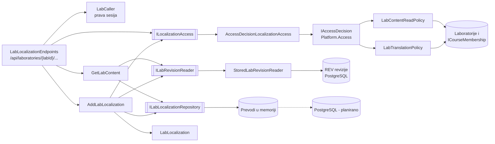
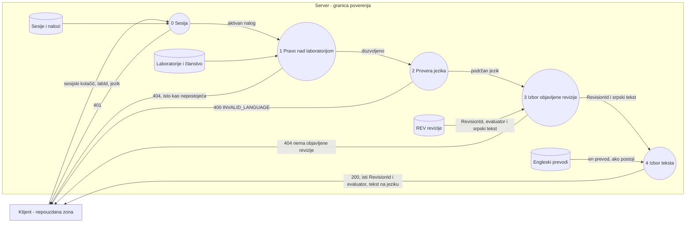

# Komponenta projekta: LAB-07, lokalizacija laboratorija

**Tim:** 14

**Student:** Lana Gojković / PR46/2023

**Zahtevi iz specifikacije:** LAB-07 (lokalizacija i pristupačne varijante), backend deo za jezičke verzije.

**Kriterijum prihvatanja:** obe jezičke varijante pokazuju istu reviziju i isti evaluator.

## Odgovornosti i granice

- **Procesi i scenariji:**
  - Čitanje trenutno objavljene revizije laboratorije na izabranom jeziku (`sr` ili `en`). Srpski tekst je tekst same revizije iz njenog nepromenljivog snapshot-a, pa postoji čim je revizija objavljena, bez ručnog unosa. Ako engleski prevod ne postoji, vraća se srpski.
  - Dodavanje engleskog prevoda reviziji dok je ona nacrt, samo za nastavnika kursa koji je autor laboratorije. Objavljen tekst se menja samo novom revizijom koja prolazi REV pregled.
- **HTTP endpointi** (`Platform.Api/Modules/LabLocalization`):

| Ruta | Svrha | Uspeh |
| --- | --- | --- |
| `GET /api/laboratories/{labId}/content?lang=sr\|en` | tekst trenutno objavljene revizije na jeziku | 200, `{ revisionId, evaluatorVersion, language, title, description, instructions }` |
| `POST /api/laboratories/{labId}/revisions/{revisionId}/translations` | dodaje engleski prevod nacrtu, telo `{ language: "en", title, description, instructions }` | 201, bez `Location` zaglavlja |

`language` u odgovoru je jezik koji je stvarno vraćen (`"sr"` ili `"en"`, kao tekst). Ako prevod na traženom jeziku ne postoji, vraća se `"sr"`.

Srpski tekst se mapira iz definicije revizije (`PublicationDefinition`): `Title` → `title`, `Goal` → `description`, `Question` → `instructions`.

- **Ugovori sa drugim modulima:**

| Ugovor | Implementacija u `Platform.Api` | Izvor podataka |
| --- | --- | --- |
| `ILabRevisionReader` | `StoredLabRevisionReader` | REV modul (`LaboratoriesDbContext`): objavljena revizija sa najvećim brojem, njen evaluator i srpski tekst iz nepromenljivog snapshot-a; za dodavanje prevoda i stanje revizije (nacrt ili ne) |
| `ILocalizationAccess` | `AccessDecisionLocalizationAccess` | centralni `IAccessDecision` sa politikama `LabContentReadPolicy` i `LabTranslationPolicy` |
| `ILabLocalizationRepository` | `InMemoryLabLocalizationRepository` | memorija procesa, samo engleski prevodi; gube se pri restartu (srpski tekst ostaje, jer je u reviziji) |
| Identitet pozivaoca | `LabCaller` | prava sesija iz Identity modula, i u Development okruženju |
| Uloga na kursu | `ICourseMembership` | zajednička implementacija iz `Platform.LabVisibility` |

- **Radnje u Access katalogu:**

| Radnja | Opseg | Resurs | Ko sme |
| --- | --- | --- | --- |
| `lab.localization.entry` | Authenticated | nema | svaki aktivan nalog sa sesijom (ulaz u grupu ruta) |
| `lab.localization.read` | Course | `laboratory` | onaj ko sme da otvori laboratoriju (LAB-03): student kursa ili nastavnik kursa koji je autor |
| `lab.localization.translate` | Course, privilegovana | `revision` | nastavnik kursa koji je autor laboratorije kojoj revizija pripada (isto pravilo kao PRG-04) |

- **Stanje implementacije:**
  - Implementirano i testirano: domen i slučajevi upotrebe (`LabLanguage`, `LabLocalization`, `GetLabContent`, `AddLabLocalization`), HTTP endpointi, adapter ka REV revizijama, adapter ka `IAccessDecision`, politike pristupa, registracija modula u `Program.cs`.
  - Nije implementirano: trajno skladište prevoda (PostgreSQL) i audit zapis uspešno dodatog prevoda.

## Arhitektura komponente

Puna strelica označava postojeću vezu, a isprekidana planiranu.



Odnos podataka: `LabRevision 1 — 0..1 LabLocalization (en)`. Evaluator i srpski tekst su na reviziji, a prevod sadrži samo engleski tekst.

Slojevi u `backend/Platform.LabLocalization`: `Domain` (pravila), `Application` (slučajevi upotrebe i interfejsi), `Infrastructure` (skladište u memoriji). Adapteri ka drugim modulima i HTTP sloj su u `backend/Platform.Api/Modules/LabLocalization`, da modul ne zavisi od REV, Access i Identity projekata.

## Dijagram toka podataka



Pravo se proverava pre jezika, pa ni neispravan jezik ne otkriva da laboratorija postoji. Revizija se bira pre prevoda, pa jezik ne može da utiče na reviziju ni na ocenjivanje. Menja se samo tekst.

## Bezbednosni zahtevi

- **Provera prava na serveru:**
  - Identitet dolazi isključivo iz prave sesije (`LabCaller`). `SessionCheckMiddleware` ne pušta razvojno zaglavlje za LAB-07 rute ni u Development okruženju.
  - Čitanje: bez prava pozivalac dobija isti 404 kao za nepostojeću laboratoriju, sa istim telom odgovora.
  - Dodavanje prevoda: `AddLabLocalization` prvo proverava pravo, pre čitanja bilo kakvih podataka. Za nepostojeću reviziju odgovor je isti 403 kao za tuđu, pa ID-jevi ne mogu da se pogađaju.
  - Prevod se prihvata samo za nacrt. Revizija u pregledu, objavljena ili arhivirana daje 409 `REVISION_NOT_DRAFT`, pa tekst koji studenti vide ne može da se promeni bez nove revizije i REV pregleda.
  - Adapter traži da `actorId` bude isti kao subjekat iz sesije; stanje naloga se uzima iz sesije, ne od pozivaoca.
  - Politike su singleton, pa scoped servise (repozitorijum laboratorija, članstvo) uzimaju kroz novi scope za svaki poziv.
  - Odbijeni pokušaji se upisuju u audit dnevnik kroz Access (`access.denied`, sa radnjom i razlogom).
- **Validacija ulaza i osetljivi podaci:**
  - Podržani su samo `sr` i `en`. Odbijaju se `xx`, `1`, `sr,en` i ponovljen parametar `lang`.
  - Pri dodavanju prevoda jezik je obavezan i mora biti `en`. Srpski se odbija sa 400 `INVALID_LANGUAGE`, jer je srpski tekst deo revizije i ne sme da se zameni mimo REV pregleda.
  - Naslov je obavezan, do 200 znakova, isto kao naslov u definiciji revizije (`PublicationDefinition`). Opis ima do 2000, a uputstva do 20000 znakova. Kontrolni znakovi se odbijaju, osim novog reda i taba u opisu i uputstvima.
  - Telo zahteva je ograničeno na 128 KB i mora biti JSON. Neispravan ili prevelik JSON daje 400 `INVALID_BODY`, bez stack trace-a, i kad telo nema `Content-Length` (chunked), pa Kestrel prekida čitanje.
  - Neočekivana greška daje 500 sa `traceId`, a detalji ostaju u serverskom logu.
  - Odgovor za sadržaj ima `Cache-Control: no-store`.
  - `LabLocalization` nema evaluator i ne može da se menja posle pravljenja.
  - Tekst se čuva kakav jeste, a klijent mora da ga prikaže kao tekst, ne kao HTML.
- **HTTP mapiranje:** `INVALID_*` u 400, bez sesije 401, `FORBIDDEN` u 403, `NOT_FOUND` u 404, `CONFLICT` i `REVISION_NOT_DRAFT` u 409.
- **Negativni scenariji (pokriveni HTTP testovima):**
  - Zahtev bez sesije, i za čitanje i za upis: 401.
  - Korisnik van kursa i nastavnik kursa koji nije autor čitaju: 404, isto telo kao za nepostojeću laboratoriju, i sa neispravnim jezikom.
  - Student dodaje prevod: 403, ništa se ne upisuje, odbijanje je u audit dnevniku.
  - Nastavnik koji nije autor i korisnik van kursa dodaju prevod: 403.
  - Nepostojeća revizija: 403. Revizija druge laboratorije: 404.
  - Nepodržan ili ponovljen jezik: 400 `INVALID_LANGUAGE`. Prevod na srpski: 400 `INVALID_LANGUAGE`. Prazan naslov: 400 `INVALID_TITLE`.
  - Prevod objavljene revizije: 409 `REVISION_NOT_DRAFT`, ništa se ne upisuje.
  - Drugi prevod na istom jeziku: 409 `CONFLICT`, prvi prevod ostaje.
  - Prevod nacrta se ne vidi dok revizija nije objavljena, a novi nacrt ne zamenjuje objavljenu reviziju.
  - Objavljena revizija ima srpski tekst bez ikakvog ručnog unosa.

## Otvorena pitanja

- Engleski prevodi su u memoriji: gube se pri restartu i ne dele se između instanci API-ja, pa se tada prikazuje srpski. Potrebno je PostgreSQL skladište.
- Prevod se dodaje nacrtu, ali nije deo snapshot-a koji REV pregled odobrava. Treba dogovoriti sa REV-om da li odobravalac treba da vidi i engleski tekst.
- Mapiranje `Title`/`Goal`/`Question` na `title`/`description`/`instructions` treba potvrditi sa REV-om i AUT-04.
- Uspešno dodat prevod se još ne upisuje u audit dnevnik, upisuju se samo odbijeni pokušaji.
- Sa AUT-04 treba dogovoriti da li se prevode i zadaci iz `LabPublicContent` i koji tekst student na kraju vidi.
- Frontend (`frontend/src/api/labs.ts`, LAB-07 frontend) još poziva `/api/laboratories/{id}?lang=` sa `X-Test-User`. Treba preći na `/api/laboratories/{id}/content?lang=` i pravu sesiju, pa isključiti `USE_FAKE_LAB_CONTENT`.

## Dokazi rada

- **Kod:** `backend/Platform.LabLocalization`, `backend/Platform.Api/Modules/LabLocalization`
- **Testovi:**
  - `backend/Platform.LabLocalization.Tests`: domen i slučajevi upotrebe, sa fake revizijom i fake pravima.
  - `backend/Platform.Laboratories.IntegrationTests/LabLocalizationHttpTests.cs`: 26 HTTP slučajeva nad pravim API hostom (Production okruženje), pravim PostgreSQL-om (Testcontainers), pravim sesijama i revizijama objavljenim kroz REV rute.
- **Glavni testovi:** `Sr_and_en_show_the_same_revision_and_evaluator_with_different_text` (unit) i `SerbianAndEnglish_ShowTheSameRevisionAndEvaluator` (HTTP).
- **Pokretanje** (HTTP testovi traže pokrenut Docker):

```powershell
dotnet test backend/Platform.LabLocalization.Tests/Platform.LabLocalization.Tests.csproj -c Release
dotnet test backend/Platform.Laboratories.IntegrationTests/Platform.Laboratories.IntegrationTests.csproj -c Release --filter "Category=LAB-07"
```

- **Rezultat** (26. novembar 2026, .NET SDK 10.0.400, lokalno): build bez grešaka; unit testovi 58/58 prolaze; HTTP testovi 26/26 prolaze (Docker 29.3.1, `postgres:17-alpine`). Ovo je lokalni rezultat, ne GitHub CI provera.
- **Sledeći koraci:** PostgreSQL skladište prevoda, audit uspešnog dodavanja, povezivanje frontenda sa pravim endpointom.
