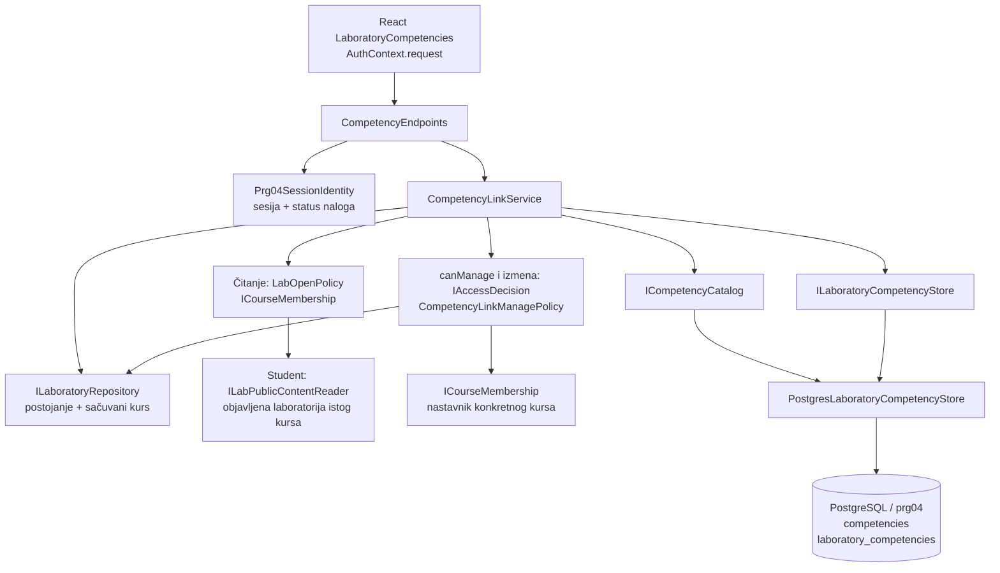

# PRG-04: Mapiranje laboratorija na kompetencije

**Status:** Implementirani su model, PostgreSQL skladište, autorizovan API i React ekran za izbor i prikaz kompetencija.

**Zahtev iz specifikacije:** PRG-04, nivo P, odeljak 4.10. Minimalni kriterijum prihvatanja: jedna vežba može proveravati više kompetencija.

Jedna laboratorija ima 0..N kompetencija, a ista kompetencija može biti povezana sa više laboratorija. Detaljan HTTP ugovor nalazi se u [PRG-04-mapping.md](PRG-04-mapping.md), a konfiguracija baze i migracija u [PRG-04-storage.md](PRG-04-storage.md).

## Odgovornosti i granice

- `Platform.Competencies` poseduje katalog i veze laboratorija sa kompetencijama.
- `Competency` sadrži stabilan `Id`, naziv i opcioni opis. Početni katalog čine **Kontrola pristupa**, **Analiza bezbednosnih logova** i **Bezbedna konfiguracija**.
- `LaboratoryCompetency` sadrži `LaboratoryId` i `CompetencyId`. Referenca je na trajni identitet laboratorije, bez kopiranja LAB entiteta i bez vezivanja za reviziju ili pokušaj.
- Mapiranje opisuje koje kompetencije laboratorija proverava; ne beleži da ih je student usvojio. LAB oznake, težina i tip ostaju odvojeni metapodaci.
- React ekran omogućava izbor više kompetencija ovlašćenom nastavniku i pregled povezanih kompetencija studentu. Uređivanje kataloga, provera usvojenosti, ocenjivanje i analitika napretka ostaju izvan obima.

## Implementirani ugovori

| Komponenta | Odgovornost |
| --- | --- |
| `CompetenciesPage` | Zaštićena ruta `/laboratories/:laboratoryId/competencies` |
| `LaboratoryCompetencies` | Prikaz veza i izbor iz kataloga prema serverskom `canManage` |
| `frontend/src/api/competencies.ts` | HTTP adapter preko `AuthContext.request`, validacija odgovora i prekid zastarelih zahteva |
| `CompetencyEndpoints` | HTTP ugovor, identitet i bezbedni odgovori |
| `Prg04SessionIdentity` | Aktivna serverska sesija i aktivan nalog |
| `CompetencyLinkService` | Provera laboratorije i prava, naslov laboratorije i serverska mogućnost izmene |
| `ILaboratoryRepository` / `ICourseMembership` | Postojeća laboratorija, njen sačuvani kurs i članstvo |
| `LabOpenPolicy` | Pravila LAB konteksta za čitanje |
| `ILabPublicContentReader` | Potvrda objavljenog sadržaja za studentsko čitanje |
| `CompetencyLinkManagePolicy` / `IAccessDecision` | Posebna ACC radnja za izmene veza |
| `ICompetencyCatalog` | Čitanje postojećeg kataloga |
| `ILaboratoryCompetencyStore` | Čitanje, dodavanje i uklanjanje veza |
| `PostgresLaboratoryCompetencyStore` | EF Core / Npgsql adapter za oba PRG ugovora |

## Arhitektura

## Tok podataka i prava

1. `SessionCheckMiddleware` proverava sesiju pre handlera, osim postojećeg razvojnog izuzetka za `/api/laboratories`. Kada middleware odbije odsutnu ili nevažeću sesiju, vraća `401` sa `{ "code": "session_invalid" }`. Handler zatim razrešava aktivnu sesiju i ponovo proverava da je nalog aktivan; njegovo odbijanje koristi `401` sa `{ "error": "unauthenticated" }`. `X-Test-User`, `X-Stub-User` i vrednosti iz tela zahteva ne mogu da zamene sesiju.
2. Katalog se čita za prijavljenog korisnika. Za operacije nad vezama servis prvo učitava laboratoriju i njen sačuvani `CourseId`; ne prihvata kurs iz zahteva.
3. Za čitanje se primenjuju postojeća LAB pravila konteksta. Student dodatno može čitati veze samo ako laboratorija nije arhivirana i `ILabPublicContentReader` vrati objavljen sadržaj sa istim ID-em laboratorije i kursa. Nastavnik koji je autor zadržava pristup i nacrtima. Za izmenu je potrebna posebna ACC radnja: pozivalac mora biti autor laboratorije i nastavnik njenog kursa. Pravo čitanja samo po sebi ne daje pravo izmene.
4. Tek nakon provere laboratorije i prava pristupa čita se ili menja PRG skladište. Nepostojeća i nedozvoljena laboratorija daju isti `404` odgovor, bez čitanja njenih kompetencija.
5. Čitanje veza vraća `laboratoryId`, `laboratoryTitle`, `competencies` i `canManage`. Poslednje polje računa ista ACC politika kao pri izmeni; pri nedostajućoj politici čitanje ostaje moguće uz `false`. Svaka izmena ponavlja autorizaciju, bez oslanjanja na ranije poslatu mogućnost. Odgovori PRG handlera imaju `Cache-Control: no-store`.

ACC politika je registrovana kao singleton, a repozitorijum i članstvo razrešava u zasebnom opsegu. Ne zadržava scoped `DbContext`. Nedostajuća politika odbija izmenu.

## Korisnički ekran

Link „Prikaži kompetencije” u rezultatu pretrage i link iz stvarnog studentskog sadržaja otvaraju `/laboratories/:laboratoryId/competencies`. Ekran prati postojeći beli/plavi izgled aplikacije i koristi stvarnu sesiju kroz `AuthContext.request`.

Ovlašćeni nastavnik vidi pretragu kataloga, checkbox izbor i povezane kompetencije. Svaka promena čuva se pojedinačno preko `PUT` ili `DELETE`, a zatim se veze i `canManage` ponovo učitavaju sa servera. Tokom čuvanja izbor je onemogućen. Student dobija samo prikaz povezanih kompetencija sa opisima; bez učitavanja kataloga i bez kontrola izmene.

Postoje stanja učitavanja, greške sa ponovnim pokušajem, praznog kataloga/veza i pretrage bez rezultata. Greška kataloga zadržava postojeći prikaz veza. Posle nepotvrđene izmene traži se ponovno učitavanje sačuvanog stanja. `AbortController` i odvojeno stanje za korisnika/laboratoriju sprečavaju da zastareli zahtevi zamene novi prikaz.

## Integritet i trajnost

`CompetenciesDbContext` poseduje samo šemu `prg04`, dve poslovne tabele i svoju istoriju migracija. Složeni primarni ključ `(LaboratoryId, CompetencyId)` sprečava duplikate, a strani ključ ka katalogu štiti postojeće kompetencije. Nema direktnog stranog ključa ka LAB tabelama; postojanje i prava proverava aplikaciona granica.

Dodavanje koristi parametrizovani `INSERT ... ON CONFLICT DO NOTHING`, pa su ponovljeni i konkurentni upisi idempotentni. Brisanje uklanja samo navedenu vezu. Čitanje filtrira po laboratoriji i deterministički sortira kompetencije.

## Verifikacija

| Grupa testova | Obuhvaćeno pravilo |
| --- | --- |
| `CompetencyTests` | Stabilni ID-evi, validacija i model veza |
| `CompetencyModelTests` | Vlasništvo šeme, snapshot, SQL migracije i DI registracija |
| `CompetencyEndpointsTests` | Stvarni HTTP host i ACC engine, identitet, prava, serverski `canManage`, promena članstva, IDOR, idempotentnost i bezbedne greške; eksterni store adapteri su test zamene |
| `CompetencyPersistenceTests` | Stvarni PostgreSQL: više kompetencija, trajnost, konkurentni upisi, integritet, migracija i izolacija šeme |
| `LaboratoryCompetencies.test.tsx` | React izbor, prikaz, studentski režim, čuvanje i oporavak od greške |
| `competencies.test.ts` | Frontend API ugovor, sesijski poziv, bezbedne greške i prekid zahteva |

PostgreSQL testovi zahtevaju `PRG04_TEST_ADMIN_CONNECTION_STRING`, prave zasebnu privremenu bazu i uklanjaju samo tu bazu. Bez te konfiguracije preskaču se; preskakanje nije dokaz trajnosti. Komande za izvršavanje i istorijski rezultati nalaze se u [PRG-04-storage.md](PRG-04-storage.md).
