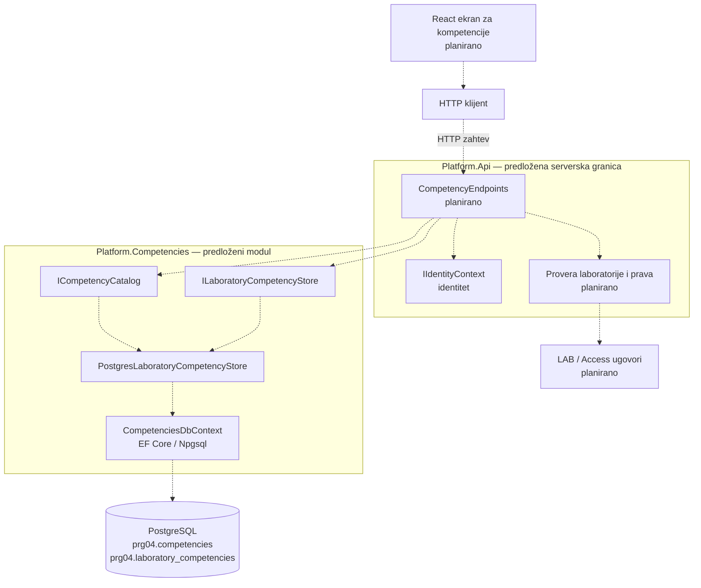

# PRG-04: Mapiranje laboratorija na kompetencije

**Status: Proposed architecture — implementation not yet available.**

**Zahtev iz specifikacije:** PRG-04, nivo P, odeljak 4.10. Minimalni kriterijum prihvatanja: jedna vežba može proveravati više kompetencija.

Ovaj dokument opisuje predloženu arhitekturu za povezivanje laboratorija sa kompetencijama. Ne predstavlja opis postojeće implementacije. Detaljni predlog HTTP operacija nalazi se u [PRG-04-mapping.md](PRG-04-mapping.md).

## Odgovornosti i granice

- `Platform.Competencies` treba da poseduje katalog kompetencija i veze laboratorija sa kompetencijama.
- Jedna laboratorija može imati 0..N kompetencija, a ista kompetencija može biti povezana sa više laboratorija.
- `Competency` treba da sadrži stabilan `Id`, naziv i opcioni opis.
- `LaboratoryCompetency` treba da sadrži `LaboratoryId` i `CompetencyId`.
- `LaboratoryId` treba da referencira postojeći trajni identitet iz LAB modula. PRG-04 ne treba da kreira niti kopira laboratorije.
- Mapiranje opisuje koje kompetencije laboratorija proverava. Ne predstavlja dokaz da je student usvojio kompetenciju.
- LAB-02 oznake, težina i tip treba da ostanu odvojeni metapodaci.

Predloženi početni katalog:

- Kontrola pristupa
- Analiza bezbednosnih logova
- Bezbedna konfiguracija

Kompetencije treba da imaju stabilne identifikatore koji se ne menjaju prilikom preimenovanja.

## Predloženi ugovori

| Ugovor / komponenta | Predložena odgovornost | Status |
| --- | --- | --- |
| `IIdentityContext` | Dostavljanje serverski razrešenog identiteta | Potrebno uskladiti sa postojećim Identity modulom |
| `CompetencyEndpoints` | Validacija zahteva i HTTP odgovori | Planirano |
| `ICompetencyCatalog` | Čitanje kataloga kompetencija | Planirano |
| `ILaboratoryCompetencyStore` | Čitanje, dodavanje i uklanjanje veza | Planirano |
| `PostgresLaboratoryCompetencyStore` | PostgreSQL implementacija skladišta | Planirano |
| LAB / Access integracija | Provera postojanja laboratorije i prava pristupa | Planirano |
| React ekran | Prikaz i upravljanje vezama | Planirano |

Konkretne ugovore sa LAB i Access modulima potrebno je dogovoriti sa vlasnicima tih komponenti pre implementacije.

## Predloženi dijagram arhitekture

Dijagram prikazuje ciljnu arhitekturu. Nijedna od prikazanih PRG-04 komponenti ne smatra se implementiranom ovim dokumentom.

## Predloženi tok podataka

Predložena implementacija treba da:

1. Razreši identitet pozivaoca na serverskoj strani.
2. Proveri da li laboratorija postoji i da li pozivalac ima odgovarajuće pravo pristupa.
3. Validira identifikatore kompetencije i laboratorije.
4. Pročita katalog ili izvrši operaciju nad vezom.
5. Vrati odgovarajući HTTP odgovor.

Klijent ne treba da bude izvor informacija o ulozi ili dozvolama pozivaoca.

## Predloženi integritet podataka

- Složeni ključ `(LaboratoryId, CompetencyId)` treba da spreči dupliranje veza.
- Strani ključ treba da povezuje `CompetencyId` sa katalogom kompetencija.
- Ne treba uvoditi strani ključ ka tabelama LAB modula bez prethodnog dogovora o vlasništvu i integraciji.
- Uklanjanje veze ne treba da briše kompetenciju ili laboratoriju.
- Čitanje treba da vraća samo kompetencije povezane sa prosleđenim `LaboratoryId`.
- Dodavanje iste veze više puta treba da bude idempotentno.

## Bezbednosni zahtevi

Autentifikacija i autorizacija moraju biti odvojene provere.

Predložena implementacija mora da:

- Odbije neautentifikovane zahteve.
- Proveri postojanje laboratorije.
- Proveri pravo pozivaoca nad konkretnom laboratorijom.
- Ne dozvoli čitanje ili izmenu veza pre uspešne autorizacije.
- Ne prihvata klijentske tvrdnje o identitetu ili dozvolama kao dokaz pristupa.
- Razmotri audit evidenciju i odgovarajuću politiku keširanja.

## Predložena verifikacija

Nakon implementacije potrebno je proveriti:

- Kreiranje i čitanje kataloga kompetencija.
- Povezivanje više kompetencija sa jednom laboratorijom.
- Korišćenje iste kompetencije u više laboratorija.
- Sprečavanje duplih veza.
- Uklanjanje jedne veze bez uticaja na ostale.
- Odbijanje neautentifikovanih zahteva.
- Odbijanje zahteva bez prava pristupa laboratoriji.
- Trajnost podataka nakon ponovnog pokretanja aplikacije.

Ovaj dokument definiše predloženu arhitekturu i kriterijume za buduću implementaciju. Ne potvrđuje postojanje API-ja, PostgreSQL adaptera, migracija ili testova.