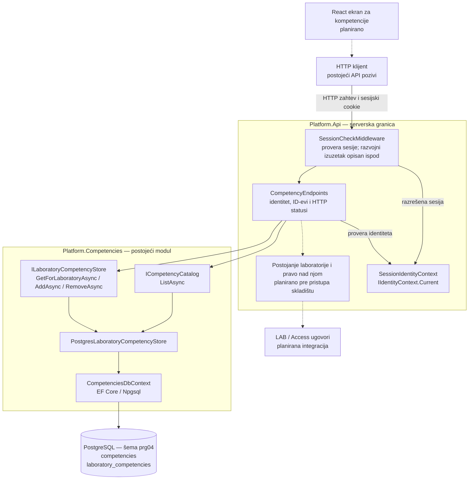
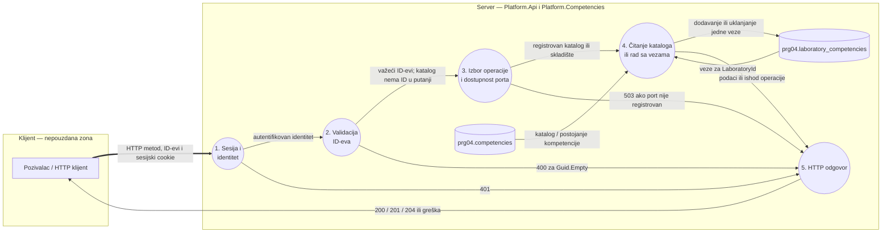

# Komponenta projekta: PRG-04, mapiranje laboratorija na kompetencije

**Zahtev iz specifikacije:** PRG-04, nivo P — Mapiranje laboratorija na kompetencije (odeljak 4.10). Minimalni kriterijum prihvatanja: jedna vežba može proveravati više kompetencija.

**Osnova dokumenta:** kod sa grane `feature/prg-04-competencies`, commit `17b20d5`, pregledan 9. novembra 2026. Ova dokumentacija dopunjuje postojeći `docs/components/PRG-04-storage.md` sa te grane. Detaljni tokovi HTTP operacija su u [PRG-04-mapping.md](PRG-04-mapping.md).

## Odgovornosti i granice

- `Platform.Competencies` poseduje katalog kompetencija i veze laboratorija sa kompetencijama. Jedna laboratorija ima 0..N veza; istu kompetenciju može koristiti više laboratorija.
- `Competency` sadrži stabilan `Id`, naziv i opcioni opis. `LaboratoryCompetency` sadrži samo `LaboratoryId` i `CompetencyId`.
- `LaboratoryId` označava postojeći trajni identitet iz LAB modula. PRG-04 ne kreira laboratorije, ne kopira njihove entitete i ne menja tuđe tabele.
- Veza nije vezana za reviziju, pokušaj ili rezultat. Mapiranje opisuje šta laboratorija proverava; ne dokazuje da je student usvojio kompetenciju.
- LAB-02 oznake, težina i tip ostaju odvojeni metapodaci. Oznaka laboratorije nije zamena za kompetenciju.
- Implementirani su model, početni katalog, PostgreSQL skladište i četiri HTTP operacije. Frontend, uređivanje kataloga i provera prava nad konkretnom laboratorijom pripadaju narednim koracima.

Početni katalog iz `BuiltInCompetencies` sadrži: **Kontrola pristupa**, **Analiza bezbednosnih logova** i **Bezbedna konfiguracija**. Migracija upisuje unapred određene ID-eve; preimenovanje ne sme da promeni identitet kompetencije.

## Ugovori sa drugim delovima

| Ugovor / komponenta | Odgovornost | Stanje |
| --- | --- | --- |
| `Platform.Api.Interfaces.Identity.IIdentityContext` | Serverski razrešen identitet; handler traži `IsAuthenticated` i neprazan `UserId` | Postoji; koristi se `SessionIdentityContext` |
| `CompetencyEndpoints` | Provera identiteta, validacija ID-eva i HTTP odgovor | Implementirano u `Platform.Api/Endpoints` |
| `ICompetencyCatalog.ListAsync` | Čitanje kataloga | Implementirano; nema operacije uređivanja |
| `ILaboratoryCompetencyStore` | `GetForLaboratoryAsync`, `AddAsync` i `RemoveAsync` | Implementirano; skladište samo ne proverava identitet ni pravo pristupa |
| `PostgresLaboratoryCompetencyStore` | Jedan adapter za oba ugovora, preko EF Core / Npgsql | Implementirano |
| LAB / Access integracija | Provera postojanja laboratorije i prava pozivaoca nad njom, uz kontekst kursa | Planirano; konkretan ugovor treba dogovoriti sa vlasnicima modula |
| React ekran za kompetencije | Izbor postojećih kompetencija i prikaz veza | Planirano |

## Dijagram arhitekture

Pune strelice prikazuju postojeće veze. Isprekidane strelice i čvorovi sa oznakom „planirano” prikazuju naredne integracije. Svi serverski delovi pripadaju modularnom monolitu; kutije ne predstavljaju zasebne mikroservise.

`Program.cs` registruje skladište pomoću `AddCompetencyPersistence`. Prednost ima `ConnectionStrings:Competencies`, uz rezervnu konfiguraciju `ConnectionStrings:Laboratories`. Oba ugovora koriste istu scoped instancu adaptera. Bez konfiguracije nema memorijskog zamenskog skladišta: autentifikovan poziv dobija `503 competency_storage_unavailable`. Migracije se ne pokreću automatski pri startovanju API-ja.

**Razvojni izuzetak postojećeg hosta:** `SessionCheckMiddleware` u Development okruženju preskače proveru sesije za ceo prefiks `/api/laboratories`, što obuhvata i PRG-04 podputanje. Registrovani `SessionIdentityContext` tada nema razrešenu sesiju i PRG-04 handler odbija poziv sa `401`. Putanja `/api/competencies` nema taj izuzetak. Dijagram prikazuje uobičajeni sesijski tok; usklađivanje razvojnog izuzetka ostaje potreban integracioni korak. LAB zaglavlje `X-Test-User` ne obezbeđuje identitet PRG-04 handlerima.

## DFD sa granicom poverenja klijent–server

DFD prikazuje postojeći tok kada je sesija razrešena. Klijent šalje samo zahtev i identifikatore; server ne prihvata klijentsku tvrdnju o ulozi ili dozvoli kao dokaz pristupa.

Neispravan format GUID-a odbija usmeravanje sa ograničenjem `:guid`, pre handlera; `Guid.Empty` obrađuje sam handler. Nepostojeća kompetencija pri dodavanju daje `404 competency_not_found`. Provera postojanja laboratorije i prava nad njom još nije deo procesa 2–4.

## Integritet podataka i bezbednosne granice

- Složeni ključ `(LaboratoryId, CompetencyId)` sprečava duplikate. Parametrizovani `INSERT ... ON CONFLICT DO NOTHING` podržava ponovljeno i istovremeno dodavanje iste veze.
- Strani ključ postoji samo za `CompetencyId`, ka katalogu u istoj šemi, uz `DeleteBehavior.Restrict`. Nema stranog ključa ka tabelama LAB modula. Čitanje ne razlikuje nepostojeću laboratoriju od laboratorije bez veza.
- Uklanjanje veze ne briše kompetenciju, druge veze ili laboratoriju. Čitanje vraća samo veze za prosleđeni `LaboratoryId`, sortirane po nazivu i ID-u kompetencije.
- **Trenutna granica je autentifikacija.** Bilo koji pozivalac sa autentifikovanim identitetom trenutno može da čita i menja veze za proizvoljan neprazan GUID laboratorije. Serverska autorizacija konkretnog resursa, obavezna prema specifikaciji, ostaje sledeći korak.
- Oznaka rute `DelegatesToLegacyAuthorization` prepušta proveru handleru; ne predstavlja proveru prava nad laboratorijom. U PRG-04 još nema integracije sa audit zapisom ni eksplicitnog `Cache-Control: no-store`.
- `503` u prikazanim tokovima označava nedostajuću registraciju skladišta. Ne postoji poseban PRG-04 prevod proizvoljne greške baze u bezbedan HTTP odgovor; takva obrada ostaje za narednu doradu.

## Dokaz i provera dokumentacije

Dokument je usklađen sa sledećim izvorima na navedenoj PRG-04 grani:

- `backend/Platform.Api/Endpoints/CompetencyEndpoints.cs`, `Program.cs`, `Middleware/SessionCheckMiddleware.cs` i `Services/Identity/SessionIdentityContext.cs`;
- `backend/Platform.Competencies/Contracts`, `Domain` i `Infrastructure/Persistence`;
- `backend/Platform.Competencies.Tests/CompetencyEndpointsTests.cs`, `CompetencyModelTests.cs` i `CompetencyPersistenceTests.cs`;
- `docs/components/PRG-04-storage.md`.

Ova izmena dodaje dokumentaciju i dijagrame. Ne predstavlja novo izvršavanje aplikacionih testova niti potvrdu integracionih koraka označenih kao planirani. Scenariji i postojeći testovi koji potkrepljuju tok mapiranja navedeni su u [PRG-04-mapping.md](PRG-04-mapping.md).
