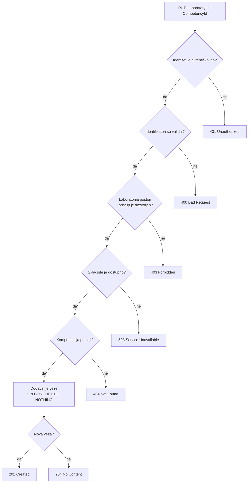
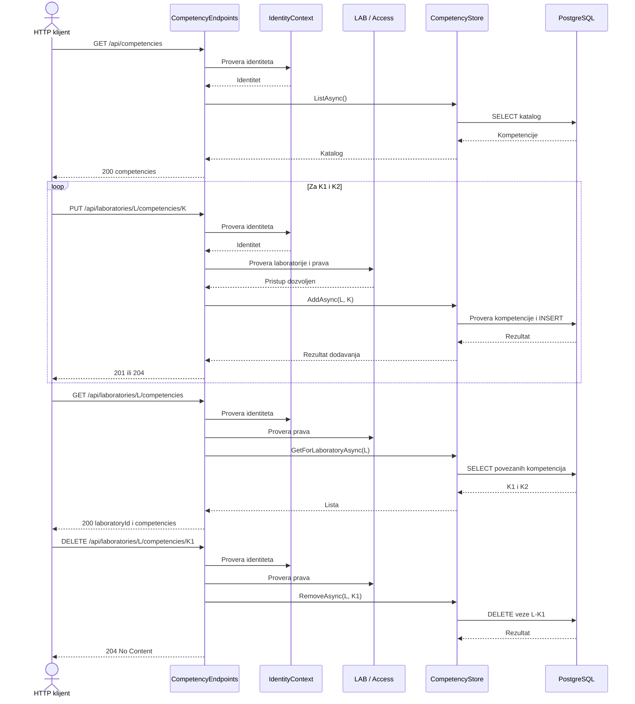

# PRG-04: Predloženi API za mapiranje kompetencija

**Status: Proposed API — not implemented.**

**Zahtev:** Jedna laboratorija može da proverava više kompetencija, a ista kompetencija može biti povezana sa više laboratorija.

Arhitektonski predlog i granice odgovornosti nalaze se u [PRG-04-competencies.md](PRG-04-competencies.md).

## Predloženi HTTP ugovor

| Metod i putanja | Očekivani odgovor | Značenje |
| --- | --- | --- |
| `GET /api/competencies` | `200 { competencies: [...] }` | Čitanje kataloga |
| `GET /api/laboratories/{laboratoryId}/competencies` | `200 { laboratoryId, competencies: [...] }` | Čitanje veza |
| `PUT /api/laboratories/{laboratoryId}/competencies/{competencyId}` | `201` ili `204` | Dodavanje veze |
| `DELETE /api/laboratories/{laboratoryId}/competencies/{competencyId}` | `204` | Uklanjanje veze |

Svaka kompetencija treba da sadrži `id`, `name` i opcioni `description`.

Predloženo ponašanje:

- `201 Created` za novu vezu.
- `204 No Content` ako veza već postoji.
- `204 No Content` prilikom uklanjanja, čak i kada veza ne postoji.
- `400 Bad Request` za nevažeće identifikatore.
- `401 Unauthorized` za neautentifikovane zahteve.
- `403 Forbidden` za nedostatak prava pristupa laboratoriji.
- `404 Not Found` za nepostojeću laboratoriju ili kompetenciju.
- `503 Service Unavailable` ako skladište nije dostupno.

Ovo su predloženi odgovori. Njihovo ponašanje treba potvrditi i implementirati.

## Predloženi tok dodavanja veze

Provera prava pristupa mora da se izvrši pre pristupa skladištu.

## Predložena sekvenca: dve kompetencije na jednoj laboratoriji

Preduslov: laboratorija i kompetencije postoje, a pozivalac ima odgovarajuća prava.

U ovom scenariju uklanjanje veze L-K1 ne treba da utiče na vezu L-K2 ili na katalog kompetencija.

## Planirana autorizacija i korisnički interfejs

1. Dogovoriti LAB ugovor za proveru postojanja laboratorije.
2. Dogovoriti Access ugovor za proveru prava pozivaoca nad laboratorijom.
3. Obezbediti da odbijeni zahtevi ne pristupaju skladištu.
4. Implementirati React ekran za izbor postojećih kompetencija i prikaz veza.
5. Omogućiti dodavanje i uklanjanje pojedinačnih veza.
6. Sprečiti prikaz zastarelih podataka nakon promene korisnika ili laboratorije.

## Planirani testovi

| Scenario | Očekivani rezultat |
| --- | --- |
| Neautentifikovan zahtev | `401` |
| Pozivalac bez prava pristupa | `403` |
| Nevažeći identifikatori | `400` |
| Nepostojeća kompetencija | `404` |
| Dodavanje dve kompetencije istoj laboratoriji | Obe veze postoje |
| Ista kompetencija u više laboratorija | Obe veze postoje |
| Ponovljeno dodavanje iste veze | Nema duplikata |
| Uklanjanje jedne veze | Ostale veze ostaju |
| Ponovno pokretanje aplikacije | Podaci ostaju sačuvani |

Testove treba napisati i izvršiti nakon implementacije.

**Napomena:** Ovaj dokument opisuje predloženi HTTP ugovor, tokove i kriterijume testiranja. Ne tvrdi da navedeni endpoint-i, skladište ili testovi trenutno postoje.