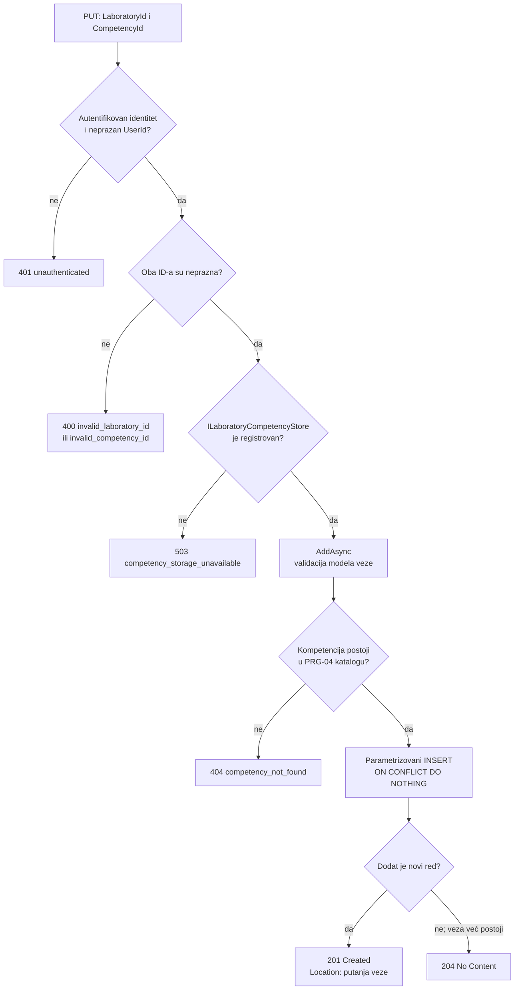
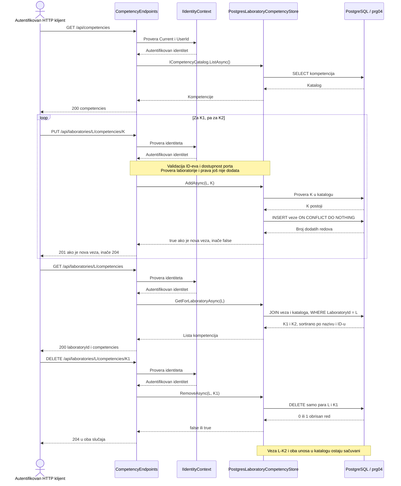

# PRG-04: čitanje, dodavanje i uklanjanje veza sa kompetencijama

**Zahtev:** jedna laboratorija može da proverava više kompetencija, a ista kompetencija može da bude povezana sa više laboratorija.

**Osnova:** postojeća implementacija sa grane `feature/prg-04-competencies`, commit `17b20d5`. Arhitektura, vlasništvo nad podacima i DFD su u [PRG-04-competencies.md](PRG-04-competencies.md). Dijagrami u ovom dokumentu prikazuju postojeći API i skladište; frontend i autorizacija laboratorije još nisu implementirani.

## HTTP ugovor

| Metod i putanja | Uspešan odgovor | Značenje |
| --- | --- | --- |
| `GET /api/competencies` | `200 { competencies: [...] }` | Ceo početni katalog |
| `GET /api/laboratories/{laboratoryId}/competencies` | `200 { laboratoryId, competencies: [...] }` | Kompetencije vezane za prosleđeni ID laboratorije |
| `PUT /api/laboratories/{laboratoryId}/competencies/{competencyId}` | `201` za novu vezu, `204` ako već postoji | Dodavanje jedne veze; bez tela zahteva |
| `DELETE /api/laboratories/{laboratoryId}/competencies/{competencyId}` | `204`, i kada veza već ne postoji | Uklanjanje samo jedne veze |

Stavka `competencies` sadrži `id`, `name` i opcioni `description`. Odgovor na uspešan novi `PUT` ima `Location` sa putanjom veze. Operacije ne primaju studentske odgovore, ocene, revizije ili podatke o usvojenosti kompetencija.

| Slučaj | Ishod handlera |
| --- | --- |
| Nema autentifikovanog identiteta ili je `UserId` prazan | `401 { error: "unauthenticated" }`, pre skladišta |
| `laboratoryId` je `Guid.Empty` | `400 { error: "invalid_laboratory_id" }` |
| `competencyId` je `Guid.Empty` | `400 { error: "invalid_competency_id" }` |
| Katalog ili skladište nije registrovano | `503 { error: "competency_storage_unavailable" }` |
| `PUT` referencira nepostojeću kompetenciju | `404 { error: "competency_not_found" }` |

Middleware može da završi zahtev sa `401` pre handlera, bez ovog JSON tela. GUID pogrešnog formata ne odgovara ruti sa `:guid` i ne stiže do handlera. `DELETE` za nepostojeću vezu daje `204`, bez posebne provere da kompetencija postoji.

## Tok dodavanja jedne veze

Tok počinje u handleru nakon usmeravanja. Puna linija predstavlja postojeće ponašanje; u njemu nema provere postojanja laboratorije ili prava nad njom.

Provera kataloga nalazi se u `PostgresLaboratoryCompetencyStore.AddAsync`. Nepostojeća kompetencija izaziva `KeyNotFoundException`, koju handler prevodi u `404`. Složeni ključ u bazi obezbeđuje da ponovljeni ili istovremeni `PUT` za isti par ne napravi dodatni red. Ostale greške baze nisu obuhvaćene granama `404` ili `503` ovog dijagrama.

## Sekvenca: dve kompetencije na jednoj laboratoriji

Preduslovi: server je razrešio autentifikovan identitet, skladište je registrovano, migracija je primenjena i K1/K2 postoje u katalogu. L označava isti trajni `LaboratoryId`. Dijagram prikazuje uspešan scenario; provera identiteta se ponavlja pri svakom zahtevu.

Veze se čuvaju u PostgreSQL-u i ostaju dostupne nakon ponovnog kreiranja aplikacionih servisa. To svojstvo proverava postojeći integracioni test; nije posledica čuvanja stanja u klijentu.

## Naredni tok autorizacije i korisničkog interfejsa

Ovo su **planirani** koraci koji dopunjuju postojeće dijagrame:

1. Pre poziva skladišta proveriti postojanje laboratorije kroz dogovoren LAB ugovor i pravo nad konkretnom laboratorijom kroz Access ugovor. Primeniti kontekst kursa i članstva; odbijeni zahtev ne sme da čita ili menja veze.
2. Tek nakon tih provera omogućiti nastavniku sa odgovarajućim pravom ekran koji učitava katalog i trenutne veze, dodaje jednu kompetenciju ili uklanja jednu vezu. Ekran ne uređuje početni katalog.
3. Pri grešci sačuvati prikaz potvrđenog stanja ili ponovo učitati veze. Pri promeni korisnika ili laboratorije ukloniti prethodne podatke i sprečiti da zakašnjeli odgovor prepiše novi prikaz.
4. Uskladiti Development izuzetak za prefiks `/api/laboratories` sa sesijskim identitetom PRG-04 i proveriti ceo tok kroz stvarni host. Trenutni razvojni izuzetak i njegova posledica opisani su u [arhitekturi](PRG-04-competencies.md).

## Postojeći testovi koji potkrepljuju tok

| Ponašanje | Test na PRG-04 grani |
| --- | --- |
| Anoniman poziv se odbija pre skladišta | `EveryOperation_RequiresAnIdentity_BeforeItUsesStorage` |
| Trenutna granica proverava samo identitet | `AuthenticatedCaller_CanAddAndRemoveALink_WithoutResourceAuthorization` |
| Prazni ID-evi i nepostojeća kompetencija | `InvalidOrUnknownIdentifiers_AreSafeHttpErrors` |
| Neregistrovano skladište | `AuthenticatedCaller_Gets503WhenCompetencyPersistenceIsNotConfigured` |
| Dve kompetencije i ponovno kreiranje servisa | `TwoCompetencies_SurviveDisposingAndRecreatingApplicationServices` |
| Ponovljeno i istovremeno dodavanje | `DuplicateLink_IsIdempotentAndDatabaseKeyAlsoRejectsDirectDuplicate`, `ConcurrentDuplicateAdds_CreateExactlyOneRelationship` |
| Uklanjanje jedne veze čuva ostale | `RemoveOneLink_PreservesOtherLinksAndSharedCatalogEntry` |

Testovi handlera koriste test identitet i skladište; ne predstavljaju proveru sesijskog middleware-a kroz stvarni HTTP host. Testovi PostgreSQL trajnosti zahtevaju posebnu test konfiguraciju. Ovaj dokument navodi postojeće testove, bez tvrdnje da su ponovo izvršeni u izmeni dokumentacije. Komande, migracije i raniji rezultati nalaze se u `docs/components/PRG-04-storage.md` na PRG-04 grani.
