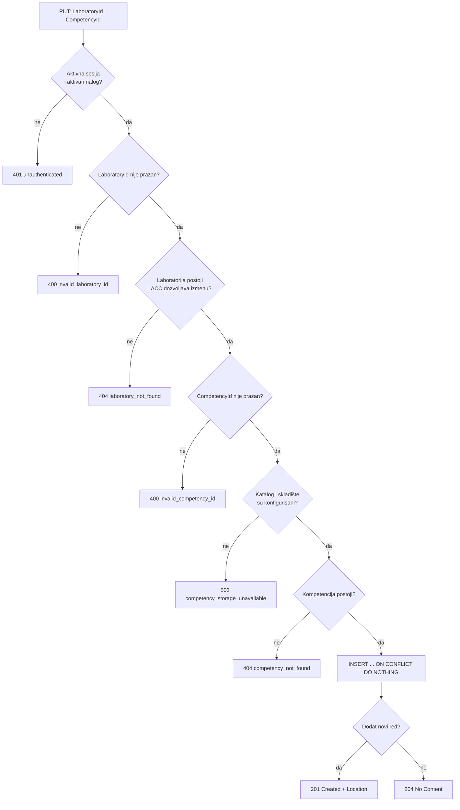
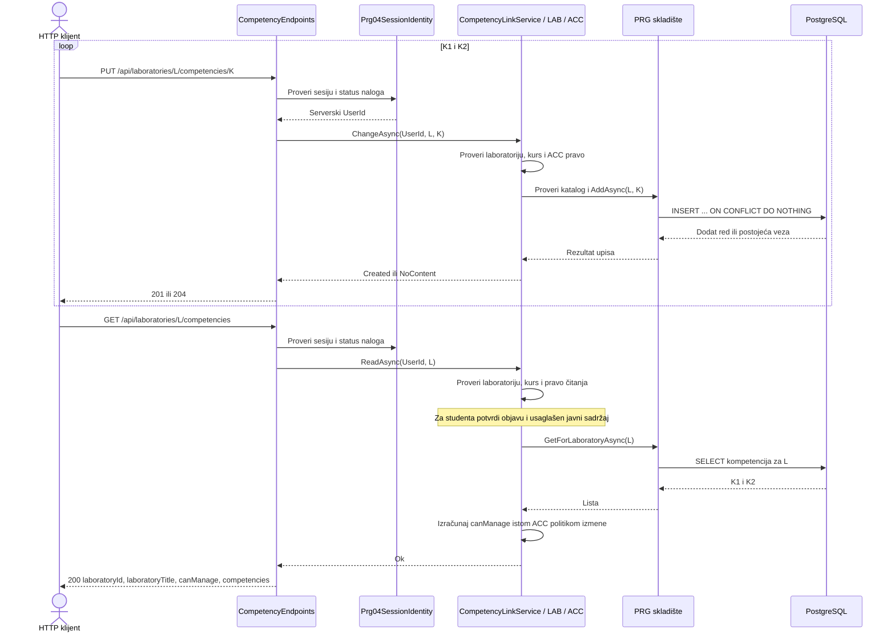

# PRG-04: API za mapiranje kompetencija

**Status:** Implementirane HTTP operacije sa serverskim identitetom, proverom laboratorije i autorizacijom, povezane sa React ekranom za izbor i prikaz.

**Zahtev:** Jedna laboratorija može proveravati više kompetencija. Ista kompetencija može se povezati sa više laboratorija.

Arhitektura i granice odgovornosti nalaze se u [PRG-04-competencies.md](PRG-04-competencies.md), a konfiguracija skladišta u [PRG-04-storage.md](PRG-04-storage.md).

## HTTP ugovor

Sve operacije zahtevaju aktivnu serversku sesiju i aktivan nalog. `PUT` i `DELETE` ne zahtevaju telo zahteva.

| Metod i putanja | Uspešan odgovor | Značenje |
| --- | --- | --- |
| `GET /api/competencies` | `200 { competencies: [...] }` | Katalog kompetencija |
| `GET /api/laboratories/{laboratoryId}/competencies` | `200 { laboratoryId, laboratoryTitle, canManage, competencies: [...] }` | Naslov, mogućnost izmene i veze dostupne laboratorije |
| `PUT /api/laboratories/{laboratoryId}/competencies/{competencyId}` | `201` ili `204` | Dodavanje veze |
| `DELETE /api/laboratories/{laboratoryId}/competencies/{competencyId}` | `204` | Uklanjanje veze |

Kompetencija u odgovoru sadrži `id`, `name` i `description` (tekst ili `null`). Nova veza vraća `201 Created` i `Location` ka putanji veze. Ponovljen `PUT` vraća `204`; ponovljen `DELETE` poznate kompetencije takođe vraća `204`.

`laboratoryTitle` je neprazan naslov iz sačuvane laboratorije, a `canManage` boolean iz serverske ACC odluke za izmenu te laboratorije. Ova polja dodata su postojećem GET odgovoru; `laboratoryId` i `competencies` ostaju. Ekran koristi `canManage` za prikaz izbora, bez nagađanja uloge ili probnog upisa. `false` ne sprečava dozvoljeno čitanje, uključujući slučaj nedostajuće manage politike. Svaki `PUT`/`DELETE` ponovo proverava aktuelno pravo.

| Odgovor | Uslov / telo |
| --- | --- |
| `400 Bad Request` | Prazan GUID laboratorije: `invalid_laboratory_id`; prazna kompetencija nakon uspešne provere laboratorije: `invalid_competency_id` |
| `401 Unauthorized` | `SessionCheckMiddleware` odbija odsutnu ili nevažeću sesiju pre handlera: `{ "code": "session_invalid" }` |
| `401 Unauthorized` | PRG handler ne razreši aktivnu sesiju ili aktivan nalog: `{ "error": "unauthenticated" }` |
| `404 Not Found` | Nepostojeća laboratorija ili nedozvoljen pristup: `laboratory_not_found` |
| `404 Not Found` | Kompetencija nije u katalogu, za `PUT` i `DELETE`: `competency_not_found` |
| `503 Service Unavailable` | PRG skladište nije konfigurisano: `competency_storage_unavailable` |
| `503 Service Unavailable` | Izuzetak pri operaciji: bezbedan Problem Details odgovor `Competency operation unavailable` |

Poslovne greške PRG handlera koriste JSON `{ "error": "..." }`, a uhvaćeni izuzeci Problem Details. Odgovori nastali pre handlera imaju ugovor odgovarajućeg middleware-a ili rutiranja. `SessionCheckMiddleware` zato može vratiti `401` sa poljem `code`; za nevažeći token dodatno uklanja sesijski kolačić. U Development okruženju postojeći izuzetak middleware-a za `/api/laboratories` ostavlja PRG handleru obaveznu proveru sesije.

Parametri ruta imaju `:guid` ograničenje: sintaksno neispravan GUID ne ulazi u handler i daje `404` zbog nepodudaranja rute. Autorizacija se proverava pre dostupnosti PRG skladišta; nedozvoljen poziv ne može kroz `503` otkriti stanje veza. PRG handleri postavljaju `Cache-Control: no-store`.

## Autorizacija

- Katalog je dostupan aktivnom prijavljenom korisniku.
- Čitanje veza proverava postojeću laboratoriju, njen sačuvani kurs i postojeću LAB politiku otvaranja. Student dobija veze samo za nearhiviranu laboratoriju čiji objavljen sadržaj iz `ILabPublicContentReader` ima isti ID laboratorije i kursa. Nacrt, arhivirana laboratorija i nedostajući ili neusaglašeni javni sadržaj daju `404`. Nastavnik koji je autor može čitati i nacrt.
- Dodavanje i uklanjanje zahtevaju posebnu ACC radnju `prg04.competency.links.manage`. Dozvoljena je autoru laboratorije koji je nastavnik njenog kursa.
- Nepostojeća i nedozvoljena laboratorija daju isti `404` odgovor. Zahtev se odbija pre pristupa PRG katalogu ili vezama.
- Članstvo se proverava pri svakom pozivu. Polja iz zahteva i razvojna zaglavlja nisu dokaz identiteta, kursa ili prava.

## Povezani frontend

Zaštićena ruta `/laboratories/:laboratoryId/competencies` koristi `CompetenciesPage` i `LaboratoryCompetencies`. Linkovi su dostupni iz rezultata LAB pretrage i iz prikaza stvarnog laboratorijskog sadržaja. Izgled nasleđuje beli/plavi identitet aplikacije.

`frontend/src/api/competencies.ts` koristi `AuthContext.request` za postojeći sesijski cookie i obradu isteka sesije. Najpre učitava laboratoriju i njene veze. Katalog i kontrole za izmenu učitavaju se/prikazuju samo uz `canManage: true`; student vidi povezane kompetencije sa opisima, bez kataloga ili uređivanja.

Označavanje checkbox-a šalje `PUT`, a odznačavanje ili dugme za uklanjanje `DELETE` za jednu vezu. Posle uspešnog upisa ponavlja se GET; prikaz odgovara serverskom stanju i aktuelnoj mogućnosti izmene. Tokom zahteva ostale izmene su onemogućene. Posle greške pri upisu ili naknadnom čitanju ekran traži ponovno učitavanje da bi potvrdio sačuvano stanje.

Ekran podržava pretragu kataloga, stanja učitavanja i praznih lista, bezbedne poruke o greškama i ponovni pokušaj. Već učitane veze ostaju vidljive ako katalog nije dostupan. Pri promeni korisnika ili laboratorije i napuštanju ekrana prekidaju se zastareli zahtevi. Uređivanje kataloga, ocenjivanje usvojenosti i analitika napretka nisu deo ovih tokova.

## Tok dodavanja veze

Prikazan je tok PRG handlera, nakon prolaska prethodnih middleware provera.

## Sekvenca: dve kompetencije na jednoj laboratoriji

Preduslov: laboratorija L i kompetencije K1/K2 postoje; pozivalac ima aktivnu sesiju i pravo izmene L. Migracija PRG šeme je primenjena.

`DELETE /api/laboratories/L/competencies/K1` prolazi iste provere identiteta i prava izmene, zatim uklanja samo vezu L–K1. Veza L–K2, katalog i veze drugih laboratorija ostaju sačuvani.

## Postojeći testovi

HTTP testovi proveravaju anonimne, opozvane, blokirane i nepotpune identitete; razvojna zaglavlja bez sesije; čitanje naspram izmene; tuđu laboratoriju i kurs; nepostojeću ACC politiku; promenu članstva; nevažeće ID-eve; nepoznatu kompetenciju i idempotentne izmene. GET testovi proveravaju naslov i `canManage` za nastavnika i studenta, čitanje uz `false` kada nema manage politike i ponovno odbijanje izmene nakon promene članstva.

Frontend testovi u `LaboratoryCompetencies.test.tsx` proveravaju serverski upravljan izbor/prikaz, čuvanje checkbox promena sa kanonskim GET osvežavanjem, prazne liste i oporavak od grešaka. `competencies.test.ts` proverava GET ugovor, upis/brisanje, sesijski adapter, bezbedne poruke, validaciju odgovora i prekid zahteva.

PostgreSQL testovi posebno proveravaju dve kompetencije iste laboratorije posle ponovnog kreiranja aplikacionih servisa, zajedničku kompetenciju više laboratorija, duplikate i konkurentne upise, izolovano uklanjanje, ograničenja baze i migraciju. Izvršavanje zahteva test konekciju opisanu u [PRG-04-storage.md](PRG-04-storage.md).
