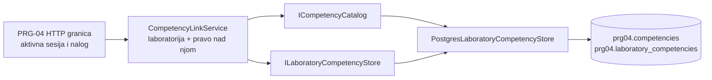

# PRG-04 — Model kompetencija, čuvanje veza, API i korisnički ekran

## Obim do sada

Specifikacija, odeljak 4.10: **PRG-04 — Mapiranje laboratorija na kompetencije**.
Minimalni kriterijum: jedna vežba može proveravati više kompetencija.

Implementirani su `Platform.Competencies`, PostgreSQL skladište i HTTP operacije
sa proverom aktivne sesije, postojanja laboratorije i prava nad njom. Jedna
laboratorija može imati više kompetencija; izmena jedne veze čuva ostale veze.
Testovi obuhvataju model, trajnost i pozitivne i negativne HTTP scenarije.

React ekran omogućava ovlašćenom nastavniku da bira i uklanja kompetencije, a
studentu da vidi povezane kompetencije dostupne laboratorije. Otvara se iz
rezultata pretrage i studentskog prikaza na ruti
`/laboratories/:laboratoryId/competencies`. Uređivanje kataloga, provera
usvojenosti, ocenjivanje i izmena revizija ili pokušaja ostaju izvan ovog obima.

## Model i pravila

- `Competency`: stabilni `Id`, obavezan naziv (do 120 znakova) i opcioni kratak
  opis (do 500 znakova). Ovo su ograničenja implementacije, a ne dodatni zahtevi specifikacije.
- `LaboratoryCompetency`: par `LaboratoryId` / `CompetencyId`. Jedna laboratorija
  ima 0..N veza, a ista kompetencija može se koristiti u više laboratorija.
- `LaboratoryId` je referenca na već postojeći trajni identitet laboratorije,
  bez kopije modela laboratorije i bez veze sa određenom revizijom ili pokušajem.
- Složeni primarni ključ sprečava duplikate. Ponovljeno ili istovremeno dodavanje
  iste veze je idempotentno: samo jedan poziv dodaje red, ostali vraćaju `false`.
- Uklanjanje briše samo navedenu vezu; katalog, ostale veze i druge laboratorije
  ostaju sačuvani. Uklanjanje nepostojeće veze vraća `false`.
- Prazni ID-evi i nepostojeća kompetencija se odbijaju. Baza dodatno proverava
  ključ, referencu na kompetenciju i neprazan ID laboratorije.

Početni katalog ima tri primera: **Kontrola pristupa**, **Analiza bezbednosnih
logova** i **Bezbedna konfiguracija**. ID-evi su eksplicitne konstante u
`BuiltInCompetencies`; postojeći ID ne sme se regenerisati pri preimenovanju.
Katalog se inicijalizuje migracijom i nema aplikacioni ugovor za njegovo uređivanje.

## Granice i ugovori

`ICompetencyCatalog.ListAsync` čita katalog. `ILaboratoryCompetencyStore` nudi
`AddAsync`, `RemoveAsync` i `GetForLaboratoryAsync`. Upiti su parametrizovani;
čitanje veza je ograničeno na prosleđeni ID laboratorije.

Skladište je **interni port**, a ne autorizovan slučaj upotrebe. Ne proverava
postojanje laboratorije ili identitet pozivaoca. Za laboratoriju bez veza vraća
praznu listu; ne razlikuje je od nepostojećeg ID-a.

HTTP granica koristi `Prg04SessionIdentity`: zahteva aktivnu sesiju, neprazne ID-eve
korisnika i sesije i aktivan nalog. Bez toga vraća `401`. Razvojna zaglavlja
`X-Test-User` i `X-Stub-User` ne zamenjuju sesiju.

`CompetencyLinkService` pre čitanja ili izmene veza učitava postojeću laboratoriju
preko `ILaboratoryRepository`. Kurs i autor dolaze iz sačuvane laboratorije.
Laboratorija bez kursa se odbija. Čitanje koristi postojeću `LabOpenPolicy` za
članstvo i vlasništvo: nastavnik kursa koji je autor može da čita i nacrt.
Za studenta kursa dodatno se proverava `ILabPublicContentReader`: javni sadržaj
mora pripadati istoj laboratoriji i kursu i biti u stanju `Published`, a sama
laboratorija ne sme biti arhivirana. Nacrt, skriven ili nedostajući javni sadržaj
ne otkriva ni veze kompetencija studentu.
Izmena se proverava odvojeno, kroz ACC radnju `CompetencyLinkActions.Manage` i
`CompetencyLinkManagePolicy`: dozvoljena je samo autoru koji je i dalje nastavnik
tog kursa. Pravo čitanja ne daje pravo izmene, a nedostajuća politika odbija izmenu.

Za nepostojeću laboratoriju i laboratoriju kojoj pozivalac nema pristup vraća se
isti `404` sa `laboratory_not_found`, pre pristupa katalogu ili skladištu veza.
Time se ne otkriva postojanje tuđeg resursa. Članstvo se proverava pri svakom
zahtevu; klijentski `courseId`, `createdBy` ili `userId` ne menjaju odluku.

API ugovor je:

| Metod i putanja | Ishod |
| --- | --- |
| `GET /api/competencies` | Katalog za aktivnog prijavljenog korisnika (`200`) |
| `GET /api/laboratories/{laboratoryId}/competencies` | `laboratoryId`, `laboratoryTitle`, `canManage` i `competencies` za dostupnu laboratoriju (`200`) |
| `PUT /api/laboratories/{laboratoryId}/competencies/{competencyId}` | Ovlašćeni autor dodaje vezu (`201`), odnosno `204` ako već postoji |
| `DELETE /api/laboratories/{laboratoryId}/competencies/{competencyId}` | Ovlašćeni autor idempotentno uklanja vezu (`204`) |

`laboratoryTitle` je sačuvani naslov laboratorije. `canManage` je serverski
izračunata mogućnost izmene prema istoj ACC politici koju koristi svaka izmena;
nije procena uloge na klijentu. Studentu i pri nedostajućoj politici vraća se
`false` ako je čitanje inače dozvoljeno. Ranija polja odgovora ostaju sačuvana.
Prikazana mogućnost ne zamenjuje ponovnu autorizaciju sledećeg `PUT`/`DELETE` poziva.

Posle provere identiteta, prazan ID laboratorije vraća `400`; za izmenu se
postojanje i pravo nad laboratorijom proveravaju pre ID-a kompetencije. Prazan ID
kompetencije vraća `400`, a kompetencija van kataloga `404` i pri dodavanju i pri
uklanjanju. Nedostupno skladište vraća bezbedan `503` posle odgovarajuće provere
pristupa; nema memorijskog zamenskog skladišta. Odgovori imaju `Cache-Control: no-store`.

Nema direktnog stranog ključa ka tuđoj tabeli laboratorija, preslikavanja tuđih
entiteta niti upisa u njihove tabele. Postojanje laboratorije, članstvo i identitet
proveravaju se preko postojećih ugovora modula; PRG-04 poseduje samo svoje podatke.



Tok za veze: HTTP poziv → aktivna sesija i nalog → postojeća laboratorija i pravo
čitanja ili izmene → provera ID-a kompetencije i kataloga pri izmeni → čitanje,
upis ili brisanje u PRG-04 šemi → rezultat. Katalog zahteva samo aktivan identitet.
Rute imaju `DelegatesToLegacyAuthorization`, jer handler sprovodi te provere;
izmena iz handlera poziva ACC engine. U Development okruženju, gde zajednički
sesijski middleware preskače LAB rute, `Prg04SessionIdentity` sam validira cookie.

## Frontend

`CompetenciesPage` i `LaboratoryCompetencies` koriste postojeći beli/plavi izgled
aplikacije. API adapter `frontend/src/api/competencies.ts` poziva postojeći
`AuthContext.request`, koji prenosi sesijski cookie i obrađuje istek sesije.

Ekran prvo učitava laboratoriju i njene veze. Samo kada server vrati
`canManage: true` učitava se katalog i prikazuju pretraga, checkbox izbor i
uklanjanje. Svaka promena šalje zaseban `PUT` ili `DELETE`, pa ponovni `GET`
osvežava prikaz sačuvanim serverskim stanjem. Tokom čuvanja ostale izmene su
onemogućene. Student vidi povezane kompetencije i opise, bez kataloga ili kontrola
za izmenu.

Obrađena su učitavanje, prazan katalog i veze, pretraga bez rezultata, greške i
ponovni pokušaj. Greška kataloga ne skriva već učitane veze. Nepotvrđena izmena
traži ponovno učitavanje; ekran ne pretpostavlja da neuspešan odgovor znači da
upis nije sačuvan. Zahtevi se prekidaju pri promeni laboratorije/korisnika ili
napuštanju ekrana, tako da zastareo odgovor ne menja novi prikaz.

## Baza i migracije

Modul koristi EF Core 10 i PostgreSQL. `CompetenciesDbContext` poseduje samo:

- `prg04.competencies`;
- `prg04.laboratory_competencies`;
- svoju istoriju migracija `prg04.__EFMigrationsHistory`.

`InitialCompetencies` kreira te dve poslovne tabele i inicijalizuje katalog.
`Down` uklanja samo poslovne tabele PRG-04. Tuđe šeme i migracije se ne menjaju.
Snapshot je generisan EF Core alatom i proverava se naspram aktuelnog modela.

Registracija je eksplicitna: `services.AddCompetencyPersistence(connectionString)`.
`Platform.Api` koristi najpre `ConnectionStrings:Competencies`, a zatim postojeći
`ConnectionStrings:Laboratories` kao rezervu za isti PostgreSQL server. Bez obe
konfiguracije nema zamenskog memorijskog skladišta i API vraća `503`. Web aplikacija
ne pokreće migracije automatski.

Za primenu migracije na namenjenu lokalnu/test bazu (konekciju postaviti kroz
okruženje, bez upisivanja lozinke u repozitorijum):

```powershell
dotnet tool restore --tool-manifest dotnet-tools.json
# Postaviti PRG04_MIGRATION_CONNECTION_STRING na ciljnu PostgreSQL bazu.
dotnet ef database update --project backend/Platform.Competencies --startup-project backend/Platform.Competencies
```

## Provera i dokaz

Testovi su u `Platform.Competencies.Tests`. HTTP testovi pokreću stvarni API host,
sesijski adapter i ACC engine; spoljne repozitorijume zamenjuju sintetički test
adapteri, bez pristupa produkcionim podacima. Za PostgreSQL testove postaviti
`PRG04_TEST_ADMIN_CONNECTION_STRING` na PostgreSQL
instancu sa dozvolom za kreiranje test baze. Docker nije obavezan; može se koristiti
i lokalni PostgreSQL. Fixture pravi novu bazu `prg04_test_<nasumični ID>` i uklanja
samo tu bazu u završnom čišćenju. Ne izvršavati testove administratorskom konekcijom
ka produkciji. Bez konfiguracije integracioni testovi se preskaču, što ne predstavlja
dokaz prolaska provere trajnosti.

```powershell
dotnet test backend/Platform.Competencies.Tests/Platform.Competencies.Tests.csproj --configuration Release
```

Za ponovljivu proveru bez ručnog podešavanja konekcije:

```powershell
./scripts/test-competencies-postgres.ps1
```

Skripta pokreće zaseban PostgreSQL kontejner na nasumičnom lokalnom portu,
izvršava sve PRG-04 testove i uklanja sopstveni kontejner. CI je poziva sa
`-NoBuild` nakon izgradnje rešenja i zahteva prolazak svih testova, bez
preskakanja, uključujući najmanje osam testova `CompetencyPersistenceTests`.
Opcija `-UseExistingServer` koristi već postavljenu test konekciju.

| Provera | Dokaz |
| --- | --- |
| Stabilni ID-evi, naziv, opis i neispravni ID-evi | `CompetencyTests` |
| Snapshot, vlasništvo nad tabelama, SQL za migraciju i rollback, registracija | `CompetencyModelTests` |
| Najmanje dve kompetencije za laboratoriju i ponovo kreiran DI kontejner/konekcija | `TwoCompetencies_SurviveDisposingAndRecreatingApplicationServices` |
| Duplikat kroz skladište i direktan duplikat u bazi | `DuplicateLink_IsIdempotentAndDatabaseKeyAlsoRejectsDirectDuplicate` |
| Istovremeni upisi iste veze | `ConcurrentDuplicateAdds_CreateExactlyOneRelationship` |
| Uklanjanje jedne veze čuva ostale i druge laboratorije | `RemoveOneLink_PreservesOtherLinksAndSharedCatalogEntry` |
| Nepostojeća kompetencija i integritet baze | `UnknownCompetency_IsRejectedByStoreAndForeignKey`, `DatabaseConstraints_RejectEmptyLaboratoryIdAndProtectCatalogFromLinkedDeletion` |
| Ponovljena migracija i izolacija šeme | `Catalog_IsSeededAndMigrationCanRunAgainWithoutResettingLinks`, `Migration_CreatesOnlyPrg04Tables` |
| Aktivna sesija i nalog pre pristupa skladištu | `UnauthenticatedRequest_DeniesBeforeCompetencyStorage`, `DevelopmentHeadersWithoutSession_DoNotAuthenticatePrg04` |
| Ovlašćeno čitanje i idempotentna izmena | `AuthenticatedTeacher_CanReadCatalogAndOwnLaboratoryLinks`, `AuthorizedTeacher_PutAndDeleteAreIdempotentAndPreserveOtherLinks` |
| Pravo čitanja ne dozvoljava izmenu | `StudentWithReadAccess_DoesNotGetEditAccess` |
| Dve kompetencije kroz HTTP i nezavisno uklanjanje | `TwoCompetencies_CanBeAddedReadAndRemovedIndependentlyThroughHttp` |
| Student vidi samo objavljenu laboratoriju istog kursa; autor vidi i nacrt | `StudentCannotReadLinksWithoutMatchingPublishedLaboratory`, `TeacherCanReadOwnDraftWithoutPublishedContent` |
| IDOR i jednaki odgovori za tuđu i nepostojeću laboratoriju | `SwappingLaboratoryId_ReturnsSameResponseAsMissingAndNeverTouchesLinks` |
| Potrebni su vlasništvo, nastavničko članstvo i ACC politika | `LaboratoryOwnerWhoIsNotCourseTeacher_CannotEdit`, `MissingPrg04AccessPolicy_DeniesEvenTheAuthorizedTeacher` |
| Serverska mogućnost izmene i njeno ponovno proveravanje | `MissingManagePolicy_ReadsLinksWithReadOnlyCapabilityWithoutProbingMutation`, `ManageCapability_ReflectsMembershipChangesAndNeverAuthorizesTheNextMutation` |
| Kurs laboratorije i članstvo dolaze sa servera | `LaboratoryWithoutSavedCourse_IsDeniedEvenToItsCreator`, `SpoofedCourseAndCallerFields_DoNotChangeAuthorization`, `ChangingMembershipAfterSuccessfulEdit_IsCheckedOnTheNextRequest` |
| Greške kompetencije i nedostupno skladište | `EmptyCompetencyId_IsRejectedWithoutMutation`, `UnknownCompetency_IsRejectedBeforeMutation`, `AuthenticatedCaller_Gets503WhenCompetencyPersistenceIsNotConfigured` |
| Registracija PRG-04 ruta u stvarnom hostu | `ApiEndpointCoverageTests` |
| React izbor/prikaz, studentski režim, čuvanje i oporavak od greške | `frontend/src/components/competencies/LaboratoryCompetencies.test.tsx` |
| Frontend HTTP ugovor, sesijski poziv, validacija odgovora i prekid zahteva | `frontend/src/api/competencies.test.ts` |
| Zaštićena ruta, povratak na kompetencije posle prijave i uklanjanje prikaza posle odjave | `frontend/src/__tests__/CompetenciesRouting.test.tsx` |

### Aktuelna provera — 18. novembar 2026.

- Posle dopune GET ugovora i React ekrana,
  `test-competencies-postgres.ps1 -NoBuild`: **66 prošlo, 0 neuspešnih,
  0 preskočenih**, uključujući svih osam PostgreSQL testova.
  Dokaz: `TestResults/competencies-postgres-5ecbb06e00864ca888f8eb39919a6da6/competencies-postgres.trx`.
- Frontend produkcioni build sa novim ekranom je uspešan; kompletna provera
  `npm.cmd test -- --maxWorkers=2`: **187 prošlo, 0 neuspešnih** u 21 test fajlu.
- Pregled stvarno renderovanog React ekrana sa sintetičkim odgovorima API-ja:
  izbor i uklanjanje, potvrda stanja sa servera, studentski prikaz, pretraga,
  prazna stanja, greške i dugačak naslov. Prikazi na 390, 768 i 1440 piksela
  nemaju horizontalno prelivanje. Snimci su u `.impeccable/review/`.
- Impeccable mehanička provera vratila je `[]`; nezavisni vizuelni pregled
  vraća `ship` za pregledani ekran i navedena stanja.

### Prethodna provera pre React ekrana — 18. novembar 2026.

Sledeći rezultati beleže raniji kod bez novog ekrana i GET polja
`laboratoryTitle`/`canManage`; služe kao prethodna regresiona osnova.

- Release build celog `SecurityLab.slnx`: uspešan, bez grešaka. Sedam `NU1900`
  upozorenja odnosi se na nedostupan NuGet izvor za podatke o ranjivostima paketa.
- `test-competencies-postgres.ps1 -NoBuild`: **64 prošlo, 0 neuspešnih,
  0 preskočenih**, uključujući svih osam testova stvarnog PostgreSQL skladišta.
- Regresiona provera celog rešenja kroz `scripts/audit/test-postgres.ps1 -NoBuild`,
  uz zasebnu test konekciju za PRG-04 i Coursework: **2.439 prošlo, 0 neuspešnih,
  10 preskočenih**. Preskočeno je devet LAB skladišnih testova i jedan Team21
  PostgreSQL test jer njihove zasebne konekcije nisu podešene; svi PRG-04 testovi su izvršeni.
- Šest scenarija `StudentCannotReadLinksWithoutMatchingPublishedLaboratory`
  prvo je potvrdilo propust, a posle ispravke prolazi. Posebno su provereni
  dodavanje dve kompetencije kroz HTTP, nezavisno uklanjanje i pristup autora nacrtu.
- Frontend posle spajanja sa `main`: produkcioni build i **154 testa** prolaze.
  Lokalno je korišćen `npm.cmd test -- --maxWorkers=2` zbog timeout-a pri
  neograničenom pokretanju test radnika.

### Istorijski dokaz — 8. novembar 2026.

Sledeći rezultati su ranije zabeležena provera modela, skladišta i tadašnjeg API
koraka. Ne predstavljaju rezultat pokretanja sadašnjeg koda sa autorizacijom;
aktuelne testove iz tabele potrebno je ponovo pokrenuti navedenom komandom.

- Release build novog modula i test projekta: uspešan, bez upozorenja i grešaka.
- Pre API koraka: **17 prošlo, 0 neuspešnih, 0 preskočenih**; od toga 8
  integracionih testova nad stvarnim PostgreSQL 17.
- Posle API koraka, bez podešene test PostgreSQL konekcije: **15 prošlo, 0
  neuspešnih, 8 preskočenih**. Preskočeni su samo raniji PostgreSQL testovi; šest
  novih API testova je prošlo.
- Postojeći test registracije i zaštite API ruta: **2 prošlo, 0 neuspešnih**.
- Dodatna provera u dva odvojena procesa: proces A upisuje dve veze i završava se;
  novi proces B ih ponovo učitava iz baze. Obe veze su sačuvane. Privremeni pomoćni
  alat za ovu proveru i generisanje migracije nalazi se u ignorisanom `obj/prg04-tools`.
- Za proveru je korišćen zaseban privremeni PostgreSQL kontejner, nezavisno od
  projektne baze. Podaci su isključivo sintetički test-podaci.

## Granice trenutne implementacije

Provera postojanja laboratorije, serverska autorizacija i ograničenje studentskog
čitanja na objavljen javni sadržaj deo su PRG-04 HTTP granice. React ekran koristi
istu granicu za izbor i prikaz kompetencija. Postojeći LAB ugovori se koriste bez
izmene zajedničkih pravila drugih modula. Uređivanje kataloga, usvojenost
kompetencija i analitika napretka nisu dodati.
