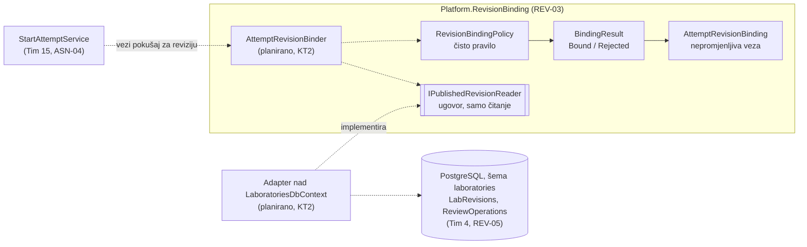
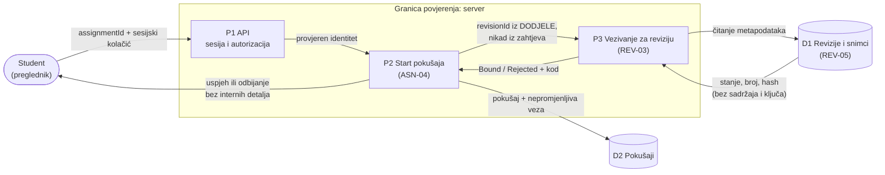

# Project component: REV-03 Vezivanje pokušaja za tačnu reviziju, REV-06 Poređenje revizija i opis izmjena

**Tim:** 22

**Student:** Vladan Dmitrović / PR118/2020

**Zahtjevi iz specifikacije:** REV-03 (Ј), REV-06 (П). Povezani: REV-16, REV-18, SEC-08, REV-04, AUT-04, REV-15.

**Grana:** `feature/REV-03-REV-06-revision-binding`

**Projekti:** `backend/Platform.RevisionBinding`, `backend/Platform.RevisionBinding.Tests`

## Odgovornosti i granice

### REV-03: Vezivanje pokušaja za tačnu reviziju

Kriterijum prihvatanja: *naknadna izmjena zadatka ne mijenja započeti pokušaj.*

Kada student započne pokušaj, pokušaj se vezuje za tačno jednu **objavljenu** reviziju laboratorije. Veza pamti identifikator revizije, laboratoriju, redni broj objave i SHA-256 hash snimka sadržaja. Nova objava (R2) ne mijenja pokušaje vezane za R1, a hash omogućava da se kasnije dokaže da je sadržaj nad kojim se pokušaj ocjenjuje isti onaj koji je student počeo.

- **Procesi i scenariji:** student pokreće pokušaj (UC-01); sistem ocjenjuje pokušaj nad njegovom revizijom (UC-06).
- **Ugovori sa drugim modulima:**
  - `IPublishedRevisionReader` (čitanje metapodataka revizije): implementira ga adapter nad podacima modula revizija (REV-05, Tim 4).
  - `RevisionBindingPolicy` / `BindingResult`: koristi ih start pokušaja (ASN-04, Tim 15).
- **Status implementacije (KT1):**
  - ✅ struktura projekta i test projekta, dodati u `SecurityLab.slnx`
  - ✅ ugovori: `RevisionState`, `PublishedRevisionInfo`, `IPublishedRevisionReader`
  - ✅ domenski tipovi: `AttemptRevisionBinding` (nepromjenljiva veza), `BindingOutcome`, `BindingResult`
  - ✅ pravilo `RevisionBindingPolicy`: postojanje revizije i stanje `Published`
  - ✅ NUnit testovi: 1 pozitivan i 3 negativna slučaja
  - ⏳ provjera kursa dodjele, provjera hasha snimka, adapter nad bazom, integracija sa ASN-04 (plan ispod)

### REV-06: Poređenje revizija i opis izmjena

Kriterijum prihvatanja: *prikazane su razlike u odnosu na prethodnu verziju.*

Planirano poslije KT1. Snimci objavljenih revizija (`ReviewOperation.Snapshot`) su JSON definicije (`PublicationDefinition`), pa se dvije revizije mogu porediti polje po polje. Bezbjednosni zahtjev: poređenje ne smije otkriti ključ evaluatora (`Evaluator.ExpectedEventIds`, AUT-04, REV-15) korisniku bez prava, niti revizije kursa na kojem korisnik nema ulogu.

## Arhitektura komponente

Puna linija: implementirano. Isprekidana linija: planirano.



`Platform.RevisionBinding` ne referencira bazu, HTTP ni projekte drugih timova. Stanje revizije je zaseban tip (`RevisionState`), a adapter prevodi `LabRevisionStatus` iz REV-05 u njega. Promjena internog modela drugog tima tako ne mijenja pravila REV-03.

## Dijagram toka podataka



Granice povjerenja i pretpostavke:

- **Klijent → server:** sve što dolazi od preglednika je nepovjerljivo. Identifikator revizije se ne prima od klijenta, nego se uzima iz dodjele na serveru. Time se sprečava da student podmetne nacrt ili reviziju drugog kursa.
- **REV-03 → podaci REV-05:** REV-03 čita samo metapodatke (stanje, broj, hash). Sadržaj zadatka i ključ evaluatora ne prelaze ovu granicu.
- **Odgovor klijentu:** interni kod (`NotPublished`, `RevisionNotFound`...) služi testovima i auditu. Klijent dobija opšti odgovor koji ne otkriva postojanje ni stanje revizije.

## Bezbjednosni zahtjevi

- **Serverske provjere pristupa:** vezivanje se odlučuje isključivo na serveru, sa podrazumijevanim odbijanjem: veza nastaje samo ako su sve provjere prošle.
- **Validacija ulaza i osjetljivi podaci:** `PublishedRevisionInfo` ne sadrži sadržaj zadatka ni ključ evaluatora. `AttemptRevisionBinding` je `record` bez settera, pa se poslije kreiranja ne može izmijeniti.
- **Negativni scenariji:** nacrt, revizija na pregledu i arhivirana revizija se odbijaju (`NotPublished`); nepostojeća revizija se odbija (`RevisionNotFound`).

### Prijetnja – kontrola – test – dokaz

| Prijetnja | Kontrola | Test | Status |
| --- | --- | --- | --- |
| Pokušaj se veže za nacrt ili reviziju na pregledu, pa student radi nepregledan zadatak | Vezivanje samo za stanje `Published` | `Decide_WhenRevisionIsNotPublished_RejectsWithNotPublished` (Draft, InReview) | ✅ |
| Novi pokušaj nad arhiviranom vježbom (REV-04) | Arhivirana revizija se odbija | isti test, slučaj `Archived` | ✅ |
| Nova objava „ispod nogu" mijenja započeti pokušaj | Veza pamti tačan ID, broj i hash, nepromjenljiva | `Decide_WhenRevisionIsPublished_BindsToExactRevision` | ✅ |
| Sadržaj snimka izmijenjen poslije objave (SEC-08) | Poređenje hasha snimka sa hashom u vezi | planiran test za `SnapshotMismatch` | ⏳ KT2 |
| Klijent podmetne ID revizije | ID samo iz dodjele na serveru | planiran integracioni test | ⏳ KT2 |
| Revizija drugog kursa | Provjera kursa dodjele (`CourseMismatch`) | planiran test | ⏳ KT2 |
| Odluka o vezivanju otkrije skrivene kriterijume | Ugovor ne prenosi sadržaj ni ključ evaluatora | pregled ugovora | ✅ po dizajnu |

## Dokazi o radu

- **Commitovi:**
  - `d4e9d16` REV-03: struktura projekta za vezivanje pokušaja za reviziju
  - `9cdda7f` REV-03: ugovori i ishodi vezivanja pokušaja za reviziju
  - `a90d8c2` REV-03: pravilo vezivanja samo za objavljenu reviziju uz testove
- **Pokretanje:**

  ```powershell
  dotnet build backend/Platform.RevisionBinding.Tests/Platform.RevisionBinding.Tests.csproj
  dotnet test backend/Platform.RevisionBinding.Tests/Platform.RevisionBinding.Tests.csproj
  ```

- **Testovi i rezultati:** `total: 4, failed: 0, succeeded: 4` (lokalno, .NET 10.0.403).

## Plan preostalog rada i zavisnosti

### Do KT2: REV-03

1. Provjera kursa dodjele u `RevisionBindingPolicy` (`CourseMismatch`) uz negativni test.
2. Provjera snimka: ponovo izračunati SHA-256 i uporediti sa `AttemptRevisionBinding.ContentHash` (`SnapshotMismatch`) uz test „snimak izmijenjen poslije objave".
3. Test „nova revizija R2 objavljena poslije starta, pokušaj ostaje vezan za R1".
4. `AttemptRevisionBinder` servis koji koristi `IPublishedRevisionReader` i bilježi audit zapis odluke (AUD-01).
5. Adapter `IPublishedRevisionReader` nad `LaboratoriesDbContext`: stanje iz `LabRevisions`, broj i hash iz `ReviewOperations` (odobrenje).
6. Integracija u start pokušaja i integracioni test.

### Poslije: REV-06

1. Poređenje dva snimka `PublicationDefinition` polje po polje (naslov, cilj, pitanje, događaji).
2. Filtriranje skrivenih polja (ključ evaluatora) prije računanja i slanja razlika.
3. Provjera prava na kurs na serveru; negativni testovi za korisnika drugog kursa i za curenje skrivenog polja.

### Dogovorene zavisnosti

| Tim | Šta je potrebno | Status |
| --- | --- | --- |
| Tim 4 (REV-05) | Potvrda da objavljena revizija uvijek ima `ReviewOperation` sa brojem i snimkom; saglasnost za adapter koji čita njihove tabele | ⏳ za dogovor |
| Tim 15 (ASN-04) | Poziv vezivanja u `StartAttemptService` prije `IAttemptStore.TryStartAsync`; usklađivanje tipa `PublishedLabRevisionId` (`string`) sa `Guid` identifikatorom revizije; čuvanje veze uz pokušaj | ⏳ za dogovor |

### Otvorena odluka

- **„Prethodna verzija" za REV-06:** REV-01 nije zaseban zadatak, a redni broj objave dodjeljuje se pri odobrenju (REV-05). Prijedlog: prethodna verzija je objavljena revizija iste laboratorije sa najvećim brojem manjim od broja posmatrane revizije.
