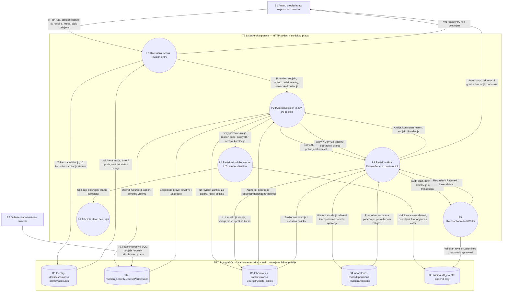
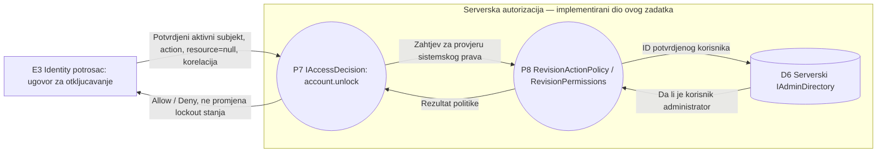

# DFD: autorizacija i audit za REV-05 / IDN-05

**Autor:** Luka, Tim 4 — autorizacija i audit.

**Zahtjevi:** REV-05 (provjera prava i odvajanje duznosti), ACC-05
(podrazumijevano odbijanje), AUD-01, AUD-02, AUD-03 i AUD-04. Za IDN-05 ovaj
dio obezbjedjuje politiku `account.unlock`; ne implementira lockout ili IP limiter.

Dokument prikazuje implementaciju dostupnu na `main` commitu `f225edb`.
Prikazani poslovni i Identity procesi su zavisnosti komponente: njihovo ukljucivanje
u dijagram ne znaci da pripadaju Lukinom zadatku. Specifikacija i kriterijumi za
komponentni DFD povezani su preko [platformskog pregleda](../../DATA_FLOW.md).

## Kako citati dijagram

`E` oznacava spoljnog aktera, `P` obradu podataka, a `D` skladiste. Svaka strelica
opisuje podatke koji se prenose. Okviri oznacavaju granice povjerenja: klijent ne
odredjuje potvrdeni identitet, vlasnika revizije, prava ili audit ishod. PostgreSQL
pristup ide preko serverskih adaptera i odvojenih prava za runtime i administraciju.

## REV-05: provjera zahtjeva i audit

P1 obuhvata `CorrelationMiddleware`, `RevisionSessionSubjectProvider`, javne
Identity ugovore i ulaznu provjeru Access middleware-a. Nakon `revision.entry`
provjere `SessionCheckMiddleware` ponovo validira sesiju prije endpointa.
`revision.entry` zahtijeva aktivan identitet; ne daje prava nad revizijom.
Njegovo odbijanje takodje prolazi kroz P4, prije poslovnog handlera.

P2 obuhvata `RevisionActionPolicy`, `RevisionApprovalPolicy`, `RevisionPermissions`
i serverske citace resursa i dozvola. Katalog i registar politika su serverska
konfiguracija u memoriji, a ne korisnicki ulaz. Nepoznata akcija ili akcija bez
politike daje Deny. D2 je autoritativni izvor u produkcionoj registraciji:
opozvano ili isteklo pravo ne aktivira rezervno odobravanje preko uloge.

P3 je zavisnost iz poslovnog REV-05 modula. Pojednostavljen prikaz izostavlja
unutrasnjost validacije i izvor publikacionog snapshot-a (`IPublicationSource`).
Transakcijski upis u P3/P5 prikazuje `submit`, `approve` i `return`; kreiranje
drafta i citanje koriste svoje provjere, ali ne proizvode te poslovne dogadjaje.
Njihove provjere ostaju obavezne: Allow iz P2 nije dokaz da su stanje, hash,
verzija ili sadrzaj pogodni za objavu. D3, D4 i D5 moraju biti u istoj fizickoj
PostgreSQL bazi za prikazani transakcijski tok. D1 moze koristiti zasebnu Identity
konekciju. D2 se u trenutnoj registraciji povezuje preko Laboratories konekcije.

### Pravila i podaci po akciji

| Akcija | Serverski izvor i provjera |
|---|---|
| `revision.create` | Resurs je kurs; potrebno je eksplicitno create pravo. Poslovni tok posebno provjerava vlasnistvo laboratorije i postojanje politike kursa. |
| `revision.read` | Kurs se ucitava iz revizije; potrebno je read pravo. |
| `revision.mine` | Korisnik mora biti autor i imati mine pravo. |
| `revision.pending.reviews` | Provjera prava za kurs svake vracene revizije. |
| `revision.submit` | Autor revizije, submit pravo i zasebno read pravo. |
| `revision.approve` | Approve i read prava; autor se odbija kada `RequiresIndependentApproval=true`. Nedostajuca politika daje Deny. |
| `revision.return` | Return i zasebno read pravo. |

Globalna administratorska ili saradnicka uloga sama ne daje kursna prava.
Kada je `RequiresIndependentApproval=false`, autor sa svim potrebnim pravima moze
odobriti svoju reviziju; i dalje vaze sve poslovne provjere.

### Audit, negativni tokovi i osjetljivi podaci

| Slucaj | Tok i rezultat |
|---|---|
| Nema sesije, sesija je opozvana / istekla, nalog nije aktivan | P1/P2 odbijaju entry prije handlera; P4 pokusava trajni upis `access.denied`. Za nepotvrdjen identitet akter je Anonymous bez korisnickog ID-ja. |
| Nema prava, drugi kurs ili zabranjeno samoodobravanje | P2 vraca Deny; nema poslovne mutacije. P4 upisuje poznatu odbijenu akciju. HTTP status zavisi od rute: mutacije vracaju 403, pojedinacno citanje skriva resurs sa 404. |
| Politika odbije / provjera politike baci gresku | Audit razlikuje `policy_denied` i `policy_error`. Nepoznate akcije ostaju odbijene, ali ih REV-05 audit filter ne prosljedjuje kao poznate REV-05 akcije. |
| Audit odbijenog pristupa nije dostupan | Pristup ostaje odbijen; P6 podize tehnicki alarm. Trajni zapis se ne predstavlja kao uspjesan. P4 koristi zaseban timeout od jedne sekunde i cuva postojeci Access audit tok. |
| Audit uspjesne mutacije nije potvrdjen | P3 ne izvrsava commit: stanje, odluka i potvrda operacije se ponistavaju; odgovor je `503 audit_unavailable`. |
| Ponovljen isti idempotentni zahtjev | Dozvole se ponovo provjeravaju; vraca se sacuvana potvrda bez druge objave i drugog poslovnog audit dogadjaja. |

Audit sadrzi serversko UTC vrijeme, aktera, tip dogadjaja, ishod i serversku
korelaciju. Uspjesni revizijski dogadjaji sadrze kurs, ID revizije, `authorId`,
`operationId` i `contentHash`; odobravanje dodaje `laboratoryId` i `revisionNumber`.
`operationId` je i EventId. Odbijanje sadrzi akciju i kod razloga, uz identifikator
i verziju politike kada su dostupni i validni.

Cookie, token, lozinka, puni snapshot, studentski / referentni odgovor i slobodni
komentar ne ulaze u ove audit detalje. Komentar i snapshot mogu biti poslovni
podaci u D4; ta razlika ne daje dozvolu za njihovo kopiranje u D5 ili tehnicke
logove. Akter i korelacija uzimaju se iz serverski potvrdjenog konteksta, a ne iz
proizvoljnih HTTP zaglavlja. Runtime nad D5 nema UPDATE, DELETE, TRUNCATE ili DDL
prava; migracije i administrativno odrzavanje su odvojeni od web zahtjeva.

## IDN-05: granica politike za otkljucavanje

`account.unlock` je sistemska akcija, bez revizije ili kursa kao resursa.
Implementirani su registracija i politika koja koristi `IAdminDirectory`.
Odbijanje ove poznate akcije je obuhvaceno audit fabrikom i forwarder-om iz P4
kada potrosac pozove zajednicki Access tok. Ovdje nije prikazana izvrsena HTTP
operacija otkljucavanja: trenutno nije povezana takva ruta sa ovom politikom.
Postojanje ciljnog naloga, promjena lockout brojaca i audit uspjesnog otkljucavanja
ostaju odgovornost Identity potrosaca. Ovo nije tvrdnja da je cijeli IDN-05 zavrsen.

## Veza sa kodom i dokazima

- [Ulazni identitet i status naloga](../../../backend/Platform.Api/Security/RevisionAuthorization/RevisionRequestIdentity.cs)
  i [rute / entry provjera](../../../backend/Platform.Api/Modules/RevisionReviews/ReviewEndpoints.cs).
- [Registracija politika](../../../backend/Platform.Api/Security/RevisionAuthorization/RevisionAuthorizationRegistration.cs),
  [dozvole](../../../backend/Platform.Api/Security/RevisionAuthorization/RevisionPermissions.cs)
  i [serverski citac resursa](../../../backend/Platform.Api/Security/RevisionAuthorization/RevisionResourceReader.cs).
- [Odbijeni zahtjevi i tehnicki alarm](../../../backend/Platform.Api/Security/RevisionAuthorization/RevisionAuditForwarding.cs),
  [audit sadrzaj](../../../backend/Platform.Api/Security/RevisionAuthorization/RevisionAuditEventFactory.cs)
  i [transakcijski poslovni tok](../../../backend/Platform.Api/Modules/RevisionReviews/ReviewService.cs).
- [Postojeci HTTP/PostgreSQL testovi](../../../backend/Platform.Laboratories.IntegrationTests/RevisionHttpWorkflowTests.cs):
  `AuthorizedHttpFlow_CreatesReadsSubmitsReturnsAndPublishes_WithDurableAudit`,
  `DeniedRevisionEntry_PersistsAnonymousAuditWithServerCorrelation`,
  `RevokedCourseGrant_DeniesNextHttpRead_AndPersistsDenial`,
  `SelfApprovalHttp_FollowsPersistedCoursePolicy` i
  `FailedAudit_RollsBackHttpSubmitAndReceipt`.
- [Politike, ukljucujuci account.unlock](../../../backend/Platform.Tests/RevisionAuthorization/RevisionActionPolicyTests.cs),
  [odluke](ADR-001.md) i [postojeci dokazi testiranja](TEST-EVIDENCE.md).

Ovaj dodatak mijenja samo dokumentaciju. Navedeni testovi su veza sa dokazima
implementacije; nisu izvjestaj o novom izvrsavanju testova za ovaj dokument.
