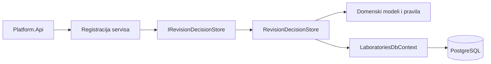
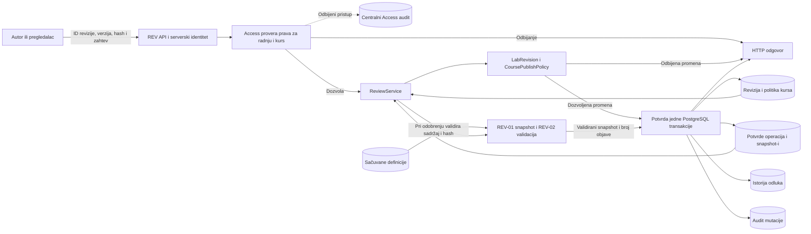

# REV-05 — dvostepeno odobravanje objave: domen i baza

| Stavka       | Vrednost                                                                                       |
| ------------ | ---------------------------------------------------------------------------------------------- |
| Student      | Matija Brkusanin                                                                               |
| Broj indeksa | PR101/2023                                                                                     |
| Tim          | Tim 4                                                                                          |
| Zahtev       | REV-05 — dvostepeno odobrenje objave                                                           |
| Zaduženje    | Domenski modeli, pravila i baza podataka                                                       |
| Status       | Domen i baza integrisani sa REV API-jem, autorizacijom i transakcionim auditom na `main` |
| Projekti     | `Platform.Laboratories.Domain`, `Platform.Laboratories.Infrastructure`                         |
| Prvobitna implementacija | `feature/REV-05-domain-persistence`, PR #37 (`b8db7e7`) |

## Moje zaduženje

Moj deo obuhvata statuse revizije i dozvoljene prelaze, politiku objavljivanja za kurs, proveru samoodobravanja, hash sadržaja, kontrolu konkurentnih izmena i istoriju odluka. Za ove modele pripremljena su EF Core mapiranja, migracije i testovi.

Osnovno pravilo REV-05 je da autor ne može da odobri sopstvenu reviziju kada politika kursa zahteva nezavisno odobrenje.

Numerisanje i sadržaj snapshot-a pripadaju REV-01, validacija tipa laboratorije i evaluatora pripada REV-02, a provera pristupa i audit povezani su kroz REV API. Moj deo obezbeđuje pravila koja taj tok primenjuje i PostgreSQL model u kojem čuva reviziju, politiku kursa i odluke.

## Ugovor za druge module

Za direktno čuvanje domenske odluke postoji `IRevisionDecisionStore`:

```csharp
Task<DecisionSaveResult> SaveDecisionAsync(
    RevisionDecisionRequest request,
    CancellationToken cancellationToken = default);
```

Zahtev sadrži ID revizije, ID pregledaoca, očekivanu verziju, hash pregledanog sadržaja i odluku. Uspešan rezultat vraća ID zapisa istorije, novi status i novu verziju. Neuspešan rezultat sadrži razlog odbijanja, na primer `SelfApprovalForbidden`, `ConcurrencyConflict` ili `ContentChanged`.

Pozivalac direktnog ugovora obezbeđuje proveru pristupa, pouzdan identitet pregledaoca i validaciju sadržaja pre objave. Produkcijski HTTP tok koristi iste domenske modele i isti `LaboratoriesDbContext`, a `ReviewService` vodi transakciju koja obuhvata i potvrdu operacije i audit.

## Implementacija

Kod je podeljen na domen i infrastrukturu:

- `Platform.Laboratories.Domain` sadrži poslovne modele i pravila, bez zavisnosti od EF Core-a, HTTP-a ili baze.
- `Platform.Laboratories.Infrastructure` sadrži PostgreSQL mapiranja, kontekst, migracije i čuvanje odluka.

Najvažnije klase:

| Klasa                    | Odgovornost                                                          |
| ------------------------ | -------------------------------------------------------------------- |
| `LabRevision`            | Čuva metapodatke revizije i kontroliše promene statusa i verzije.    |
| `LabRevisionTransitions` | Proverava dozvoljene parove početnog i ciljnog stanja.               |
| `CoursePublishPolicy`    | Čuva pravilo nezavisnog odobravanja za konkretan kurs.               |
| `RevisionContentHash`    | Računa SHA-256 nad bajtovima snapshot-a i proverava format hash-a.   |
| `RevisionConcurrency`    | Poredi očekivanu i trenutnu verziju.                                 |
| `RevisionDecisionRecord` | Čuva pregledaoca, odluku, vreme, hash i primenjeno pravilo politike. |
| `LaboratoriesDbContext`  | Povezuje modele sa PostgreSQL tabelama.                              |
| `RevisionDecisionStore`  | U jednoj transakciji čuva promenu revizije i istoriju odluke.        |

### Stanja i dozvoljeni prelazi

Prelazi prate dijagram 4.5.1 iz specifikacije:

| Početno stanje | Akcija             | Novo stanje |
| -------------- | ------------------ | ----------- |
| `Draft`        | Predaja na pregled | `InReview`  |
| `InReview`     | Vraćanje na doradu | `Draft`     |
| `InReview`     | Odobravanje        | `Published` |
| `Published`    | Povlačenje         | `Archived`  |

Nova revizija počinje u stanju `Draft`, sa `RowVersion = 1`. Status nema javni setter. Odbijena operacija ne menja stanje ni verziju.

### Direktno čuvanje odluke

`RevisionDecisionStore` izvršava sledeći tok:

1. Proverava ulazne podatke i učitava reviziju.
2. Učitava politiku njenog kursa i zaključava taj red za čitanje do kraja transakcije.
3. Proverava verziju, hash, dozvoljeni prelaz i samoodobravanje.
4. Priprema novi status, uvećava verziju i kreira zapis istorije sa serverskim vremenom.
5. Zajedno čuva promenu i istoriju, pa potvrđuje transakciju.

`RowVersion` je aplikacioni `long`, mapiran kao EF concurrency token. Ako dva zahteva koriste istu verziju, samo jedan može da sačuva izmenu. Drugi dobija `ConcurrencyConflict`. Ako upis istorije ne uspe, poništava se i promena statusa.

Očekivani domenski neuspeh vraća definisan rezultat, bez `return null` i bacanja domenskih izuzetaka. Konflikt koji EF prijavi pri upisu prevodi se u rezultat odbijanja.

## Baza i migracije

Tabele su u PostgreSQL šemi `laboratories`:

- `CoursePublishPolicies` — jedna politika po kursu; `CourseId` je primarni ključ.
- `LabRevisions` — ID, kurs, autor, status, hash i verzija revizije.
- `RevisionDecisions` — istorija odluka, sa indeksom nad revizijom i vremenom.

Migracije se nalaze u `Platform.Laboratories.Infrastructure/Persistence/Migrations`:

- `CreateReviewTables` pravi politiku kursa i istoriju odluka.
- `AddRevisionState` dodaje metapodatke revizije sa verzijom i ograničenjima.

Prvobitne migracije proverene su na praznoj test bazi i pri nadogradnji sa prve migracije uz očuvanje podataka. HTTP tok koristi i migracije `AddReviewOperations` za potvrde operacija i objave i `AddReviewDefinitions` za definicije nacrta. `LabRevision` čuva metapodatke revizije, dok se definicija i objavljeni snapshot čuvaju u tabelama tog toka.

Kurs pri kreiranju nacrta dolazi iz sačuvanog zapisa laboratorije. Migracija `AddLaboratoryCourse` čuva ranije laboratorije sa nepoznatim kursom. Kreiranje revizije za takvu laboratoriju se odbija dok se kurs pouzdano ne dopuni. Identifikatori revizije, kursa i korisnika su tipa `Guid`.

## Dijagram arhitekture



Dijagram prikazuje direktan persistence ugovor. `Program.cs` poziva `AddLaboratoriesPersistence()` za registraciju konteksta i store-a. Domenski projekat je nezavisan od API-ja i infrastrukture.

## Dijagram toka podataka



Prava se proveravaju nad kursom postojeće revizije. Pri novoj odluci servis učitava aktuelnu politiku pod zaključavanjem, poziva domensko pravilo i pri odobrenju proverava sačuvanu definiciju i hash. Nova predaja, vraćanje ili odobrenje potvrđuju se u istoj transakciji sa auditom. Vraćanje i odobrenje upisuju i domenski zapis odluke. Ako audit mutacije ne uspe, nema potvrde transakcije. Ponavljanje već potvrđenog zahteva sa istim ključem vraća raniji rezultat bez nove odluke i audit događaja mutacije.

Tok kreiranja i HTTP ugovor opisani su u [REV-05 API dokumentaciji](REV-05-use-cases-api.md). Provera prava i audit opisani su u [REV-05 dokumentaciji autorizacije](REV-05-authorization/README.md).

## Bezbednosne provere i ograničenja

- Autor se poredi sa sačuvanim `AuthorId`, a pravilo se čita iz politike odgovarajućeg kursa. Nedostajuća politika odbija odluku.
- Promenjen hash ili zastarela verzija ne dozvoljavaju upis odluke.
- SHA-256 se računa nad sačuvanim bajtovima. Pri odobrenju HTTP tok ponovo računa hash nad validiranim snapshot-om.
- Istorija čuva vrednost politike koja je važila pri odluci. Naknadna promena politike ne prepisuje taj zapis.
- Aplikacija upisuje nove zapise istorije. Direktne SQL izmene ostaju pod kontrolom dozvola baze.
- Lozinka razvojne baze je u lokalnom, ignorisanom `.env` fajlu. API connection string je u user-secrets ili promenljivoj okruženja.

## Demonstracija i testovi

Iz korena repozitorijuma:

```powershell
dotnet tool restore
dotnet build backend/Platform.Api/Platform.Api.csproj --configuration Release
dotnet test backend/Platform.Laboratories.Tests/Platform.Laboratories.Tests.csproj --configuration Release
dotnet test backend/Platform.Laboratories.IntegrationTests/Platform.Laboratories.IntegrationTests.csproj --configuration Release
```

Za integracione testove pokrenuti Docker sa Linux kontejnerima. Testcontainers podiže privremeni PostgreSQL na slobodnom portu i uklanja ga na kraju. Testovi sami pripremaju sintetičke naloge, laboratoriju, grantove i politiku kursa.

Za demonstraciju Matijinog dela kroz stvarni HTTP tok pokrenuti:

```powershell
dotnet test backend/Platform.Laboratories.IntegrationTests/Platform.Laboratories.IntegrationTests.csproj --configuration Release --filter "FullyQualifiedName~RevisionTwoStepApprovalHttpTests"
```

Pokaži kako autor sa pravom odobravanja predaje nacrt i dobija `403` kada kurs zahteva nezavisnog pregledaoca. Revizija ostaje `InReview`. Pregledalac sa pravima za taj kurs zatim objavljuje istu reviziju. Proveri da postoje jedna odluka i jedan uspešan audit odobrenja. Ista grupa testova pokazuje da se politika primenjuje u trenutku odluke i da se zahtev odbija ako politika ili pravo nedostaju.

Za demonstraciju transakcije i migracija u bazi koristi se grupa `PublicationDatabaseTests`. Scenariji `ConcurrentDecisions_OnlyOneCommitsStateAndHistory` i `FailedHistoryInsert_RollsBackRevisionChange` prikazuju ponašanje pod konkurencijom i pri grešci upisa. `UpgradeFromFirstMigration_PreservesPolicyAndDecisionHistory` proverava podatke pri nadogradnji.

## Rezultati provera

Release provera 26.11.2026. na osnovi `main` (`1ea6a41`), sa .NET SDK 10.0.404 i Dockerom:

| Grupa | Prošlo | Palo | Preskočeno |
| --- | ---: | ---: | ---: |
| `Platform.Laboratories.Tests` | 62 | 0 | 0 |
| `PublicationDatabaseTests` | 29 | 0 | 0 |
| `RevisionHttpWorkflowTests` | 21 | 0 | 0 |
| `RevisionTwoStepApprovalHttpTests` | 8 | 0 | 0 |
| `LabLocalizationHttpTests` | 26 | 0 | 0 |
| **Ukupno** | **146** | **0** | **0** |

Četiri integracione grupe čine svih 84 testa iz `Platform.Laboratories.IntegrationTests`. API je izgrađen tokom provere sa tri postojeća `CS0105` upozorenja o duplim `using` direktivama u `Program.cs`. `dotnet ef migrations has-pending-model-changes` potvrdio je da `LaboratoriesDbContext` odgovara poslednjoj migraciji.

## Lokalna razvojna baza

Razvojna baza se pokreće komandom `docker compose up -d --wait db`. Na novom računaru prvo treba napraviti lokalni `.env` prema `.env.example`, podesiti sopstvenu lozinku i connection string. Docker Compose čita `.env`, a API koristi `ConnectionStrings:Laboratories` kroz user-secrets u Development okruženju ili `ConnectionStrings__Laboratories` iz okruženja.

Kada je promenljiva `ConnectionStrings__Laboratories` lokalno podešena, migracije se primenjuju komandom:

```powershell
dotnet ef database update --project backend/Platform.Laboratories.Infrastructure --startup-project backend/Platform.Laboratories.Infrastructure --context LaboratoriesDbContext
```

## Solution i CI

REV-05 projekti su u solution folderu `Publication`. API referencira domenski i infrastrukturni projekat i registruje persistence servise pri pokretanju. [REV-05 workflow](../../.github/workflows/rev05.yml) pokreće domenske i PostgreSQL testove, proverava migracioni snapshot i čuva TRX izveštaje kao CI artefakte pri izvršavanju na PR-u i posle push-a na `main`.
