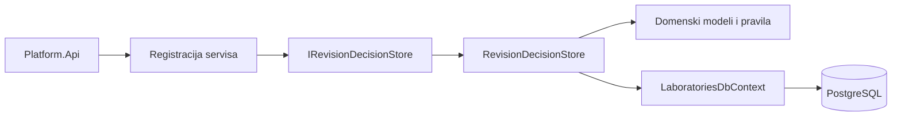
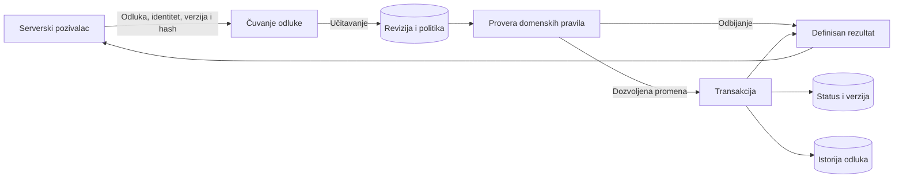

# REV-05 — dvostepeno odobravanje objave: domen i baza

| Stavka       | Vrednost                                                                                       |
| ------------ | ---------------------------------------------------------------------------------------------- |
| Student      | Matija Brkusanin                                                                               |
| Broj indeksa | PR101/2023                                                                                     |
| Tim          | Tim 4                                                                                          |
| Zahtev       | REV-05 — dvostepeno odobrenje objave                                                           |
| Zaduženje    | Domenski modeli, pravila i baza podataka                                                       |
| Status       | Domen i baza implementirani i lokalno testirani; povezivanje sa ostalim komponentama predstoji |
| Projekti     | `Platform.Laboratories.Domain`, `Platform.Laboratories.Infrastructure`                         |
| Grana        | `feature/REV-05-domain-persistence`                                                            |

## Moje zaduženje

Moj deo obuhvata statuse revizije i dozvoljene prelaze, politiku objavljivanja za kurs, proveru samoodobravanja, hash sadržaja, kontrolu konkurentnih izmena i istoriju odluka. Za ove modele pripremljena su EF Core mapiranja, migracije i testovi.

Osnovno pravilo REV-05 je da autor ne može da odobri sopstvenu reviziju kada politika kursa zahteva nezavisno odobrenje.

Numerisanje i sadržaj snapshot-a pripadaju REV-01, a validacija tipa laboratorije i evaluator-a pripada REV-02. Frontend, endpoint-i i utvrđivanje korisničkih ovlašćenja nisu deo ovog zaduženja. U API je dodata samo registracija persistence servisa.

## Ugovor za druge module

Za čuvanje odluke koristi se `IRevisionDecisionStore`:

```csharp
Task<DecisionSaveResult> SaveDecisionAsync(
    RevisionDecisionRequest request,
    CancellationToken cancellationToken = default);
```

Zahtev sadrži ID revizije, ID pregledaoca, očekivanu verziju, hash pregledanog sadržaja i odluku. Uspešan rezultat vraća ID zapisa istorije, novi status i novu verziju. Neuspešan rezultat sadrži razlog odbijanja, na primer `SelfApprovalForbidden`, `ConcurrencyConflict` ili `ContentChanged`.

Pozivalac mora prethodno proveriti ovlašćenja i obezbediti identitet pregledaoca iz pouzdanog serverskog izvora. Prosleđivanje tuđeg ID-ja iz klijentskog zahteva nije dokaz identiteta. Pre objavljivanja mora biti izvršena i validacija iz REV-02.

## Implementacija

Kod je podeljen na domen i infrastrukturu:

- `Platform.Laboratories.Domain` sadrži poslovne modele i pravila, bez zavisnosti od EF Core-a, HTTP-a ili baze.
- `Platform.Laboratories.Infrastructure` sadrži PostgreSQL mapiranja, kontekst, migracije i čuvanje odluka.

Najvažnije klase:

| Klasa                    | Odgovornost                                                          |
| ------------------------ | -------------------------------------------------------------------- |
| `LabRevision`            | Čuva metapodatke revizije i kontroliše promene statusa i verzije.    |
| `LabRevisionTransitions` | Proverava dozvoljene parove početnog i ciljnog stanja.               |
| `CoursePublishPolicy`    | Čuva pravilo nezavisnog odobravanja za konkretan kurs.               |
| `RevisionContentHash`    | Računa SHA-256 nad bajtovima snapshot-a i proverava format hash-a.   |
| `RevisionConcurrency`    | Poredi očekivanu i trenutnu verziju.                                 |
| `RevisionDecisionRecord` | Čuva pregledaoca, odluku, vreme, hash i primenjeno pravilo politike. |
| `LaboratoriesDbContext`  | Povezuje modele sa PostgreSQL tabelama.                              |
| `RevisionDecisionStore`  | U jednoj transakciji čuva promenu revizije i istoriju odluke.        |

### Stanja i dozvoljeni prelazi

Prelazi prate dijagram 4.5.1 iz specifikacije:

| Početno stanje | Akcija             | Novo stanje |
| -------------- | ------------------ | ----------- |
| `Draft`        | Predaja na pregled | `InReview`  |
| `InReview`     | Vraćanje na doradu | `Draft`     |
| `InReview`     | Odobravanje        | `Published` |
| `Published`    | Povlačenje         | `Archived`  |

Nova revizija počinje u stanju `Draft`, sa `RowVersion = 1`. Status nema javni setter. Odbijena operacija ne menja stanje ni verziju.

### Čuvanje odluke

`RevisionDecisionStore` izvršava sledeći tok:

1. Proverava ulazne podatke i učitava reviziju.
2. Učitava politiku njenog kursa i zaključava taj red za čitanje do kraja transakcije.
3. Proverava verziju, hash, dozvoljeni prelaz i samoodobravanje.
4. Priprema novi status, uvećava verziju i kreira zapis istorije sa serverskim vremenom.
5. Zajedno čuva promenu i istoriju, pa potvrđuje transakciju.

`RowVersion` je aplikacioni `long`, mapiran kao EF concurrency token. Ako dva zahteva koriste istu verziju, samo jedan može da sačuva izmenu. Drugi dobija `ConcurrencyConflict`. Ako upis istorije ne uspe, poništava se i promena statusa.

Očekivani domenski neuspeh vraća definisan rezultat, bez `return null` i bacanja domenskih izuzetaka. Konflikt koji EF prijavi pri upisu prevodi se u rezultat odbijanja.

## Baza i migracije

Tabele su u PostgreSQL šemi `laboratories`:

- `CoursePublishPolicies` — jedna politika po kursu; `CourseId` je primarni ključ.
- `LabRevisions` — ID, kurs, autor, status, hash i verzija revizije.
- `RevisionDecisions` — istorija odluka, sa indeksom nad revizijom i vremenom.

Migracije se nalaze u `Platform.Laboratories.Infrastructure/Persistence/Migrations`:

- `CreateReviewTables` pravi politiku kursa i istoriju odluka.
- `AddRevisionState` dodaje metapodatke revizije sa verzijom i ograničenjima.

Obe migracije su primenjene na lokalnu razvojnu bazu. Provereni su i instalacija na praznoj test bazi i nadogradnja prve migracije uz očuvanje podataka. `Down` metode uklanjaju odgovarajuće tabele i njihove podatke.

`LabRevision` trenutno sadrži samo metapodatke potrebne ovom delu. Sadržaj i numerisanje revizije treba povezati sa modelom REV-01. Strani ključevi prema drugim modulima nisu dodati; tipove identifikatora i provere postojanja treba usaglasiti pri povezivanju. Trenutno su identifikatori `Guid`.

## Dijagram arhitekture



Registracija je u `Platform.Laboratories.Infrastructure/Composition`, a `Program.cs` poziva `AddLaboratoriesPersistence()`. Domenski projekat ne referencira API ili infrastrukturu.

## Dijagram toka podataka



Dijagram prikazuje implementirani domenski i persistence deo. Autentikacija, provera prava i HTTP zahtev pripadaju komponentama koje pozivaju ovaj ugovor.

## Bezbednosne provere i ograničenja

- Autor se poredi sa sačuvanim `AuthorId`, a pravilo se čita iz politike odgovarajućeg kursa. Nedostajuća politika odbija odluku.
- Promenjen hash ili zastarela verzija ne dozvoljavaju upis odluke.
- SHA-256 se računa nad tačnim bajtovima. Format i kompletan sadržaj snapshot-a treba usaglasiti sa REV-01/02; ova komponenta ne normalizuje JSON.
- Istorija čuva vrednost politike koja je važila pri odluci. Naknadna promena politike ne prepisuje taj zapis.
- Store dodaje nove zapise istorije; zasebna zabrana direktnog SQL menjanja ili brisanja istorije nije uvedena.
- Lozinka razvojne baze je u lokalnom, ignorisanom `.env` fajlu. API connection string je u user-secrets ili promenljivoj okruženja.
- Povezivanje sa serverskom autorizacijom i auditom objavljivanja ostaje odvojen korak. Testovi ovog dela ne potvrđuju ceo HTTP tok objavljivanja.

## Demonstracija i testovi

Iz korena repozitorijuma:

```powershell
dotnet tool restore
dotnet build backend/Platform.Api/Platform.Api.csproj --configuration Release
dotnet test backend/Platform.Laboratories.Tests/Platform.Laboratories.Tests.csproj --configuration Release
dotnet test backend/Platform.Laboratories.IntegrationTests/Platform.Laboratories.IntegrationTests.csproj --configuration Release
```

Za integracione testove mora biti pokrenut Docker sa Linux kontejnerima. Testcontainers sam pravi poseban PostgreSQL kontejner na slobodnom portu i uklanja ga nakon testiranja. Razvojna baza i drugi projekti se ne koriste za ove testove.

Poslednja lokalna provera: **61 jedinični/modelski i 20 integracionih testova prolazi**, a API build nema upozorenja ni greške.

Za prikaz ključnih scenarija mogu se pokrenuti:

- `Approval_AppliesCoursePolicyAndSavesHistoryAtomically` — zabrana samoodobravanja i primena politike.
- `ConcurrentDecisions_OnlyOneCommitsStateAndHistory` — dva zahteva nad istom verzijom.
- `FailedHistoryInsert_RollsBackRevisionChange` — poništavanje promene kada istorija ne može da se sačuva.
- `UpgradeFromFirstMigration_PreservesPolicyAndDecisionHistory` — očuvanje podataka pri nadogradnji.

Razvojna baza se pokreće komandom `docker compose up -d --wait db`. Na novom računaru prvo treba napraviti lokalni `.env` prema `.env.example`, podesiti sopstvenu lozinku i connection string. Docker Compose čita `.env`, a API koristi `ConnectionStrings:Laboratories` kroz user-secrets u Development okruženju ili `ConnectionStrings__Laboratories` iz okruženja.

Kada je promenljiva `ConnectionStrings__Laboratories` lokalno podešena, migracije se primenjuju komandom:

```powershell
dotnet ef database update --project backend/Platform.Laboratories.Infrastructure --startup-project backend/Platform.Laboratories.Infrastructure --context LaboratoriesDbContext
```

U zasebnom `.github/workflows/rev05.yml` definisane su REV-05 domenske, PostgreSQL integracione i migracione provere. Zajednički backend i frontend CI zadržan je iz main grane.

## Povezivanje sa zajedničkim solution-om

REV-05 projekti su u solution folderu `Publication`. Reference iz API-ja su u posebnoj `Laboratories` grupi u `Platform.Api.csproj`. Namespace za registraciju je izdvojen u `GlobalUsings.Laboratories.cs`, a `AddLaboratoriesPersistence` se poziva nakon registracije `TimeProvider` servisa u `Program.cs`.

Pri usklađivanju sa `main` granom 04.11.2026. sačuvani su svi integrisani moduli. Prošli su build svih 22 projekta, svih 497 testova solution-a, frontend build, provera migracionog snapshot-a i 41 KT1 HTTP demo provera. REV-05 i dalje ima 61 domenski/model test i 20 PostgreSQL integracionih testova.

Otvoreni PR-ovi drugih modula provereni su radi preklapanja u zajedničkim fajlovima; njihov neintegrisani kod nije preuzet. Odvojene reference smanjuju preklapanje, ali nove izmene istih fajlova mogu ponovo zahtevati usklađivanje pre merge-a.


## Odvojene CI provere

REV-05 workflow je u zasebnom fajlu `.github/workflows/rev05.yml`. Zajednički `ci.yml` zadržava backend i frontend provere iz main-a, uključujući UI testove. Oba workflow-a se pokreću za pull request i push na main. Time se uklanja preklapanje pri dodavanju koraka u zajednički CI fajl, bez preskakanja provera.
