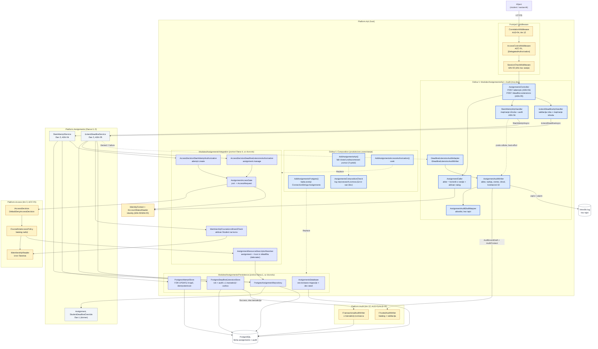
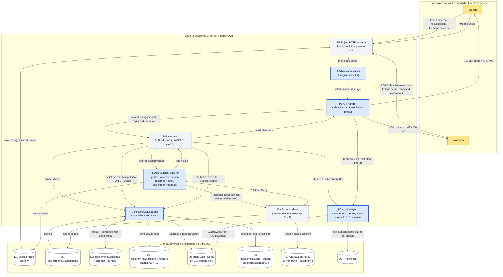

# Projektna celina: ASN-04 / ASN-06, celina 5 — Audit i API

**Tim:** 15

**Student:** Bubulj Milan / PR 136/2021

**Zahtevi iz specifikacije:** ASN-04 (limit pokušaja), ASN-06 (individualno produženje roka). Oslanja se na
AUD-01 (zapis ima akter, događaj, vreme i ishod), AUD-03 (bez tajni), AUD-04 (korelacioni ID), ACC-05
(podrazumevano odbijanje) i IDN-02 (identitet iz sesije).

## Odgovornosti i granice

| Član | Celina | Šta je njegovo |
|-|-|-|
| 1 | Baza i domen | `Assignment`, `StudentDeadlineOverride`, PostgreSQL za `IAssignmentRepository`, `IAttemptStore`, `IDeadlineExtensionStore`, migracije, seed |
| 2 | ASN-04 | `StartAttemptService` |
| 3 | ASN-06 | `ExtendDeadlineService` |
| 4 | Autorizacija | adapteri `IStartAttemptAuthorization`, `IDeadlineExtensionAuthorization`, `ICourseEnrollmentCheck` nad `IAccessDecision` |
| **5** | **Audit i API (ovaj dokument)** | audit adapter (akter, radnja, vreme, ishod, korelacioni ID, bez tajni) i kontroleri koji izlažu use-case-ove |

**Moj deo radi:**

- `AssignmentsController` sa dve rute, akter isključivo iz proverene sesije (`AssignmentCaller`).
- `StartAttemptApiHandler` i `ExtendDeadlineApiHandler`: validacija HTTP ulaza i mapiranje ishoda use-case-a u
  bezbedne HTTP odgovore (stabilan `code`, bez poruka izuzetaka).
- `IAssignmentAuditWriter` / `AssignmentAuditWriter`: dodaje aktera, vreme i korelacioni ID iz pouzdanog
  konteksta, čisti nacrt po allowlisti i upisuje kroz `ITrustedAuditWriter` Audit modula (tim 12).
- `DeadlineExtensionAuditAdapter`: implementacija porta `IDeadlineExtensionAuditWriter` koji je definisao član 3.
- `AddAssignmentsApi()`: DI; portovi članova 1 i 4 dobijaju **fail-closed** podrazumevane implementacije
  (`TryAdd`), pa host radi i pre njihovih adaptera, a sve se odbija.
- **Produkciono povezivanje portova** (odgovor na review PR-a, uz dozvolu članova 1 i 4):
  `AddAssignmentsAccessAuthorization()` (autorizacija preko `IAccessDecision`) i `AddAssignmentsPostgres()`
  (PostgreSQL skladišta), sa integracionim testovima stvarnih adaptera. Vidi odeljak „Produkciono povezivanje portova”.

**Moj deo NE radi** (da ne bi ulazio u tuđi posao): logiku limita i dostupnosti (član 2), pravila roka
(član 3), domenske entitete (član 1), pravila o pravima i članstvu (Access modul, tim 3), Audit katalog,
skladište i čitanje audita (AUD-01/AUD-06, tim 12). Audit i Access moduli se samo pozivaju preko javnih ugovora.
Adapteri u `Modules/Assignments/Integration` i `Modules/Assignments/Persistence` samo **prevode** portove
članova 1 i 4 na postojeće module (Access, PostgreSQL); ne uvode nova pravila. Napisani su uz dozvolu
članova 1 i 4 jer review traži stvarne adaptere; ako član 1 ili 4 isporuči svoje, zamena je jedna linija u
`Program.cs`.

## Endpointi

| Metoda i ruta | Zahtev | Odgovori |
|-|-|-|
| `POST /api/assignments/{assignmentId}/attempts` (ASN-04) | kolačić sesije, zaglavlje `Idempotency-Key: <guid>` | `201 {attemptId}`; `400 invalid_request_id`; `401`; `404 assignment_not_available` (i za nepostojeće i za zabranjeno, isto telo); `409 attempt_limit_reached`; `409 assignment_closed`; `503 temporarily_unavailable` |
| `POST /api/assignments/{assignmentId}/students/{studentId}/deadline-extensions` (ASN-06) | kolačić sesije, telo `{"newDueAtUtc":"2026-11-20T23:59:00Z"}` | `200 {assignmentId, studentId, dueAtUtc, previousDueAtUtc, extendedAtUtc}`; `400 invalid_deadline / invalid_student`; `401`; `403 forbidden` (i za nepostojeću dodelu); `409 deadline_extension_rejected`; `503` |

Svi odgovori imaju `Cache-Control: no-store` i `X-Correlation-ID` (iz `CorrelationMiddleware`).

## Arhitektura



Izvor: [diagrams/asn-audit-api-architecture.mmd](diagrams/asn-audit-api-architecture.mmd) (plavo = moj deo,
sivo = ostali članovi tima 15, narandžasto = drugi timovi).

## Dijagram toka podataka (DFD)



Izvor: [diagrams/asn-audit-api-dfd.mmd](diagrams/asn-audit-api-dfd.mmd). Granice poverenja: (1) klijent je
nepouzdan; (2) server određuje aktera, kurs i vreme; (3) skladišta su iza portova. Klijent nikad ne šalje
aktera, kurs, broj pokušaja ni trenutni rok. Eventualna polja `actorId`/`courseId` u telu se ignorišu
(pokriveno testom).

## Audit zapis

| Polje (AUD-01) | Izvor |
|-|-|
| akter | `IIdentityContext` (sesija koju je proverio `SessionCheckMiddleware`); bez sesije `Anonymous` |
| radnja | `assignment.attempt.start` ili `assignment.deadline.extend` (format `ActionId`) |
| vreme | `TimeProvider` (UTC), postavlja ga i Audit modul |
| ishod | `Success`, `Denied`, `Failure` |
| korelacioni ID | `ICorrelationContext` (AUD-04, tim 12) |
| ostalo | `assignmentId`, kurs (samo ako je GUID), student (samo ako prolazi `PrincipalId`), `reasonCode`, stari/novi rok, `attemptId` |

Nikad se ne upisuju: token, kolačić ili ID sesije, lozinke, telo zahteva, poruke izuzetaka, slobodan tekst.
Nevažeće vrednosti se izbacuju, ne prepisuju se u log ni u izuzetak.

**Audit nikad ne menja odluku.** Use-case prvo odluči (i eventualno sačuva pokušaj ili rok), iz ishoda se
napravi HTTP odgovor, a audit se piše tek posle, van `try` bloka use-case-a, kao best-effort korak koji ne
baca izuzetke. Ako audit padne: uspešan start ostaje `201` (ponovljen zahtev sa istim `Idempotency-Key`
vraća isti pokušaj), odbijanje ostaje `404`/`403`, nema drugog „Failure” zapisa za isti zahtev, a podiže se
tehnički alarm bez detalja izuzetka. Isto važi za ASN-06 (`DeadlineExtensionAuditAdapter` vraća `false`
umesto izuzetka). Izuzetak je samo `Success` za ASN-06, koji član 1 upisuje u istoj transakciji sa rokom.

**Ko upisuje šta:** ASN-04 svaki ishod upisuje `StartAttemptApiHandler` (servis člana 2 nema audit port).
ASN-06 `Denied` i `Failure` upisuje servis člana 3 kroz `DeadlineExtensionAuditAdapter`; `Success` upisuje
`IDeadlineExtensionStore.SaveAsync` (član 1) u istoj transakciji, za šta može da koristi
`AssignmentAuditDraftMapper.ToPlatformDraft(DeadlineExtensionAuditAdapter.ToDraft(entry))` i
`ITransactionalAuditWriter`.

### Zahtev timu 12 (otvoreno)

Audit katalog (verzija 1) nema tipove za dodele. Predlog:

| Tip | Ishodi | Kurs | Resurs | Detalji |
|-|-|-|-|-|
| `assignment.attempt.started` | Success, Denied, Failure | opciono | nema (akter je student) | `attemptId` (Success), `reasonCode` (Denied/Failure) |
| `assignment.deadline.extended` | Success, Denied, Failure | opciono dok se ne dogovori tip `CourseId` | `Account` (student) | `previousDueAt`, `newDueAt`, `reasonCode` |

Dok tipovi nisu dodati, Audit modul ih odbija sa `UnknownEventType`. Tada se **odbijanja** (`Denied`) upisuju
kao postojeći `access.denied` sa `action` i `denialReason = policy_denied`, a za `Success`/`Failure` se
podiže tehnički alarm. Test `ToPlatformDraft_MatchesCatalogSchema_WhenTeam12AddsTheType` automatski proverava
naše nacrte čim tim 12 doda tipove. Otvorena tačka iz `ASN-06-contracts.md`: `Assignment.CourseId` je string, a
`AuditEventDraft.CourseId` je `Guid`; kurs se šalje samo kada je string ispravan GUID.

## Bezbednosni zahtevi

- **Provera na serveru:** akter samo iz sesije + aktivan nalog; kurs iz same dodele; odluka u use-case-u kroz
  portove člana 4 pre čitanja ili izmene (`[DelegatedAuthorization]`, dodato u inventar
  `ApiEndpointCoverageTests` uz komentar za review tima 3).
- **Bez nabrajanja:** ASN-04 vraća isti `404` za nepostojeću i zabranjenu dodelu; ASN-06 isti `403`.
- **Validacija ulaza:** `Idempotency-Key` mora biti GUID; rok mora imati eksplicitnu zonu (`Z` ili `±hh:mm`), do
  40 znakova; student ID proverava servis (`PrincipalId`).
- **Fail-closed:** bez adaptera članova 1/4 start vraća 404, produženje 403; neuspeh audita ne menja odluku
  (testirano i kada writer baci izuzetak); tehnička greška use-case-a daje `503` bez detalja.
- **Negativni scenariji (testirani):** bez sesije, blokiran nalog, student van kursa, nastavnik drugog kursa,
  student koji šalje `actorId` nastavnika u telu, nepostojeća dodela, limit dostignut, istekao rok, ponovljen
  `Idempotency-Key`, rok bez zone/u prošlosti/raniji, nevažeći student ID, student nije upisan, pad skladišta,
  pad audita, prekinut zahtev, ubačene vrednosti nalik tajnama.

## Produkciono povezivanje portova

Review: „potvrditi produkciono povezivanje portova skladišta i autorizacije, uz integracione testove stvarnih
adaptera”. Stanje posle ove izmene:

| Port (vlasnik) | Produkcioni adapter | Kada je aktivan |
|-|-|-|
| `IStartAttemptAuthorization` (4) | `AccessDecisionStartAttemptAuthorization` → `IAccessDecision`, radnja `attempt.create` | uvek |
| `IDeadlineExtensionAuthorization` (4) | `AccessDecisionDeadlineExtensionAuthorization` → `IAccessDecision`, radnja `assignment.manage` | uvek |
| `ICourseEnrollmentCheck` (4) | `MembershipCourseEnrollmentCheck` → `IMembershipReader` (aktivan `Student`) | uvek |
| (Access) `IResourceDescriptorResolver` | `AssignmentResourceDescriptorResolver`: resurs `assignment` → kurs iz same dodele; ostale tipove prosleđuje prethodnom resolveru | uvek |
| `IAssignmentRepository` (1) | `PostgresAssignmentRepository` | `ConnectionStrings:Assignments` |
| `IAttemptStore` (1) | `PostgresAttemptStore`: brojač po (dodela, student) pod `SELECT ... FOR UPDATE`, idempotentnost po `Idempotency-Key`, jedinstveni ključevi u bazi | `ConnectionStrings:Assignments` |
| `IDeadlineExtensionStore` (1) | `PostgresDeadlineExtensionStore`: optimistička provera prethodnog roka, nova verzija roka (istorija, ASN-19), Success audit u **istoj transakciji** kroz `ITransactionalAuditWriter`; ako ga Audit modul ne primi (tip još nije u katalogu), zapis ide u `assignments.audit_outbox`, takođe u istoj transakciji (Audit odluka D3) | `ConnectionStrings:Assignments` |

**Autorizacija** je povezana bez ikakve konfiguracije: odluku donosi centralni `DefaultDenyAccessDecision`
(katalog radnji, `CourseRoleAccessPolicy`, podrazumevano odbijanje). Izvor članstva je `IMembershipReader`
tima 3; dok on u produkciji ne postoji, Access koristi `EmptyMembershipReader` i **sve se odbija**. To nije
naše ograničenje nego stanje platforme (isto važi za AUD-06 čitanje audita); čim tim 3 registruje pravi
izvor, ASN-04/ASN-06 rade bez izmene našeg koda.

**Skladišta**: šema `assignments` (verzionisane SQL migracije u `AssignmentsDatabase`). Web host ne migrira
produkciju automatski (isti princip kao `MigrateAuditDatabaseAsync`); deploy korak je
`AssignmentsDatabase.MigrateAsync(connectionString)`, a u Development-u to radi `Program.cs` i dodaje jednu demo
dodelu (`a5500000-0000-4000-8000-000000000015`, demo kurs `aaaaaaaa-…`). Za Success audit u istoj transakciji
`ConnectionStrings:Assignments` treba da pokazuje na bazu u kojoj je i audit šema; ako nije, zapis ostaje u outbox-u.

Lokalno: u `.env` dodati
`ConnectionStrings__Assignments=Host=127.0.0.1;Port=5432;Database=${POSTGRES_DB};Username=${POSTGRES_USER};Password=${POSTGRES_PASSWORD}`
(ista baza kao Identity, gde Development već primenjuje i audit šemu), pa pokrenuti API.

**Bez konfiguracije baze** skladišta ostaju fail-closed (ASN-04 `404`, ASN-06 `403`, ništa se ne čita ni
menja), a `AssignmentsCompositionCheck` pri startu loguje `IAssignmentRepository, IAttemptStore,
IDeadlineExtensionStore` (Error van Development-a). Fail-closed je dakle samo rezervni režim pogrešne
konfiguracije, ne isporučeni scope.

Otvoreno (nije deo ove celine): relay koji isporučuje redove iz `assignments.audit_outbox` u Audit modul čim
tim 12 doda `assignment.*` tipove u katalog; `Assignment.CourseId` (string) i Access/Audit kurs (Guid) — kurs koji
nije GUID se odbija (fail-closed).

## Dokaz rada

- **Fajlovi:** `backend/Platform.Api/Modules/Assignments/**` (novo, uključujući `AssignmentsCompositionCheck`,
  `Composition/AssignmentsProductionPortsExtensions.cs`, `Integration/**`, `Persistence/**`), `backend/Platform.Api/Program.cs`
  (povezivanje portova i Development migracija),
  `backend/Platform.Tests/AssignmentsIntegration/**` (integracioni testovi stvarnih adaptera),
  `backend/Platform.Tests/Platform.Tests.csproj` (+`Testcontainers.PostgreSql`), `.github/workflows/ci.yml` (provera da su
  PostgreSQL testovi zaista prošli), `backend/Platform.Api/Platform.Api.csproj` (+referenca na `Platform.Assignments`),
  `backend/Platform.Access.Tests/ApiEndpointCoverageTests.cs` (+2 rute u inventar),
  `backend/Platform.Tests/AssignmentsAuditApi/**` (testovi), `docs/components/assignments-audit-api/**`.
- **Pokretanje testova:**
  ```
  dotnet build backend/SecurityLab.slnx --configuration Release
  dotnet test backend/SecurityLab.slnx --configuration Release --no-build
  ```
  Samo moji testovi: `dotnet test backend/Platform.Tests/Platform.Tests.csproj --configuration Release --no-build --filter "FullyQualifiedName~AssignmentsAuditApi"`
- **Testovi (NUnit):** `AssignmentAuditDraftMapperTests` 20, `AssignmentAuditWriterTests` 10,
  `DeadlineExtensionAuditAdapterTests` 8, `StartAttemptApiHandlerTests` 17, `ExtendDeadlineApiHandlerTests` 21,
  `AssignmentsHttpTests` 18 (ceo HTTP pipeline preko `WebApplicationFactory<Program>`, portovi su dvojnici).
  **Integracioni testovi stvarnih adaptera** (`Platform.Tests/AssignmentsIntegration`):
  - `AccessAuthorizationAdapterTests` — pravi Access modul (`AddAccessControl`): student/nastavnik/asistent/
    drugi kurs/blokiran/bivši član/nepoznat nalog, kurs iz skladišta a ne od pozivaoca, ne-GUID kurs, pad
    skladišta i članstva, produkciono prazno članstvo (sve odbijeno), dekorisanje resolvera. Ne treba baza.
  - `PostgresAssignmentStoresTests` — prava PostgreSQL baza: migracije, CHECK ograničenja, repozitorijum,
    limit pod 25 istovremenih zahteva, idempotentnost (i pod konkurencijom), rok: istorija, zastareo prethodni
    rok, dva istovremena produženja, audit u transakciji / outbox / pad audita, bez tajni u outbox-u.
  - `AssignmentsProductionCompositionHttpTests` — `Program` sa produkcionom kompozicijom (Access + PostgreSQL +
    `PostgresTransactionalAuditWriter`): svi portovi su pravi adapteri, 201/409/idempotentnost i limit pod
    konkurencijom kroz HTTP, isti 404, 403 za studenta/drugi kurs/autsajdera bez upisa, 409 za neupisanog,
    drugi rok mora biti posle sačuvanog.
  PostgreSQL testovi koriste `AUDIT_TEST_ADMIN_CONNECTION_STRING` (CI, `scripts/audit/test-postgres.ps1`) ili
  Docker (Testcontainers); svaki fixture pravi i briše svoju bazu. Bez oba su `Ignored` lokalno, a CI korak
  „Verify ASN-04/ASN-06 PostgreSQL adapter tests ran and passed” pada ako nisu prošli.
- **Demonstracija (KT1):** pokrenuti `AssignmentsHttpTests` i pokazati: 401 bez sesije, 201 i audit sa akterom i
  istim `X-Correlation-ID`, 409 iznad limita, isti 404 za tuđu i nepostojeću dodelu, 403 za studenta na ASN-06
  iako u telu šalje `actorId` nastavnika.
- **Sledeći koraci i zavisnosti:** tim 12 dodaje `assignment.*` u katalog (tada Success ide direktno u
  `audit.audit_events`, test se sam prilagođava) i relay za outbox; tim 3 registruje pravi `IMembershipReader`; član 2 po želji dodaje
  namenski izuzetak za limit (sada se prepoznaje po poruci, test `LimitMessage_MatchesStartAttemptService` čuva
  ugovor) i individualni rok u `StartAttemptService`; frontend poziva dve rute.
