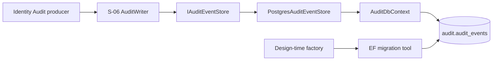
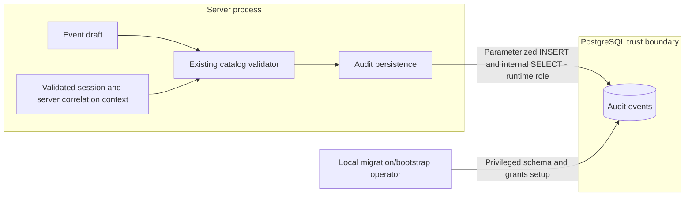

# Audit persistence (AUD-01, S-05)

## Current state

`AuditEventRow` maps the existing domain record to PostgreSQL without adding EF Core
dependencies to the domain. `AuditDbContext` owns `audit.audit_events`. Details use
`jsonb`; enum values are stored by name. Historical account/course identifiers have no
cascading foreign keys to other modules.

The primary key is the event ID, not the correlation ID. Indexes support course/time/ID
ordering and correlation lookups. Database constraints check actor consistency, outcome,
schema version, JSON object details and paired resource fields. The existing application
validator remains responsible for event catalog and detail allowlists.

The initial migration and model snapshot are committed with the source. Migration history
is kept in `audit.__EFMigrationsHistory`, separate from other modules' migrations.

`PostgresAuditEventStore` implements the internal `IAuditEventStore` used by S-06.
It rechecks the existing catalog validator, uses parameterized SQL and never overwrites
an event. Repeating an ID with the same content returns `AlreadyPresent`; a changed
payload returns `Conflict`. Server-assigned time is excluded from retry comparison,
matching the existing domain rule. `ON CONFLICT DO NOTHING` avoids aborting an enclosing
transaction on a duplicate key.

Without an explicit transaction, an append is committed by PostgreSQL before it returns.
Inside an existing `AuditDbContext` transaction, it participates in that transaction;
the caller must commit before reporting business success. It does not call `SaveChanges`
or commit other pending EF changes. `AuditWriter` translates expected storage failures to
the public fail-closed result without returning database messages or event details.

`AddAudit(IConfiguration)` now registers `AuditDbContext`, `PostgresAuditEventStore`,
`AuditWriter`, `IAuditWriter`, `ITrustedAuditWriter` and `ITransactionalAuditWriter`.
The regular writer uses `ConnectionStrings:Audit`; the transactional writer instead
enlists in the caller-owned PostgreSQL transaction and therefore requires the `audit`
schema in that transaction's database. The API replaces the composition
fallback context provider with `ServerAuditContextProvider`: actor identity comes only
from the session validated by `SessionCheckMiddleware`, and correlation comes only from
`CorrelationMiddleware`. Identity login, logout and account-status producers use the
trusted writer boundary because those flows establish their actor at different points.
`FindAsync` remains an internal storage operation, not an authorized AUD-06 endpoint.

The S-06 writer/store contract is therefore integrated. PR #148 completed the IDN-03
transaction boundary: `ChangeAccountStatus` updates the persistent `identity.accounts` row,
revokes sessions and appends `account.status.changed` through `ITransactionalAuditWriter` in
one PostgreSQL transaction. `AccountStatusChangeIntegrationTests` forces an unavailable Audit
writer and verifies through fresh service scopes that the account status and session remain
unchanged and that no Audit row was committed.

## Architecture and data flow





These diagrams cover persistence, not the complete AUD-06 flow. The API must not build
the trusted actor context from client input. The runtime database role is not a substitute
for course authorization. IDN-03 now demonstrates the shared producer/Audit transaction;
other privileged producers must still provide their own transaction or accepted outbox proof.

## Migration tools

Run from the repository root:

```powershell
dotnet tool restore
```

The root `dotnet-tools.json` pins `dotnet-ef` to 10.0.14 for the shared solution. Audit keeps its EF Core 10.0.4 packages. The PostgreSQL provider is 10.0.3; provider patch numbers need not match EF's.

`AuditDbContextFactory` reads `AUDIT_MIGRATION_CONNECTION_STRING`. It does not read `.env`
or API user-secrets and never enables sensitive-data logging. Actual database updates
require a separately supplied privileged migration connection; do not commit credentials.
The runtime account must not run migrations.

## Local Docker schema installation

The existing Compose service reads `POSTGRES_USER`, `POSTGRES_DB` and `POSTGRES_PASSWORD`
from the ignored local `.env`. Do not overwrite an existing file. Its initial account is a
bootstrap account, not the future restricted application account.

```powershell
docker compose --env-file .env up -d db
docker compose --env-file .env ps
```

For SQL generation only, no database login or password is needed:

```powershell
$env:AUDIT_MIGRATION_CONNECTION_STRING = 'Host=localhost;Database=securitylab'
New-Item -ItemType Directory -Force TestResults | Out-Null
dotnet ef migrations script --idempotent --project backend/Platform.Audit/Platform.Audit.csproj --startup-project backend/Platform.Audit/Platform.Audit.csproj --context AuditDbContext --output TestResults/audit-initial-migration.sql
```

Stop if SQL generation fails. Review the generated SQL before applying it. After adding
a migration, build again before using `--no-build`, otherwise the compiled assembly does
not contain the new migration.

For the local Docker development database, apply the reviewed script through the
container's bootstrap account, without copying its password into command arguments:

```powershell
Get-Content -Raw TestResults/audit-initial-migration.sql | docker compose --env-file .env exec -T db sh -c 'psql -v ON_ERROR_STOP=1 -U "$POSTGRES_USER" -d "$POSTGRES_DB"'
```

This uses the container's local PostgreSQL connection. It does not verify password
authentication over TCP. It is a development bootstrap procedure, not runtime access.
The idempotent script can be reapplied; an already recorded migration is skipped.
No API startup migration or database deletion is performed.

## Verification performed on 2026-11-04

- Initial mapping/model tests: 98 passed, 0 failed, 0 skipped, including 3 new tests.
- Generated and reviewed `InitialAudit` SQL.
- Applied migration `20261104182110_InitialAudit` to the local `securitylab` database
  (PostgreSQL 17.11) and confirmed the table, constraints, indexes and migration history.
- Reapplied the idempotent script successfully. This local installation check did not
  insert audit events; the separate integration test below checks populated data.
- Added 7 PostgreSQL tests: all catalog examples round-trip through separate connections,
  identical retries, conflicting retries, concurrent identical retries, audit insert rollback,
  reapplying migrations with an existing event, and rejection of secret-like detail keys.
- Ran the full Audit project with PostgreSQL configured: **105 passed, 0 failed, 0 skipped**.
  These tests ran as the bootstrap account in a uniquely named temporary database, which
  was removed afterward. They do not prove runtime privileges or business-rights rollback.

The migration is owned by the local bootstrap role, separate from the runtime role.
The shared business transaction guarantee is still pending; no claim of a complete
AUD-01 integration is made.

## Restricted local runtime role

After applying the migration, run from the repository root using PowerShell:

```powershell
./scripts/audit/bootstrap-runtime.ps1
```

The script reuses `AUDIT_RUNTIME_PASSWORD` in the ignored `.env`, or generates a random
password when the setting is absent or still a `CHANGE_ME_` placeholder. It passes the
password through the container environment to psql; it does not print it or put it in
command-line arguments. The generated value is saved only after successful bootstrap.
This is a local development helper; it does not configure production secrets or the API.

`bootstrap-runtime.sql` configures `securitylab_audit_runtime` with LOGIN, no privileged
role attributes, no inherited roles, CONNECT to the current database, USAGE on `audit`
and SELECT/INSERT on `audit.audit_events`. It refuses unexpected privileged attributes,
memberships or Audit ownership in an existing role instead of silently accepting them.
Audit schema/table grants from PUBLIC are removed. The role has no access to Audit
migration history. Rerun bootstrap after relevant schema changes; grants are not
automatically extended to arbitrary future Audit tables.

This protects against changes by the runtime account. The bootstrap/database administrator
can still modify data, and a compromised runtime account can insert false events or read
Audit rows. Course authorization and trusted identity checks remain application concerns.
No database-wide PUBLIC privileges belonging to other modules are changed.

`AuditRuntimePermissionsTests` uses `AUDIT_TEST_RUNTIME_CONNECTION_STRING` to log in over
TCP with this actual role. It checks role attributes/memberships/ownership, reads a
synthetic event through a new context, and verifies SQLSTATE 42501 for UPDATE, DELETE,
TRUNCATE, ALTER TABLE, CREATE TABLE in the Audit schema and reading migration history.
Forbidden statements are tested inside transactions that roll back even if permissions
regress. The fixture leaves one synthetic audit event per run, since runtime deletion
is intentionally forbidden. Do not point it at production or a database with real data.

With both test connection variables configured on 2026-11-04, the Audit project ran
**113 tests: 113 passed, 0 failed, 0 skipped**. Eight of these test cases verify the actual
bootstrapped runtime role. Without the runtime variable, those eight are explicitly skipped.

## API runtime configuration

The API resolves the restricted Audit connection from `ConnectionStrings:Audit`.
For local PowerShell sessions, set it through `ConnectionStrings__Audit`; for deployed
environments, use the platform's secret store. Never commit the password or place it in
command-line arguments. The value must identify the restricted
`securitylab_audit_runtime` role created by `scripts/audit/bootstrap-runtime.ps1`, not the
bootstrap or migration account. Runtime startup never applies Audit migrations.

If the setting is absent, invalid, or the Audit database is unavailable, durable Audit
writes fail closed. In particular, a credential check does not produce a usable login:
the API revokes the newly created server-side session and returns 503 without exposing a
token. This is an operational dependency of the shared Identity flow, so the Audit schema,
runtime grants, and secret must be prepared before enabling that flow.

Example shape (replace the placeholders through a secret prompt or deployment secret):

```powershell
$env:ConnectionStrings__Audit = 'Host=127.0.0.1;Port=5432;Database=securitylab;Username=securitylab_audit_runtime;Password=<secret>'
dotnet run --project backend/Platform.Api/Platform.Api.csproj
Remove-Item Env:ConnectionStrings__Audit
```

Do not use `AUDIT_MIGRATION_CONNECTION_STRING` as the API connection. That variable is
reserved for the privileged design-time migration tool. The two PostgreSQL test variables
documented below are likewise test-only.

## Running PostgreSQL tests

`PostgresAuditEventStoreTests` uses `AUDIT_TEST_ADMIN_CONNECTION_STRING` to connect to a
development PostgreSQL server. This account needs permission to create/drop databases.
The fixture creates only its own `audit_test_<random GUID>` database, applies migrations,
then drops that database. It does not clear the configured development database.

For a local run, enter the bootstrap credentials through the PowerShell credential prompt:

```powershell
$auditCredential = Get-Credential -UserName securitylab_bootstrap -Message 'Local PostgreSQL bootstrap credentials'
$auditConnection = [System.Data.Common.DbConnectionStringBuilder]::new()
$auditConnection['Host'] = '127.0.0.1'
$auditConnection['Port'] = '5432'
$auditConnection['Database'] = 'securitylab'
$auditConnection['Username'] = $auditCredential.UserName
$auditConnection['Password'] = $auditCredential.GetNetworkCredential().Password
$env:AUDIT_TEST_ADMIN_CONNECTION_STRING = $auditConnection.ConnectionString
try {
    dotnet test backend/Platform.Audit.Tests/Platform.Audit.Tests.csproj --configuration Release --logger trx --results-directory TestResults/audit-postgres
} finally {
    Remove-Item Env:AUDIT_TEST_ADMIN_CONNECTION_STRING
    $auditConnection.Clear()
    $auditCredential = $null
}
```

Do not print the connection string. Without this environment variable, the 7 database
tests are explicitly skipped. With it set, a failed database connection or migration fails
the tests. The S-09 [test runner](S09-TESTING.md) configures both database connections
in shared CI and checks that the PostgreSQL fixtures actually ran.

To include runtime permission tests, before the same test command set
`AUDIT_TEST_RUNTIME_CONNECTION_STRING` using the same connection-string builder pattern,
with username `securitylab_audit_runtime` and its separate local password. Remove both
test environment variables afterward. Keep bootstrap credentials only in the admin test
variable; do not use them to claim a runtime permission result.
