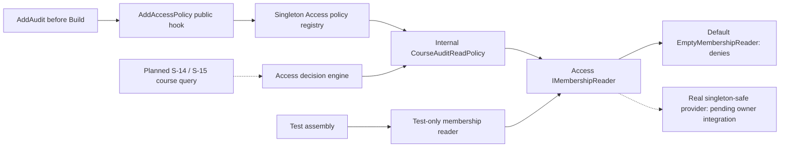
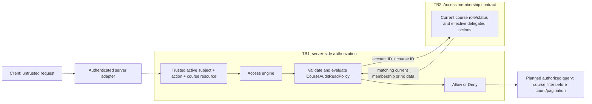

# S-08: course audit read policy

**Team:** 12, Audit component

**Student:** Bojan Kostic (`Bojan763`), member 5

**Story:** S-08

**Requirements:** AUD-06; related ACC-05, ACC-07, SEC-01 and OPS-09

**Status:** S-08 policy and registration adapted to the published Team 3 contract in
[PR #109](https://github.com/owlCoder/security-lab/pull/109), head `bfb4b77`. That dependency
was a draft PR during validation on 2026-11-06. Accept that dependency into main before applying these integration changes to S-08
[PR #57](https://github.com/owlCoder/security-lab/pull/57). Local validation combines the
current main, the previous S-08 contribution and this dependency. It does not merge PR #109
into the user's S-08 changes or declare the dependency accepted. The course query/endpoint
and S-15 remain separate work; the complete AUD-06 flow is not declared finished here.

## Responsibilities and boundaries

`CourseAuditReadPolicy` implements the existing `Platform.Access.Contracts.IAccessPolicy`
for central action `AccessActions.AuditEventsRead.Id` (`audit.events.read`). Its policy ID
is `audit.course.read`, version `v1`. The resource type is exactly lowercase `course`, and
the resource ID is a nonempty GUID in canonical `D` format, for example
`new ResourceRef("course", courseId.ToString("D"))`. The policy answers whether a trusted,
server-resolved subject may read one course's audit events.

The policy is internal to `Platform.Audit.Application.Authorization`. It uses the published
Access contract instead of the former provisional Audit membership/delegation types:

- `IMembershipReader.GetAsync(accountId, courseId, cancellationToken)` returns the current
  `CourseMembership` for exactly one account and course, or `null` if none is available.
- `CourseMembership` carries `AccountId`, `CourseId`, `CourseRole`, `MembershipStatus` and
  the set of effective `DelegatedActions`. Returned identifiers must match the request.
- A delegation's validity, expiry and revocation are evaluated by the real membership
  provider. The policy consumes only currently effective actions, as required by the
  PR #109 contract. It does not introduce a second delegation clock or expiry algorithm.

The provisional `ICourseAuditMembershipReader`, `CourseAuditMembership` and
`CourseAuditDelegation` contract is removed. The policy no longer depends on the Identity
account-lookup interface or `TimeProvider`. `Platform.Audit.csproj` references
`Platform.Access` for the shared authorization contract; Access has no reverse reference.

`AccessRequest.Subject` must come from the trusted authenticated server pipeline. Its
current account/session state cannot be taken from a caller-selected actor ID, role,
header or body. The policy checks the supplied subject is active, but it does not perform
HTTP authentication or an independent account lookup. Authentication/session integration
must supply current, validated subject state for every request.

The policy does not load audit records, expose an HTTP endpoint, write audit records or
read another module's tables. Course filtering, DTO field selection, count/pagination
isolation and `audit.events.viewed` remain query integration responsibilities.

## Decision rules

The policy requires the exact action `audit.events.read`, resource type `course`, a
nonempty `D`-format course GUID, and an active subject with a nonempty GUID identifier.
It reads membership on each evaluation and stores no caller state or permission cache.

| Current server-side state | Result |
|---|---|
| Active subject and active Teacher membership in the requested course | Allow |
| Active subject, active Assistant membership and exact effective action `audit.events.read` | Allow |
| Student or unknown course role, even with an action in the snapshot | Deny |
| Absent, Left, Suspended or otherwise invalid membership status | Deny |
| Teacher in K, Student or no membership in L, request for L | Deny |
| Global administrator without a qualifying course membership | No automatic permission |
| Missing, blocked, archived or malformed subject | Deny |
| Membership returned for another account or course | Deny |
| Unknown action, wrong resource type, missing or malformed course identifier | Deny |
| Membership provider error, unavailable data or malformed provider data | Deny |

The effective action comparison is exact and case-sensitive. An unrelated or differently
cased action does not authorize an Assistant. A Teacher still needs an active membership
in this specific course; a global role does not widen the course scope.

Every subsequent decision reads the provider again. If a membership is removed/suspended
or the provider removes a revoked/expired effective action, the next evaluation denies.
Tests can simulate those provider changes; they do not prove that a real adapter correctly
filters expiry/revocation. That remains an integration obligation of its owner.

A caller-requested cancellation propagates as `OperationCanceledException` when the policy
is called directly. PR #109's Access decision engine catches evaluation failures, including
cancellation, and returns a denial. Neither path grants access. Other provider failures
return `false` from the policy without exposing rejected payloads or exception text.

## Component architecture

Solid connections are implemented for the PR #109 integration. Dashed connections remain
planned query/adapter integration.



The tests exercise both the policy and its public composition through the real Access
catalog, registry and decision engine. Registration uses `AddAccessPolicy`, not concrete
registry mutation. A configured test reader proves the policy against its synthetic data;
the default host's empty reader gives no user a course membership.

## Data flow and trust boundaries



TB1 cannot be crossed by trusting caller-supplied identity or role claims. TB2 is a logical
module boundary in the same process, not protection against fully compromised server
code. No audit database read is introduced by this contribution.

## Registration and DI

`AddAudit()` registers the policy before the host is built:

```csharp
services.AddAccessPolicy<CourseAuditReadPolicy>(AccessActions.AuditEventsRead.Id);
```

The action is already defined in the central PR #109 Access catalog, so Audit does not
register a duplicate action. Existing Audit correlation registrations are preserved.
The existing host already calls `AddAccessControl()` and `AddAudit()`; this contribution
requires no edits to `Platform.Api/Program.cs`, `Platform.Access`, CI or `SecurityLab.slnx`.
No new audit endpoint or runtime fake membership provider is added.

PR #109 registers policies, the decision engine and registry as singletons. The policy is
stateless across requests and its `IMembershipReader` dependency must also be singleton-safe.
It must never capture a scoped `DbContext`, request identity or other per-request service.
A future database adapter needs a safe per-operation resource strategy; it cannot be
injected as a scoped service into this chain. Strict `ValidateScopes`/`ValidateOnBuild`
checks and concurrent-request tests cover the composition used here. An incompatible
provider lifetime is an integration blocker, not a reason to disable DI validation.

The default `EmptyMembershipReader` returns no membership and therefore denies access.
Tests replace the reader explicitly inside their own service collection. They do not
register their synthetic memberships in Development or Production. The existing concrete
registry compatibility adapters in other modules are not copied into this integration.

## Verification and individual evidence

All subjects, courses and rights used by authorization tests are synthetic. Tests under
`backend/Platform.Audit.Tests/Authorization/` cover these groups:

- Teacher access, Student/unknown-role denial and cross-course isolation.
- Assistant access only for the exact effective action and matching active membership.
- Provider changes across successive decisions, including removed effective actions and
  inactive/removed membership; freshness of a real expiry/revocation adapter remains external.
- Invalid request data, mismatched provider results, failures and cancellation semantics.
- Independent concurrent subjects, public registration, duplicate rejection, strict DI
  validation and the default empty-reader denial.

Run from the repository root after the PR #109 dependency is available:

```powershell
dotnet build backend/SecurityLab.slnx --configuration Release
dotnet test backend/Platform.Audit.Tests/Platform.Audit.Tests.csproj --configuration Release --filter "FullyQualifiedName~Authorization"
dotnet test backend/SecurityLab.slnx --configuration Release
```

Record the actual commands, commit/dependency SHAs, date, executed/pass/fail/skip counts
and local/CI result links in the PR. A green targeted test run is not proof of production
authentication, real provider freshness or the full query flow. Whole-solution failures
must be reported separately rather than hidden by running only the targeted tests.

Baseline authentication failures found while combining the dependency need separate
attribution: correlation probe requests without a valid test session receive 401 from
`SessionCheckMiddleware`, and the existing laboratory test
`Approve_WithoutRegisteredPolicy_DeniesBeforeDatabase(True, Forbidden)` receives 401 where
it expects 403. If the Audit correlation fixture is adapted, it must use a valid test-only
session and cookie while retaining its original assertions; production authentication is
not bypassed. Its strict DI provider must also register `AddAccessControl()` before
`AddAudit()`, so the newly registered policy can resolve the shared membership reader.
The laboratory test remains its owner's responsibility. The validation
report records current outcomes; this document does not claim pass counts or a green CI.

The individual contribution is the course policy, its public Access registration,
authorization tests and this architecture/DFD explanation. Bojan should be able to explain
why a Teacher in K cannot read L, why the Assistant action must match exactly, why the
policy fetches membership every time and why the empty reader/provider failure denies.

## Dependency and remaining work

Validation targeted PR #109 head `bfb4b77` while it was a published draft dependency.
Accept that contract into main and refresh the S-08 branch before applying the integration
patch. If the final contract differs, adapt and retest. Do not merge all of PR #109's files
or its commits into the S-08 change solely to make the local branch compile.

Real membership/delegation adapter integration must establish current effective actions,
expiry/revocation behavior, singleton safety and current authenticated subject state.
Policy tests using a changing reader prove consumption of that contract, not the behavior
of an unavailable real provider. Global audit access remains outside the course policy.

S-15 still depends on the writer (S-06), S-08, correlation context (S-10), and coordinated
query/endpoint work with S-14. Its responsibilities include checking authorization in the
query flow, preventing cross-course data/count leaks and writing `audit.events.viewed`
with agreed failure semantics. This S-08 contribution does not implement or declare those
responsibilities complete.

The future query must define consistency between checking permission and reading data.
Fresh membership reads do not alone provide an atomic transaction across a permission
check and a later query.
