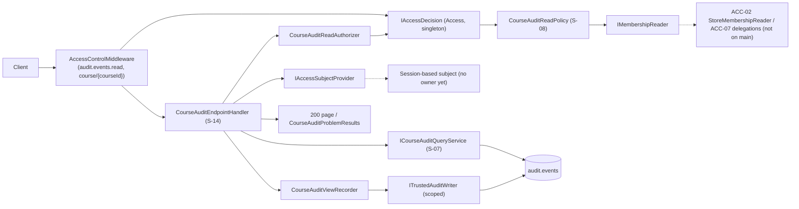
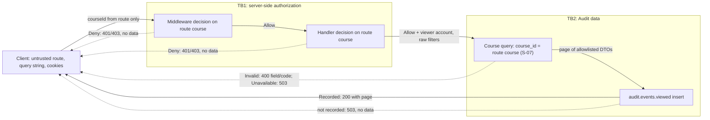

# S-14: course audit endpoint

**Team:** 12, Audit component

**Student:** Aleksa Mandarić (`VelikiVojvoda`), member 9

**Story:** S-14

**Requirements:** AUD-06; related AUD-11, AUD-19, SEC-01, SEC-04, SEC-05, OPS-06, ACC-03/ACC-07 (with S-15)

**Status:** endpoint implemented, mapped in `Platform.Api` and tested with test-only subjects and
memberships. **It is not a finished production integration.** The real host has no session-based
Access subject for `/api/courses/...` and no real membership provider on `main` yet, so today every
real caller gets 401 (no subject) or 403 (no membership). The endpoint fails closed: no event leaves
the server until those dependencies are delivered (see [Dependencies](#dependencies-and-open-points)).

## Route contract

`GET /api/courses/{courseId:guid}/audit-events?type=&outcome=&actorId=&from=&to=&correlationId=&page=&pageSize=`

| Result | HTTP | Body |
|-|-|-|
| No authenticated subject (or no valid session outside Development) | 401 | Access problem details, no event data |
| No current right for the course (or the check failed) | 403 | Access problem details; identical for an existing and an unknown course |
| Malformed `courseId` | 404 | The `guid` route constraint never reaches the handler or the membership reader |
| Refused filter (S-07 `Invalid`, or a filter given twice) | 400 | `errors: [{ field, code }]`, never the refused value |
| Storage failure (S-07 `Unavailable` or an exception) | 503 | No partial data, no exception text |
| `audit.events.viewed` not recorded | 503 | Sent **before** any event (D5, provisional) |
| Success | 200 | S-07 `CourseAuditPage`, `Cache-Control: no-store` |

Every error is `application/problem+json` with `Cache-Control: no-store` and `correlationId`.
Limits, parsing and sorting are S-07's (`CourseAuditQueryLimits`, DECISIONS.md "D5 query limits");
S-14 does not duplicate them. A `+` in a time offset must be sent as `%2B`.

Success body (enums as lower-case names, the same spelling as the `outcome` filter):

```json
{
  "courseId": "…", "from": "…Z", "to": "…Z", "page": 1, "pageSize": 50, "hasNextPage": false,
  "items": [
    { "id": "…", "occurredAt": "…", "eventType": "access.denied", "outcome": "denied",
      "actorKind": "anonymous", "actorId": null, "resourceType": "Course", "resourceId": "…",
      "correlationId": "…" }
  ]
}
```

No `details`, no schema version and no total count. Field visibility can change only through D4.

## Request flow

The handler (`Platform.Audit/Endpoints/CourseAuditEndpointHandler.cs`) has a fixed order:

1. `AccessControlMiddleware` decides on the route metadata (`audit.events.read`, `course/{courseId}`).
   Anonymous callers stop here with 401.
2. The handler takes the subject from `IAccessSubjectProvider` and the correlation ID from
   `ICorrelationContext` (S-10), and calls `CourseAuditReadAuthorizer` again. A Deny here is 401/403.
   This check comes **before** filter validation, so an outsider learns nothing from a 400.
3. The raw filters go to `ICourseAuditQueryService` (S-07) with the route course. A filter given
   twice is refused as `InvalidFormat` before S-07.
4. On `Ok`, `CourseAuditViewRecorder` writes `audit.events.viewed`. Only when it is recorded is the
   page sent; otherwise 503 without data.

The course comes only from the route value; a `courseId` in the query string is ignored. Membership
is read on every decision; nothing is cached, so a revocation applies from the next request (T08).

| Part | File |
|-|-|
| Handler and 200 result | `Platform.Audit/Endpoints/CourseAuditEndpointHandler.cs` |
| Route and Access metadata | `Platform.Audit/Endpoints/CourseAuditEndpointRoute.cs` |
| Error responses | `Platform.Audit/Endpoints/CourseAuditProblemResults.cs` |
| Application-layer check | `Platform.Audit/Application/CourseView/CourseAuditReadAuthorizer.cs` |
| View record | `Platform.Audit/Application/CourseView/CourseAuditViewRecorder.cs` |
| DI and mapping | `Platform.Audit/Composition/CourseAuditViewServiceCollectionExtensions.cs` |
| Host wiring | `Platform.Api/Program.cs`: `AddCourseAuditView()` after `AddAuditPersistence(...)`, `MapCourseAuditEndpoints()` after the other maps |

## DI

`AddCourseAuditView()` registers the S-14 parts and, as agreed with the S-07 owner (member 4), the
S-07 query service. S-07 registers nothing itself, because it does no authorization: the query
service is resolvable only in a host that also has the protected endpoint around it.

| Service | Lifetime | Why |
|-|-|-|
| `CourseAuditReadAuthorizer` | singleton | stateless; uses the singleton `IAccessDecision` |
| `CourseAuditViewRecorder` | scoped | uses the scoped `ITrustedAuditWriter` (`AuditDbContext`) |
| `CourseAuditQueryNormalizer` | singleton | only `TimeProvider` |
| `ICourseAuditEventReader` → `PostgresCourseAuditEventReader` | scoped | `AuditDbContext` |
| `ICourseAuditQueryService` → `CourseAuditQueryService` | scoped | uses the reader |

`MapCourseAuditEndpoints()` throws at startup when `AddCourseAuditView()` was not called, so the
route can never exist without its authorization. Lifetimes are checked with `ValidateScopes` and
`ValidateOnBuild` (`CourseAuditViewCompositionTests`).

## `audit.events.viewed`

| Field | Value |
|-|-|
| Actor | `User` = the authorized account |
| Course, resource | the route course; `Course/{courseId}` |
| Outcome | `Success` |
| Details | `filterFrom`, `filterTo` (normalized UTC range), `resultCount`; `filterType` and `filterOutcome` only when set |

The `actorId` and `correlationId` filters are not recorded: the catalog schema of
`audit.events.viewed` has no keys for them, and adding keys is a contract change.
No event content is recorded. The recorder never calls `IAccessDecision`, so recording a view cannot
start another decision or an `access.denied` record (no recursion with S-13).

Alarms (level Error, fixed fields only, never filter values, events or exception text):

| Event id | Message |
|-|-|
| 6301 | `audit.events.viewed.failure reason={invalid_summary\|rejected\|unavailable\|failed} code={rejection code or exception type} correlationId={id or "invalid"}` |
| 6302 | `audit.course_view.unavailable code={Unavailable or exception type} correlationId={id}` |

## Rights matrix and evidence

Host tests run through the real `Platform.Api` (Program.cs composition, session middleware active)
with a test-only subject and test-only memberships (`CourseAuditEndpointHostFactory`).

| Subject / context | Result | Test |
|-|-|-|
| Anonymous | 401, no query | `CourseAuditEndpointHostTests.Anonymous_Gets401_WithoutEventsOrQuery`, `CourseAuditViewCompositionTests.RealApiHost_MapsTheEndpointOnce_AndAnAnonymousCallerGets401` |
| No valid session (outside Development) | 401 | `WithoutTestSession_TheSessionCheckStillApplies` |
| Teacher in K, request for K | 200, one `audit.events.viewed` | `TeacherOfK_Gets200_WithTheAllowlistedPage_AndExactlyOneViewRecord`, `CourseAuditEndpointPostgresTests.TeacherOfK_SeesOnlyKInStableOrder_AndTheViewIsStoredOnce` |
| Teacher in K, request for L (T07) | 403, same body as for an unknown course, no query, no record | `TeacherOfK_Gets403_ForL_LooksLikeAnUnknownCourse_AndNothingIsReadOrRecorded`, `CourseAuditEndpointPostgresTests.TeacherOfK_Gets403ForL_AndNoViewOfLIsStored` |
| Teacher in K, student in L | 403 for L | `CourseAuditReadAuthorizerTests.TeacherInK_StudentInL_CannotReadL` |
| Student in K, blocked teacher | 403 | `StudentAndBlockedTeacher_Get403` |
| Assistant in K | 200 only with the exact delegated `audit.events.read` | `Assistant_NeedsTheExactDelegation` (3 cases) |
| Revoked membership (T08) | 403 from the next request | `RevokedMembership_AppliesFromTheNextRequest` |
| Administrator without teacher membership in K | 403 | `CourseAuditReadAuthorizerTests.Administrator_WithoutTeacherMembershipInK_IsForbidden` |
| Non-account subject (for example `dev-user`) | 403 | `AllowForANonAccountSubject_IsStillForbidden` |
| Outsider with invalid filters | 403, not 400 | `CallerWithoutTheRight_Gets403_EvenWithInvalidFilters` |

| Behaviour | Test |
|-|-|
| T11: 14 refused filters (page, size, offset, range, date-only, type, outcome, actor, correlation, repeated filter) → 400 with exactly the expected `field:code` | `InvalidFilter_Gets400_WithFieldAndCode_BeforeAnyDatabaseCall` |
| T11: boundary values (size 1 and 100, last allowed page, a 31-day range, `%2B` offset) pass validation | `BoundaryValues_PassValidation_AndReachStorage` |
| Script and SQL fragments in filters are not in the response or the log | `HostileFilterValues_AreNeverEchoed_InTheResponseOrTheLog` |
| Storage down → 503 without data or connection details | `StorageDown_Gets503_WithoutDataOrInternalDetails`, `QueryServiceThatThrows_Gets503` |
| View record fails or throws → 503 and no event in the body | `ViewRecordUnavailable_Gets503_AndNoEventIsSent`, `ViewRecordWriterThrows_Gets503_AndNoEventIsSent` |
| Only K's rows, ordered by time descending, against PostgreSQL | `CourseAuditEndpointPostgresTests.TeacherOfK_SeesOnlyKInStableOrder_AndTheViewIsStoredOnce` |
| Stable order for equal times (`Id DESC`), page bounds, SQL course filter | S-07: `PostgresCourseAuditQueryTests` |

Other unit evidence: `CourseAuditReadAuthorizerTests`, `CourseAuditViewRecorderTests`,
`CourseAuditProblemResultsTests`, `CourseAuditRouteTests`, `CourseAuditViewCompositionTests`,
`CourseAuditViewPostgresTests`. All identities and courses in tests are synthetic.

## Component architecture

Solid lines exist on this branch; dashed lines are owed by other teams.



## Data flow and trust boundaries (input for S-18, member 7)



The order is fixed: authorize, read, record the view, then send. A failed view record means no data
leaves the server.

## Dependencies and open points

| Dependency | Owner | Status |
|-|-|-|
| S-07 query contract and SQL | member 4 | done: [PR #98](https://github.com/owlCoder/security-lab/pull/98) merged |
| Session-based Access subject for `/api/courses/...` | member 1 with Team 3 / Identity | open, no owner yet: only `/api/revisions` maps a session to an Access subject (`RevisionRequestIdentity`). Until then every real caller is anonymous → 401 |
| Real membership provider | ACC-02 | open: `StoreMembershipReader` is on `feature/ACC-02-membership`, not on `main`; until then `EmptyMembershipReader` denies everyone → 403 |
| Current delegations in `DelegatedActions` | ACC-07 | open: the ACC-02 reader returns an empty set; assistants get 403 until ACC-07 fills it with valid (not expired, not revoked) actions |
| S-15 (current delegation in the query flow, measured with S-14) | member 5 | open; joint merge to be agreed |
| D4: global view, events without a course, visible fields | members 5, 7, 9 with the assistant | provisional: only the course view, no automatic admin access, DTO without `details` |
| D5: limits and failure of `audit.events.viewed` | members 4, 5, 6 | provisional: S-07 limits; 503 before data |
| Exact 401/403 for an inactive account or revoked session | Identity | provisional: no session → 401 (session middleware); inactive account → 403 (`AccountNotActive`) |

In Development, `SessionCheckMiddleware` skips the session check for every path under `/api/courses`
(a Team 21 test-header exception), and `DevelopmentFakeSubjectProvider` supplies the non-account
subject `dev-user`, which the authorizer refuses. Outside Development the session check runs.

When ACC-02 is merged, its namespace `Platform.Membership` hides the short `Membership(...)` test
helper; the S-14 tests already call `AuditAuthorizationExamples.Membership(...)`.
