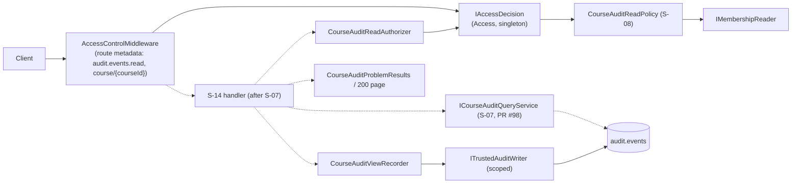
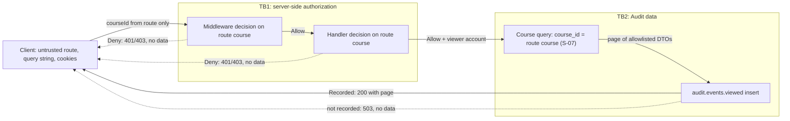

# S-14: course audit endpoint

**Team:** 12, Audit component

**Student:** Aleksa Mandarić (`VelikiVojvoda`), member 9

**Story:** S-14

**Requirements:** AUD-06; related AUD-11, AUD-19, SEC-01, SEC-04, SEC-05, OPS-06, ACC-03/ACC-07 (with S-15)

**Status:** building blocks implemented and tested; **the endpoint is not mapped**. The handler
needs the S-07 query contract (`ICourseAuditQueryService`, `CourseAuditQuery`, `CourseAuditQueryResult`),
which is in [PR #98](https://github.com/owlCoder/security-lab/pull/98) and not on `main` yet.
Until the handler is wired, `GET /api/courses/{courseId}/audit-events` answers 404 in the real host
(test `RealApiHost_DoesNotExposeTheUnfinishedEndpoint`). Nothing in `Program.cs` changes in this part.

## Route contract (target)

`GET /api/courses/{courseId:guid}/audit-events?type=&outcome=&actorId=&from=&to=&correlationId=&page=&pageSize=`

| Result | HTTP | Body |
|-|-|-|
| No authenticated subject | 401 | Access problem details, no event data |
| No current right for the course (or the check failed) | 403 | Access problem details; identical for an existing and an unknown course |
| Malformed `courseId` | 404 | The `guid` route constraint never reaches the handler or the membership reader |
| Refused filter (S-07 `Invalid`) | 400 | `errors: [{ field, code }]`, never the refused value |
| Storage failure (S-07 `Unavailable`) | 503 | No partial data, no exception text |
| `audit.events.viewed` not recorded | 503 | Sent **before** any event (D5, provisional) |
| Success | 200 | S-07 `CourseAuditPage` (allowlisted `CourseAuditEventDto`, no `details`, no total count) |

Every error is `application/problem+json` with `Cache-Control: no-store` and `correlationId`.
Limits, parsing and sorting are S-07's (`CourseAuditQueryLimits`, DECISIONS.md "D5 query limits");
S-14 does not duplicate them.

## What is implemented now

| Part | File | Responsibility |
|-|-|-|
| Route and Access metadata | `Platform.Audit/Endpoints/CourseAuditEndpointRoute.cs` | Route template with the `guid` constraint; `RequireCourseAuditRead()` declares `audit.events.read` on `course/{courseId}` from the central Access catalog |
| Application-layer check | `Platform.Audit/Application/CourseView/CourseAuditReadAuthorizer.cs` | Second decision right before the query, through `IAccessDecision`; maps Deny to 401/403; the viewer must be an active account with a GUID ID |
| View record | `Platform.Audit/Application/CourseView/CourseAuditViewRecorder.cs` | Writes `audit.events.viewed` through `ITrustedAuditWriter`; any failure returns `false` and raises alarm 6301 |
| Error responses | `Platform.Audit/Endpoints/CourseAuditProblemResults.cs` | 400 / 401 / 403 / 503 shapes; 401/403 reuse `AccessProblemDetailsWriter` |
| DI | `Platform.Audit/Composition/CourseAuditViewServiceCollectionExtensions.cs` | `AddCourseAuditView()`: authorizer singleton, recorder scoped; not called by `Platform.Api` yet |

### Two authorization checks

1. `AccessControlMiddleware` reads the route metadata and decides before the handler runs.
   An anonymous caller gets 401 there; the handler is never reached.
2. The handler calls `CourseAuditReadAuthorizer` before `ICourseAuditQueryService`. S-07 does no
   authorization by design, so the query is never called without a current Allow in the same code
   path, and a revocation between the two checks already applies to this request (T08).

The course comes only from the route value; a `courseId` in the query string is ignored
(`QueryStringCourse_IsIgnored_OnlyTheRouteCourseIsAuthorized`). The subject comes only from the
server-side `IAccessSubjectProvider`. Membership is read on every decision; nothing is cached.

### `audit.events.viewed`

| Field | Value |
|-|-|
| Actor | `User` = the authorized account |
| Course, resource | the route course; `Course/{courseId}` |
| Outcome | `Success` |
| Details | `filterFrom`, `filterTo` (normalized UTC range), `resultCount`; `filterType` and `filterOutcome` only when set |

The `actorId` and `correlationId` filters are not recorded: the catalog schema of
`audit.events.viewed` has no keys for them, and adding keys is a contract change.
No event content is recorded. The recorder never calls `IAccessDecision`, so recording a view cannot
start another decision or an `access.denied` record (no recursion with S-13).

Failure alarm (event id 6301, level Error), only fixed fields:
`audit.events.viewed.failure reason={invalid_summary|rejected|unavailable|failed} code={rejection code or exception type} correlationId={validated id or "invalid"}`.

## Rights matrix and evidence

| Subject / context | Result | Test |
|-|-|-|
| Anonymous | 401, handler not reached | `CourseAuditRouteTests.Anonymous_Gets401_WithoutReachingTheHandler`, `CourseAuditReadAuthorizerTests.Anonymous_IsUnauthenticated_WithoutASecondDecision` |
| Teacher in K, request for K | Allowed, viewer = account | `TeacherOfK_ReachesTheHandler_ForK`, `Teacher_InCourseK_IsAllowed_WithTheAccountAsViewer` |
| Teacher in K, request for L | 403, same body as for an unknown course | `TeacherOfK_Gets403_ForL_AndTheDecisionUsesTheRouteCourse`, `Forbidden_LooksTheSame_ForAnExistingAndAnUnknownCourse` |
| Teacher in K, student in L | 403 for L | `TeacherInK_StudentInL_CannotReadL` |
| Student in K | 403 | `Student_IsForbidden_EvenWithTheActionInTheSnapshot` |
| Assistant in K | Only with the exact delegated `audit.events.read` | `Assistant_NeedsTheExactDelegatedAction` (4 cases) |
| Revoked delegation or membership | 403 from the next call | `RevokedMembershipOrDelegation_AppliesFromTheNextCall` |
| Administrator without teacher membership in K | 403 | `Administrator_WithoutTeacherMembershipInK_IsForbidden` |
| Blocked account | 403 | `BlockedTeacher_Gets403`, `BlockedAccount_IsNotAllowed_EvenAsTeacher` |
| Non-account subject (for example `dev-user`) | 403 | `AllowForANonAccountSubject_IsStillForbidden` |
| Decision error | 403, no exception text | `DecisionThatThrows_IsForbidden` |

Other evidence: `CourseAuditViewRecorderTests` (draft accepted by the real validator, UTC range,
invalid summaries, Rejected/Unavailable/exception → `false` with an alarm without values or secrets),
`CourseAuditProblemResultsTests` (400 without values; a filter error accepts only identifier-like
names, so a refused value cannot be echoed), `CourseAuditViewCompositionTests` (strict DI, lifetimes,
missing persistence fails at startup, route not mapped in the real host) and
`CourseAuditViewPostgresTests` (one `audit.events.viewed` row through the real writer and the
restricted runtime role).

All identities and courses in tests are synthetic.

## Component architecture

Solid lines exist now; dashed lines are added with the handler after S-07.

## Data flow and trust boundaries (input for S-18, member 7)

The order is fixed: authorize, read, record the view, then send. A failed view record means no data
leaves the server.

## Dependencies and open points

| Dependency | Owner | Status |
|-|-|-|
| S-07 query contract and SQL ([PR #98](https://github.com/owlCoder/security-lab/pull/98)) | member 4 | open; handler, 200/400/503 mapping and endpoint host tests wait for it |
| Real subject for `/api/courses/...` | Identity / Access owners | open: only `/api/revisions` maps a session to an Access subject (`RevisionRequestIdentity`); elsewhere the subject is anonymous, so the real endpoint would answer only 401 |
| Real membership and delegation provider | Access / ACC-07 owners | open: the default `EmptyMembershipReader` denies everyone |
| S-15 (current delegation in the query flow, measured with S-14) | member 5 | open; joint merge agreed with member 5 |
| D4: global view, events without a course, visible fields | members 5, 7, 9 with the assistant | provisional: only the course view, no automatic admin access |
| D5: limits and failure of `audit.events.viewed` | members 4, 5, 6 | provisional: S-07 limits; 503 before data |
| Exact 401/403 for an inactive account or revoked session | Identity | provisional: inactive account → 403 from Access (`AccountNotActive`) |

Note for the Development environment: `SessionCheckMiddleware` skips the session check for every
path under `/api/courses` (a Team 21 test-header exception). The course audit route falls under that
prefix, so in Development only the Access checks apply. Outside Development the session check runs.

## Remaining work after S-07 is on main

1. Handler: subject from `IAccessSubjectProvider`, correlation ID from `ICorrelationContext`,
   `CourseAuditReadAuthorizer`, `ICourseAuditQueryService`, `CourseAuditViewRecorder`, results.
2. Map S-07 errors to `CourseAuditFilterError` (camelCase field name, code name).
3. `MapCourseAuditEndpoints()` in Audit composition; in `Program.cs` one `AddCourseAuditView()` line
   and one map line (reviewed by member 1).
4. Host tests through `Platform.Api`: 401, K/L isolation, 400 boundaries, 503 on storage failure and
   on a failed view record (no event in the body), exactly one `audit.events.viewed` per success.
5. Update `SECURITY_MATRIX.md` rows for AUD-06 with the final evidence.
