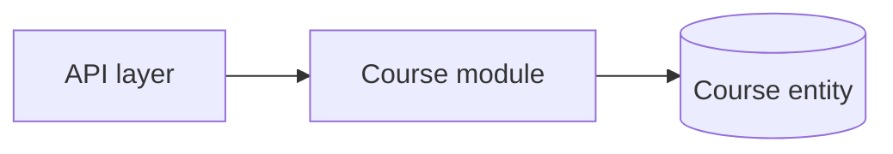
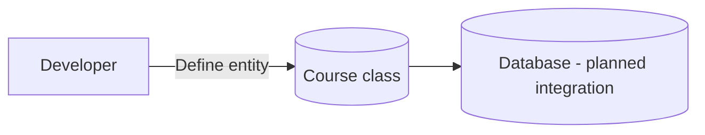

# Project component: [ACC-01 (Course entity)]

**Team:** [5]

**Student:** [Srdjan Lazarevic / PR47-2019]

**Specification requirements:** [ACC-01 , ACC-06]

## Responsibilities and boundaries

- Moja odgovornost je definisanje osnovnog entiteta `Course` sa poljima: `Id`, `Code`, `Name`, `Status`, `CreatedAt`.
- Ovaj entitet predstavlja osnovu za kasnije kreiranje i arhiviranje kursa.
- Granice: moj deo obuhvata samo model; integracija u DbContext, API endpointi, validacija i testovi su zadaci drugih članova tima.

## Component architecture

Replace the example with the actual architecture.

## Data flow diagram

## Security requirements

-- Entitet sam po sebi ne sadrži logiku pristupa.
    
- Status kursa (`Active` / `Archived`) predviđen je za kasniju kontrolu pristupa i arhiviranje.

## Evidence of work

- Changed files: `Modules/Course/Course.cs`
    
- Commit: "Add Course entity (ACC-01)"
    
- Run instructions: `dotnet build backend/Platform.Api/Platform.Api.csproj`
    
- Tests and results: nisu primenjivi u ovom koraku (planirani u kasnijim delovima).
    
- Next steps: dodati DbContext integraciju i API endpoint za kreiranje i arhiviranje kursa.
