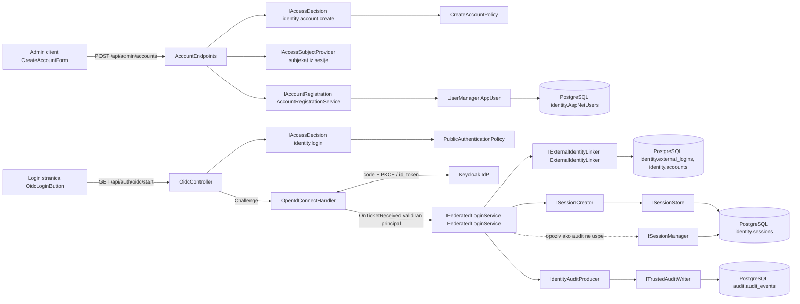
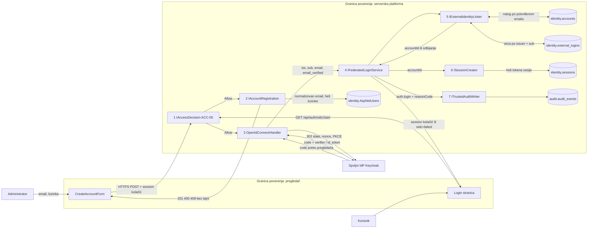

# IDN-01 i IDN-08 — Kreiranje naloga i federativni identitet (OIDC)

| Stavka | Vrednost |
|---|---|
| Tim | Tim 18 |
| Zahtevi | **IDN-01** (J) — Registracija naloga ili administrativno kreiranje · **IDN-08** (N) — Federativni identitet preko OIDC |
| Kriterijumi prihvatanja | IDN-01: kreira se jedinstven nalog, postojeći identifikator se ne može ponovo dodeliti. IDN-08: ponovljeni identitet se mapira na jedan unutrašnji nalog, bez dupliranja. |
| Projekti | `backend/Platform.Identity`, `backend/Platform.Api`, `backend/Platform.Identity.Tests`, `frontend`, `infra/keycloak` |
| Studenti | PR13/2023 Antonija Mitić, PR71/2023 Nina Budjen, PR65/2023 Milica Dukić, PR66/2023 Anđela Javor, PR72/2023 Jovana Boljanović |

## Odluke tima

| Tema | Odluka | Razlog |
|---|---|---|
| Ko kreira naloge | Samo administrator, nema javne samoregistracije | Manja površina napada; isti model koristi i IDN-08 |
| Identifikator | Email, normalizovan (`Trim` + mala slova); `Id` je `Guid` koji se ne menja | Jedinstvenost garantuje unique indeks u bazi, ne samo kod |
| Brisanje | Nalozi se ne brišu fizički; arhiviran ili blokiran nalog zadržava email i `Id` | Identifikator se ne može ponovo dodeliti |
| Kriptografija | Samo gotove biblioteke: ASP.NET Core Identity (heš lozinke), `Microsoft.AspNetCore.Authentication.OpenIdConnect` (tokeni) | Spec zabranjuje sopstvenu kriptografiju |
| Ključ spoljnog identiteta | Par `(issuer, sub)` iz validiranog `id_token`-a, nikad email | `sub` je stabilan; email kod IdP-a može da se promeni |
| Prvo povezivanje (IDN-08) | Samo sa **postojećim** nalogom i samo preko emaila koji je IdP potvrdio (`email_verified = true`); nalog se nikad ne pravi automatski | Sprečava preuzimanje naloga; u skladu sa odlukom iz IDN-01 |
| OIDC tok | Authorization code + PKCE, public klijent (bez client secret-a) | Nema tajne u Git-u |
| Test IdP | Keycloak u Docker-u, samo za lokalni razvoj (profil `oidc`) | Spec ne traži integraciju sa stvarnim institucionalnim nalozima |

## Podela rada

| Deo | Student | IDN-01 | IDN-08 |
|---|---|---|---|
| Domen i ugovori | Antonija | `AppUser`, `RegistrationOutcome`, `RegisterAccountCommand/Result`, `IAccountRegistration` | `ExternalLogin`, `FederatedLoginOutcome`, `ExternalIdentity`, `FederatedLoginResult`, `IExternalIdentityLinker` |
| Prijava i endpointi | Antonija | admin endpoint i `CreateAccountPolicy` (zajedno sa timom) | `FederatedLoginService`, OIDC handler, `GET /api/auth/oidc/start`, callback |
| Baza | Nina | `AccountDbContext`, unique indeks, migracija | tabela `identity.external_logins`, migracija `AddExternalLogins`, Keycloak realm i Docker profil |
| Servis | Milica | `AccountRegistrationService` | `ExternalIdentityLinker`, `Oidc:PublicOrigin`, usklađivanje sa ACC-05 |
| Testovi | Anđela | `AccountRegistrationTests` | `ExternalIdentityLinkerPostgresTests`, `FederatedLoginServiceTests` |
| Frontend i dokumentacija | Jovana | `CreateAccountForm` | dugme „Sign in with external account (OIDC)“, poruka za `?oidc=failed`, ovaj dokument |

## 1. Realizovana funkcionalnost i tok upotrebe

### IDN-01: administrator kreira nalog

1. Administrator se prijavljuje lozinkom (IDN-02) i otvara `/access-demo`, formu „Kreiranje naloga (administrator)“.
2. Forma šalje `POST /api/admin/accounts` sa `{ email, password }`.
3. ACC-05 middleware traži odluku za radnju `identity.account.create`. Pozivalac dolazi iz session kolačića, nikad iz zaglavlja ili tela. Dozvolu daje samo `CreateAccountPolicy` za naloge iz `Identity:AdminAccountIds`.
4. `AccountRegistrationService` normalizuje email, proverava format i dužine, primenjuje pravila lozinke (najmanje 12 znakova, veliko i malo slovo, broj, specijalan znak), hešira lozinku preko ASP.NET Identity-ja i upisuje nalog.

| Status | Telo | Značenje |
|---|---|---|
| 201 | `{ id, correlationId }` | Nalog kreiran |
| 400 | `{ error: "invalid_input", errors[], correlationId }` | Nevalidan email ili lozinka |
| 401 / 403 | problem details sa `correlationId` | Pozivalac nije prijavljen / nije administrator |
| 409 | `{ error: "identifier_taken", correlationId }` | Email već postoji (i kad se razlikuje samo po velikim slovima ili razmaku) |

Ugovor za druge module:

```csharp
ValueTask<RegisterAccountResult> RegisterAsync(RegisterAccountCommand command, CancellationToken ct = default);
```

### IDN-08: prijava preko spoljnog naloga

1. Korisnik na `/login` klikne **Sign in with external account (OIDC)**. Dugme je običan link na `GET /api/auth/oidc/start`.
2. API preusmerava na IdP (Keycloak) sa `state`, `nonce` i PKCE izazovom.
3. Posle prijave IdP vraća pregledač na `/api/auth/oidc/callback?code=...`. Adresa za povratak dolazi iz `Oidc:PublicOrigin`, ne iz `Host` zaglavlja.
4. OIDC handler razmenjuje `code` + `code_verifier` za `id_token` i proverava potpis, `iss`, `aud`, istek, `nonce` i `state`.
5. `FederatedLoginService` čita `(iss, sub, email, email_verified)` iz validiranog tokena i poziva `ExternalIdentityLinker`:
   - poznat `(issuer, sub)` → isti nalog kao ranije, ažurira se `last_login_at`;
   - nepoznat → povezuje se sa postojećim nalogom istog, **potvrđenog** emaila;
   - sve ostalo → odbijanje.
6. Uspeh: ista sesija, isti `SecurityLab.Session` kolačić i isti audit događaj `auth.login` kao kod prijave lozinkom (IDN-02), pa preusmerenje na `/`.
7. Bilo kakvo odbijanje: preusmerenje na `/login?oidc=failed` i jedna generička poruka. Razlog je samo u audit-u.

| Ishod linkera | Odgovor klijentu | Audit `reasonCode` |
|---|---|---|
| `Linked` / `NewlyLinked` | sesija, 302 na `/` | `auth.login` Success |
| `EmailNotVerified` | `/login?oidc=failed` | `oidc_email_not_verified` |
| `NoMatchingAccount` | `/login?oidc=failed` | `oidc_no_account` |
| `AccountAlreadyLinked` | `/login?oidc=failed` | `oidc_account_already_linked` |
| `InvalidIdentity` | `/login?oidc=failed` | `oidc_invalid_identity` |
| blokiran ili arhiviran nalog | `/login?oidc=failed` | `account_inactive` |
| greška u protokolu / korisnik odustao kod IdP-a | `/login?oidc=failed` | `oidc_remote_failure` / `oidc_access_denied` |

Ugovor za druge module:

```csharp
Task<FederatedLoginResult> ResolveAsync(ExternalIdentity identity, CancellationToken ct = default);
```

## Arhitektura komponente

Čvorovi su stvarni interfejsi i klase iz koda. Strelica znači „poziva preko interfejsa“.



| Interfejs | Implementacija | Modul / vlasnik | Uloga |
|---|---|---|---|
| `IAccessDecision` | `DefaultDenyAccessDecision` + `CreateAccountPolicy`, `PublicAuthenticationPolicy` | Platform.Access (ACC-05) | Odluka pre svakog endpointa |
| `IAccessSubjectProvider` | `ResolverAccessSubjectProvider` | Platform.Api | Pozivalac iz session kolačića, nikad iz zahteva |
| `IAccountRegistration` | `AccountRegistrationService` | Platform.Identity (IDN-01) | Validacija, heširanje, jedinstvenost |
| `IFederatedLoginService` | `FederatedLoginService` | Platform.Api (IDN-08) | Validiran principal → nalog → sesija i audit |
| `IExternalIdentityLinker` | `ExternalIdentityLinker` | Platform.Identity (IDN-08) | `(issuer, sub)` → tačno jedan nalog |
| `ISessionCreator`, `ISessionStore`, `ISessionManager` | `StoreSessionCreator`, `SessionStore`, `SessionManager` | IDN-02, IDN-03 | Sesija, provera statusa naloga, opoziv |
| `ITrustedAuditWriter` | Audit modul | AUD-01 | Trajni audit zapis `auth.login` |

Ostali moduli identitet naloga dobijaju samo kroz ove ugovore i ne čitaju tabele direktno.

## Dijagram toka podataka (DFD)

Procesi su označeni interfejsom koji ih izvršava. Isprekidane granice su granice poverenja.



**Procesi:**

1. **`IAccessDecision`:** default-deny. Dozvoljava `identity.account.create` samo administratoru, a `identity.login` (pokretanje OIDC prijave) svima, uz rate limiting.
2. **`IAccountRegistration`:** normalizacija i validacija, heš preko ASP.NET Identity-ja, unique indeks.
3. **`OpenIdConnectHandler`:** biblioteka proverava potpis, `iss`, `aud`, istek, `state`, `nonce` i PKCE.
4. **`IFederatedLoginService`:** čita claim-ove samo iz validiranog tokena; svako odbijanje daje isti odgovor.
5. **`IExternalIdentityLinker`:** `(issuer, sub)` → jedan nalog; prvo povezivanje samo preko potvrđenog emaila; nikad ne pravi nalog.
6. **`ISessionCreator`:** sesija kao kod prijave lozinkom; blokiran nalog je ne dobija.
7. **`ITrustedAuditWriter`:** svaki uspeh i neuspeh; ako zapis o uspehu ne uspe, sesija se opoziva.

Identitet i uloga iz zaglavlja, tela i query stringa se ignorišu.

## 2. Povezivanje sa drugim modulima

| Modul / zahtev | Interfejs koji koristimo | Šta dobijamo |
|---|---|---|
| ACC-05 (Access) | `[RequireAccess]`, `IAccessDecision`, `CreateAccountPolicy`, javna radnja `identity.login` | Default-deny provera pre svakog endpointa; `/api/auth/oidc/start` koristi istu radnju i politiku kao `POST /api/auth/login` |
| IDN-02 (prijava i sesije) | `ISessionCreator`, `ISessionManager`, `SessionCookie` | OIDC prijava daje istu sesiju i kolačić kao prijava lozinkom; odjava radi isto |
| IDN-03 (statusi naloga) | provera statusa u `SessionStore` | Blokiran ili arhiviran nalog ne dobija sesiju ni preko OIDC-a |
| IDN-05 (rate limiting) | politika `RateLimitPolicies.Login` | Ograničen broj pokretanja OIDC prijave |
| AUD-01 (Audit) | `IdentityAuditProducer`, događaj `auth.login` | Svaki uspeh i neuspeh se beleži; uspeh bez audit zapisa opoziva sesiju |

Demonstracija veza je u odeljku 4: posle OIDC prijave `/api/auth/me` (IDN-02) vraća isti nalog, `blocked` se odbija (IDN-03), a audit tabela sadrži `auth.login` zapise (AUD-01).

### Preostala ograničenja

- **Dva skladišta naloga.** IDN-01 upisuje naloge u `identity.AspNetUsers` (ASP.NET Identity, `AccountDbContext`). Prijava (IDN-02), statusi (IDN-03) i IDN-08 rade nad `identity.accounts` (`PlatformIdentityDbContext`). Nalog napravljen kroz admin formu zato još ne može da se prijavi ni da se poveže preko OIDC-a; demonstracija IDN-08 koristi razvojne naloge iz `identity.accounts`. Plan: prebaciti `AccountRegistrationService` na `identity.accounts` (`UserAccount` + `IPasswordHasher`), uz dogovor sa timom za IDN-02.
- **Administratori za IDN-01** se zadaju u konfiguraciji (`Identity:AdminAccountIds`), ne preko uloge naloga.
- **MFA (IDN-06):** kada postane obavezan za privilegovane naloge, federativna prijava mora da primeni istu politiku. Trenutno OIDC prijava daje sesiju nivoa `Active`, kao i prijava lozinkom.
- **IdP:** podržan je jedan IdP iz konfiguracije. Keycloak služi samo za lokalni razvoj; za produkciju je potreban HTTPS `Authority` i `PublicOrigin` (proverava se pri startu).
- **Povezivanje naloga** radi samo automatski pri prvoj prijavi. Ručno povezivanje ili raskidanje veze iz korisničkog interfejsa nije implementirano.

## 3. Testovi i bezbednost

### Testovi i rezultati

```powershell
dotnet test backend/Platform.Identity.Tests --filter "FullyQualifiedName~AccountRegistrationTests"   # IDN-01
dotnet test backend/Platform.Identity.Tests --filter "Category=IDN-08"                             # IDN-08: 31/31
dotnet test backend/Platform.Access.Tests --filter "FullyQualifiedName~ApiEndpointCoverageTests|FullyQualifiedName~AccountEndpointAccessTests"
cd frontend; npm test -- OidcLogin                                                                 # IDN-08 UI: 6/6
```

Testovi nad PostgreSQL-om koriste Testcontainers, pa mora da radi Docker Desktop. Svi testovi prolaze i u CI-ju (backend check na PR-u).

### Mapiranje na kriterijume prihvatanja

| Kriterijum | Kako je ispunjeno | Dokaz (test) |
|---|---|---|
| **IDN-01:** kreira se jedinstven nalog | `Guid` kao `Id`, unique indeks na normalizovanom emailu | `Valid_registration_creates_active_account_with_hashed_password` |
| IDN-01: duplikat se odbija | provera + hvatanje `UniqueViolation` | `Duplicate_email_is_rejected`, `Duplicate_email_differing_only_in_case_or_whitespace_is_rejected` |
| IDN-01: trka dva zahteva | unique indeks u bazi | `Concurrent_registrations_of_same_email_create_exactly_one_account` |
| IDN-01: identifikator se ne dodeljuje ponovo | nalozi se ne brišu | `Identifier_of_archived_account_cannot_be_reused` |
| IDN-01: nevalidan unos | validacija emaila i lozinke | `Invalid_email_is_rejected`, `Weak_password_is_rejected_and_no_account_is_created` |
| IDN-01: samo administrator | `CreateAccountPolicy` preko ACC-05 | `Admin_can_create_account_through_central_access_policy`, `Authenticated_non_admin_cannot_create_account` |
| **IDN-08:** ponovljeni identitet → jedan nalog | traženje po `(issuer, sub)` | `RepeatedLogin_ReturnsTheSameAccount_WithoutASecondLink`, `RepeatedLogin_AfterTheEmailChangedAtTheProvider_StillMapsToTheSameAccount` |
| IDN-08: bez dupliranja | unique indeks `(issuer, subject)` | `ConcurrentFirstLogins_OfTheSameIdentity_CreateExactlyOneLink` (10 istovremenih prijava), `Database_RejectsADuplicateIssuerSubject_EvenWithoutTheService` |
| IDN-08: bez preuzimanja naloga | samo potvrđen email za prvo povezivanje | `FirstLogin_WithUnverifiedEmail_IsRefused_AndNothingIsStored`, `FirstLogin_WithoutEmail_IsRefused`, `EmailIsVerifiedOnlyWhenTheClaimIsTrue` |
| IDN-08: bez automatskih naloga | nepoznat email se odbija | `FirstLogin_WithUnknownEmail_IsRefused_AndNoAccountIsCreated` |
| IDN-08: jedan identitet po IdP-u | unique indeks `(account_id, issuer)` | `SecondIdentity_FromTheSameIssuer_ForAnAlreadyLinkedAccount_IsRefused`, `SameSubject_FromAnotherIssuer_IsADifferentIdentity` |
| IDN-08: lažan ili neispravan identitet | `sub` mora imati `iss` iz validiranog tokena | `MissingIssuerOrSubject_IsInvalid`, `TooLongSubject_IsInvalid`, `MissingSubject_IsRefused_WithoutCallingTheLinker`, `SubjectWithoutTokenIssuer_IsRefused` |
| IDN-08: generičan odgovor, blokiran nalog, fail-closed | isti `LoginResult`, IDN-03 provera, opoziv bez audit-a | `RefusedIdentity_GetsTheGenericAnswer_AndNoSession`, `BlockedAccount_GetsNoSession_AndTheAuditNamesTheConfirmedAccount`, `SuccessThatCannotBeAudited_RevokesTheNewSession` |
| IDN-08: UI ne prikazuje ništa iz URL-a | samo fiksna poruka za `oidc=failed` | `OidcLogin.test.tsx` |
| ACC-05: svaka ruta ima tačno jednu radnju | `[RequireAccess]` na svim endpointima | `ACC05_Every_real_route_has_exactly_one_access_requirement` |

### Bezbednosni zahtevi

- **Provera pristupa na serveru:** nijedan endpoint ne radi ništa pre ACC-05 odluke. Nepoznata radnja ili politika daje `Deny`. Forma i dugme nisu bezbednosna granica.
- **Validacija unosa:** email ≤ 254 znaka i važeći format, lozinka ≤ 128 znakova (zaštita od preskupog heširanja). Kod IDN-08 `issuer` ≤ 512 i `sub` ≤ 255 znakova.
- **Osetljivi podaci:** lozinka postoji samo u telu zahteva, u bazi je samo heš, `ToString` komandi je redigovan. Tokeni IdP-a se ne čuvaju (`SaveTokens = false`). Tokeni, `sub` i email ne idu u log.
- **Poruke o greškama:** ne otkrivaju unutrašnja pravila. Kod IDN-08 klijent za svaki razlog dobija isti odgovor.
- **Bez open redirect-a:** sva preusmerenja posle prijave su lokalne putanje iz konfiguracije, proverene pri startu.
- **Tajne:** connection stringovi i lozinke Keycloak-a su u lokalnom `.env`, koji se ne komituje. OIDC klijent je public, pa nema client secret-a.
- **Negativni scenariji:** pokriveni testovima iz tabele iznad i ručnom demonstracijom u odeljku 4.

## 4. Pokretanje i demonstracija

Sve komande se pokreću iz korena repoa, sa pokrenutim Docker Desktop-om. Osnovna podešavanja (.NET 10, Node 22, PostgreSQL, audit baza) su u [README.md](../../../README.md) i [DEVELOPMENT.md](../../DEVELOPMENT.md).

**1. Lokalni `.env`** (pored vrednosti iz `.env.example`):

```
KEYCLOAK_ADMIN_PASSWORD=<izmisli>
OIDC_TEST_USER_PASSWORD=<izmisli>
Oidc__Enabled=true
Identity__AdminAccountIds__0=11111111-1111-1111-1111-111111111111
```

i `frontend/.env.local`:

```
VITE_OIDC_ENABLED=true
```

Lozinke bez `$`, `#`, navodnika i razmaka.

**2. Baza, audit i Keycloak:**

```powershell
docker compose up -d db
docker compose --profile oidc up -d keycloak
curl.exe http://localhost:8081/realms/security-lab/.well-known/openid-configuration
```

Prvi put pre toga treba primeniti audit šemu i `scripts/audit/bootstrap-runtime.ps1`, prema `DEVELOPMENT.md`.

**3. API i frontend** (dva terminala):

```powershell
dotnet run --project backend/Platform.Api --urls http://localhost:5080
cd frontend; npm ci; npm run dev
```

API pri startu primenjuje migracije i pravi razvojne naloge (`admin@`, `student@`, `teacher@`, `blocked@example.com`) sa lozinkom iz `Seed__DevelopmentPassword`.

**4. Demonstracija** (svaki scenario u novom inkognito prozoru, uvek `localhost`, ne `127.0.0.1`):

| # | Koraci | Očekivano |
|---|---|---|
| 1 | Prijava lozinkom kao `admin@example.com`, `/access-demo`, kreiranje naloga sa novim emailom | `201` i `id` novog naloga |
| 2 | Isti email ponovo, pa sa velikim slovima | `409 identifier_taken` |
| 3 | Slaba lozinka ili neispravan email | `400 invalid_input`, ništa nije upisano |
| 4 | Prijava kao `student@example.com`, pa pokušaj kreiranja naloga | `403` |
| 5 | `/login` → **Sign in with external account (OIDC)** → Keycloak korisnik `student` | završava na `/`, `/api/auth/me` vraća `2222…` |
| 6 | Isto ponovo | isti nalog |
| 7 | OIDC kao `fake-teacher` (email nije potvrđen) | `/login?oidc=failed` |
| 8 | OIDC kao `stranger` (nalog ne postoji) | `/login?oidc=failed`, nalog nije napravljen |
| 9 | OIDC kao `blocked` | `/login?oidc=failed` |
| 10 | Kod Keycloak-a klik na „Cancel“ | `/login?oidc=failed` |

Provera baze posle scenarija 5 i 6 (uvek **jedan** red, menja se samo `last_login_at`):

```powershell
docker compose exec db psql -U securitylab_bootstrap -d securitylab -c "select account_id, issuer, linked_at, last_login_at from identity.external_logins"
```

Keycloak uvozi realm samo pri prvom pokretanju kontejnera. Posle izmene `infra/keycloak/security-lab-realm.json` ili lozinki: `docker compose --profile oidc up -d --force-recreate keycloak`.

## Implementirano i planirano

| Implementirano | Planirano |
|---|---|
| IDN-01: servis, validacija, heširanje, unique indeks, admin endpoint preko ACC-05, React forma, testovi | Prebacivanje IDN-01 na `identity.accounts` (jedno skladište naloga sa IDN-02) |
| IDN-08: OIDC prijava (code + PKCE), mapiranje bez dupliranja, ista sesija i audit kao IDN-02 | MFA politika za federativnu prijavu kada IDN-06 postane obavezan |
| Keycloak test IdP, konfiguracija `Oidc:*` sa proverom pri startu | Ručno povezivanje i raskidanje spoljnog identiteta iz UI-ja |
| Dugme i generička poruka na login stranici | Podrška za više IdP-ova |
| 31 backend + 6 frontend testova za IDN-08 | |
