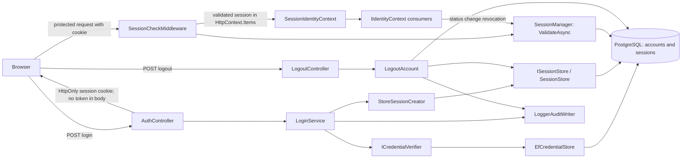

# Project component: IDN-02 Secure login and logout, IDN-06 MFA for selected user groups

**Team:** 1
**Student:** Denis Đuriš / PR 14/2023
**Specification requirements:** IDN-02 (primary), IDN-06, ACC-05, SEC-01, SEC-03, AUD-01, AUD-03. Consumers: IDN-03, IDN-07. Depends on IDN-01 (user entity), IDN-05 (attempt limiting), AUD (`IAuditWriter`) and ADM-02 (migrations).

## Responsibilities and current status

- **Login (IDN-02): implemented.** The API accepts e-mail and password, checks credentials and account status, creates a database-backed session, and sends the opaque session token only in an HttpOnly cookie.
- **Logout (IDN-02): implemented.** The API revokes the session identified by the presented cookie and deletes the cookie. Calling logout without a usable session is idempotent.
- **Session validation (IDN-02): implemented.** Protected endpoints validate the cookie against the session store; revoked, expired, unknown, or missing sessions receive `401`. Last activity is updated on successful validation.
- **Identity context: implemented.** `IIdentityContext.Current` is populated from the session validated by middleware. A `MfaPending` identity is not authenticated, but middleware itself does not restrict it to MFA endpoints.
- **MFA (IDN-06): planned, not implemented.** Login currently creates every successful session as `Active`. MFA enrollment, verification, policy, TOTP secret storage, and MFA-specific endpoints do not exist.

### Contracts and integrations

| Contract / module | Direction | Current state |
|-|-|-|
| `IIdentityContext` | we provide | Implemented by `SessionIdentityContext`; see [contract](../../contracts/IIdentityContext.md). |
| `ISessionManager` | we provide | Database-backed validation, revocation, and listing; see [contract](../../contracts/ISessionManagement.md). |
| `ISessionCreator` | internal dependency | Implemented by `StoreSessionCreator`; creates sessions through `ISessionStore`. |
| `IAuditWriter` | we use, owned by AUD | `LoggerAuditWriter` writes structured application logs. Login and logout record events; no secrets are included. |
| Account status | we use, owned by IDN-03 | `LoginService` denies non-active accounts. IDN-03 requests revocation on blocked/archived status, but currently does not await the asynchronous revocation call. Its account repository remains in-memory. |
| Attempt limiting | we use, owned by IDN-05 | Per-account lockout runs inside `CredentialVerifier`, see [IDN-05 lockout](IDN-05-lockout.md). |
| User credentials | we use, owned by IDN-01 | `ICredentialVerifier`/`EfCredentialStore` read the account and password hash; passwords are checked with the configured BCrypt hasher. ASP.NET Core Identity is not used. |

Not our responsibility: user registration (IDN-01), account status rules (IDN-03), session list screen (IDN-07), shared attempt limiting (IDN-05), and audit persistence (AUD).

### Implementation status

| Part | Story | State |
|-|-|-|
| Identity/session contracts and API wiring | US-01 | Implemented; contracts have evolved from the initial proposals. |
| Identity DbContext, schema, and migrations | US-02 | Implemented. |
| Session entity, token generation, and database store | US-03 | Implemented. Raw tokens are returned only for the cookie; SHA-256 hashes are stored. |
| Login, logout, and request session check | US-04, US-05, US-06 | Implemented. |
| MFA enrollment, verification, and policy | US-17, US-18, US-19 | Planned. |

## Implemented component architecture



`SessionCookie` centralizes cookie name and options: HttpOnly, Secure, SameSite Strict, path `/`, and the session expiration. `StoreSessionCreator` currently issues sessions with an eight-hour absolute lifetime. `SessionStore` generates a new token and stores its SHA-256 hash with the session. `SessionCheckMiddleware` reads the cookie, bypasses endpoints marked `AllowAnonymous`, and otherwise calls `ISessionManager.ValidateAsync`.

The middleware places a `ValidateSession` in `HttpContext.Items`; `SessionIdentityContext` maps it to `CallerIdentity`. `IsAuthenticated` is true only for `Active`. Middleware accepts a valid `MfaPending` session as a validated session and does not apply endpoint-specific MFA policy.

`Program.cs` registers a single `ISessionManager`, `SessionManager`. The older `StoreSessionManager` stub (no-op list/revocation) is no longer registered. `SessionManager.ValidateAsync` refuses a session whose account is not `Active`, so a blocked or archived account is refused on its very next request (IDN-03, SEC-03).

## Data flow and trust boundary

Everything received from the browser, including credentials and cookies, is untrusted. Identity and account status are established server-side.

1. Login validates request lengths/presence, normalizes e-mail, verifies the password, and rejects non-active accounts using the same public `invalid_credentials` response as other credential failures.
2. On success, the session store creates a fresh random token and stores only its hash, user id, level, timestamps, and public handle. The token is returned in the cookie, never the response body.
3. On a protected request, middleware validates the token against the database, rejects missing/unknown/revoked/expired sessions with `401`, updates last activity, and makes the validated session available to the identity context.
4. Logout looks up and revokes the session presented in the cookie before deleting the cookie. The old token is rejected on the next protected request.
5. Session revocation/listing for other modules uses `ISessionManager`; logout uses `ISessionStore.RevokeByTokenAsync`.

The cookie token and its hash, passwords, and password hashes are not included in login/logout audit events. The public session handle is not a token.

## Security behavior and gaps

### Implemented

- Login fails with the same public credential response for unknown e-mail, wrong password, missing password hash, and inactive account. Credential verification checks the password even for an unknown e-mail to reduce timing-based account discovery.
- A new token is created on login; cookie flags are configured centrally as HttpOnly, Secure, and SameSite Strict.
- Only a SHA-256 token hash is stored in the database. Session validation checks revocation and expiry on each protected request.
- `MfaPending` maps to `IsAuthenticated == false` in `IIdentityContext`.
- Session revocation by public handle checks both owner id and handle; `false` is returned for both unknown and foreign handles.
- Login and logout audit events do not include passwords, tokens, or hashes.

### Not implemented or not enforced by this component yet

- IDN-06 MFA policy, enrollment, verification, TOTP storage, and routing of `MfaPending` sessions to MFA-only endpoints are not implemented. Current successful login sessions are `Active`.
- `SessionCheckMiddleware` validates the session but does not enforce authentication level or endpoint authorization. Consumers must check `IIdentityContext.Current` and `IsAuthenticated`; it is not a global default-deny authorization policy.
- No explicit anti-CSRF token validation is implemented. SameSite Strict is configured on the cookie but should not be treated as a complete substitute for a CSRF control.
- The session lifetime is currently an eight-hour absolute lifetime; configurable lifetime and inactivity expiration are not implemented.
- `ISessionManager.RevokeAllForUser` accepts `reason` but currently does not use or audit it.
- The IDN-03 account repository is in-memory; its account status changes are not persisted across application restarts.
- IDN-03 currently invokes `RevokeAllForUser` without awaiting its task. Revocation may complete after the status-change response, and failures are not observed by that caller.

## Test evidence and local verification

Identity tests cover login, logout, credential checking, session validation and middleware behavior, and identity mapping, including `MfaPending` being unauthenticated. Tests are in `backend/Platform.Identity.Tests`.

From the repository root:

```powershell
dotnet build backend\Platform.Api\Platform.Api.csproj
dotnet test backend\Platform.Identity.Tests\Platform.Identity.Tests.csproj
```

## Next steps

1. Confirm account-status persistence with IDN-03.
2. Implement IDN-06 MFA policy, enrollment, verification, and endpoint restrictions before claiming MFA protection.
3. Add explicit authorization/CSRF controls where required by ACC-05 and SEC-03.
4. Align session lifetime and inactivity behavior with US-14.
5. Keep this document and the contract docs synchronized with code and tests.
