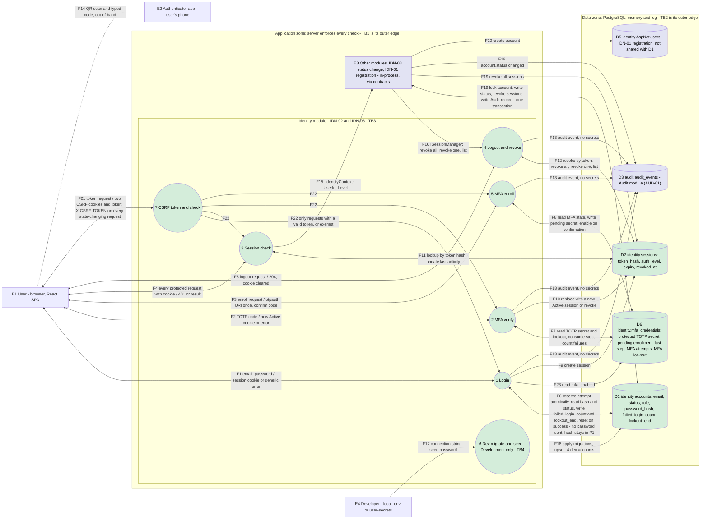

# Data flow diagram: IDN-02 Secure login and logout, IDN-06 MFA

**Team:** 1 (IDN-02 + IDN-06)

**Student:** Nikola Jovanović / PR3-2023 (story US-10, reviewed by the whole team)

**Specification requirements:** IDN-02, IDN-06 (primary), SEC-02, SEC-03, SEC-04, AUD-01, AUD-03, AUD-04, ACC-05, UC-05. Depends on IDN-03 (account status), IDN-05 (attempt limiting) and AUD (audit).

## Responsibilities and boundaries

- Processes and user scenarios:
  - A user logs in with e-mail and password and receives a server-side session in `identity.sessions` (IDN-02, implemented).
  - Every protected request is checked against the session store by `SessionCheckMiddleware`; logout and revocation take effect on the next request (IDN-02, UC-05, implemented).
  - A user with MFA enabled receives a `MfaPending` session first, replaced by a new `Active` session with a new token only after a valid TOTP code (IDN-11), and enrolls an authenticator by QR code from an `Active` session (IDN-06, US-17 and US-18, implemented). Mandatory MFA for selected groups (US-19) is not implemented: MFA is opt-in.
  - In Development only, the API applies the identity migrations and seeds four known accounts (US-09, implemented).
  - Every state-changing request that carries the session cookie, and every login, must carry a valid CSRF token (US-15, SEC-03, implemented).
- Contracts with other modules:
  - Provided: `IIdentityContext` (implemented by `SessionIdentityContext`), `ISessionManager` (implemented by `SessionManager`), `IMfaPolicy` (proposed, US-19).
  - Used: the Audit module contract (AUD-01) through `IdentityAuditProducer` (`ITrustedAuditWriter`, `ITransactionalAuditWriter`), account status from IDN-03, per-account lockout from IDN-05 (inside `CredentialVerifier`), ACC-05 actions for every endpoint.
- Implementation status: see [Implementation status](#implementation-status). P1 to P7 are implemented.

This file covers only the data flow diagram (US-10). The component architecture diagram is a separate story (US-11).

## Data flow diagram

Legend: circle = process, rectangle = external actor or module, cylinder = data store, double-headed arrow = request and response of one named flow, dotted line = out-of-band channel or planned flow. Dashed grey = planned, not implemented yet. Green = implemented. Blue-grey = owned by another module, shown because it touches our data or contracts (D3 is owned by the Audit module).

## Elements

### External actors

| ID | Actor | Notes |
|-|-|-|
| E1 | User (browser) | Student, teacher or administrator, using the React SPA (`frontend/src/auth/authApi.ts`). Untrusted input. Teacher and administrator would have mandatory MFA (proposed, to be confirmed). |
| E2 | Authenticator app | On the user's phone. Receives the TOTP secret from the QR code, shows a 6-digit code. Outside our control. Used by IDN-06 (US-17, US-18). |
| E3 | Other modules | In-process consumers: IDN-03 `ChangeAccountStatus` and `AdminAccountsController`, IDN-01 `AccountEndpoints` and `AccountRegistrationService`. They should use only our contracts. |
| E4 | Developer | Provides `ConnectionStrings__Identity` and `Seed__DevelopmentPassword` through the git-ignored `.env` or user-secrets. Exists only in Development. |

### Processes

| ID | Process | Entry point | Status |
|-|-|-|-|
| P1 | Login | `POST /api/auth/login` (`AuthController.Login` -> `LoginService`) | implemented, see [`IDN-02_LOGIN.md`](./IDN-02_LOGIN.md) |
| P2 | MFA verify | `POST /api/auth/mfa/verify` (`AuthController.MfaVerify` -> `MfaService.VerifyAsync`, ACC-05 action `identity.mfa.verify`) | implemented (US-18), see [`IDN-02_TOTP_MFA.md`](./IDN-02_TOTP_MFA.md) |
| P5 | MFA enroll | `POST /api/auth/mfa/enroll` and `.../enroll/confirm` (`MfaService.EnrollAsync`, `ConfirmEnrollAsync`, ACC-05 actions `identity.mfa.enroll`, `identity.mfa.enroll.confirm`) | implemented (US-17), see [`IDN-02_TOTP_MFA.md`](./IDN-02_TOTP_MFA.md) |
| P3 | Session check | `SessionCheckMiddleware` on every non-anonymous endpoint, `GET /api/auth/me` (`AuthController.Me`) | implemented |
| P4 | Logout and revoke | `POST /api/auth/logout` (`LogoutService`), `ISessionManager.RevokeAllForUser`, `RevokeSession`, `ListForUser` (`SessionManager`) | logout implemented, see [`IDN-02_LOGOUT.md`](./IDN-02_LOGOUT.md). Revoke all, revoke one and list are implemented; IDN-07 exposes list and revoke one as `GET /api/auth/sessions` and `DELETE /api/auth/sessions/{handle}` |
| P6 | Dev migrate and seed | `DevelopmentDatabase.ApplyIdentityMigrationsAsync`, `DevelopmentAccountSeeder.SeedDevelopmentAccountsAsync` at API startup | implemented, Development only, see [`DEVELOPMENT.md`](../../DEVELOPMENT.md) |
| P7 | CSRF token and check | `GET /api/auth/csrf` (`AuthController.Csrf`), `CsrfProtectionMiddleware` right after routing, before every session check, Access and rate limiting | implemented, see [`IDN-02_CSRF.md`](./IDN-02_CSRF.md) |

Process numbers follow the team work plan (P5 is listed after P2 only for layout).

### Data stores

| ID | Store | Content | Status |
|-|-|-|-|
| D1 | `identity.accounts` (`PlatformIdentityDbContext`, entity `UserAccount`) | `id`, `email` (unique, lower-case), `status` (`Active`, `Blocked`, `Archived`), `role` (`Student`, `Teacher`, `Administrator`), `password_hash` (BCrypt, nullable), `failed_login_count`, `lockout_end` (IDN-05). MFA data is in D6, not here | implemented. Read and written by login (F6, `EfCredentialStore`, the writes touch only `failed_login_count` and `lockout_end`), written by the seeder (P6). Migrations `InitialIdentity`, `AddAccountPasswordHash`, `AddAccountRole`, `AddAccountLockout` |
| D2 | `identity.sessions` (entity `Session`) | `id`, `user_id` (FK to D1, cascade), `token_hash` (SHA-256, unique, never the token), `session_handle` (public, unique), `auth_level` (`MfaPending` or `Active`), `created_at`, `expires_at`, `last_activity_at`, `revoked_at` (concurrency token) | implemented (migration `AddSessions`), accessed through `ISessionStore` and `SessionManager` |
| D3 | `audit.audit_events` (Audit module, AUD-01) | event type, outcome, actor kind and id, resource, correlation ID, server UTC time, `reasonCode` and other catalog details | Login, logout and MFA refusals: `IdentityAuditProducer` through `ITrustedAuditWriter`. MFA enabled and MFA verified: `ITransactionalAuditWriter` in the same transaction as D6 and D2. IDN-03 status changes and IDN-05 unlock: `ITransactionalAuditWriter`, in the same transaction as D1 and D2 |
| D4 | (removed) | `InMemoryAccountRepository` no longer exists | IDN-03 writes to D1 |
| D5 | `identity.AspNetUsers` (`AccountDbContext`, ASP.NET Core Identity) | accounts created by IDN-01 registration | implemented by IDN-01, **not the same data as D1**, not migrated on startup |
| D6 | `identity.mfa_credentials` (entity `MfaCredentials`) | `user_id` (PK, FK to D1, cascade), `mfa_enabled`, `totp_secret_ciphertext` and `totp_secret_key_version` (Data Protection), `pending_totp_secret_ciphertext`, `pending_totp_secret_key_version`, `pending_enrollment_expires_at`, `last_totp_time_step`, `mfa_failed_attempts`, `mfa_locked_until` | implemented (US-17, US-18), accessed through `IMfaCredentialsStore` (`EfMfaCredentialsStore`) |

## Data flows

| Flow | Direction | Data | Endpoint or contract | Store / table | Status |
|-|-|-|-|-|-|
| F1 | E1 <-> P1 | E-mail and password in, with `X-CSRF-TOKEN` (US-15, `403 csrf_invalid` without it). Session cookie `SecurityLab.Session` (`HttpOnly`, `Secure`, `SameSite=Strict`) and `{ userId, mfaRequired }` (`mfaRequired` is true for a `MfaPending` session), and a CSRF token for the new session (F21), or one generic `401 invalid_credentials`. `400 invalid_request`, `503 login_unavailable`. The token is never in the body. `Cache-Control: no-store` | `POST /api/auth/login` | none | implemented |
| F2 | E1 <-> P2 | 6-digit TOTP code in, requires a `MfaPending` cookie and its `X-CSRF-TOKEN` (F22). `200` (a new cookie with the token of a new `Active` session; the `MfaPending` cookie is rejected afterwards, and a CSRF token for the new session (F21); the token of the `MfaPending` session gets `403 csrf_invalid` afterwards), one generic `401 invalid_mfa` (wrong, replayed or expired code, locked second factor, invalid session), `400 invalid_request`, `503 mfa_unavailable`. `Cache-Control: no-store` | `POST /api/auth/mfa/verify` | none | implemented |
| F3 | E1 <-> P5 | Enroll request from an `Active` session. `otpauth://` URI shown once. Confirmation code. `409` when MFA is already enabled or an enrollment is pending | `POST /api/auth/mfa/enroll`, `.../enroll/confirm` | none | implemented |
| F4 | E1 <-> P3 | Cookie on every request. `401` without reason, or the normal response. Endpoints with `[AllowAnonymous]` skip the check. A state-changing request also needs `X-CSRF-TOKEN` (F21, F22), `SameSite=Strict` is a second layer | any protected endpoint, e.g. `GET /api/auth/me`, `PUT /api/admin/accounts/{id}/status`, `POST /api/admin/accounts` | none | implemented |
| F5 | E1 <-> P4 | Logout request with the cookie. `204` and the cleared cookie. Always the same answer. No CSRF token needed (documented exception, US-15) | `POST /api/auth/logout` (`[AllowAnonymous]`) | none | implemented |
| F6 | P1 <-> D1 | E-mail normalized. In order: (1) `ReserveAttemptAsync` charges the attempt in one atomic `UPDATE` before the hash check, and an attempt that finds the limit already charged writes `lockout_end` and restarts `failed_login_count`. (2) `FindByEmailAsync` reads id, status, `password_hash`, `failed_login_count` and `lockout_end`. (3) The hash is checked with BCrypt inside P1 (also for unknown e-mails and locked accounts, dummy hash when there is none). (4) A correct password on an unlocked account calls `TryClearFailuresAsync`, one atomic `UPDATE` that resets `failed_login_count`, clears `lockout_end` and refuses the login if the account locked during the hash. (5) Every other attempt calls `LockIfLimitReachedAsync`, which writes `lockout_end` and restarts the counter at the limit, then reads `lockout_end` back. Locked accounts and unknown e-mails change no row. The reset in (4) also runs for blocked and archived accounts, but `LoginService` lets only `Active` continue, so it gives no access (accepted by the IDN-02 owner). No secrets leave: only the normalized e-mail, the account id and the counter and lockout values go to D1, the password never does, and the hash is read but never written, returned or logged. The counter and `lockout_end` are never returned to E1, a locked account gets the same `401` as in F1 | `ICredentialVerifier`, `ICredentialStore` (`EfCredentialStore`: `ReserveAttemptAsync`, `FindByEmailAsync`, `TryClearFailuresAsync`, `LockIfLimitReachedAsync`), `IPasswordHasher` | `identity.accounts` | implemented for password, status and lockout. MFA state is read from D6 (F23) |
| F7 | P2 <-> D6 | Protected secret and `mfa_locked_until` read. A correct, newer step is consumed by one conditional `UPDATE` (newer than `last_totp_time_step`, not locked; clears the counter and lockout). A wrong code is counted by one atomic `UPDATE` that sets `mfa_locked_until` at the threshold | `IMfaCredentialsStore` (`RecordFailedAttemptAsync`, `BeginAsync` -> `IMfaUnitOfWork.TryConsumeTimeStepAsync`) | `identity.mfa_credentials` | implemented |
| F8 | P5 <-> D6 | MFA state read, protected pending secret written (10 minutes). Both writes first lock the account (`Active`) and the session (not revoked or expired) in the same transaction. Confirmation moves it to the active secret in one conditional `UPDATE` (MFA still disabled, same unexpired pending enrollment). An enabled secret is never overwritten | `IMfaUnitOfWork` (`TryLockActiveSessionAsync`, `TryCreatePendingAsync`, `TryConfirmEnrollmentAsync`) | `identity.mfa_credentials` | implemented |
| F9 | P1 -> D2 | New session with a fresh random token and handle (session fixation protection), 8 hours lifetime, level `MfaPending` when D6 says MFA is enabled, otherwise `Active` | `ISessionCreator` -> `StoreSessionCreator` -> `ISessionStore.CreateForActiveAccountAsync` | `identity.sessions` | implemented |
| F10 | P2 -> D2 | In the same transaction as F7 and the F13 record, the `MfaPending` session (only one that is not revoked or expired) is revoked and a new `Active` session with a new token and handle and an 8 hours lifetime is stored (IDN-11, session fixation protection), or revoke the pending session at the threshold or while the second factor is locked | `IMfaUnitOfWork.TryReplaceWithActiveSessionAsync`, `ISessionStore.RevokeByTokenAsync` | `identity.sessions` | implemented |
| F11 | P3 <-> D2 | Lookup by token hash on every request. Missing, unknown, revoked or expired means `401`. `last_activity_at` is updated | `ISessionManager.ValidateAsync` (`SessionManager`) | `identity.sessions` | implemented |
| F12 | P4 <-> D2 | Logout revokes the session of the cookie. Revoke all and revoke one set `revoked_at`. List returns public handles of `Active` sessions only (an `MfaPending` session gives no access) | `ISessionStore.RevokeByTokenAsync` (logout), `ISessionManager.RevokeAllForUser`, `RevokeSession`, `ListForUser` | `identity.sessions` | implemented; list and revoke one also over HTTP (IDN-07, `SessionController`) |
| F13 | P1, P2, P4, P5 -> D3 | `auth.login` (Success, Failure with `reasonCode`), `auth.logout`, `auth.mfa.enrollment.started`, `auth.mfa.enabled` (Success, Failure with `reasonCode`) and `auth.mfa.verified` (Success, Failure with `reasonCode`, Denied with `attempt_limit`). Never e-mail, password, hash, token, TOTP secret, URI or code. Correlation ID from the server (`CorrelationMiddleware`, also in `HttpContext.TraceIdentifier`) | `IdentityAuditProducer` -> `ITrustedAuditWriter`; MFA enabled and verified through `ITransactionalAuditWriter` (no record, no commit, `503`) | `audit.audit_events` | implemented. Logout of an unknown or already revoked session writes no event. A login whose record fails revokes the new session and answers `503` |
| F14 | E1 - E2 | QR code scanned with the phone, 6-digit code typed back. Outside the server | none | none | not a server flow |
| F15 | P3 -> E3 | `CallerIdentity`: `IsAuthenticated`, `UserId`, `Level`, `CurrentSessionHandle`. Never token, hash or cookie | `IIdentityContext.Current` (`SessionIdentityContext`, reads the result of the middleware) | none | implemented |
| F16 | E3 -> P4 | Revoke all sessions of a user when IDN-03 blocks or archives the account. Revoke one and list reserved for IDN-07 | `ISessionManager.RevokeAllForUser` (`SessionManager`) | `identity.sessions` | implemented, called by `ChangeAccountStatus` |
| F17 | E4 -> P6 | Connection string and seed password from `.env` or user-secrets. Not in the repository | `Seed:DevelopmentPassword`, `ConnectionStrings:Identity` | none | implemented, Development only |
| F18 | P6 -> D1 | Pending migrations applied. Four accounts upserted (administrator, student, teacher, blocked student), BCrypt hash set only if missing | `ApplyIdentityMigrationsAsync`, `SeedDevelopmentAccountsAsync` | `identity.accounts`, creates `identity.sessions` | implemented. Throws outside Development |
| F19 | E3 <-> D1, D2, D3 | IDN-03 locks the account row, writes the new status, revokes all sessions (Blocked, Archived) and writes the `account.status.changed` Audit record in one transaction. Rolled back as a whole if any step fails | `ChangeAccountStatus`, `IAccountStatusStore` (`EfAccountStatusStore`), `ITransactionalAuditWriter` | `identity.accounts`, `identity.sessions`, `audit.audit_events` | implemented. Login and the session check read the same status |
| F20 | E3 -> D5 | IDN-01 creates an account for the administrator-only endpoint | `POST /api/admin/accounts`, `IAccountRegistration` | `identity.AspNetUsers` | implemented by IDN-01. The new account cannot log in (see [Known deviations](#known-deviations)) |
| F21 | E1 <-> P7 | Token request. Out: HttpOnly cookie `__Host-SecurityLab.Csrf` (only when missing), readable cookie `__Host-SecurityLab.CsrfToken` and `{ token }`, `no-store`. The request token is bound to the session cookie sent with it (SHA-256 inside the encrypted token); login sets a new readable token for the new session, logout removes both cookies. In, on every state-changing request: header `X-CSRF-TOKEN` and the HttpOnly cookie | `GET /api/auth/csrf`, `IAntiforgery` | none (Data Protection key ring) | implemented |
| F22 | P7 -> P1, P3 and every other endpoint | A state-changing request with a valid session, or a login, passes only with a valid token for that session. Otherwise `403 csrf_invalid` before any session check, Access decision, rate limit or audit, so nothing changes, not even `last_activity_at`. Whether the session is valid is read without recording activity. `GET`, logout, the OIDC callback and requests without a valid session are not checked; an invalid session still gets `401` from P3 | `CsrfProtectionMiddleware` | none | implemented |
| F23 | P1 -> D6 | After a valid password for an `Active` account: is MFA enabled? Decides the level in F9 and `mfaRequired` in F1. Nothing is written. A database error gives `503 login_unavailable` and no session (`auth.login` Failure, `mfa_unavailable`) | `IMfaCredentialsStore.GetAsync` | `identity.mfa_credentials` | implemented |

## Trust boundaries

| ID | Boundary | Crossed by | Rule |
|-|-|-|-|
| TB1 | Internet / browser and server | F1 to F5, F21 | Everything from E1 is untrusted and validated on the server. The cookie carries only an opaque random token. Hiding screens in the UI is not a control. |
| TB2 | Server and database / memory / log | F6 to F13, F18 to F20, F23 | Only the Identity module touches `identity.accounts`, `identity.sessions` and `identity.mfa_credentials`. Other modules go through contracts (F15, F16). Secrets come from the local `.env`, user-secrets or environment, never from code. |
| TB3 | Identity module and other modules (logical, in-process) | F15, F16 | Contracts only. `IIdentityContext` never exposes passwords, tokens or session identifiers. `ISessionManager` does not decide who may call it, the caller checks permission first. |
| TB4 | Development and every other environment | F17, F18 | Migrations and seeding run only when `IsDevelopment()`, `RequireDevelopment` throws otherwise. The seed password is never in the repository. Without a connection string or password the seed is skipped. |

The phone (E2) is outside all boundaries. The TOTP secret leaves the server once, in F3, over HTTPS, and the QR code is drawn locally in the browser (no third-party service).

## Negative flows

| Scenario | Flow | Expected result |
|-|-|-|
| Wrong password, unknown account, account without password | F1 | Same `401 invalid_credentials`, no session, `auth.login` Failure (`invalid_credentials`) |
| Blocked or archived account in `identity.accounts` | F1, F6 | Same `401`, no session, `auth.login` Failure with the real reason (`account_blocked`, `account_archived`). A correct password still resets the counter in F6, which gives no access |
| Locked account, also with the correct password | F1, F6 | Same `401`, no session, `auth.login` Failure (`account_locked`). The attempt changes no row, so it does not extend the lockout |
| Parallel attempts on one account | F6 | Each attempt is charged by one atomic `UPDATE`, so a burst cannot exceed the limit. A correct password that finishes after the lock is refused by `TryClearFailuresAsync` |
| Empty or too long e-mail or password | F1 | `400 invalid_request`, no database read |
| Session cannot be stored (database error) | F1, F9 | `503 login_unavailable`, no cookie (fails closed) |
| Old cookie after logout, expired, revoked or unknown token, no cookie | F4 | `401` without the reason (IDN-02 criterion) |
| Logout without a session or with an unknown cookie | F5 | `204`, cookie cleared, no audit event, does not reveal session state |
| Two requests revoke the same session at once | F12 | Only one succeeds (`revoked_at` is a concurrency token) |
| Account blocked or archived through IDN-03 | F16 | All sessions of that user in D2 are revoked at once |
| Revoking another user's session handle | F16 | Returns false, indistinguishable from an unknown handle |
| Seeding outside Development | F18 | `InvalidOperationException`, nothing written |
| Cookie captured before the second factor (network, logs, shared machine) | F2, F10 | The verification revokes the `MfaPending` session and issues a new `Active` session with a new token, so the old cookie gets `401` afterwards (IDN-11) |
| `MfaPending` cookie sent to a protected endpoint (UI bypassed) | F4 | `IsAuthenticated` is false and there is no Access subject until `Active`, so ACC-05 denies it (IDN-06 criterion) |
| Wrong TOTP code | F2, F7 | `401 invalid_mfa`, session stays `MfaPending`, the attempt is counted atomically. At `Identity:Mfa:Lockout:MaxFailedAttempts` the second factor is locked for `Identity:Mfa:Lockout:LockoutMinutes` (separate from the IDN-05 password lockout) and the pending session is revoked |
| Correct code while the second factor is locked, also after a new password login | F2, F7 | Same `401 invalid_mfa`, the code is not checked, the pending session is revoked, `auth.mfa.verified` Denied (`attempt_limit`) |
| Replayed or older TOTP code, also the same code from two parallel requests | F2, F7 | Refused (`step <= last_totp_time_step`). In parallel only one request consumes the step; the other matches no row after the row lock and gets `401` |
| Audit record of MFA enabled or verified cannot be written | F8, F10, F13 | `503 mfa_unavailable`, the transaction is rolled back: MFA stays disabled, the session stays `MfaPending` |
| Enrollment when MFA is already enabled | F3 | `409 mfa_already_enabled`, existing secret not overwritten |
| Two parallel confirmations of one enrollment | F3, F8 | Only one enables MFA |
| State-changing request without a valid CSRF token (missing, forged, from another browser, issued for another session, without its cookie), also on login | F1, F4, F22 | `403 csrf_invalid` before any other check, nothing changes, the session is not extended (US-15) |
| CSRF token of the `MfaPending` session used after the second factor | F2, F22 | `mfa/verify` issues a new token for the new `Active` session; the old one is bound to the revoked session and gets `403 csrf_invalid` (US-15, IDN-11) |

## Sensitive data

| Data | Where it travels | Handling |
|-|-|-|
| Password | F1 only | HTTPS only, BCrypt check (work factor 12, SHA-384 pre-hash), never logged or stored in plain text. Seed password only in `.env` or user-secrets (F17) |
| Session token | cookie, F1, F4, F5 | Generated with a cryptographically secure generator. Only its SHA-256 hash is stored in D2. Never in a response body, `IIdentityContext` or logs |
| `SessionHandle` | F12, F15, F16 | Public identifier, not a secret, safe to list and to put in the `auth.logout` audit event |
| Password hash | D1, F6 | Read only inside `CredentialVerifier`, never written by login, never returned, never logged |
| `failed_login_count`, `lockout_end` | D1, F6 | Not secret, but they reveal account state. Never returned to E1 and never put in an audit event, which carries only the account id and the detail `account locked` |
| TOTP secret | F3 once, D6 | Shown once at enrollment (in the `otpauth://` URI), stored protected with ASP.NET Core Data Protection (`SecurityLab / Identity / MfaTotpSecret / v1`, only through `ITotpSecretProtector`), never logged, audited or returned again. The keys are kept in `Identity:DataProtection:KeysPath` (outside the repository, backed up with the database) and are not encrypted at rest; the start does not check the setting (IDN-02_TOTP_MFA.md, "Ključevi") |
| TOTP code | F2, F3 | Never logged or audited. Each step is accepted once; wrong codes are limited by the MFA lockout |
| CSRF token pair | F21, F22 | Made and checked by ASP.NET Core antiforgery (Data Protection), no custom cryptography. Bound to the session by the SHA-256 of the session cookie, inside the encrypted token. Cookies `__Host-`, `Secure`, `SameSite=Strict`; the cookie token is `HttpOnly`. Never logged |

## Security requirements

- Server-side access checks: every request to an endpoint without `[AllowAnonymous]` goes through P3 and gets `401` without a valid session. Administrator-only actions are decided on the server (`AdminOnlyAccessDecision`, `CreateAccountPolicy`). Endpoints without an explicit policy are denied by default (ACC-05).
- Input validation and sensitive data: length limits and generic error messages on login, no secrets in logs or API responses (SEC-02, AUD-03).
- Negative scenarios: see [Negative flows](#negative-flows). Unit tests exist for `LoginService`, `LogoutService`, `MfaService`, `IdentityAuditProducer`, `SessionStore`, `StoreSessionCreator`, `SessionManager`, `SessionCheckMiddleware`, `DevelopmentAccountSeeder` and `TestUsers`. HTTP-level tests against PostgreSQL (Testcontainers) cover login, logout, `me`, sessions and MFA (`Integration/Mfa/`, including parallel requests and audit rows).

## Known deviations

These are the places where the code and the intended single data model differ. They matter for the diagram because several stores hold account data:

- **Two account stores.** Login, the seeder and the IDN-03 status change use D1 (`identity.accounts`); IDN-01 registration uses D5 (`identity.AspNetUsers`). An account created through `POST /api/admin/accounts` cannot log in. Resolved when registration uses D1 (ADM-02). An account blocked through `PUT /api/admin/accounts/{id}/status` can no longer log in and its sessions are revoked.
- **Administrator check is a stub.** `ConfigAdminDirectory` reads `Stub:AdminIds` from configuration. The `role` column in D1 is not used for authorization yet.
- **`POST /api/admin/accounts` resolves the caller from `Identity:DevSubjectId`** (`DevelopmentSubjectResolver`), not from the session. Outside Development the caller is always unauthenticated.
- **No inactivity timeout.** The session lifetime is fixed at 8 hours (US-14).

## Implementation status

Present in the repository now:

- Contracts: `IIdentityContext` (`CallerIdentity`), `ISessionManager`, `IAccessDecision`, `AuthenticationLevel` (`None`, `MfaPending`, `Active`). Audit through the Audit module contract (`IdentityAuditProducer`); the old Identity `IAuditWriter` / `LoggerAuditWriter` is removed.
- Identity module: `backend/Platform.Identity` with `PlatformIdentityDbContext` (`identity.accounts`, `identity.sessions`, `identity.mfa_credentials`), `AddIdentityModule(configuration)`, BCrypt `IPasswordHasher`, `ICredentialVerifier`, `ISessionStore`, `IMfaCredentialsStore`, migrations `InitialIdentity`, `AddAccountPasswordHash`, `AddSessions`, `AddAccountRole` and the MFA credentials migration.
- US-17 and US-18 MFA: `POST /api/auth/mfa/enroll`, `.../enroll/confirm`, `.../verify` (`MfaService`). Details in [`IDN-02_TOTP_MFA.md`](./IDN-02_TOTP_MFA.md).
- US-04 login: `POST /api/auth/login` (`AuthController`, `LoginService`), cookie `SecurityLab.Session`. Details in [`IDN-02_LOGIN.md`](./IDN-02_LOGIN.md).
- US-03 session store: `identity.sessions`, `SessionStore`, `StoreSessionCreator`.
- US-05 logout: `POST /api/auth/logout` (`LogoutService`). Details in [`IDN-02_LOGOUT.md`](./IDN-02_LOGOUT.md).
- US-06 session check: `SessionCheckMiddleware`, `SessionManager.ValidateAsync` (also updates last activity), `SessionIdentityContext` as the registered `IIdentityContext`, `GET /api/auth/me`.
- Session revocation: `SessionManager.RevokeAllForUser`, `RevokeSession` and `ListForUser` work against `identity.sessions`. `ChangeAccountStatus` (IDN-03) calls `RevokeAllForUser` when it blocks or archives an account.
- US-09 development seed: `DevelopmentDatabase` and `DevelopmentAccountSeeder` (four accounts, Development only), test helper `TestUsers` in `Platform.Identity.Tests`.
- Frontend: `frontend/src/auth/authApi.ts` calls `/api/auth/me`, `/api/auth/login` and `/api/auth/logout`, `frontend/src/api/accounts.ts` calls `POST /api/admin/accounts`.
- Not used on the request path: `StubIdentityContext` and `AnonymousIdentityContext`. The old `StoreSessionManager` stub has been deleted.

Planned (this DFD describes them, but the code does not exist yet): mandatory MFA for selected groups (`IMfaPolicy`, US-19).

Open decisions that can change this diagram (to confirm with the assistant): which groups have mandatory MFA, when D5 is merged into D1.

## Evidence of work

- Changed files / commit / pull request: `docs/components/identity/IDN-02_IDN-06_DFD.md` ([PR link])
- Run instructions: open this file on GitHub, the Mermaid diagram renders in the page.
- Tests and results: not applicable to documentation. Each flow is linked to an endpoint, contract or table in [Data flows](#data-flows).
- Team review: [ ] reviewed by the whole team
- Next steps: update flow status as US-12 (MFA ADR), IDN-05, US-15 and ADM-02 land, final update in US-28 for KT2.