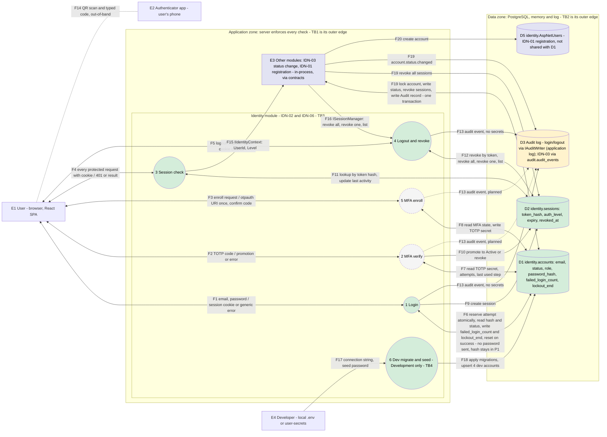

# Data flow diagram: IDN-02 Secure login and logout, IDN-06 MFA

**Team:** 1 (IDN-02 + IDN-06)

**Student:** Nikola Jovanović / PR3-2023 (story US-10, reviewed by the whole team)

**Specification requirements:** IDN-02, IDN-06 (primary), SEC-02, SEC-03, SEC-04, AUD-01, AUD-03, AUD-04, ACC-05, UC-05. Depends on IDN-03 (account status), IDN-05 (attempt limiting) and AUD (audit).

## Responsibilities and boundaries

- Processes and user scenarios:
  - A user logs in with e-mail and password and receives a server-side session in `identity.sessions` (IDN-02, implemented).
  - Every protected request is checked against the session store by `SessionCheckMiddleware`; logout and revocation take effect on the next request (IDN-02, UC-05, implemented).
  - A user with MFA enabled or required would receive a `MfaPending` session first, promoted to `Active` only after a valid TOTP code, and would enroll an authenticator by QR code (IDN-06, **planned**: no MFA code exists yet, every login is `Active`).
  - In Development only, the API applies the identity migrations and seeds four known accounts (US-09, implemented).
- Contracts with other modules:
  - Provided: `IIdentityContext` (implemented by `SessionIdentityContext`), `ISessionManager` (implemented by `SessionManager`), `IMfaPolicy` (proposed).
  - Used: `IAuditWriter` (`LoggerAuditWriter`), account status from IDN-03, per-account lockout from IDN-05 (inside `CredentialVerifier`).
- Implementation status: see [Implementation status](#implementation-status). P1, P3, P4 and P6 are implemented. P2 and P5 (MFA) are planned.

This file covers only the data flow diagram (US-10). The component architecture diagram is a separate story (US-11).

## Data flow diagram

Legend: circle = process, rectangle = external actor or module, cylinder = data store, double-headed arrow = request and response of one named flow, dotted line = out-of-band channel or planned flow. Dashed grey = planned, not implemented yet. Yellow = working but temporary (audit goes to the application log). Green = implemented. Blue-grey = owned by another module, shown because it touches our data or contracts.

## Elements

### External actors

| ID | Actor | Notes |
|-|-|-|
| E1 | User (browser) | Student, teacher or administrator, using the React SPA (`frontend/src/auth/authApi.ts`). Untrusted input. Teacher and administrator would have mandatory MFA (proposed, to be confirmed). |
| E2 | Authenticator app | On the user's phone. Receives the TOTP secret from the QR code, shows a 6-digit code. Outside our control. Planned with IDN-06. |
| E3 | Other modules | In-process consumers: IDN-03 `ChangeAccountStatus` and `AdminAccountsController`, IDN-01 `AccountEndpoints` and `AccountRegistrationService`. They should use only our contracts. |
| E4 | Developer | Provides `ConnectionStrings__Identity` and `Seed__DevelopmentPassword` through the git-ignored `.env` or user-secrets. Exists only in Development. |

### Processes

| ID | Process | Entry point | Status |
|-|-|-|-|
| P1 | Login | `POST /api/auth/login` (`AuthController.Login` -> `LoginService`) | implemented, see [`IDN-02_LOGIN.md`](./IDN-02_LOGIN.md) |
| P2 | MFA verify | `POST /api/auth/mfa/verify` (proposed name) | planned |
| P5 | MFA enroll | `POST /api/auth/mfa/enroll` and `.../enroll/confirm` (proposed names) | planned |
| P3 | Session check | `SessionCheckMiddleware` on every non-anonymous endpoint, `GET /api/auth/me` (`AuthController.Me`) | implemented |
| P4 | Logout and revoke | `POST /api/auth/logout` (`LogoutService`), `ISessionManager.RevokeAllForUser`, `RevokeSession`, `ListForUser` (`SessionManager`) | logout implemented, see [`IDN-02_LOGOUT.md`](./IDN-02_LOGOUT.md). Revoke all, revoke one and list are implemented as methods, no HTTP endpoint for revoke one or list yet (IDN-07) |
| P6 | Dev migrate and seed | `DevelopmentDatabase.ApplyIdentityMigrationsAsync`, `DevelopmentAccountSeeder.SeedDevelopmentAccountsAsync` at API startup | implemented, Development only, see [`DEVELOPMENT.md`](../../DEVELOPMENT.md) |

Process numbers follow the team work plan (P5 is listed after P2 only for layout).

### Data stores

| ID | Store | Content | Status |
|-|-|-|-|
| D1 | `identity.accounts` (`PlatformIdentityDbContext`, entity `UserAccount`) | `id`, `email` (unique, lower-case), `status` (`Active`, `Blocked`, `Archived`), `role` (`Student`, `Teacher`, `Administrator`), `password_hash` (BCrypt, nullable), `failed_login_count`, `lockout_end` (IDN-05). MFA columns planned (names pending US-12) | implemented. Read and written by login (F6, `EfCredentialStore`, the writes touch only `failed_login_count` and `lockout_end`), written by the seeder (P6). Migrations `InitialIdentity`, `AddAccountPasswordHash`, `AddAccountRole`, `AddAccountLockout` |
| D2 | `identity.sessions` (entity `Session`) | `id`, `user_id` (FK to D1, cascade), `token_hash` (SHA-256, unique, never the token), `session_handle` (public, unique), `auth_level` (`MfaPending` or `Active`), `created_at`, `expires_at`, `last_activity_at`, `revoked_at` (concurrency token) | implemented (migration `AddSessions`), accessed through `ISessionStore` and `SessionManager` |
| D3 | Audit log | actor, action, target, time, outcome, correlation ID, detail | Login and logout: `LoggerAuditWriter` writes to the application log. IDN-03 status changes: `audit.audit_events` through `ITransactionalAuditWriter`, in the same transaction as D1 and D2 |
| D4 | (removed) | `InMemoryAccountRepository` no longer exists | IDN-03 writes to D1 |
| D5 | `identity.AspNetUsers` (`AccountDbContext`, ASP.NET Core Identity) | accounts created by IDN-01 registration | implemented by IDN-01, **not the same data as D1**, not migrated on startup |

## Data flows

| Flow | Direction | Data | Endpoint or contract | Store / table | Status |
|-|-|-|-|-|-|
| F1 | E1 <-> P1 | E-mail and password in. Session cookie `SecurityLab.Session` (`HttpOnly`, `Secure`, `SameSite=Strict`) and `{ userId }`, or one generic `401 invalid_credentials`. `400 invalid_request`, `503 login_unavailable`. The token is never in the body. `Cache-Control: no-store` | `POST /api/auth/login` | none | implemented |
| F2 | E1 <-> P2 | 6-digit TOTP code in, requires a `MfaPending` cookie. Promotion or generic error out | `POST /api/auth/mfa/verify` (proposed) | none | planned |
| F3 | E1 <-> P5 | Enroll request. `otpauth://` URI shown once. Confirmation code | `POST /api/auth/mfa/enroll`, `.../enroll/confirm` (proposed) | none | planned |
| F4 | E1 <-> P3 | Cookie on every request. `401` without reason, or the normal response. Endpoints with `[AllowAnonymous]` skip the check. No CSRF token yet (US-15), `SameSite=Strict` is the only layer | any protected endpoint, e.g. `GET /api/auth/me`, `PUT /api/admin/accounts/{id}/status`, `POST /api/admin/accounts` | none | implemented |
| F5 | E1 <-> P4 | Logout request with the cookie. `204` and the cleared cookie. Always the same answer | `POST /api/auth/logout` (`[AllowAnonymous]`) | none | implemented |
| F6 | P1 <-> D1 | E-mail normalized. In order: (1) `ReserveAttemptAsync` charges the attempt in one atomic `UPDATE` before the hash check, and an attempt that finds the limit already charged writes `lockout_end` and restarts `failed_login_count`. (2) `FindByEmailAsync` reads id, status, `password_hash`, `failed_login_count` and `lockout_end`. (3) The hash is checked with BCrypt inside P1 (also for unknown e-mails and locked accounts, dummy hash when there is none). (4) A correct password on an unlocked account calls `TryClearFailuresAsync`, one atomic `UPDATE` that resets `failed_login_count`, clears `lockout_end` and refuses the login if the account locked during the hash. (5) Every other attempt calls `LockIfLimitReachedAsync`, which writes `lockout_end` and restarts the counter at the limit, then reads `lockout_end` back. Locked accounts and unknown e-mails change no row. The reset in (4) also runs for blocked and archived accounts, but `LoginService` lets only `Active` continue, so it gives no access (accepted by the IDN-02 owner). No secrets leave: only the normalized e-mail, the account id and the counter and lockout values go to D1, the password never does, and the hash is read but never written, returned or logged. The counter and `lockout_end` are never returned to E1, a locked account gets the same `401` as in F1 | `ICredentialVerifier`, `ICredentialStore` (`EfCredentialStore`: `ReserveAttemptAsync`, `FindByEmailAsync`, `TryClearFailuresAsync`, `LockIfLimitReachedAsync`), `IPasswordHasher` | `identity.accounts` | implemented for password, status and lockout, MFA state planned |
| F7 | P2 <-> D1 | TOTP secret read, attempt counter and last used step read and updated | MFA service | `identity.accounts` (MFA columns) | planned |
| F8 | P5 <-> D1 | MFA state read, TOTP secret written after confirmation. Existing secret never overwritten | MFA service | `identity.accounts` (MFA columns) | planned |
| F9 | P1 -> D2 | New session with a fresh random token and handle (session fixation protection), 8 hours lifetime, level always `Active` until MFA exists | `ISessionCreator` -> `StoreSessionCreator` -> `ISessionStore.CreateAsync` | `identity.sessions` | implemented |
| F10 | P2 -> D2 | `MfaPending` to `Active`, or revoke after too many wrong codes | session service | `identity.sessions` | planned |
| F11 | P3 <-> D2 | Lookup by token hash on every request. Missing, unknown, revoked or expired means `401`. `last_activity_at` is updated | `ISessionManager.ValidateAsync` (`SessionManager`) | `identity.sessions` | implemented |
| F12 | P4 <-> D2 | Logout revokes the session of the cookie. Revoke all and revoke one set `revoked_at`. List returns public handles only | `ISessionStore.RevokeByTokenAsync` (logout), `ISessionManager.RevokeAllForUser`, `RevokeSession`, `ListForUser` | `identity.sessions` | implemented, revoke one and list have no HTTP endpoint yet |
| F13 | P1, P4 -> D3 (P2, P5 planned) | `auth.login` (`success`, `failure`, `denied`) and `auth.logout`. Never e-mail, password, hash, token or TOTP data. Correlation ID from `HttpContext.TraceIdentifier` | `IAuditWriter.Write(AuditEvent)` | application log | implemented. Logout of an unknown or already revoked session writes no event |
| F14 | E1 - E2 | QR code scanned with the phone, 6-digit code typed back. Outside the server | none | none | not a server flow, planned |
| F15 | P3 -> E3 | `CallerIdentity`: `IsAuthenticated`, `UserId`, `Level`, `CurrentSessionHandle`. Never token, hash or cookie | `IIdentityContext.Current` (`SessionIdentityContext`, reads the result of the middleware) | none | implemented |
| F16 | E3 -> P4 | Revoke all sessions of a user when IDN-03 blocks or archives the account. Revoke one and list reserved for IDN-07 | `ISessionManager.RevokeAllForUser` (`SessionManager`) | `identity.sessions` | implemented, called by `ChangeAccountStatus` |
| F17 | E4 -> P6 | Connection string and seed password from `.env` or user-secrets. Not in the repository | `Seed:DevelopmentPassword`, `ConnectionStrings:Identity` | none | implemented, Development only |
| F18 | P6 -> D1 | Pending migrations applied. Four accounts upserted (administrator, student, teacher, blocked student), BCrypt hash set only if missing | `ApplyIdentityMigrationsAsync`, `SeedDevelopmentAccountsAsync` | `identity.accounts`, creates `identity.sessions` | implemented. Throws outside Development |
| F19 | E3 <-> D1, D2, D3 | IDN-03 locks the account row, writes the new status, revokes all sessions (Blocked, Archived) and writes the `account.status.changed` Audit record in one transaction. Rolled back as a whole if any step fails | `ChangeAccountStatus`, `IAccountStatusStore` (`EfAccountStatusStore`), `ITransactionalAuditWriter` | `identity.accounts`, `identity.sessions`, `audit.audit_events` | implemented. Login and the session check read the same status |
| F20 | E3 -> D5 | IDN-01 creates an account for the administrator-only endpoint | `POST /api/admin/accounts`, `IAccountRegistration` | `identity.AspNetUsers` | implemented by IDN-01. The new account cannot log in (see [Known deviations](#known-deviations)) |

## Trust boundaries

| ID | Boundary | Crossed by | Rule |
|-|-|-|-|
| TB1 | Internet / browser and server | F1 to F5 | Everything from E1 is untrusted and validated on the server. The cookie carries only an opaque random token. Hiding screens in the UI is not a control. |
| TB2 | Server and database / memory / log | F6 to F13, F18 to F20 | Only the Identity module touches `identity.accounts` and `identity.sessions`. Other modules go through contracts (F15, F16). Secrets come from the local `.env`, user-secrets or environment, never from code. |
| TB3 | Identity module and other modules (logical, in-process) | F15, F16 | Contracts only. `IIdentityContext` never exposes passwords, tokens or session identifiers. `ISessionManager` does not decide who may call it, the caller checks permission first. |
| TB4 | Development and every other environment | F17, F18 | Migrations and seeding run only when `IsDevelopment()`, `RequireDevelopment` throws otherwise. The seed password is never in the repository. Without a connection string or password the seed is skipped. |

The phone (E2) is outside all boundaries. The TOTP secret would leave the server once, in F3, over HTTPS, and the QR code would be drawn locally in the browser (no third-party service).

## Negative flows

| Scenario | Flow | Expected result |
|-|-|-|
| Wrong password, unknown account, account without password | F1 | Same `401 invalid_credentials`, no session, audit event `failure` |
| Blocked or archived account in `identity.accounts` | F1, F6 | Same `401`, no session, audit event `denied` with the real reason. A correct password still resets the counter in F6, which gives no access |
| Locked account, also with the correct password | F1, F6 | Same `401`, no session, audit event `failure` with detail `account locked`. The attempt changes no row, so it does not extend the lockout |
| Parallel attempts on one account | F6 | Each attempt is charged by one atomic `UPDATE`, so a burst cannot exceed the limit. A correct password that finishes after the lock is refused by `TryClearFailuresAsync` |
| Empty or too long e-mail or password | F1 | `400 invalid_request`, no database read |
| Session cannot be stored (database error) | F1, F9 | `503 login_unavailable`, no cookie (fails closed) |
| Old cookie after logout, expired, revoked or unknown token, no cookie | F4 | `401` without the reason (IDN-02 criterion) |
| Logout without a session or with an unknown cookie | F5 | `204`, cookie cleared, no audit event, does not reveal session state |
| Two requests revoke the same session at once | F12 | Only one succeeds (`revoked_at` is a concurrency token) |
| Account blocked or archived through IDN-03 | F16 | All sessions of that user in D2 are revoked at once |
| Revoking another user's session handle | F16 | Returns false, indistinguishable from an unknown handle |
| Seeding outside Development | F18 | `InvalidOperationException`, nothing written |
| `MfaPending` cookie sent to a protected endpoint (UI bypassed) | F4 | Planned: `IsAuthenticated` is false until `Active` (IDN-06 criterion) |
| Wrong or replayed TOTP code | F2 | Planned: session stays `MfaPending`, limited attempts, replay rejected |
| Enrollment when MFA is already enabled | F3 | Planned: rejected, existing secret not overwritten |
| State-changing request without a valid CSRF token | F4 | Planned (US-15). Today only `SameSite=Strict` helps |

## Sensitive data

| Data | Where it travels | Handling |
|-|-|-|
| Password | F1 only | HTTPS only, BCrypt check (work factor 12, SHA-384 pre-hash), never logged or stored in plain text. Seed password only in `.env` or user-secrets (F17) |
| Session token | cookie, F1, F4, F5 | Generated with a cryptographically secure generator. Only its SHA-256 hash is stored in D2. Never in a response body, `IIdentityContext` or logs |
| `SessionHandle` | F12, F15, F16 | Public identifier, not a secret, safe to list and to put in the `auth.logout` audit event |
| Password hash | D1, F6 | Read only inside `CredentialVerifier`, never written by login, never returned, never logged |
| `failed_login_count`, `lockout_end` | D1, F6 | Not secret, but they reveal account state. Never returned to E1 and never put in an audit event, which carries only the account id and the detail `account locked` |
| TOTP secret | F3 once, D1 | Planned: shown once at enrollment, stored protected (US-22), never logged or returned again |
| TOTP code | F2, F3 | Planned: never logged. Replay and guessing limited |
| CSRF token | F4 | Planned (US-15) |

## Security requirements

- Server-side access checks: every request to an endpoint without `[AllowAnonymous]` goes through P3 and gets `401` without a valid session. Administrator-only actions are decided on the server (`AdminOnlyAccessDecision`, `CreateAccountPolicy`). Endpoints without an explicit policy are denied by default (ACC-05).
- Input validation and sensitive data: length limits and generic error messages on login, no secrets in logs or API responses (SEC-02, AUD-03).
- Negative scenarios: see [Negative flows](#negative-flows). Unit tests exist for `LoginService`, `LogoutService`, `SessionStore`, `StoreSessionCreator`, `SessionManager`, `SessionCheckMiddleware`, `DevelopmentAccountSeeder` and `TestUsers`. HTTP-level tests are planned in US-13, US-24 and US-25.

## Known deviations

These are the places where the code and the intended single data model differ. They matter for the diagram because several stores hold account data:

- **Two account stores.** Login, the seeder and the IDN-03 status change use D1 (`identity.accounts`); IDN-01 registration uses D5 (`identity.AspNetUsers`). An account created through `POST /api/admin/accounts` cannot log in. Resolved when registration uses D1 (ADM-02). An account blocked through `PUT /api/admin/accounts/{id}/status` can no longer log in and its sessions are revoked.
- **Administrator check is a stub.** `ConfigAdminDirectory` reads `Stub:AdminIds` from configuration. The `role` column in D1 is not used for authorization yet.
- **`POST /api/admin/accounts` resolves the caller from `Identity:DevSubjectId`** (`DevelopmentSubjectResolver`), not from the session. Outside Development the caller is always unauthenticated.
- **Login and logout audit goes to the application log** (D3), not to a store owned by AUD. IDN-03 already writes to `audit.audit_events`.
- **No CSRF token (US-15), no inactivity timeout.** The session lifetime is fixed at 8 hours (US-14).

## Implementation status

Present in the repository now:

- Contracts: `IIdentityContext` (`CallerIdentity`), `ISessionManager`, `IAuditWriter`, `IAccessDecision`, `AuthenticationLevel` (`None`, `MfaPending`, `Active`).
- Identity module: `backend/Platform.Identity` with `PlatformIdentityDbContext` (`identity.accounts`, `identity.sessions`), `AddIdentityModule(configuration)`, BCrypt `IPasswordHasher`, `ICredentialVerifier`, `ISessionStore`, migrations `InitialIdentity`, `AddAccountPasswordHash`, `AddSessions`, `AddAccountRole`.
- US-04 login: `POST /api/auth/login` (`AuthController`, `LoginService`), cookie `SecurityLab.Session`. Details in [`IDN-02_LOGIN.md`](./IDN-02_LOGIN.md).
- US-03 session store: `identity.sessions`, `SessionStore`, `StoreSessionCreator`.
- US-05 logout: `POST /api/auth/logout` (`LogoutService`). Details in [`IDN-02_LOGOUT.md`](./IDN-02_LOGOUT.md).
- US-06 session check: `SessionCheckMiddleware`, `SessionManager.ValidateAsync` (also updates last activity), `SessionIdentityContext` as the registered `IIdentityContext`, `GET /api/auth/me`.
- Session revocation: `SessionManager.RevokeAllForUser`, `RevokeSession` and `ListForUser` work against `identity.sessions`. `ChangeAccountStatus` (IDN-03) calls `RevokeAllForUser` when it blocks or archives an account.
- US-09 development seed: `DevelopmentDatabase` and `DevelopmentAccountSeeder` (four accounts, Development only), test helper `TestUsers` in `Platform.Identity.Tests`.
- Frontend: `frontend/src/auth/authApi.ts` calls `/api/auth/me`, `/api/auth/login` and `/api/auth/logout`, `frontend/src/api/accounts.ts` calls `POST /api/admin/accounts`.
- Not used on the request path: `StubIdentityContext`, `AnonymousIdentityContext` and `StoreSessionManager` (a stub whose revoke and list methods do nothing, no longer registered in `Program.cs`).

Planned (this DFD describes them, but the code does not exist yet): P2 MFA verify, P5 MFA enroll, `IMfaPolicy`, MFA columns in D1, CSRF token, endpoints for revoke one and list sessions.

Open decisions that can change this diagram (to confirm with the assistant): which groups have mandatory MFA, physical names of the MFA columns, exact MFA endpoint names, when D5 is merged into D1.

## Evidence of work

- Changed files / commit / pull request: `docs/components/identity/IDN-02_IDN-06_DFD.md` ([PR link])
- Run instructions: open this file on GitHub, the Mermaid diagram renders in the page.
- Tests and results: not applicable to documentation. Each flow is linked to an endpoint, contract or table in [Data flows](#data-flows).
- Team review: [ ] reviewed by the whole team
- Next steps: update flow status as US-12 (MFA ADR), IDN-05, US-15 and ADM-02 land, final update in US-28 for KT2.