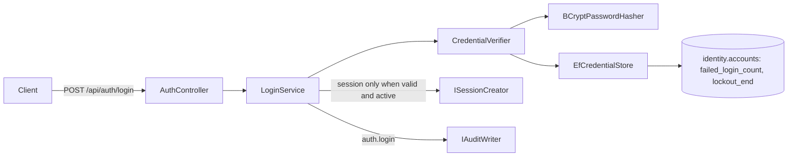
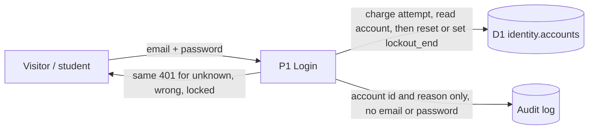

# Project component: IDN-05, Per-account lockout

**Team:** 4

**Student:** milanmilosev1 / [student ID]

**Specification requirements:** IDN-05 (Ј, "Ограничење броја покушаја пријаве"), with support for SEC-04 and AUD-03

## Responsibilities and boundaries

- **Processes and user scenarios:**
  - Temporary lockout after consecutive failed logins.
  - The failure counter resets after a successful login.
  - The same generic response whether the account doesn't exist, the password is wrong or the account is locked.
- **Contracts with other modules:**
  - `ICredentialVerifier` (IDN-02) applies the lockout. `CredentialResult.IsLockedOut` exists for the audit only.
  - `ICredentialStore` gains `ReserveAttemptAsync`, `LockIfLimitReachedAsync` and `TryClearFailuresAsync`.
- **Why not ASP.NET Identity's `lockoutOnFailure`:** the ticket named it, but login does not use ASP.NET Identity. IDN-02 checks passwords against `identity.accounts` (`UserAccount`, BCrypt), and `sessions` has a foreign key to that table. `AspNetUsers` accounts cannot log in at all (see Known deviations in [the DFD](IDN-02_IDN-06_DFD.md)), so a lockout there would never run. The lockout therefore lives on `identity.accounts` and follows the same rules as Identity's: a failure limit, a lock window, a restart of the counter on lockout and a reset on success.
- **Relation to [IDN-05 rate limiting](IDN-05.md):** that component limits login requests per IP (SEC-04). This one adds the per-account lockout stored in the database, in place of the in-memory `ILoginAttemptLimiter` that document plans. A locked account gets **401**, not 429, so the response does not reveal that the account exists.
- **Not in this component:** administrator unlock. It was removed from this branch because REV-05 (#85) also registers an unlock action, `account.unlock`, and the two would have had different security and audit conditions. #85 registers only the action, the policy and denial audit, so no endpoint clears a lockout yet. Until one exists, a locked account stays locked until `lockout_end` passes.
- **Implementation status:** done on branch `feature/IDN-05-identity-lockout`, connected to the real IDN-02 login and sessions.

## Component architecture

## Data flow diagram

Trust boundary: the client is untrusted. Every decision (counter, lockout window) is made on the server.

## Lockout rules

1. Every attempt is charged **before** the password is checked, in one atomic `UPDATE`. An attempt that finds `MaxFailedAccessAttempts` already charged sets `lockout_end` and gets no chance to log in. So at most that many attempts per lockout window can log in or fail, however many requests run in parallel. A failure stays charged, so an abandoned check is not a free guess.
2. The password hash is verified on **every** attempt, including unknown and locked accounts, but the result is only used for an attempt that was charged. `BCryptPasswordHasher` uses a dummy hash when there is no stored hash.
3. While `lockout_end` is in the future, the attempt is refused, even with the correct password. It is not counted and does not extend the lockout.
4. A correct password is accepted only by an atomic `UPDATE` that fails if the account locked during the hash. That update resets the counter and clears an expired lockout.
5. A wrong password that used the last charged attempt sets `lockout_end` and restarts the counter, so a full run of failures is needed after a lockout ends.
6. Unknown emails and locked accounts run the same statements as a wrong password. Those statements match no row or change nothing, so the failure paths cost the same database round trips.

## Configuration

| Key | Default | Allowed | Meaning |
|-|-|-|-|
| `Identity:Lockout:MaxFailedAccessAttempts` | 5 | 1 to 20 | consecutive failures before the lockout |
| `Identity:Lockout:LockoutMinutes` | 15 | 1 to 1440 | length of the lockout |

The lockout values are validated by `IdentityLockoutOptionsValidator` with `ValidateOnStart`, so an invalid value stops the service from starting.

## Security requirements

- **Server-side access checks:**
  - The counter and the lockout window are stored in `identity.accounts` and enforced in `CredentialVerifier`.
- **Input validation and sensitive data:**
  - Audit events carry the account id (when known) and a short reason (`invalid credentials`, `account locked`). They never contain the email, the password or a token.
  - For a locked account the id is the audit target, not the actor, because the caller has not proven who they are.
- **Negative scenarios:** see the table below.

| Threat | Control | Test |
|-|-|-|
| Online password guessing | Lockout after N failures for T minutes | `AccountLockoutTests.Reaching_the_limit_locks_the_account_for_the_configured_time` |
| Guessing the password while locked | Refused even with the correct password | `Correct_password_is_rejected_while_the_account_is_locked` |
| Parallel requests slipping past the limit | Attempt charged before the hash; a correct password is accepted only if the account is still not locked | `Guesses_over_the_limit_are_refused_while_earlier_guesses_are_still_running`, `Correct_password_in_flight_when_the_account_locks_is_refused` |
| Abandoned requests as free guesses | Attempt stays charged if the check never finishes | `Checks_abandoned_midway_still_count_and_do_not_leave_the_account_stuck` |
| Lost counter updates | Atomic `UPDATE` | `Parallel_failures_are_all_counted` |
| Typos leading to a lockout | Counter resets on success | `Successful_login_resets_the_failure_counter`, `Successful_login_resets_the_counter_so_typos_do_not_add_up` |
| Account enumeration from the response | Identical 401 status, content type, cache header and body | `LockoutEndpointTests.Unknown_wrong_and_locked_logins_get_identical_responses` |
| Account enumeration from timing | Hash verified and the same statements run on every failure path | `Unknown_email_is_invalid_verifies_a_hash_and_creates_nothing`, `Locked_account_still_verifies_a_hash`, `Verifier_UnknownEmail_RunsTheSameStatements_SoTimingDoesNotReveal`, `Verifier_LockedAccount_IsRefused_EvenWithTheCorrectPassword_AndRunsTheSameStatements` |
| Insecure configuration | Startup validation | `Out_of_range_values_fail_startup_validation`, `Host_refuses_to_start_with_an_invalid_lockout_setting` |
| Secrets in the audit log | Account id and reason only | `LoginTests.AuditEvents_NeverContainEmailPasswordOrToken` |

### Traceability (spec §8.1)

| Requirement ID | Precondition | Action | Expected | Evidence |
|-|-|-|-|-|
| IDN-05 | Active account, limit N | N wrong passwords | The account is locked; the next correct password gets 401 `invalid_credentials` | `AccountLockoutTests`, `LockoutEndpointTests` (Testcontainers Postgres) |
| IDN-05 | N-1 failures | Correct password | 200; `failed_login_count = 0` | `Successful_login_resets_the_failure_counter` |
| IDN-05 | Unknown email / wrong password / locked account | Login | The same 401 response, with no hint about the account | `LockoutEndpointTests` |

### Residual risks

- **Deliberate lockout of a victim.** Anyone who knows a victim's email can lock the account on purpose (denial of service). The lockout is limited in time, and the account stays locked until it expires because there is no admin unlock yet.
- **The per-IP limit is not attached to login yet.** `AuthController.Login` has no `[EnableRateLimiting(RateLimitPolicies.Login)]`, so the per-IP layer does not run on this endpoint. Until it does, spreading guesses across many accounts is limited only by each account's lockout.
- **A real login reopens the attempts.** A successful login resets the counter, as the ticket requires, so an attacker gets a new run of attempts each time the real owner logs in during an attack.
- **A burst can refuse the real owner.** Attempts that use up the limit lock the account even while they are still running, so a correct login that arrives after them is refused until the lockout ends. This is the same denial of service as a deliberate lockout, reached sooner.
- **Hashing is not limited.** Refused attempts still run BCrypt for equal timing, so a request flood costs CPU even though it cannot guess passwords. The per-IP limit is the control for that.
- **A correct password on a blocked account resets its counter.** The login is still refused by `LoginService`, so this gives no access.
- **Accounts outside `identity.accounts`.** `AspNetUsers` accounts (IDN-01) cannot log in, and IDN-03 status changes still go to the in-memory repository. Both are known deviations, to be resolved when those stores move to D1 (ADM-02).

## Evidence of work

- **Changed files:**
  - `Platform.Identity`: `UserAccount`, `UserAccountConfiguration`, migration `AddAccountLockout`, `CredentialVerifier`, `EfCredentialStore`, `IdentityLockoutOptions`.
  - `Platform.Api`: `LoginService`.
- **Run instructions:**
  - `dotnet test backend/SecurityLab.slnx`. Docker is required for the Testcontainers tests.
  - Development applies migration `AddAccountLockout` at startup. Other environments must apply it before deploying this version, because login reads the new columns.
- **Tests and results:** 2026-11-06: `Platform.Identity.Tests` 214 passed, 29 of them in category `IDN-05`. The CI script `scripts/audit/test-postgres.ps1` passes for the whole solution: 1262 passed, 0 failed, 9 skipped. The new in-flight tests failed before the fix. With the reservation removed on purpose, 10 `IDN-05` tests failed; with the final "still not locked" condition removed, `Correct_password_in_flight_when_the_account_locks_is_refused` failed. A manual run in Development against a throwaway local Postgres on 2026-11-05, before this fix, confirmed the lockout and identical 401 bodies.
- **Next steps:**
  - Add `[EnableRateLimiting(RateLimitPolicies.Login)]` to `AuthController.Login`.
  - Admin unlock: add it in a separate change, under the single action id agreed with REV-05 (#85). It needs its own unconditional clear, because `TryClearFailuresAsync` refuses a locked account.
