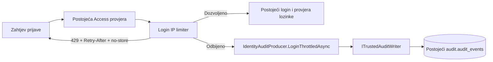

# IDN-05 / AUD-01: trajni audit prekoračenja limita prijave

Autor: Luka, Tim 4 — povezivanje politika pristupa i audita.
Grana: `codex/idn05-throttled-audit`, osnova `main` (`76b0a36`).

## Problem i ponašanje

Login IP limiter je vraćao ispravan 429, ali je odbijanje postojalo samo u tehničkom
ILogger zapisu. Sada za svako odbijanje politikom `RateLimitPolicies.Login` poziva
postojeći javni Audit ugovor preko `IdentityAuditProducer.LoginThrottledAsync`.

| Polje | Vrijednost |
| --- | --- |
| EventType | auth.login.throttled |
| Outcome | Denied |
| Actor | Anonymous, bez ID-ja |
| CorrelationId | serverski TraceIdentifier, isti kao u X-Correlation-ID odgovoru |
| Vrijeme i EventId | dodaje postojeći Audit writer |
| Course / Resource / Details | nisu dostavljeni; u bazi nema naloga, kursa ni dodatnih detalja |

Limiter ne čita email, lozinku, cookie, token ili tijelo zahtjeva za potrebe audita.
Postojanje naloga ne mijenja oblik događaja. Čak i zahtjev s prethodno izdatim
sesijskim cookie-jem ostaje anoniman za ovu vrstu događaja. Proizvoljni klijentski
actor/correlation headeri ne određuju audit identitet.

## Povezivanje i granice



Program već registruje producent i persistent writer. Koristi se postojeći
`ConnectionStrings:Audit`, schema/migracija i katalog događaja. Nema novih paketa,
tabela, migracija, prava ili javnih endpointa. Runtime nalog za audit treba postojeća
SELECT/INSERT prava, bez prava prepravljanja istorije.

Poslovna pravila limitera, lockout naloga, REV i autorizacija ruta nisu promijenjeni.
Ova dopuna važi samo za login politiku. PasswordReset politika ne šalje login događaj;
audit zaključavanja i otključavanja naloga ostaje zaseban zadatak.

## Greške i vremensko ograničenje

Audit pokušaj ima rok od jedne sekunde, nezavisan od prekida klijenta. Koristi sopstveni
scope koji traje do završetka writer-a. Ako adapter ignoriše otkazivanje i završi kasnije,
ne koristi HttpContext niti već završen request scope; eventualna kasna greška se posmatra.

Neuspješan, odbijen, izostao ili spor writer ne mijenja odbijanje prijave: zadržavaju se
429, Retry-After, no-store i generičko tijelo. Nema poziva credential verifier-u niti
nove sesije. Zapis greške sadrži bezbjednu poruku i korelaciju, bez sadržaja izuzetka.

Trajni događaj je potvrđen samo kada writer prijavi Recorded. Nema outbox-a, automatskog
ponavljanja ni garancije isporuke tokom pada baze. Timeout ne isključuje kasnije uspješan
upis adaptera koji ne poštuje otkazivanje. Ovo je audit odbijanja, pa nedostupan audit
ne smije pretvoriti odbijenu prijavu u dozvoljenu operaciju.

## Provjere

Završne ciljane provjere, 17.11.2026:

| Grupa | Prošlo | Palo | Preskočeno |
| --- | ---: | ---: | ---: |
| Platform.RateLimiting.Tests | 38 | 0 | 0 |
| IdentityAuditProducerTests + audit integracioni testovi | 16 | 0 | 0 |

Novi scenariji provjeravaju:

- Jedan anoniman događaj po odbijenom login zahtjevu, sa serverskom korelacijom i bez tajni.
- Očuvanje 429 i odsustvo provjere lozinke/sesije kada writer vrati Unavailable ili Rejected ili baci izuzetak.
- Bounded odgovor čak i ako writer ignoriše otkazivanje i kasnije prijavi grešku.
- Prekid klijenta nakon početka audit upisa ne otkazuje taj upis.
- Stvarni HTTP tok, pravi Audit writer i ograničeni PostgreSQL runtime nalog:
  po jedan trajni događaj za poznat i nepoznat nalog, potvrđen novim DB kontekstom.
- PostgreSQL odbije INSERT: zahtjev i dalje dobije 429, bez nove sesije i bez lažne tvrdnje da je audit sačuvan.

Kompletni backend CI korak `scripts/audit/test-postgres.ps1` takođe je prošao:
**2.158 prošlo, 0 palo, 62 preskočeno**. Preskočeni su postojeći uslovni testovi drugih
modula (52 Coursework, 9 LaboratoryPersistence, 1 Team21). Svi Audit PostgreSQL/runtime
testovi koje skripta zahtijeva izvršeni su uspješno. Puna kampanja prethodila je dodavanju
posljednja dva testna scenarija; poslije toga ponovljene su kompletne ciljane grupe iz
tabele, bez daljih promjena produkcionog koda. Brojevi ponovljenih testova se ne sabiraju.

Lokalni sirovi dokazi: `TestResults/throttled-audit/*.trx` i `full-ci.log`, te
`TestResults/audit-s09-0f276b39d6aa444bbdf957f42fd3b66c/*.trx` (git-ignored).
Provjera `git diff --check` prolazi. Frontend nije mijenjan niti je za ovu dopunu ponavljan.

Ponovljivo pokretanje (potreban Docker za PostgreSQL):

Od dorade za #262 audit integracioni testovi su u
`Integration/Audit/IdentityAuditIntegrationTests.cs` i koriste zajednicki
`IntegrationTestBase`, host i PostgreSQL kontejner. Ograniceni Audit runtime nalog
i stvarno odbijanje INSERT-a ostaju pokriveni; pomocne operacije su u `AuditTestData`.

```powershell
dotnet test backend/Platform.RateLimiting.Tests/Platform.RateLimiting.Tests.csproj --configuration Release
dotnet test backend/Platform.Identity.Tests/Platform.Identity.Tests.csproj --configuration Release --filter "FullyQualifiedName~IdentityAuditProducerTests|FullyQualifiedName~IdentityAuditIntegrationTests"
./scripts/audit/test-postgres.ps1
```

## Uskladjivanje po Audit reviewu PR-a #263

Zajednicki `CustomWebApplicationFactory` eksplicitno registruje `AuditDbContext`
nad `TestDatabaseFixture.ConnectionString`, nezavisno od lokalnog `.env` i drugih
konfiguracionih izvora. Varijanta za HTTP audit i dalje koristi zaseban ograniceni
runtime nalog u istom kontejneru. Regresiona provjera namjerno podmece drugu Audit
konekciju i provjerava da oba helpera citaju stvarni zapis iz testne baze.

Audit sema se migrira prije pravljenja Respawn plana, a eksplicitno je izuzeta
iz resetovanja zbog append-only zastite. Identiteti i sesije se resetuju, dok se
audit zapisi biraju po jedinstvenom akteru ili korelaciji. Ponovni poziv
`CreateRestrictedRuntimeAsync` koristi isti testni nalog i lozinku u okviru
pokretanja, pa vec izdati runtime connection string ostaje vazeci.

Za S-17 matricu iz #221 potrebna su sljedeca preimenovanja (zajednicki novi
namespace i klasa: `Platform.Identity.Tests.Integration.Audit.IdentityAuditIntegrationTests`):

| Stavka | Stari metod u `Platform.Identity.Tests.Services.IdentityAuditPostgresIntegrationTests` | Novi metod |
| --- | --- | --- |
| T02 | LoginAndLogoutHttpFlow_PersistsTrustedAuditEventsAndRevokesSession | LoginAndLogout_ValidAccount_ShouldPersistAuditEventsAndRevokeSession |
| T06 | Login_WhenAuditWriteFails_PersistsOnlyARevokedSession | Login_WhenAuditWriteFails_PersistsOnlyARevokedSession |

Matrica i njeni filteri jos nisu na ovoj osnovi `main`-a; autor #221 treba da ih
uskladi prema konacnim nazivima. Istorijski brojevi testova iznad nisu nova kampanja.
#243 i #232 su spojeni u `main`; #263 je uskladjen sa osnovom c991046e.
Novi test iz #243 prenesen je kao
`LoginAndRevokeHttpFlow_ValidSession_PersistsSessionRevokedWithRequestCorrelation`
u `Integration/Audit/IdentityAuditIntegrationTests.cs`. Koristi `CreateIdentityHost`,
`SessionTestData` i `AuditTestData`, uz ocuvane provjere aktera, korelacije, ishoda,
resursa, uzroka i handle-a opozvane sesije; dodatno provjerava sacuvani opoziv.
`AuditTestData` je jedna `public static class`: sacuvani su `Row` i `RowsAsync`
za MFA i CSRF, kao i ograniceni runtime nalog i citanja po akteru/korelaciji.
Zajednicki fixture migrira Audit semu jednom prije Respawn plana i eksplicitno je
izuzima iz resetovanja. Cvetkove provjere izolacije od `.env` ostaju ukljucene.
Preostaje CI i ponovni review na uskladjenom commitu prije merge-a #263.

Provjera 27.11.2026, osnova `main` 549f5a87 + dorade #263:

- Prije ispravke novi `.env` regresioni test pada na pogresnoj Audit konekciji,
  prije pristupa drugoj bazi; poslije ispravke prolazi.
- `dotnet test backend/Platform.Identity.Tests/Platform.Identity.Tests.csproj --configuration Release --filter "FullyQualifiedName~Integration.Audit"`:
  10 proslo, 0 palo, 0 preskoceno (7 postojecih + 3 regresiona scenarija).
- Kompletan `Platform.Identity.Tests` u Release: 512 proslo, 0 palo, 0 preskoceno.
  Audit grupa je ukljucena u taj broj, ne sabira se ponovo.
- `git diff --check` prolazi, a preimenovanje originalnog audit fajla ostaje vidljivo.

Logovi i TRX: `TestResults/issue-262-audit-review/` (git-ignored).
GitHub CI i dalje treba potvrditi na novom PR commitu.

Uskladjivanje sa `main` 34da05b8, 27.11.2026: razrijesen je add/add konflikt
`AuditTestData.cs` uz ocuvanje oba API-ja helpera. Cijeli backend se kompajlira bez
gresaka; kompletan `Platform.Identity.Tests` u Release prolazi sa 551 testom,
0 padova i 0 preskocenih, ukljucujuci nase audit i nove CSRF/Identity provjere.
Dokazi su u `TestResults/issue-262-merge/` (git-ignored). Raniji brojevi iznad
ostaju istorijski rezultati svojih osnova; ne sabiraju se sa ovim pokretanjem.

Zavrsno uskladjivanje poslije merge-a #243 i #232, osnova `main` c991046e,
27.11.2026: cijeli backend se kompajlira bez gresaka, a svih 690 Identity testova
prolazi bez preskakanja. Audit grupa ima 11 scenarija (8 funkcionalnih i 3
regresiona) i vec je ukljucena u tih 690. Preneseni session-revoked test prolazi
sa stvarnim HTTP tokom, audit writer-om i ogranicenim nalogom baze.
Dokazi su u `TestResults/issue-262-mfa-final/` (git-ignored).
