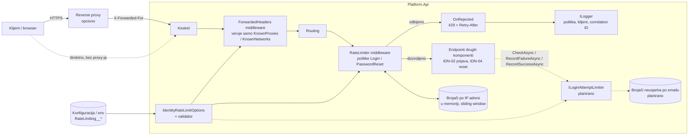
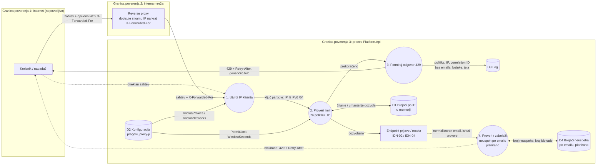

# Project component: IDN-05, ograničenje broja pokušaja prijave (rate limiting)

**Team:** TIM05

**Student:** Nemanja Vuksa / PR12/2023

**Specification requirements:** IDN-05 (J)

Usklađeno sa (ne implementira ih ova celina, već ih poštuje ili se na njih oslanja): SEC-04, ADM-04,
AUD-03, AUD-04; zavisi od IDN-02 (prijava) i IDN-04 (reset lozinke).

## Responsibilities and boundaries

- **Processes and user scenarios:**
  - Ograničenje broja zahteva za prijavu i reset lozinke po IP adresi klijenta.
  - Prekoračenje vraća `429 Too Many Requests` sa `Retry-After` (sekunde), `X-Correlation-ID`,
    `Cache-Control: no-store` i generičkim telom `{ "code": "rate_limited", ... }`.
  - Utvrđivanje stvarne adrese klijenta iza reverse proxy-ja (`ForwardedHeaders`), uz prihvatanje
    `X-Forwarded-For` samo od eksplicitno navedenih proxy-ja.
  - Pragovi i poverljivi proxy-ji se zadaju kroz konfiguraciju/okruženje (ADM-04) i proveravaju pri startu.
  - **Planirano:** brojanje neuspešnih prijava po nalogu i privremena blokada (ostatak IDN-05 iz kataloga),
    kroz ugovor `ILoginAttemptLimiter` koji poziva login tok (IDN-02).
- **Contracts with other modules:**
  - Komponenta izlaže dve imenovane politike u `RateLimitPolicies`. Vlasnici endpointa ih samo zakače:
    - IDN-02 (prijava, kontroler): `[EnableRateLimiting(RateLimitPolicies.Login)]` na akciji
    - IDN-04 (reset lozinke): `[EnableRateLimiting(RateLimitPolicies.PasswordReset)]`, odnosno
      `.RequireRateLimiting(RateLimitPolicies.PasswordReset)` ako je minimal API
  - Komponenta ne čita ni ne menja naloge, lozinke ni tokene. Odgovor 429 je isti bez obzira na
    nalog, pa ne narušava neotkrivanje postojanja naloga (IDN-04).
  - **Planirani ugovor `ILoginAttemptLimiter`** (dogovor sa IDN-02), koji `LoginAccount` poziva:
    - `CheckAsync(email)` pre provere lozinke: ako je blokirano, login vraća `429` sa `Retry-After`;
    - `RecordFailureAsync(email)` posle pogrešnih podataka;
    - `RecordSuccessAsync(email)` posle uspešne prijave (briše brojač).
  - Ključ je normalizovan email, a ne ID naloga: nepostojeći email se broji isto kao postojeći, pa
    blokada ne otkriva da li nalog postoji (IDN-04). Blokada je privremena i podesiva kroz okruženje,
    da napadač ne bi mogao trajno da zaključa tuđi nalog.
- **Implementation status:**
  - Implementirano i testirano: politike, particionisanje po IP-u, 429 odgovor, ForwardedHeaders,
    konfiguracija i validacija, uključivanje u `Program.cs`.
  - Login (IDN-02) i reset (IDN-04) endpointi još nisu spojeni na `main`; politike se kače kad budu.
  - `ILoginAttemptLimiter`: planirano (isprekidano na dijagramima).

## Component architecture



| Element | Fajl |
| --- | --- |
| Politike (ugovor prema IDN-02/IDN-04) | `backend/Platform.Api/Modules/Identity/RateLimiting/RateLimitPolicies.cs` |
| Konfiguracija i validacija | `backend/Platform.Api/Modules/Identity/RateLimiting/IdentityRateLimitOptions.cs` |
| Registracija, middleware, particionisanje, 429 | `backend/Platform.Api/Modules/Identity/RateLimiting/IdentityRateLimitingExtensions.cs` |
| Uključivanje u aplikaciju | `backend/Platform.Api/Program.cs` |

## Data flow diagram



Bitne odluke na granicama poverenja:

- `X-Forwarded-For` dolazi preko granice 1 i nepoverljiv je. Prihvata se samo kada je neposredni
  pošiljalac (granica 2) na listi `KnownProxies`/`KnownNetworks`, i to samo poslednja adresa
  (`ForwardLimit = 1`). Bez podešenog proxy-ja obrada headera je potpuno isključena.
- Telo zahteva (email, lozinka) se ne čita i ne upisuje u D3.
- Planirani P4 dobija samo normalizovan email i ishod, nikad lozinku. D4 se ne upisuje u log.

## Security requirements

- **Server-side access checks:**
  - Limit se primenjuje u serverskom middleware-u pre izvršavanja endpointa. Klijent ne može da ga
    isključi ni da utiče na ključ particije, osim stvarnom IP adresom.
  - Podrazumevano: prijava 30 zahteva / 60 s, reset 10 / 900 s,
    sliding window sa 6 segmenata.
- **Input validation and sensitive data:**
  - Konfiguracija se validira pri startu (`ValidateOnStart`). Limit ili prozor van opsega i
    neispravna IP adresa ili CIDR zaustavljaju pokretanje aplikacije.
  - Pragovi i proxy-ji su u okruženju, ne u kodu, i nisu tajne (ADM-04).
  - Log odbijanja sadrži samo politiku, IP/blok i correlation ID (AUD-03). Correlation ID je
    `HttpContext.TraceIdentifier`, isti koji koristi login tok, pa se zahtev može pratiti kroz module (AUD-04).
  - IPv6 adrese se grupišu po /64 da se limit ne bi zaobilazio promenom adrese unutar bloka.
- **Negative scenarios** (svaki ima automatski test u `RateLimitingHttpTests.cs`):

| Pretnja / zloupotreba | Kontrola | Test | Dokaz |
| --- | --- | --- | --- |
| Pogađanje lozinke velikim brojem zahteva | Limit po IP-u, 429 | `RequestsAboveLimitGet429WithRetryAfter` | Prošao, 1. 11. 2026 |
| Enumeracija naloga kroz odgovor limitera | Generičko, stabilno telo | `RejectionBodyIsGenericAndStable` | Prošao, 1. 11. 2026 |
| Zaobilaženje limita lažnim `X-Forwarded-For` | Header samo od poznatih proxy-ja | `SpoofedForwardedForFromUntrustedSourceIsIgnored`, `ForwardedForFromUnlistedProxyIsIgnored` | Prošao, 1. 11. 2026 |
| Lažna adresa ispred prave iza proxy-ja | `ForwardLimit = 1` | `ClientCannotPrependFakeAddressBehindTrustedProxy` | Prošao, 1. 11. 2026 |
| Rotacija IPv6 adresa unutar bloka | Grupisanje po /64 | `Ipv6AddressesInSameSlash64ShareLimit` | Prošao, 1. 11. 2026 |
| Blokada drugih korisnika (pogrešna particija) | Odvojeni brojači po IP-u i politici | `DifferentClientsHaveSeparateLimits`, `LoginAndPasswordResetHaveSeparateCounters`, `TrustedProxyForwardsRealClientAddress` | Prošao, 1. 11. 2026 |
| Tihi kvar zbog loše konfiguracije | Validacija pri startu | `InvalidConfigurationStopsStartup`, `ApiRefusesToStartWithInvalidLimit` | Prošao, 1. 11. 2026 |
| Email ili lozinka u logovima (AUD-03) | Log sadrži samo politiku, IP i correlation ID | `RejectionIsLoggedWithCorrelationIdButWithoutCredentials` | Prošao, 1. 11. 2026 |
| Limiter ne radi na MVC kontroleru (login) | Atribut `[EnableRateLimiting]` | `ControllerActionWithAttributeIsLimited` | Prošao, 1. 11. 2026 |

Verzija koda za kolonu "Dokaz": commit `ef107a5` ([PR #28](https://github.com/owlCoder/security-lab/pull/28)). Rezultat: 24/24 testa prolazi
(`dotnet test backend/Platform.Identity.Tests` i Visual Studio Test Explorer).

### Test scenariji (struktura iz poglavlja 8.1)

| Requirement ID | Preduslov | Akcija | Očekivano | Dokaz |
| --- | --- | --- | --- | --- |
| IDN-05 | Limit prijave 2 zahteva / 60 s; klijent `203.0.113.10`. | Klijent šalje 3 zahteva za prijavu zaredom. | Prva dva prolaze. Treći dobija `429` sa `Retry-After` između 1 i 60 s, `Cache-Control: no-store` i `X-Correlation-ID`. | `RequestsAboveLimitGet429WithRetryAfter`, 1. 11. 2026, commit `ef107a5`, prošao |
| IDN-05 | Nijedan proxy nije podešen; limit 2. | Napadač šalje 3 zahteva, svaki sa drugom lažnom adresom u `X-Forwarded-For`. | Header se ignoriše, svi zahtevi se broje na stvarnu adresu; treći dobija `429`. | `SpoofedForwardedForFromUntrustedSourceIsIgnored`, 1. 11. 2026, commit `ef107a5`, prošao |
| IDN-05 | Limit 1; klijent je već potrošio limit. | Dva nova zahteva za prijavu sa iste adrese. | Oba odgovora imaju identično telo sa kodom `rate_limited`, bez podataka o nalogu (ne otkriva se postojanje naloga). | `RejectionBodyIsGenericAndStable`, 1. 11. 2026, commit `ef107a5`, prošao |
| IDN-05 | Limit 1; login je MVC kontroler sa `[EnableRateLimiting]`; zahtev nosi email i lozinku u telu. | Dve prijave sa iste adrese. | Druga dobija `429`; odbijanje je u logu sa istim correlation ID-jem kao u odgovoru; ni email ni lozinka se ne pojavljuju ni u jednoj log poruci. | `RejectionIsLoggedWithCorrelationIdButWithoutCredentials`, 1. 11. 2026, commit `ef107a5`, prošao |
| IDN-05 | Konfiguracija `RateLimiting:Login:PermitLimit = 0`. | Pokretanje aplikacije. | Aplikacija se ne pokreće (`OptionsValidationException`); limiter nikad ne radi sa neispravnim pragom. | `ApiRefusesToStartWithInvalidLimit`, `InvalidConfigurationStopsStartup`, 1. 11. 2026, commit `ef107a5`, prošao |

**Poznata ograničenja:**

- Brojači su u memoriji: restart ih resetuje, a više instanci API-ja bi brojalo odvojeno
  (rešenje: deljeni store, npr. Redis).
- Distribuirani napad sa mnogo IP adresa na jedan nalog se ne zaustavlja po IP-u; to pokriva
  planirani `ILoginAttemptLimiter`.
- IP adresa u logu je lični podatak; zadržavanje logova prati politiku ADM-05.

## Evidence of work

- **Changed files / commit / pull request:**
  - Grana: `feature/IDN-05-rate-limiting`
  - Novi fajlovi: `backend/Platform.Api/Modules/Identity/RateLimiting/*` (3 `.cs` + `README.md`),
    `backend/Platform.Identity.Tests/*`, `docs/components/identity/IDN-05.md`
  - Izmenjeni fajlovi: `backend/Platform.Api/Program.cs` (3 linije)
  - Commit / PR: `ef107a5`, [PR #28](https://github.com/owlCoder/security-lab/pull/28)
- **Run instructions:**

  ```powershell
  dotnet test backend/Platform.Identity.Tests
  ```

  Primer konfiguracije iza proxy-ja:

  ```powershell
  $env:RateLimiting__Login__PermitLimit = "30"
  $env:RateLimiting__KnownProxies__0 = "10.0.0.5"
  dotnet run --project backend/Platform.Api
  ```

  Ručna provera, kada IDN-02 login endpoint postoji: više od `PermitLimit` prijava u prozoru sa
  iste adrese vraća 429 sa `Retry-After`.
- **Tests and results:**
  - `Platform.Identity.Tests`: 24 testa (22 nad izolovanim hostom sa istim podešavanjem kao
    `Program.cs`, uključujući probni MVC kontroler, i 2 nad celim `Program.cs` preko `WebApplicationFactory`).
  - Lokalno, Visual Studio Test Explorer i `dotnet test`, 1. 11. 2026: 24/24 testova prolazi.
    CI: trenutni CI samo builduje API i ne pokreće testove; rezultat builda je vidljiv u PR #28.
  - Prvo pokretanje je otkrilo propust (prazna lista proxy-ja u ASP.NET-u znači "veruj svima").
    Ispravljeno je isključivanjem obrade headera kada proxy nije podešen.
- **Next steps:**
  - Implementirati `ILoginAttemptLimiter` sa implementacijom u memoriji i testovima (blokada posle N
    neuspeha, isto ponašanje za nepostojeći email, istek blokade, reset posle uspeha).
  - Zavisnost od IDN-02: poziv iz `LoginAccount` na mestu predviđenom za IDN-05 i atribut
    `[EnableRateLimiting(RateLimitPolicies.Login)]` na `LoginController`. Revizorski zapis za blokiranu
    prijavu piše login tok (AUD-01).
  - Zavisnost od IDN-04: atribut `PasswordReset` na endpointu za reset lozinke.
  - Posle merge-a IDN-02: premestiti testove u zajednički `backend/Platform.Tests`, da se pokreću u CI-ju.
  - Kasnije: brojače neuspeha čuvati u bazi identity modula umesto u memoriji.
  - Podesiti `KnownProxies` u deployment konfiguraciji kada se zna adresa reverse proxy-ja.
