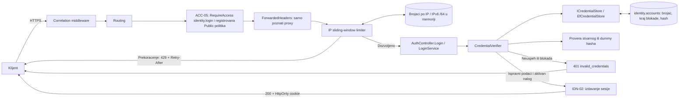

# Project component: IDN-05, ogranicenje pokusaja prijave

**Team:** Tim 4

**Student:** Nemanja Vuksa / PR12/2023

**Specification requirements:** IDN-05 (J)

## Responsibilities and boundaries

IDN-05 ogranicava zahteve po IP adresi i privremeno zakljucava nalog posle uzastopnih
neuspesnih prijava. Prijava koristi postojeci IDN-02 tok, sesije i Identity skladiste.

- IP limiter odbija zahtev pre provere lozinke sa `429 Too Many Requests`, `Retry-After`
  u sekundama, `Cache-Control: no-store`, `X-Correlation-ID` i kodom `rate_limited`.
- Brojac neuspeha i kraj blokade naloga cuvaju se u `identity.accounts`.
  `CredentialVerifier` preko `ICredentialStore` rezervise pokusaj pre skupog hasha;
  `EfCredentialStore` koristi atomske SQL UPDATE naredbe i proverava blokadu ponovo
  pre prihvatanja uspesne prijave. Uspesna prijava brise brojac kada nalog nije blokiran.
- Pogresna lozinka, nepostojeci email i zakljucan nalog vracaju isti
  `401 { "code": "invalid_credentials" }`, bez `Retry-After` i bez nove sesije.
  Nepostojeci email nema red u bazi; jednakost se obezbedjuje javnim odgovorom,
  dummy proverom hasha i istim tokom upita, bez cuvanja proizvoljnih email adresa.
- Prava prijava je `AuthController.Login`, `POST /api/auth/login`, sa
  `[AllowAnonymous]`, `[RequireAccess(IdentityAccessActions.Login)]` i
  `[EnableRateLimiting(RateLimitPolicies.Login)]`. `identity.login` je registrovana
  `ActionScope.Public` akcija sa eksplicitnom politikom pre `AddAccessControl()`.
  Na strogoj ACC-05 grani nijedna auth ruta ne koristi `AllowPublic` ili
  `DelegatedAuthorization`. Odjava koristi javnu akciju `identity.logout`, a `/me`
  akciju `identity.session.read` sa `Authenticated` opsegom i subjektom iz proverene sesije.
- Komponenta izlaze i `RateLimitPolicies.PasswordReset`; vlasnik IDN-04 je ukljucuje
  na odgovarajucem endpointu. IDN-05 ne implementira reset lozinke.

## Component architecture and data flow



Klijentovi headeri su nepoverljivi. `X-Forwarded-For` se prihvata samo od
`KnownProxies` / `KnownNetworks`, uz `ForwardLimit = 1`. Bez konfigurisanog proxy-ja
obrada headera je iskljucena. IPv6 adrese iz istog /64 dele IP limit.
Email, lozinka, hash i token ne upisuju se u log odbijanja. Login tok pise audit
ishod; kod blokade nalog je cilj dogadjaja, a ne potvrdjeni akter.

## Configuration

| Kljuc | Podrazumevano |
| --- | --- |
| `RateLimiting:Login:PermitLimit` | 30 |
| `RateLimiting:Login:WindowSeconds` | 60 |
| `RateLimiting:PasswordReset:PermitLimit` | 10 |
| `RateLimiting:PasswordReset:WindowSeconds` | 900 |
| `RateLimiting:KnownProxies` / `KnownNetworks` | prazne liste |
| `Identity:Lockout:MaxFailedAccessAttempts` | 5, dozvoljeno 1-20 |
| `Identity:Lockout:LockoutMinutes` | 15, dozvoljeno 1-1440 |

Za env varijable koristi se `__` umesto `:`. Neispravne vrednosti zaustavljaju
pokretanje aplikacije. Potrebna je Identity migracija `AddAccountLockout`.

## Contracts and source files

| Odgovornost | Fajl |
| --- | --- |
| Imenovane IP politike | `backend/Platform.Api/Modules/Identity/RateLimiting/RateLimitPolicies.cs` |
| IP konfiguracija i validacija | `backend/Platform.Api/Modules/Identity/RateLimiting/IdentityRateLimitOptions.cs` |
| IP middleware, proxy, 429 | `backend/Platform.Api/Modules/Identity/RateLimiting/IdentityRateLimitingExtensions.cs` |
| Javni login i sesijski cookie | `backend/Platform.Api/Controllers/Identity/AuthController.cs` |
| Genericki 401 i audit | `backend/Platform.Api/Services/Identity/LoginService.cs` |
| Blokada naloga | `backend/Platform.Identity/Services/CredentialVerifier.cs` |
| Trajni brojac i atomski SQL | `backend/Platform.Identity/Services/EfCredentialStore.cs` |
| Prag i trajanje blokade | `backend/Platform.Identity/IdentityLockoutOptions.cs` |

## Verification

| Scenario | Automatski test |
| --- | --- |
| Pravi login vraca 401 pre IP limita i 429 sa Retry-After posle limita | `LoginEndpointRateLimitingTests.FailedLogins_AboveTheLimit_AreAnswered429_WithRetryAfter` |
| IP blokada ne poziva credential verifier | `LoginEndpointRateLimitingTests.ThrottledAttempt_NeverReachesThePasswordCheck` |
| Uspesna prijava unutar limita, token samo u cookie-ju | `LoginEndpointRateLimitingTests.SuccessfulLogin_WithinTheLimit_StillWorks_AndTokenIsOnlyInTheCookie` |
| Napad sa razlicitih IP adresa zakljucava jedan nalog; ni tacna lozinka ne izdaje sesiju | `LockoutEndpointTests.ManyFailuresForOneAccount_FromDifferentClients_BlockEvenTheCorrectPassword` |
| Zakljucan nalog i nepostojeci email imaju isti javni odgovor | `LockoutEndpointTests.AccountBlock_AppliesToUnknownEmail_Identically` |
| Nepostojeci, pogresan i zakljucan login imaju isti 401 | `LockoutEndpointTests.Unknown_wrong_and_locked_logins_get_identical_responses` |
| Auth rute imaju tacno jednu akciju, politiku i odgovarajuci opseg, bez migracionih markera | `RevisionEndpointMetadataTests.AuthRoutes_RequireExactlyOneRegisteredPolicy_WithoutMigrationMarkers` |

IP testovi koriste pravi API pipeline sa zamenjenim verifier-om i izdavanjem sesije.
Testovi blokade naloga koriste pravi Identity modul, sesije i izolovani PostgreSQL
kroz Testcontainers. Dva ranija `[Ignore]` testa premestena su iz IP testova u ovu
integracionu grupu i uskladjena sa postojecim ugovorom: blokada naloga daje 401,
IP ogranicenje daje 429. Ne postoji novi `ILoginAttemptLimiter` ugovor.

```powershell
dotnet test backend/Platform.RateLimiting.Tests/Platform.RateLimiting.Tests.csproj
dotnet test backend/Platform.Identity.Tests/Platform.Identity.Tests.csproj --filter "TestCategory=IDN-05"
dotnet test backend/Platform.Tests/Platform.Tests.csproj --filter "FullyQualifiedName~RevisionAuthorization"
```

Za testove sa PostgreSQL potreban je pokrenut Docker. Rezultati ove ispravke
za strogu ACC-05 granu zabelezeni su u `docs/components/REV-05-authorization/STRICT-ACCESS-ALIGNMENT.md`.

## Known limitations

IP brojaci su u memoriji: restart ih resetuje, a vise API instanci broji odvojeno.
Za deljeni IP limit potreban je deljeni store. Blokada naloga je trajna u Identity
bazi i deli se izmedju instanci. Podesavanje poverljivog proxy-ja pripada deployment
konfiguraciji. Ova ispravka obuhvata IDN-05 i provere REV-01/REV-02/REV-05 ruta;
ne menja autorizaciju ostalih timova niti opsta ACC-05 pravila.
