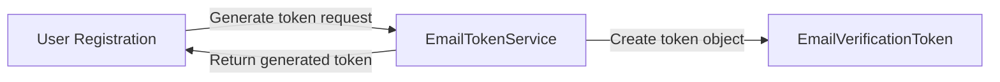

# Project component: IDN-10 Initial email verification token support
**Team:** 5

**Student:** Srdjan Lazarevic / PR47/2019

**Specification requirements:** IDN-10, IDN-13

### Responsibilities and boundaries

- Processes and user scenarios:
    - Generation of email verification tokens.
	- Definition of token metadata required for account verification.
	- Preparation for future email confirmation workflow.
    
- Contracts with other modules:
    - Uses entities and services from Platform.Identity.
	- Intended to be used by account registration and email confirmation workflows.
	- Does not send emails.
	- Does not activate user accounts.
	- Does not perform token validation.
    
- Implementation status:
    - EmailVerificationToken entity implemented.
	- IEmailTokenService interface implemented.
	- EmailTokenService implemented.
	- Initial NUnit tests implemented.
	- Token generation implemented.
## Component architecture

## Data flow diagram

## Security requirements

- Server-side access checks:
	- Token generation is performed on the server side.
	
- Input validation and sensitive data:
	- Tokens are generated using Guid values.   
	- No sensitive credentials are stored in the token entity.
    
- Negative scenarios:
	- Token validation is not yet implemented.
	- Token persistence is not yet implemented.
	- Negative security scenarios are planned for future iterations.

### Known limitations

- Tokens are not persisted to the database.
- Token validation is not implemented.
- Email confirmation workflow is not implemented.
- Account activation is not implemented.
- Email delivery is not implemented.

## Evidence of work

- Changed files / commit / pull request:
	- Platform.Identity/Entities/EmailVerificationToken.cs
	- Platform.Identity/Interfaces/IEmailTokenService.cs
	- Platform.Identity/Services/EmailTokenService.cs
	- Platform.Identity.Tests/Services/EmailTokenServiceTests.cs
- Run instructions:
	- dotnet build
	- dotnet test Platform.Identity.Tests --filter EmailTokenService
- Tests and results:
	- GenerateAsync_ShouldGenerateToken
    - Passed successfully (1/1 tests passed)
- Next steps:
	- Add database persistence for tokens.
	- Implement token validation.
	- Implement expiration checks.
	- Implement one-time use validation.
	- Integrate account confirmation workflow.
