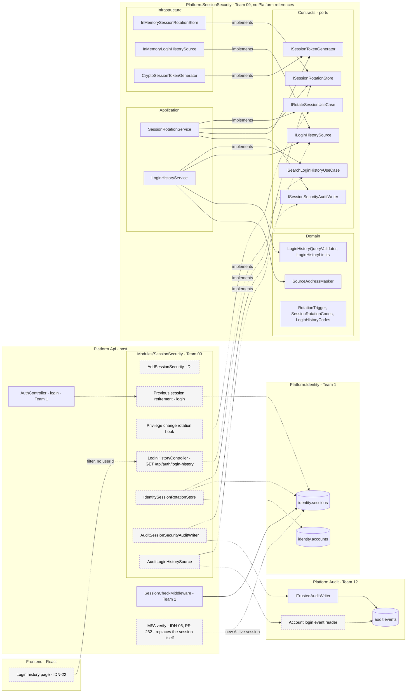
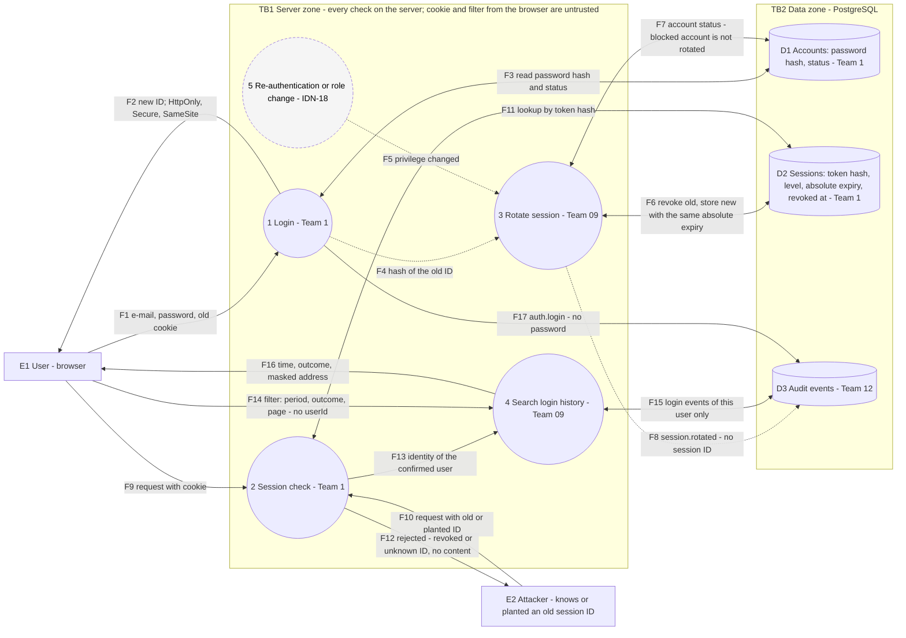

# Project component: IDN-11 session identifier rotation, IDN-22 personal login history search

**Team:** 09

**Student:** Team 09 (all members)

**Specification requirements:** IDN-11 (core), IDN-22 (extended). Related: SEC-01, SEC-03, SEC-04, SEC-05, AUD-01, AUD-03, AUD-04, AUD-10, AUD-11, AUD-19. Depends on IDN-02 and IDN-06 (Team 1: login, session check, MFA) and AUD-01 (Team 12: audit records of logins).

## Responsibilities and boundaries

- Processes and user scenarios:
  - **IDN-11:** after a login or a privilege change the session gets a new identifier and the previous one is rejected. `SessionRotationService` checks the current session, issues a new token from a CSPRNG, and atomically revokes the old session and stores the new one. The new session keeps the chain ID and the absolute expiry of the old one, so a rotation never extends the session lifetime. Every rotation attempt is audited without any token, token hash or chain ID.
  - **IDN-22:** a logged-in user searches only their own login events by period and outcome, with paging. `LoginHistoryService` takes the subject only from `AuthenticatedSubject` (built by the host from a checked session), validates the filter before any data is read, asks the source for events of that subject only, and masks the source IP address before returning it.
- Contracts with other modules:

  | Contract | Direction | State |
  |-|-|-|
  | `IRotateSessionUseCase` | we provide | Implemented by `SessionRotationService`. Planned callers: the login flow (Team 1) and the privilege change hook used by re-authentication (IDN-18) and role change. MFA (IDN-06) replaces the session itself (see [Decisions](#decisions-and-open-questions)). |
  | `ISearchLoginHistoryUseCase` | we provide | Implemented by `LoginHistoryService`. Planned caller: `GET /api/auth/login-history`. |
  | `ISessionRotationStore` | we use | `InMemorySessionRotationStore` for tests. Planned: an adapter over `identity.sessions` of Team 1, without schema changes. |
  | `ISessionTokenGenerator` | we use | `CryptoSessionTokenGenerator`: `RandomNumberGenerator`, 32 bytes, Base64Url, SHA-256 hash (the same token format as `Platform.Identity`). |
  | `ISessionSecurityAuditWriter` | we use | Test doubles only. Planned: an adapter to `ITrustedAuditWriter` of Team 12 with the event type `session.rotated`. |
  | `ILoginHistorySource` | we use | `InMemoryLoginHistorySource` with synthetic events. Planned: an adapter over `auth.login` audit records of Team 12. |

  `Platform.SessionSecurity` references no other `Platform.*` module (checked by a test). The adapters, the DI registration and the endpoint will live in the API host, in `backend/Platform.Api/Modules/SessionSecurity/`.
- Implementation status: the module skeleton, all contracts, both use cases, the in-memory store and source, the token generator, the query validator and the address masker are implemented, merged into `main` (#131, #180, #184) and covered by 139 NUnit tests. The integration with Team 1 and Team 12, the API endpoint and the React page are planned (see [Next steps](#next-steps-and-external-dependencies)). Nothing outside the module calls it yet.

## Component architecture

Solid lines are implemented on `main`. Dashed nodes and lines are planned.



Layers inside `backend/Platform.SessionSecurity`:

- `Contracts/`: ports and public records (`IRotateSessionUseCase`, `ISearchLoginHistoryUseCase`, `ISessionRotationStore`, `ISessionTokenGenerator`, `ISessionSecurityAuditWriter`, `ILoginHistorySource`, requests and results).
- `Domain/`: pure rules and constants (`RotationTrigger`, `SessionPrivilegeLevel`, `SessionRotationCodes`, `LoginHistoryCodes`, `LoginHistoryLimits`, `LoginHistoryQueryValidator`, `SourceAddressMasker`).
- `Application/`: `SessionRotationService`, `LoginHistoryService`. They depend only on `Contracts` and `Domain`.
- `Infrastructure/`: `InMemorySessionRotationStore`, `CryptoSessionTokenGenerator`, `InMemoryLoginHistorySource`.

## Data flow diagram

Owners: login, session check and the session and account stores belong to Team 1; the audit store belongs to Team 12; rotation and history search belong to Team 09. Dashed elements are planned.



Today P3 and P4 run only with in-memory stores in the tests. The flows F4, F5, F8 and the connection of P3 and P4 to D1, D2 and D3 are planned (see [Next steps](#next-steps-and-external-dependencies)). MFA verification (IDN-06, Team 1) is not a caller of P3: it replaces the `MfaPending` session with a new `Active` session in D2 itself.

Trust boundaries:

| Boundary | Rule |
|-|-|
| TB1, browser and server | The cookie and the history filter are untrusted. The subject never comes from the request; the filter is validated on the server; the new token goes only into the session cookie (`HttpOnly`, `Secure`, `SameSite`, owned by Team 1). An old or planted session ID is rejected without content. |
| TB2, server and stores | Only the SHA-256 hash of a token is stored. The history source is always called with the subject from the session, and the subject filter is part of the query. Audit records hold no token, hash or chain ID. |

### Order of checks: rotation (IDN-11)

1. Missing token, subject or correlation ID, unknown trigger, or a new level of `PreAuthentication`: `InvalidRequest`, nothing is read or audited.
2. Session not found by the token hash: `SessionNotFound`.
3. Session revoked: `SessionRevoked`. Session at or past its absolute expiry: `SessionExpired`.
4. Subject check: a `Login` may start from a pre-authentication session (no subject) or a session of the same subject; every other trigger needs a session of the same subject. Otherwise `SubjectMismatch`.
5. New token, then atomic rotation in the store. The store checks the old session again inside the same atomic operation, because it can change after step 2: rotated or revoked by another request gives `RotationConflict`, absolute expiry reached gives `SessionExpired`. In both cases nothing is changed. The replacement must keep the chain ID and the absolute expiry of the old session.
6. The replacement is stored as pending activation. It is activated only after the success has been audited. If the audit fails, the whole chain is revoked (also when the request is cancelled) and the result is `AuditFailed`: the old and the new session are both revoked, the new token never reaches the client, and the user has to log in again. Revoking a chain is idempotent, so it can be retried safely.

Every rejection after step 1 is audited with its code as the outcome. The client gets the same generic answer for every rejection.

### Order of checks: login history (IDN-22)

1. No subject or not authenticated: `NotAuthenticated`. Empty subject ID or no query: `InvalidRequest`.
2. Undefined outcome filter: `InvalidRequest`.
3. Missing bounds are filled in on the server: `ToUtc = now`, `FromUtc = ToUtc - 30 days`.
4. `FromUtc > ToUtc`: `InvalidTimeRange`. Range over 90 days: `RangeTooLarge`.
5. `Page < 1`: `InvalidPage`. `PageSize < 1` or over 50: `InvalidPageSize`.
6. The source is called with the subject from the session; results are newest first; addresses are masked.

In steps 1 to 5 the source is never called.

## Security requirements

- Server-side access checks: the subject of the history search comes only from `AuthenticatedSubject`, and `SearchLoginHistoryQuery` has no user field (checked by a test), so another user's history cannot be requested (SEC-01, IDOR). The subject filter is applied in the source, not after loading. A rotation for another trigger than login requires a session of the same subject.
- Input validation and sensitive data: the history filter is validated against `LoginHistoryLimits` before any read (SEC-04, SEC-05). Tokens come only from `RandomNumberGenerator`; only their SHA-256 hash is stored. Records that hold a token, hash, chain ID or full IP address override `ToString()` to hide them (AUD-03). IPv4 addresses are masked to `203.0.113.*`, IPv6 to the first four groups, and an invalid or non-canonical address to `*` (AUD-19). Audit is fail-closed (AUD-10).
- Negative scenarios: old token reused after login (session fixation); old token after MFA; revoked chain; revoked subject; two parallel rotations with the same token; expired session; audit failure; session of another subject; invalid requests; user A asking for history while user B has events in the same period; invalid ranges and paging; unauthenticated caller; invalid addresses. All are covered by tests.

### Threats, controls and tests

| Threat | Control | Test |
|-|-|-|
| Session fixation | New token after login and privilege change, old one revoked | `RotateAsync_WhenPreLoginTokenIsReusedAfterLogin_ReturnsSessionRevoked`, `RotateAsync_WhenMfaCompleted_IssuesElevatedSessionAndRevokesOld` |
| Reuse of an old token in a race | Atomic rotation, exactly one wins | `RotateAsync_WhenTwoRequestsUseSameOldToken_ExactlyOneSucceeds`, `RotateAsync_WhenManyCallsUseSameOldHash_ExactlyOneRotates` |
| Session that escapes revocation through rotation | Shared chain ID, revoke chain and subject | `RotateAsync_AfterChainIsRevoked_RejectsEveryTokenOfChain`, `RevokeAllForSubjectAsync_RevokesSessionsCreatedByRotation` |
| Endless session through repeated rotation | Absolute expiry copied, expired session not rotated | `RotateAsync_KeepsChainAndAbsoluteExpiryOfOriginalSession`, `RotateAsync_WhenSessionReachedAbsoluteExpiry_ReturnsSessionExpiredAndDoesNotRotate`, `RotateAsync_WhenReplacementChangesChainOrAbsoluteExpiry_ThrowsAndChangesNothing` |
| Session expires between the check and the rotation | Expiry checked again inside the atomic store operation | `RotateAsync_WhenOldSessionReachedAbsoluteExpiry_ReturnsExpiredAndChangesNothing`, `RotateAsync_WhenSessionExpiresBeforeStoreRotation_ReturnsSessionExpired` |
| Rotation without an audit trail | Fail-closed audit, idempotent chain revocation | `RotateAsync_WhenAuditFails_ReturnsAuditFailedAndRevokesOldAndNewSession`, `RevokeChainAsync_WhenCalledAgain_RevokesNothingAndKeepsFirstRevocationTime` |
| Secrets in logs or audit | No token, hash or chain ID in records and results | `RotateAsync_AuditEntriesAndResults_DoNotContainTokensHashesOrChainId`, `ContractsTests` |
| Predictable token | CSPRNG, 256 bits | `Generate_ThousandTokens_AreAllUnique`, `Generate_ReturnsBase64UrlTokenWith256Bits` |
| IDOR on login history | Subject from the session, filter in the source | `SearchAsync_WhenUserBHasEventsInSamePeriod_NeverReturnsThemToUserA`, `SearchLoginHistoryQuery_HasNoUserField` |
| Leak of the full IP address | Masking on the server | `SearchAsync_WhenResultIsReturned_ContainsNoFullAddressOrSubjectId`, `SourceAddressMaskerTests` |
| Query abuse (large ranges, huge pages) | 90 days, 50 per page, validation before reading | `SearchAsync_WhenQueryIsInvalid_RejectsWithCodeAndDoesNotCallSource`, `LoginHistoryQueryValidatorTests` |

These tests run against the in-memory store and source. The same threats will be tested against PostgreSQL and over HTTP when the adapters are added.

### Decisions and open questions

- Privilege change triggers (`RotationTrigger`): login, completed MFA (IDN-06), re-authentication for a sensitive change (IDN-18), role change. The specification does not define a privilege change; this is the team's interpretation.
- Completed MFA is implemented by Team 1, not by our hook: MFA verification (#232) revokes the `MfaPending` session and issues a new `Active` session with a new token and handle, in the same transaction as the MFA audit record, and its integration tests are tagged `IDN-11`. Calling our hook as well would rotate twice and write two audit records. Our `MfaCompleted` trigger stays in `RotationTrigger` and is covered by unit tests, but has no caller in the host. The hook is for re-authentication (IDN-18) and role change.
- Expiry after MFA: our service copies the absolute expiry of the old session (IDN-20). An `MfaPending` session has a short lifetime (US-14, #224), so a rotation through our service would end the `Active` session within minutes. Because Team 1 replaces the session after MFA, the new `Active` session gets the normal lifetime from Team 1; this is their decision, not a prolonged rotation chain.
- Concurrent rotations with the same token: exactly one succeeds; the others get `RotationConflict` or `SessionRevoked`.
- Fail-closed order: rotate first and keep the replacement pending, then audit, then activate; on audit failure the whole chain is revoked. The user has to log in again, but a session without an audit record never becomes active. If the compensation itself fails, the exception is propagated and no token is returned; the pending replacement is never active and ends at the absolute expiry at the latest. This is part of the `IRotateSessionUseCase` contract.
- History limits: at most 90 days per query (30 by default), at most 50 items per page (20 by default), in `LoginHistoryLimits`.
- Adapters live in the API host (`backend/Platform.Api/Modules/SessionSecurity/`), so the core module keeps no references to other modules.
- Planned session adapter over `identity.sessions`, without schema changes: the token format is the same as in `Platform.Identity` (only the hash encoding differs, hex here and bytes there); the chain ID is the session handle; the account is read with `FOR SHARE`, so a blocked account is not rotated (IDN-03); revoking a chain revokes every session of the subject, because `identity.sessions` has no chain column; `Elevated` is stored as `Active`, because Team 1 has no higher level. A session that has expired because of inactivity (US-14, #224) is returned as expired, so the adapter never rotates a session that the session check of Team 1 already rejects.
- Planned audit: the event type `session.rotated`, with an `Account` resource and `trigger` and `reasonCode` details in lower snake case, to be added to the catalog of Team 12. Login events get an optional `sourceAddress` detail, masked by `SourceAddressMasker` on read.

## Evidence of work

- Changed files / commit / pull request: `backend/Platform.SessionSecurity/` (new module); `backend/Platform.Tests/SessionSecurity/`; `backend/SecurityLab.slnx` and `backend/Platform.Tests/Platform.Tests.csproj` (one line each); `docs/components/identity/IDN-11_IDN-22.md` (this file); `docs/PROJECT_COMPONENTS.md` (Team 09 row). Pull requests, all merged into `main`: #131 skeleton and contracts (`feature/IDN-11-IDN-22-skeleton`), #180 IDN-11 logic (`feature/IDN-11-session-rotation`), #184 IDN-22 logic (`feature/IDN-22-login-history`).
- Run instructions:

  ```powershell
  dotnet build backend/SecurityLab.slnx --configuration Release
  dotnet test backend/Platform.Tests --configuration Release --filter "FullyQualifiedName~SessionSecurity"
  ```

- Tests and results: 139 NUnit tests in `backend/Platform.Tests/SessionSecurity/`: IDN-11 72 (`SessionRotationServiceTests` 32, `InMemorySessionRotationStoreTests` 20, `CryptoSessionTokenGeneratorTests` 5, `ContractsTests` 15), IDN-22 67 (`LoginHistoryServiceTests` 21, `LoginHistoryQueryValidatorTests` 18, `SourceAddressMaskerTests` 20, `InMemoryLoginHistorySourceTests` 8). Run on `main` at commit `3900874`: **139 passed, 0 failed** for the filter above; the whole `Platform.Tests` project **418 passed, 0 failed**. The tests use in-memory implementations and test doubles; they do not confirm a real database or the integration with Team 1 and Team 12.
- Demo of the current state: run the test command above and show:
  1. `RotateAsync_WhenPreLoginTokenIsReusedAfterLogin_ReturnsSessionRevoked`: the old identifier is rejected after login.
  2. `RotateAsync_WhenTwoRequestsUseSameOldToken_ExactlyOneSucceeds`: only one of two parallel rotations wins.
  3. `RotateAsync_WhenAuditFails_ReturnsAuditFailedAndRevokesOldAndNewSession`: fail-closed audit.
  4. `SearchAsync_WhenUserBHasEventsInSamePeriod_NeverReturnsThemToUserA`: only own events.
  5. `SearchAsync_WhenEventsHaveAddresses_ReturnsOnlyMaskedAddresses`: masked addresses.

## Next steps and external dependencies

Planned work, one pull request each, in this order:

1. Host skeleton (#229): reference from `Platform.Api`, one `AddSessionSecurity()` call in `Program.cs` and the folder `backend/Platform.Api/Modules/SessionSecurity/` with temporary registrations. The temporary audit writer always fails, so every rotation is fail-closed until the real adapter exists. The temporary session store is an empty in-memory singleton, which is safe only while nothing calls the use case: every rotation returns `SessionNotFound`, and `RevokeAllForSubjectAsync` revokes nothing in `identity.sessions` (IDN-03). For that reason the login call (step 5) is connected only after the session store adapter (step 2); connected earlier, it would fail every login.
2. Session store adapter over `identity.sessions` (see the decisions above), tested against PostgreSQL in `backend/Platform.Identity.Tests/SessionSecurity/`.
3. Audit: `session.rotated` and the `sourceAddress` detail in the Team 12 catalog, then our adapter to `ITrustedAuditWriter`.
4. Login history: a public reader of `auth.login` events of one account in `Platform.Audit` (Team 12), our source adapter, `GET /api/auth/login-history` with its own Access action, the subject from `IIdentityContext`, and a rate limit.
5. Login and privilege change: on a successful login the session of the incoming cookie is revoked; a rotation hook for re-authentication (IDN-18) and role change; end-to-end session fixation tests over HTTP.
6. React page for IDN-22: period and outcome filters, paged list, keyboard access, error messages without secrets.
7. This file: diagrams and evidence updated to the final implementation.

To agree with other teams:

- Team 1 (IDN-02, IDN-06): the call from `AuthController` on login, the adapter writing to `identity.sessions`, the `SessionBound` entry for the new Access action, and the source address and the `Account` resource on failed `auth.login` events. MFA is a stack of pull requests that is not merged yet: #243 (audit events), #232 (TOTP verification, which replaces the session) and #250 (secret protection). MFA verification and our session adapter both write to `identity.sessions`, so the order of their merges is agreed with Team 1.
- Team 12 (AUD-01), MFA audit: #243 changes `AuditEventCatalog`, `AuditEventTypes` and `docs/components/audit/CONTRACTS.md`, the same files as our `session.rotated` entry, so the two changes are aligned before either is merged.
- Team 12 (AUD-01):
  - `session.rotated` is not in their event catalog yet (needs a catalog entry, a detail schema and a test); their reason codes are lower snake case (`session_revoked`), so the adapter maps our codes;
  - `auth.login` events store no source IP address, so IDN-22 masking shows `*` until the `sourceAddress` detail exists;
  - a failed `auth.login` has the actor `Anonymous` and an optional `Account` resource, so the history source matches the user by the account resource, not by the actor. A failed login with a wrong password has no resource today, so it would not appear in the user's history.
