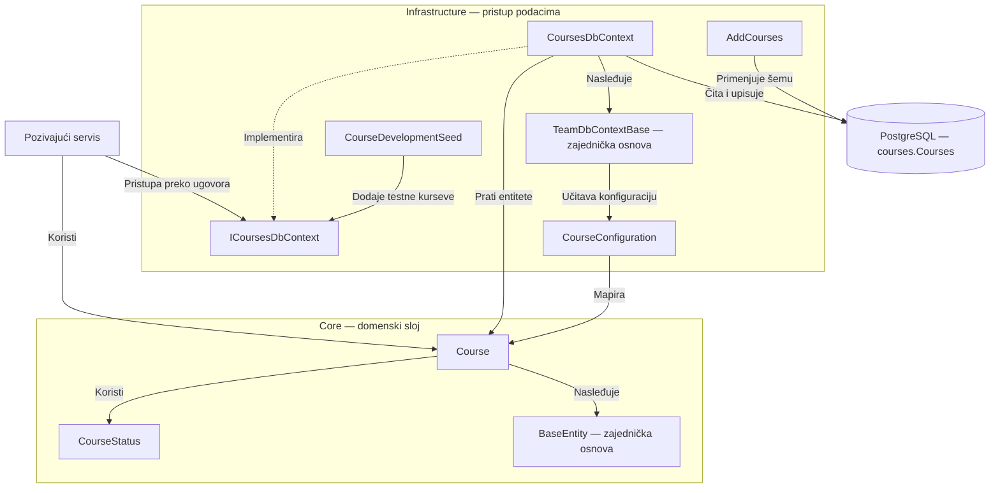
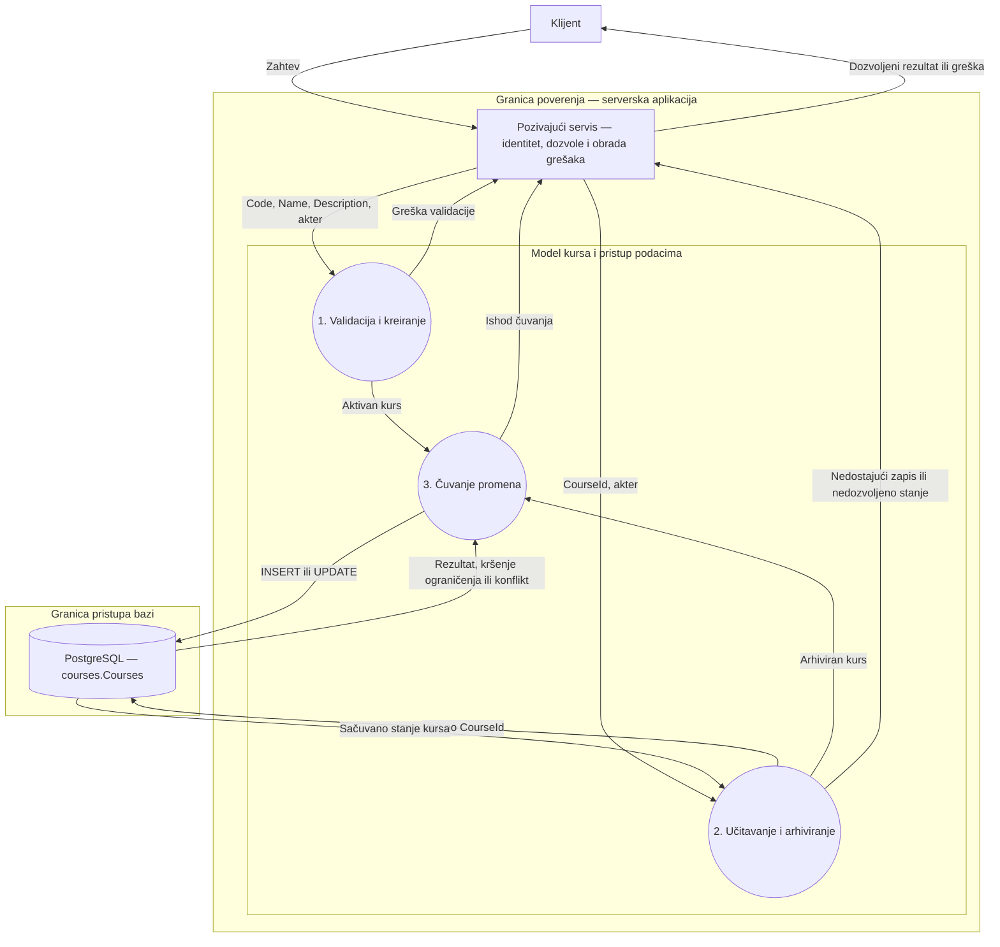

# ACC-01 — Model kursa, baza podataka, migracije i testni podaci

Implementacija obuhvata entitet kursa, pravila kreiranja i arhiviranja, EF Core
mapiranje, PostgreSQL migraciju i inicijalizaciju razvojnih podataka. Dokument
opisuje taj sloj i njegove ugovore sa pozivajućim servisima.

Osnovni zahtev ACC-01 definisan je u odeljku 4.2 [specifikacije projekta](../spec/PROJECT_SPECIFICATION_OIB.pdf):
arhiviranje sprečava nove upise i čuva istoriju. Model predstavlja stanje kursa
i uslov za upis; servis za upis primenjuje taj uslov nad trenutnim stanjem u bazi.

## Domenski model

Entitet `Course` nalazi se u projektu `Team21.Acc.Core` i nasleđuje postojeći
`BaseEntity`. Domenski sloj nema zavisnosti od EF Core, HTTP-a ili PostgreSQL-a.

| Svojstvo | Tip u modelu | Značenje i pravila |
| --- | --- | --- |
| `Id` | `Guid` | Identitet kursa; inicijalno se generiše u aplikaciji i predstavlja primarni ključ |
| `Code` | `string` | Obavezna šifra, najviše 32 znaka; pri kreiranju se uklanjaju okolni razmaci i primenjuje `ToUpperInvariant` |
| `Name` | `string` | Obavezan naziv, najviše 200 znakova; okolni razmaci se uklanjaju; nazivi se mogu ponavljati |
| `Description` | `string` | Opcioni opis, najviše 4000 znakova; `null` se pretvara u prazan tekst |
| `Status` | `CourseStatus` | Stanje `Active` ili `Archived`; novi kurs je aktivan |
| `ArchivedAt` | `DateTime?` | UTC vreme prvog arhiviranja |
| `ArchivedBy` | `Guid?` | Identifikator aktera prvog arhiviranja |
| `CanEnroll` | `bool` | Izračunato: `Status == CourseStatus.Active && !IsDeleted`; ne čuva se kao kolona |

Nasleđena svojstva `CreatedAt`, `CreatedBy`, `UpdatedAt` i `UpdatedBy` opisuju
kreiranje i poslednju izmenu zapisa. Svojstva `IsDeleted`, `DeletedAt` i `DeletedBy`
pripadaju zajedničkom mehanizmu logičkog brisanja.

### Kreiranje kursa

Konstruktor `Course(code, name, description, createdBy)` odbija praznu šifru,
prazan naziv, prekoračenje dozvoljenih dužina i `Guid.Empty` kao autora.
Normalizacija se obavlja pre čuvanja. Iz opisa se takođe uklanjaju okolni razmaci.

Ograničenja dužina predstavljaju odluke implementacije. Konstante su definisane
u klasi `Course`, a postojeći `CourseService` koristi iste vrednosti.
Za šifre su predviđene uobičajene ASCII oznake, na primer `OIB-2026`, radi
doslednosti između aplikacione normalizacije i SQL funkcije `upper`.

### Arhiviranje kursa

Metoda `Archive(archivedBy)` proverava aktera i stanje zapisa, a zatim postavlja
`Status`, `ArchivedAt`, `ArchivedBy` i `UpdatedBy`. Kontekst prilikom čuvanja
dopunjuje `UpdatedAt`.

| Uslov | Ponašanje |
| --- | --- |
| Aktivan, neobrisan kurs i neprazan identifikator aktera | Kurs prelazi u `Archived`; beleže se UTC vreme i akter |
| Već arhiviran, neobrisan kurs i neprazan identifikator aktera | Prvobitni podaci o arhiviranju ostaju sačuvani |
| `archivedBy == Guid.Empty` | Poziv se odbija izuzetkom `ArgumentException` |
| `IsDeleted == true` uz validnog aktera | Poziv se odbija izuzetkom `InvalidOperationException` |

Identitet, šifra, naziv, opis i podaci o kreiranju ostaju sačuvani.
Arhiviranje ne postavlja `IsDeleted`, pa kurs ostaje dostupan standardnim upitima,
uz provere prava u servisnom sloju. Reaktivacija kursa nije deo implementiranog
životnog ciklusa.

## Arhitektura i ugovori

`ICoursesDbContext` izlaže `DbSet<Course>` i nasleđuje operacije zajedničkog
`ITeamDbContext` ugovora, uključujući `SaveChangesAsync`, `BeginTransactionAsync`
i `ClearChangeTracker`. Pozivajući servisi koriste taj interfejs, dok
`CoursesDbContext` implementira pristup bazi.



`BaseEntity` i `TeamDbContextBase` predstavljaju postojeću zajedničku infrastrukturu.
Kontekst učitava konfiguracije odgovarajućeg modula, popunjava vremenske oznake,
čuva prvobitne podatke o kreiranju pri praćenim izmenama i primenjuje imenovani
filter `SoftDelete`.

Identitet i ovlašćenja pripadaju pozivajućem servisnom sloju. Neprazan identifikator
aktera u modelu potvrđuje oblik podatka, dok servis utvrđuje identitet korisnika
i pravo na konkretnu operaciju.

## Šema baze i integritet podataka

`CoursesDbContext` mapira entitet u tabelu `courses."Courses"`.
Identifikatori se čuvaju kao PostgreSQL `uuid`, status kao tekst dužine do 16
znakova, a vremenske oznake kao `timestamp with time zone`. Konverter datuma
obezbeđuje UTC vrednosti pri čitanju i upisu.

`Code`, `Name`, `Description`, `Status` i `CreatedBy` su obavezni.
Prazan opcioni opis predstavlja se praznim tekstom, dok su arhivska polja
prazna do prvog arhiviranja.

| SQL ograničenje | Pravilo |
| --- | --- |
| `CK_Courses_Code` | Dužina šifre je u opsegu 1–32 nakon SQL `trim` provere, ukupna dužina je najviše 32, a sadržaj odgovara `upper(Code)` |
| `CK_Courses_Name` | Naziv sadrži najmanje jedan znak nakon SQL `trim` provere; ukupna dužina je najviše 200 |
| `CK_Courses_Description` | Dužina opisa je najviše 4000 |
| `CK_Courses_Status` | Status je `Active` ili `Archived` |
| `CK_Courses_CreatedBy` | Autor kreiranja je različit od praznog GUID-a |
| `CK_Courses_ArchiveMetadata` | Aktivan kurs ima prazna arhivska polja; arhiviran kurs ima oba popunjena, uz neprazan identifikator aktera |

Domenska validacija dodatno odbija unose sastavljene od whitespace znakova.
SQL `trim` provere i domenska normalizacija opisuju odvojene slojeve zaštite.

### Indeksi i konkurentne promene

Jedinstveni indeks `IX_Courses_Code` primenjuje se na redove gde je
`IsDeleted = false`. Arhivirani kurs zadržava svoju šifru. Nakon logičkog brisanja,
drugi zapis može koristiti istu šifru, u skladu sa zajedničkim filterom.

Indeks `IX_Courses_Status_Name` nad parom `Status, Name` podržava upite za
neobrisane kurseve.

Svojstvo `Status` označeno je kao EF Core concurrency token. Pri izmeni se
proverava njegova prethodno učitana vrednost; arhiviranje zastarelog stanja
može izazvati `DbUpdateConcurrencyException`. Postojeći servis prevodi takav
konflikt u odgovor `409`.

Ova kontrola pokriva sukob promene statusa kursa. Ne predstavlja opštu verziju
celog entiteta i ne usklađuje upise u tabele drugih modula.

### Migracija

Migracija `20261103010833_AddCourses` kreira šemu, tabelu, ograničenja i indekse.
Istorija EF migracija vodi se u `courses."__EFMigrationsHistory"`.
Razvojni podaci dodaju se odvojeno, bez `HasData` zapisa u migraciji.

`Up` uvodi strukturu kursa bez izmene drugih modula. `Down` uklanja tabelu
i zahteva prethodnu procenu uticaja na sačuvane podatke. Primena migracije
obavlja se eksplicitno.

## Tok podataka

Klijentski zahtev prolazi kroz servisni sloj koji proverava identitet, prava
i ulazne podatke. Model primenjuje domenska pravila, a kontekst prenosi promenu
u bazu. Baza dodatno proverava integritet i vraća rezultat čuvanja.



Migracija priprema strukturu pre obrade ovih tokova. Razvojni inicijalizator
koristi isti kontekst za upis primera nakon primene migracije.

## Razvojni i testni podaci

`CourseDevelopmentSeed.SeedAsync` obezbeđuje sledeće primere:

| Šifra | Naziv | Početno stanje |
| --- | --- | --- |
| `OIB-2026` | Osnove informacione bezbednosti | `Active` |
| `WEB-2026` | Bezbednost veb aplikacija | `Active` |
| `OIB-2025` | OIB — prethodna generacija | `Archived` |

Primeri koriste fiksne identifikatore i sintetičkog aktera.
Inicijalizacija je dozvoljena za `Development` i `Testing`; ime okruženja
prosleđuje host aplikacije.

Metoda proverava postojeće identifikatore uz isključen filter logičkog brisanja.
Ponovljeni poziv dodaje samo nedostajuće primere. Postojeći, arhivirani i logički
obrisani primeri zadržavaju svoje stanje. Postupak ne ažurira promenjene primere
i nije predviđen za istovremeno pokretanje iz više inicijalizatora. Postojeća
ista šifra pod drugim identifikatorom može izazvati konflikt jedinstvenog indeksa.

Registracija API-ja i migracija ne pozivaju ovu metodu automatski. Poziv se
izvršava eksplicitno, nakon migracije, kroz razvojni inicijalizator sa namenskim
kontekstom. Primer poziva u kodu koji raspolaže kontekstom i okruženjem hosta:

```csharp
await CourseDevelopmentSeed.SeedAsync(context, environmentName, cancellationToken);
```

## Priprema okruženja i izvršavanje

Na drugom računaru potrebno je preuzeti kompletan repozitorijum i izabrati
verziju koja sadrži dokumentovanu implementaciju. Sve komande izvršavaju se
iz korena repozitorijuma; primeri podešavanja promenljivih koriste PowerShell.

Potrebni su .NET SDK 10.x i pristup izvorima NuGet paketa za obnovu zavisnosti.
Za migraciju je potreban EF Core CLI alat `dotnet-ef` verzije 10.x, a za
migraciju i PostgreSQL test dostupna PostgreSQL instanca. Ako se baza pokreće
preko priloženog Compose fajla, potreban je i pokrenut Docker.
Ostali dokumentovani testovi koriste memorijski provider ili SQLite i ne
zahtevaju pokrenut PostgreSQL server.

### Obnova EF alata

Repozitorijum sadrži manifest `dotnet-tools.json` koji određuje verziju alata.
Na novom računaru alat se obnavlja iz tog manifesta:

```powershell
dotnet tool restore --tool-manifest dotnet-tools.json
```

### Obnova zavisnosti i build

```powershell
dotnet restore backend/Team21.Acc.Tests/Team21.Acc.Tests.csproj
dotnet build backend/Team21.Acc.Tests/Team21.Acc.Tests.csproj --no-restore
```

Projektni fajlovi određuju verzije zavisnosti, uključujući EF Core 10.0.10
i PostgreSQL provider 10.0.3. Obnova paketa ne zahteva promenu tih verzija.

### Podešavanje konekcije i primena migracije

PostgreSQL se pokreće prema [timskom uputstvu](README.md#first-time-setup).
Konekcija se podešava kroz user secrets projekta infrastrukture ili promenljivu
`ConnectionStrings__Team21`. Primer sa lokalnim parametrima:

```powershell
dotnet user-secrets set "ConnectionStrings:Team21" "Host=localhost;Port=5432;Database=platform;Username=platform;Password=<LOKALNA_LOZINKA>" --project backend/Team21.Acc.Infrastructure
dotnet ef database update --context CoursesDbContext --project backend/Team21.Acc.Infrastructure --startup-project backend/Team21.Acc.Infrastructure
```

Parametri moraju odgovarati dostupnoj instanci; `<LOKALNA_LOZINKA>` zamenjuje se
stvarnom lokalnom lozinkom, bez oznaka `<` i `>`. User secrets i promenljive
okruženja podešavaju se na svakom računaru zasebno. Lozinka i vrednost konekcije
čuvaju se van repozitorijuma. `CoursesDbContextFactory` omogućava EF alatu da
pripremi kontekst bez pokretanja HTTP aplikacije.

### Demonstracija ponašanja modela i baze

Postojeći testovi omogućavaju ponovljivu demonstraciju kreiranja kursa,
arhiviranja uz ponovno učitavanje i dodavanja razvojnih podataka:

```powershell
dotnet test backend/Team21.Acc.Tests/Team21.Acc.Tests.csproj --no-restore --filter "FullyQualifiedName~NewCourseHasStableIdentityAndAllowsEnrollment|FullyQualifiedName~ArchiveRoundTripKeepsCourseVisibleAndCreationMetadataUnchanged|FullyQualifiedName~SampleDataIsRepeatableAndNeverOverwritesExistingOrDeletedCourses" --logger "console;verbosity=normal"
```

Očekivani ishodi su aktivno početno stanje, `CanEnroll == false` nakon
arhiviranja, nepromenjeni podaci o kreiranju i očuvanje postojećih primera
pri ponovljenoj inicijalizaciji. Ove provere izvršavaju pravila kroz model
i kontekst; prijem stvarnog studentskog upisa proverava se u integraciji
sa odgovarajućim servisom.

## Bezbednosne kontrole i dokazi

| Pretnja ili neispravan scenario | Kontrola | Postojeći test | Dokaz izvršavanja |
| --- | --- | --- | --- |
| Prazna šifra ili naziv | Provera obaveznih podataka u konstruktoru | `EmptyCodeIsRejected`, `EmptyNameIsRejected` | Uspešni slučajevi u TRX izveštaju |
| Predugačak unos ili zaobilaženje domenske validacije | Domenske provere i SQL ograničenja | `LengthLimitsAreEnforced`, `DatabaseRejectsOverlongText`, `DatabaseRejectsInvalidDataEvenWhenDomainIsBypassed` | Uspešni slučajevi u TRX izveštaju; relaciona SQLite baza |
| Ponovna upotreba šifre arhiviranog kursa | Filtrirani jedinstveni indeks | `ArchivedCourseStillReservesItsCode` | Uspešan test u TRX izveštaju |
| Promena podataka pri ponovljenom arhiviranju | Zadržavanje prvih arhivskih metapodataka uz validnog aktera i neobrisan zapis | `RepeatedArchiveKeepsOriginalActorAndTime` | Uspešan test u TRX izveštaju |
| Prepisivanje već promenjenog statusa | EF kontrola prethodne vrednosti statusa | `StaleArchiveCannotOverwriteFirstArchiveActor` | Uspešan test u TRX izveštaju; relaciona SQLite baza |
| Gubitak zapisa kursa ili podataka o kreiranju | Arhiviranje bez brisanja zapisa | `ArchiveRoundTripKeepsCourseVisibleAndCreationMetadataUnchanged` | Uspešan test u TRX izveštaju |
| Gubitak povezanog istorijskog zapisa u testnom modelu | Provera arhiviranja uz pomoćni istorijski entitet i `Restrict` relaciju | `ArchivePreservesRelatedHistoryAndRestrictForeignKeyProtectsIt` | Uspešan test u TRX izveštaju; pomoćni entitet `HistoryRecord` |
| Neusklađen status i arhivski metapodaci | `CK_Courses_ArchiveMetadata` | `ArchivedCourseMustKeepItsArchiveMetadata` | Uspešan test u TRX izveštaju; relaciona SQLite baza |
| Neusklađena migracija i EF model | Provera snimka modela i generisanog SQL-a | `PostgreSqlMigrationMatchesModelAndOnlyAddsCourses` | Uspešan test u TRX izveštaju; bez primene na PostgreSQL |
| Testni podaci u produkcijskom okruženju | Ograničenje inicijalizacije na dozvoljena okruženja hosta | `SampleDataIsRejectedOutsideDevelopmentAndTesting` | Uspešni slučajevi u TRX izveštaju |
| Prepisivanje postojećih razvojnih primera | Provera fiksnih identifikatora uključuje logički obrisane zapise | `SampleDataIsRepeatableAndNeverOverwritesExistingOrDeletedCourses` | Uspešan test u TRX izveštaju |
| Neispravna migracija ili ograničenja na PostgreSQL-u | Test sa stvarnim providerom i namenskom bazom | `MigrationArchiveAndConstraintsWorkOnPostgreSql` | Preskočen; zahteva namensku testnu bazu |

SQL ograničenja štite integritet podataka. Autentifikacija, autorizacija i bezbedan
prikaz korisničkog teksta sprovode se u pripadajućim slojevima aplikacije.
`CreatedBy`, `UpdatedBy` i arhivska polja predstavljaju metapodatke zapisa;
ne čuvaju potpun niz prethodnih vrednosti i nisu zamena za revizorski dnevnik.

### Rezultati provera

Projekat `Team21.Acc.Tests` proveren je 25.11.2026. u 13:51 po vremenu
Europe/Budapest. Provera je izvršena nad lokalnom verzijom `9da8cdc`;
kod modela i čuvanja kurseva odgovara pregledanom `origin/main` commitu `76b87f6`.

| Rezultat | Broj |
| --- | --- |
| Ukupno pronađeni testovi | 95 |
| Uspešni | 94 |
| Neuspešni | 0 |
| Preskočeni | 1 |

Build testnog projekta i njegovih zavisnosti je uspešan. Rezultat se odnosi
na ceo navedeni projekat, a ne samo na testove modela kursa.

Dokaz je lokalni izveštaj
`backend/Team21.Acc.Tests/TestResults/acc01-review-2026-11-25.trx`.
Direktorijum rezultata ignorisan je Git-om. Komanda za ponavljanje provere:

```powershell
dotnet test backend/Team21.Acc.Tests/Team21.Acc.Tests.csproj --no-restore --logger "trx;LogFileName=acc01-review-2026-11-25.trx" --results-directory backend/Team21.Acc.Tests/TestResults
```

PostgreSQL test je preskočen jer `TEAM21_ACC_TEST_POSTGRES` nije bio podešen
u testnom procesu. Za njegovo izvršavanje prethodno se priprema zasebna testna
baza, a korisniku konekcije omogućava primena migracije. U istom PowerShell
prozoru podešava se konekcija i pokreće test. Naziv baze i ostali parametri
u primeru zamenjuju se lokalnim vrednostima:

```powershell
$env:TEAM21_ACC_TEST_POSTGRES = "Host=localhost;Port=5432;Database=team21_acc_test;Username=platform;Password=<LOKALNA_LOZINKA>"
dotnet test backend/Team21.Acc.Tests/Team21.Acc.Tests.csproj --no-restore --filter TestCategory=PostgreSql
```

Test primenjuje migracije pre otvaranja transakcije sa testnim redovima.
Migrirana šema ostaje u testnoj bazi, a testni redovi se poništavaju pri završetku.

## Granice integracije i otvorene provere

Servis za upis mora da proveri sačuvani status kursa i uskladi upis sa
arhiviranjem. `CanEnroll` i concurrency token kursa sami ne rešavaju trku između
provere i upisa u drugu tabelu. Taj slučaj zahteva dogovoreni transakcioni
mehanizam ili zaključavanje i integracionu proveru.

Drugi moduli čuvaju `CourseId` i pristupaju stanju kursa kroz dogovoreni ugovor.
Model nema navigacije ni strane ključeve ka tabelama drugih modula. Postojeći
test sa `HistoryRecord` potvrđuje ponašanje pomoćne relacije, dok očuvanje
stvarnih članstava, dodela, pokušaja i rezultata zahteva međumodulske provere.

Servisni sloj proverava prava nad konkretnim kursom i pribavlja identitet aktera.
U pregledanoj registraciji, identitet i politika kursa za razvojno okruženje
imaju testne implementacije, a `IAuditTrail` koristi `LoggingAuditTrail`.
Povezivanje sa stvarnim identitetom, dozvolama i trajnim auditom obavlja se
preko integracionih adaptera.

Otvorene verifikacione tačke su primena migracije na namenskoj PostgreSQL bazi,
istovremeni upis i arhiviranje i očuvanje stvarnih povezanih podataka. One
ograničavaju potvrdu kompletne ACC-01 integracije; dokumentovani model, konfiguracija,
migracija i razvojni podaci već su implementirani.

## Izvorni kod i evidencija implementacije

| Artefakt | Lokacija |
| --- | --- |
| Entitet kursa | [Course.cs](../../backend/Team21.Acc.Core/Courses/Course.cs) |
| Stanja kursa | [CourseStatus.cs](../../backend/Team21.Acc.Core/Courses/CourseStatus.cs) |
| Ugovor pristupa bazi | [ICoursesDbContext.cs](../../backend/Team21.Acc.Infrastructure/Courses/Data/ICoursesDbContext.cs) |
| Kontekst baze | [CoursesDbContext.cs](../../backend/Team21.Acc.Infrastructure/Courses/Data/CoursesDbContext.cs) |
| EF Core konfiguracija | [CourseConfiguration.cs](../../backend/Team21.Acc.Infrastructure/Courses/Configurations/CourseConfiguration.cs) |
| Migracija | [AddCourses.cs](../../backend/Team21.Acc.Infrastructure/Courses/Data/Migrations/20261103010833_AddCourses.cs) |
| Razvojni podaci | [CourseDevelopmentSeed.cs](../../backend/Team21.Acc.Infrastructure/Courses/Data/CourseDevelopmentSeed.cs) |
| Domenski testovi | [CourseTests.cs](../../backend/Team21.Acc.Tests/Courses/CourseTests.cs) |
| Relacione provere | [CoursePersistenceTests.cs](../../backend/Team21.Acc.Tests/Courses/CoursePersistenceTests.cs) |
| PostgreSQL provera | [CoursePostgreSqlTests.cs](../../backend/Team21.Acc.Tests/Courses/CoursePostgreSqlTests.cs) |

Osnovni doprinos evidentiran je commitom `7b81510` i PR-om #52
(merge commit `f8c0cea`). Obuhvata model, konfiguraciju, dopunu konteksta,
migraciju, razvojne podatke i prateće testove; zajedničke osnovne klase postojale
su pre tog doprinosa. Razlika je proverljiva komandom:

```powershell
git show --stat 7b81510
```
