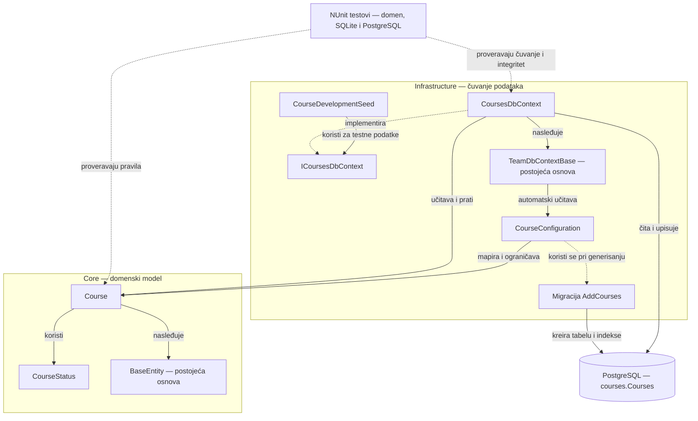

# ACC-01 — Arhitektura komponenti: model kursa i baza

Ovaj dokument prikazuje Nikolin doprinos: domenski model kursa, EF Core konfiguraciju,
pristup bazi, migraciju, razvojne podatke i automatske testove.

## Dijagram arhitekture

## Uloge komponenti

| Komponenta | Odgovornost |
| --- | --- |
| `Course` | Čuva podatke kursa, proverava ulaz i kroz `Archive` menja status u `Archived`. |
| `CourseStatus` | Definiše stanja `Active` i `Archived`. |
| `BaseEntity` | Postojeća osnova sa ID-jem, podacima o kreiranju, izmenama i logičkom brisanju. |
| `ICoursesDbContext` | Ugovor preko kojeg pozivaoci pristupaju skupu kurseva i čuvanju promena. |
| `CoursesDbContext` | EF Core kontekst koji izlaže `DbSet<Course>` i koristi šemu `courses`. |
| `TeamDbContextBase` | Postojeća osnova konteksta: učitava konfiguracije modula, popunjava datume i filtrira logički obrisane zapise. |
| `CourseConfiguration` | Definiše mapiranje, primarni ključ, dužine polja, CHECK ograničenja, indekse i concurrency token za status. |
| `AddCourses` | Migracija koja pravi tabelu kurseva, ograničenja i indekse. |
| `CourseDevelopmentSeed` | Eksplicitno dodaje testne primere samo u Development ili Testing okruženju. |
| Testovi | Proveravaju domenska pravila, arhiviranje, ograničenja baze i očuvanje podataka. PostgreSQL test koristi namensku testnu bazu. |

`BaseEntity` i `TeamDbContextBase` su postojali pre ovog doprinosa.
`CoursesDbContext` i njegov interfejs dopunjeni su skupom `Courses`.
Migracija se primenjuje pri pripremi baze; nije korak svakog upisa kursa.

## Pravilo arhiviranja

`Archive(actorId)` postavlja status `Archived`, vreme i autora arhiviranja.
Zapis kursa ostaje u tabeli, a `IsDeleted` se ne postavlja.
Ponovljeni poziv čuva prvog autora i trenutak arhiviranja.

`CanEnroll` se računa iz statusa i polja `IsDeleted`; ne čuva se kao kolona.
Servis za upis mora proveravati trenutno stanje kursa i uskladiti novi upis sa
arhiviranjem. Autorizacija, HTTP endpointi i stvarni istorijski entiteti pripadaju
drugim delovima projekta. Test istorije koristi minimalan entitet samo u test projektu.

Prethodni dijagram je sačuvan u fajlu [ACC-01-Nikola.png](ACC-01-Nikola.png).
