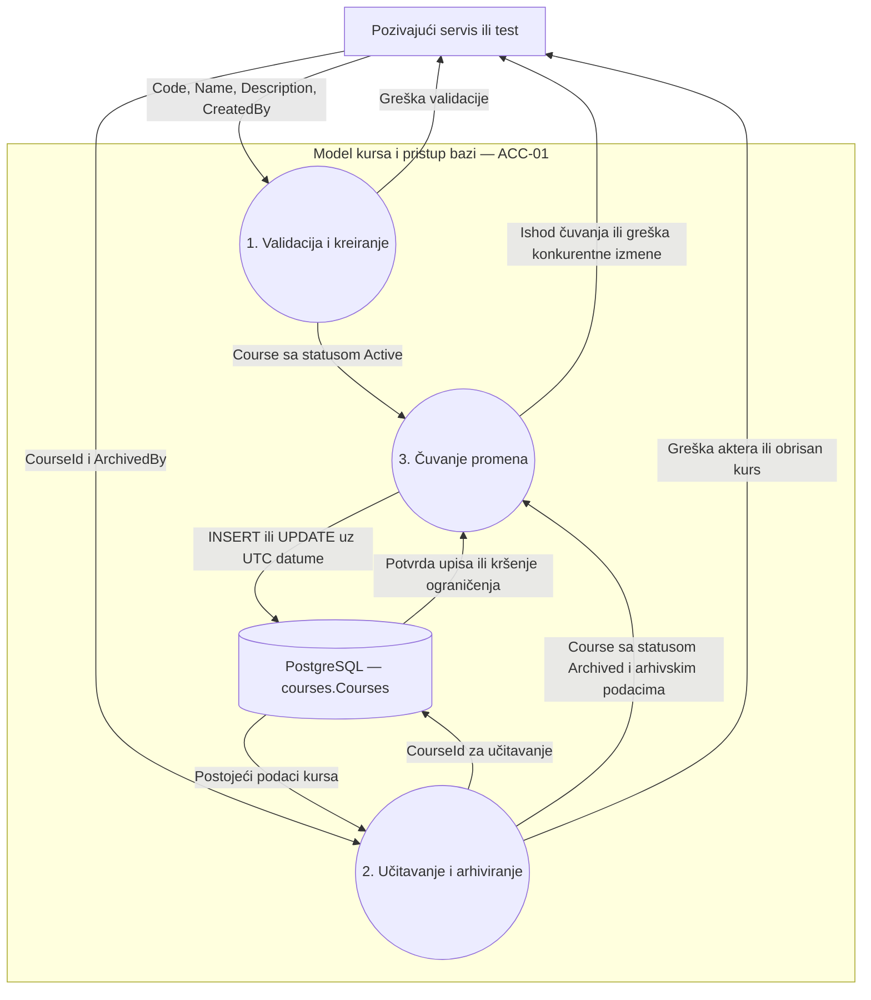

# ACC-01 — Tok podataka: kreiranje i arhiviranje kursa

Dijagram prikazuje kako pozivajući servis ili test koristi model i kontekst.
Autentifikacija i autorizacija su odgovornost pozivajućeg sloja.
Proces učitavanja i arhiviranja koristi `CoursesDbContext` da učita kurs,
a zatim `Course.Archive` da promeni njegovo stanje u memoriji.

## Dijagram toka podataka

## Objašnjenje toka

Pri kreiranju konstruktor proverava šifru, naziv, dužine teksta i autora, a kurs
dobija status `Active`. Pozivalac dodaje objekat u `Courses` i poziva `SaveChangesAsync`.

Pri arhiviranju pozivalac učitava postojeći kurs, poziva `Archive(actorId)` i zatim
`SaveChangesAsync`. Arhiviranje postavlja arhivska polja i `UpdatedBy`, dok kontekst
popunjava `UpdatedAt`. Kurs i njegovi podaci o kreiranju ostaju sačuvani.
Ponovljeni poziv `Archive` čuva prvog autora i trenutak arhiviranja.

`CanEnroll` nakon arhiviranja vraća `false`. Servis za upis mora proveravati
trenutno stanje kursa i uskladiti novi upis sa arhiviranjem.
Stvarne istorijske entitete treba povezati pri integraciji sa odgovarajućim modulima;
test očuvanja istorije koristi minimalan entitet samo u test projektu.
