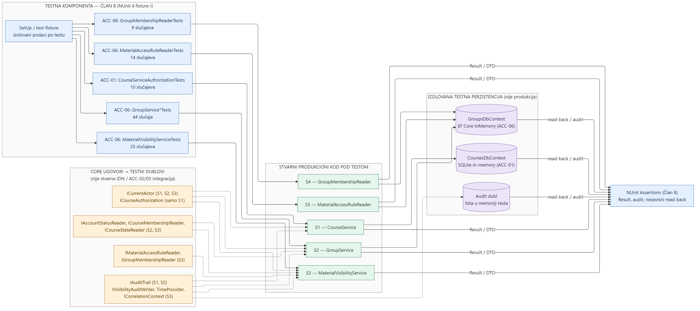
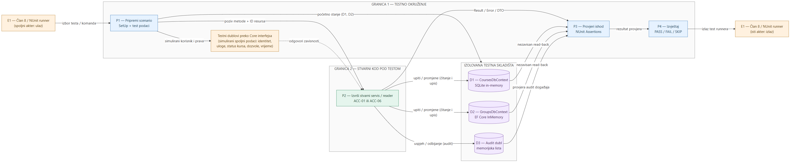

# Team 21 — Automated security testing (Member 8)

- **Team:** 21
- **Component owner:** Member 8 (tests)
- **Primary requirements:** ACC-01 (course creation/archiving); ACC-06 (groups and material visibility)
- **Related requirements:** SEC-01 (authorization), SEC-05 (validation), AUD-01 (audit evidence), as applicable
- **Technology:** .NET 10, NUnit 4, EF Core, SQLite in-memory (ACC-01), EF Core InMemory (ACC-06)
- **Scope:** automated service, reader, authorization and persistence-behavior tests. Production HTTP, actual session adapters, integration with other teams and PostgreSQL runtime validation are not claimed here.

## 1. Responsibilities and boundaries

The component verifies security invariants of ACC-01 and ACC-06 without reimplementing their business rules. Test subjects are the **real production** `CourseService`, `GroupService`, `MaterialVisibilityService`, `GroupMembershipReader` and `MaterialAccessRuleReader`. External authorization inputs are controlled by small, per-test implementations of Core interfaces.

| Layer | Responsibility | Representative types |
| --- | --- | --- |
| NUnit test fixtures | Arrange context, invoke real behavior, assert outcomes | `CourseServiceAuthorizationTests`, `GroupService*Tests`, `MaterialVisibilityServiceTests`, reader tests |
| Core contracts | Define the collaborators, without requiring a production identity/enrollment module | `ICurrentActor`, `ICourseAuthorization`, `ICourseStateReader`, `ICourseMembershipReader`, `IAccountStatusReader`, reader/audit interfaces |
| Real service and reader code | Execute authorization and business rules | `CourseService`, `GroupService`, `MaterialVisibilityService`, `GroupMembershipReader`, `MaterialAccessRuleReader` |
| Isolated persistence | Persist and independently read test data | `CoursesDbContext` with SQLite in-memory; `GroupsDbContext` with EF Core InMemory |
| Observability | Assert results, audit events and persisted state | `Result`/`Error`, NUnit assertions, recording audit doubles, independent database contexts |

**Interface boundary:** test doubles substitute external data sources; they do not substitute the authorization services under test. This validates isolated ACC behavior, not completed integration with IDN, ACC-02/03, LAB/ASN, AUD or platform ACC-05.

## 2. Component architecture (KT1)



**Relationships shown:** each NUnit fixture (blue, left) exercises exactly one real production class (green, S1–S5). The yellow Core contracts are satisfied by per-test doubles and point only at the services that really depend on them: `ICurrentActor` feeds `CourseService`, `GroupService` and `MaterialVisibilityService`; `ICourseAuthorization` feeds `CourseService` only; the account, membership and course-state readers feed `GroupService` and `MaterialVisibilityService`; the access-rule and group-membership readers feed `MaterialVisibilityService`. `CourseService` persists to `CoursesDbContext` on SQLite in-memory (ACC-01); `GroupService` and both real readers use `GroupsDbContext` on EF Core InMemory (ACC-06). Audit events go to an in-memory test double, not to production audit persistence. The assertion node on the right collects service results and independent read-back from the isolated stores. The contracts box marks the trust boundary: none of these doubles represents a real IDN, ACC-02/03 or platform HTTP integration.

**Architecture reading:** the blue nodes are Member 8's NUnit test harness (fixtures and the assertion step), the green area is **real production code being tested**, the yellow area contains deliberately controlled interface implementations (not production adapters), and the purple area contains isolated persistence and audit observations. The fixtures select scenarios and assert outputs. The tested services keep responsibility for authorization decisions.

**Dependency direction / SOLID:** the production contracts live in Core; small doubles implement those contracts only within the test fixtures. The services and readers remain real. No external identity, enrollment or material-storage module is claimed to be integrated merely because a fixture provides its data.

## 3. Data flow diagram (DFD — KT1 test execution)



**Flows and trust boundaries:** the external actor E1 (Member 8 through the NUnit runner) is drawn twice, as the source of the test command on the left and the recipient of the PASS/FAIL/SKIP report on the right; it is the same actor. **Boundary 1** (test environment) contains scenario setup P1, the interface doubles that simulate external identity, roles, course state, permissions and time, and the verification steps P3–P4. P1 seeds the isolated stores (D1 courses, D2 groups/members/rules) and invokes the real service or reader. **Boundary 2** contains only P2, the real ACC-01/ACC-06 code; the doubles answer its dependency calls but do not make its authorization decisions. P2 reads and writes D1/D2 and writes success or denial audit events to D3. P3 checks the returned `Result`/`Error`/DTO, an independent read-back of D1/D2 and the D3 audit events. No HTTP, session middleware, PostgreSQL or real external adapter appears in the flow because none is exercised at KT1.

**DFD elements and trust boundaries:**

- **External actor:** Member 8 invoking the NUnit runner (E1, drawn once for input and once for output).
- **Inputs:** scenario selection, identity, course/group IDs, membership, course status and material access rules.
- **Processes:** test fixture setup (P1), call into a real service/reader (P2), NUnit result/audit/state assertions (P3), PASS/FAIL/SKIP report (P4).
- **Data stores:** isolated SQLite for ACC-01 course tests (D1); EF Core InMemory for ACC-06 group tests (D2); an in-memory list of audit events (D3).
- **Outputs:** `Result` / `Error` / DTOs, stored-state observations, audit records and NUnit verdict.
- **Boundary 1:** inputs are controlled by test fixtures and interfaces, rather than coming from real IDN or membership services.
- **Boundary 2:** actual authorization and business rules run in real service code. The fixtures do not bypass or reimplement those rules.
- **Not yet covered:** the HTTP network boundary, session middleware, real external adapters, live PostgreSQL concurrency and final `main` integration are KT2 work.

## 4. Actual test contribution and evidence

| Contribution branch | Files | Added NUnit cases | What it verifies |
| --- | ---: | ---: | --- |
| `feature/acc01-tests` | 1 | 10 | creation and archive authorization, audit success/denial, archive IDOR, validation |
| `feature/acc06-tests` | 7 | 92 | group creation/member changes/reads, course and group scoping, visibility, default deny, soft deletion, archived-course behavior |
| **Total** | **8** | **102** | **9 test commits across both branches** |

**Branch heads at time of preparation:** `ccadf736` (ACC-01 tests) and `b8190583` (ACC-06 tests). All changes in the nine commits are test-only.

Last externally reported local results (not new CI verification):

- ACC-01 test project: 95 discovered; 94 passed; 1 PostgreSQL-gated test skipped.
- ACC-06 test project: 118 passed, 0 failed, 0 skipped.
- Disposable ACC-01/06 integration rehearsal: 187 discovered; 186 passed, 1 PostgreSQL-gated test skipped.

The full project test totals include existing tests from other contributions; the 102 figure counts only Member 8's added cases.

## 5. Reproduce the KT1 demonstration

Commands below are executed from the repository root, with .NET SDK 10 installed. **Do not switch branches with uncommitted changes.**

```powershell
git status --short
git switch feature/acc06-tests
dotnet test backend/Team21.Acc.Tests/Team21.Acc.Tests.csproj --filter "Name~CanAccess_StudentInOtherGroup_ReturnsNotFound"
dotnet test backend/Team21.Acc.Tests/Team21.Acc.Tests.csproj --filter "Name~FilterVisible_StudentInArchivedCourse_ReturnsNotFound"
dotnet test backend/Team21.Acc.Tests/Team21.Acc.Tests.csproj --filter "Name~GetMembers_TeacherOfOtherCourse_ReturnsNotFoundAndLeavesDataUnchanged"

git status --short
git switch feature/acc01-tests
dotnet test backend/Team21.Acc.Tests/Team21.Acc.Tests.csproj --filter "Name~Archive_CourseNotAuthorizedForCaller_ReturnsNotFound"
dotnet test backend/Team21.Acc.Tests/Team21.Acc.Tests.csproj --filter "Name~Create_UserWithoutPermission_RecordsDeniedAudit"
```

See [`DEMO.md`](DEMO.md) for the suggested presentation sequence and explanation of test assertions.

## 6. Current limitations / KT2 handoff

- **Not production-integrated:** `ICourseStateReader` for ACC-06 still uses a Development fake / production deny-all; changes to ACC-01 course state will not propagate until the real adapter is registered. Owner: integration (Member 9 and ACC-01).
- **External contracts:** session identity (IDN), account state, enrollment/course roles (ACC-02/03), actual LAB/ASN content enforcement, ACC-05 access metadata and audit persistence need integration by their owners.
- **Unverified in PostgreSQL CI:** filtered unique indexes, concurrency and some soft-delete semantics; existing PostgreSQL-gated test is skipped without `TEAM21_ACC_TEST_POSTGRES`.
- **No end-to-end HTTP host tests yet:** KT2 should cover real request authentication, authorization middleware, routing/DTOs and access to actual material contents.
- **Known defense-in-depth follow-up:** `GroupService.AddMemberAsync` should independently validate `membership.CourseId` before relying on external adapter data; owned by the GroupService author.

None of these limitations makes the currently reviewed test-only parent PRs incorrect, but they prevent claiming a completely integrated production workflow.

### Remaining work after KT1 and integration agreements

| Dependency | Owner | Status at KT1 |
| --- | --- | --- |
| Real `ICourseStateReader` over `CoursesDbContext`, so ACC-01 archiving reaches ACC-06 | Member 9 (Team 21 integration) with the ACC-01 author | Pending; only the Development fake and the production deny-all reader exist |
| Session identity for `ICurrentActor` (IDN) and account status for `IAccountStatusReader` (IDN-03) | Member 9 with the IDN teams | Pending; Development uses the `X-Test-User` header, production treats every caller as anonymous |
| Enrollment and course roles for `ICourseMembershipReader`; ACC-01 "no new enrollments" enforced by enrollment | ACC-02 / ACC-03 teams, adapter by Member 9 | Pending; ACC-01 tests verify only the course's `CanEnroll` flag |
| LAB/ASN material retrieval calling `IMaterialVisibilityService` before returning content | LAB / ASN teams, adapter by Member 9 | Pending; Team 21 endpoints return only the material reference |
| ACC-05 access metadata on all Team 21 endpoints | Member 9 when integrating into `main` | Pending; required by the shared access middleware on `main` |
| Audit persistence behind `IAuditTrail` / `IVisibilityAuditWriter` | AUD team, adapter by Member 9 | Pending; events are written to the application log |
| PostgreSQL verification (filtered unique indexes, concurrency tokens, Postgres error mapping) and end-to-end HTTP host tests | Member 8 in KT2, with a dedicated test database | Pending |

**Confirmed:** the Core interfaces listed above are the contracts Team 21 code depends on, and the tests verify Team 21 behaviour against them. **Not confirmed:** no external team has implemented or formally accepted an adapter for these contracts yet; each row stays pending until its owner delivers it.

## 7. Git workflow

Keep this documentation separate from production code. Review and merge `feature/acc01-tests` into `feature/acc01-courses`, and `feature/acc06-tests` into `feature/acc06-groups` only after their respective PR checks and parent-owner approvals. Use merge commits (not squash) if preserving Member 8's individually visible commit history is a review requirement.

**Do not treat a green isolated NUnit run as proof the repository-wide CI or `main` integration will pass.**

## 8. KT1 checkpoint coverage

`docs/CHECKPOINT_1.md` lists six items. This document covers them as follows:

| KT1 item | Where |
| --- | --- |
| Initial work: code structure, commits, current behaviour | Section 4 (test files, commits, results); the tests themselves in `backend/Team21.Acc.Tests/` |
| Responsibilities and individual contribution | Header and section 1 |
| Component architecture diagram | Section 2 |
| Data flow diagram with trust boundaries | Section 3 |
| Short demonstration | Section 5 and [`DEMO.md`](DEMO.md) |
| Plan for remaining work and external dependencies | Section 6 |
