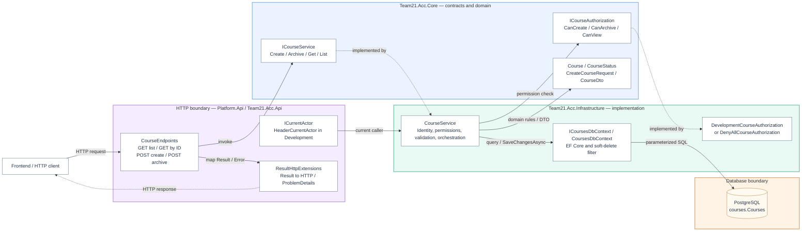
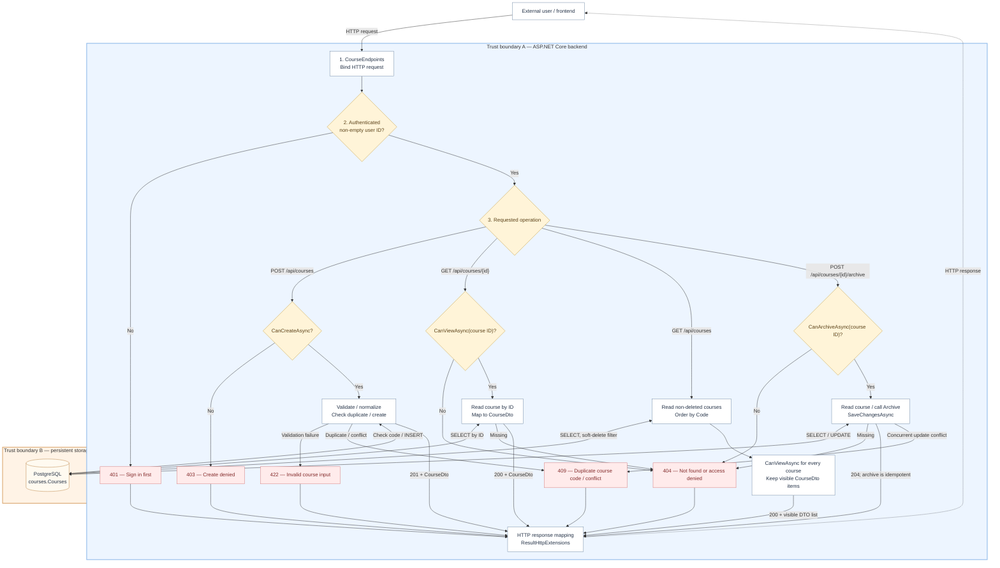

# ACC-01 — Course Management API

- **Team:** 21
- **Student:** Luka Nikolic, PR131/2023
- **Specification requirement:** ACC-01 — Creating and archiving courses
- **Work branch:** `feature/acc01-api`

## 1. Responsibilities and boundaries

The ACC-01 backend exposes four ASP.NET Core Minimal API endpoints:

| Method | Route                       | Operation                                           | Success          |
| ------ | --------------------------- | --------------------------------------------------- | ---------------- |
| `POST` | `/api/courses`              | Create a course                                     | `201 Created`    |
| `POST` | `/api/courses/{id}/archive` | Archive a course                                    | `204 No Content` |
| `GET`  | `/api/courses`              | List courses visible to the caller, ordered by code | `200 OK`         |
| `GET`  | `/api/courses/{id}`         | Read one visible course                             | `200 OK`         |

The component is part of the Security Lab modular monolith and follows the `Core / Infrastructure / Api` separation:

- **Core:** `Course`, `CourseStatus`, DTOs, `ICourseService`, `ICourseAuthorization` and shared contracts.
- **Infrastructure:** `CourseService`, authorization implementations, `CoursesDbContext`, EF Core mappings and PostgreSQL persistence.
- **Api:** endpoint routing, Development identity adapter, dependency injection and `Result`-to-HTTP mapping.
- **Platform.Api:** shared host that registers the Team 21 module.

**Scope:** This component handles course creation, reading and archiving. Login/session management, enrollment, materials, group visibility, frontend features and persistent audit storage belong to other components or integration work.

**Current limitations:** Development uses `X-Test-User` and a fake course authorization policy. Outside Development, the currently registered identity adapter is anonymous and course authorization denies access. These are not production-ready identity/permission integrations.

## 2. Component architecture

The diagram groups the actual components by responsibility. Solid arrows represent calls or data access; dashed arrows represent implementation, identity or response relationships. The client-to-API and application-to-database links cross trust boundaries.

### Component responsibilities

| Component                              | Responsibility                                                                                                       |
| -------------------------------------- | -------------------------------------------------------------------------------------------------------------------- |
| `CourseEndpoints`                      | Declares four Minimal API routes; delegates operations to `ICourseService`.                                          |
| `ResultHttpExtensions`                 | Maps `Result` / `Result<T>` to success responses or ProblemDetails errors.                                           |
| `ICurrentActor` / `HeaderCurrentActor` | Supplies the caller identity; `X-Test-User` works in Development only.                                               |
| `ICourseService` / `CourseService`     | Performs authentication checks, per-operation authorization, input validation, EF Core reads/writes and DTO mapping. |
| `ICourseAuthorization`                 | Contract for `CanCreateAsync`, `CanArchiveAsync` and `CanViewAsync`.                                                 |
| `DevelopmentCourseAuthorization`       | Shared test manager can create/archive; any authenticated Development user can view courses.                         |
| `DenyAllCourseAuthorization`           | Rejects course permissions outside Development until the real authorization adapter is integrated.                   |
| `Course` / `CourseStatus`              | Domain invariants and archive lifecycle, including `CanEnroll` and preservation of archive metadata.                 |
| `CoursesDbContext`                     | Access to the `courses` PostgreSQL schema, indexes, constraints and soft-delete query filtering.                     |

## 3. Data flow diagram (DFD)

The diagram shows the four request flows and the security denial paths. The external client is untrusted. Identity and permissions are checked by the backend, not the frontend.

### Data flow details

1. **Create:** The caller is authenticated, `CanCreateAsync` is checked, the request is validated and normalized, and a new `Course` is inserted. Success returns `201 Created` and `CourseDto`. Invalid input returns `422`; duplicate codes return `409`; permission denial returns `403`.
2. **Get by ID:** Authentication and `CanViewAsync(userId, courseId)` are checked _before_ loading the course. A missing or forbidden course returns the same `404 Not Found` message: `Course not found.`
3. **Get list:** The backend loads non-soft-deleted courses, sorts by `Code`, checks `CanViewAsync` for each one and returns only allowed `CourseDto` items. A signed-in caller with no visible courses gets `200 OK` and `[]`.
4. **Archive:** Authentication and `CanArchiveAsync` are checked before loading a course. The domain method `Archive(userId)` changes the status and stores archive metadata; the row is not deleted. Repeated archive requests succeed without overwriting the original archive metadata.

**Boundary A:** A request from the frontend is untrusted. The `X-Test-User` test header is accepted only in Development. The service makes its own authorization decisions even if the frontend hides restricted actions.

**Boundary B:** The database is accessed via EF Core, not directly by the client. Course queries respect the existing soft-delete query filter; archived courses are not soft-deleted and remain readable to authorized callers.

## 4. Security requirements

### Authentication and authorization

| Scenario                        | Expected behavior                                  |
| ------------------------------- | -------------------------------------------------- |
| No authenticated user           | `401 Unauthorized`                                 |
| Create without permission       | `403 Forbidden`                                    |
| Get a course without permission | `404 Not Found`                                    |
| Get a nonexistent course        | `404 Not Found` with the same public message       |
| Archive without permission      | `404 Not Found`                                    |
| List request                    | `200 OK`, containing only permitted courses        |
| Read an archived course         | `200 OK` when authorized; DTO status is `Archived` |

The identical `404` response for missing and forbidden individual resources reduces resource-existence disclosure (BOLA/IDOR risk). The list operation filters visibility per course. Production identity and permission integration are still pending; Development test headers and test permissions must not be treated as production controls.

### Input validation and data integrity

- `Code` and `Name` are mandatory; values are trimmed and the code is uppercased.
- Length limits: code **32**, name **200**, description **4000** characters.
- Duplicate course codes are rejected (`409 Conflict`); the PostgreSQL unique index also protects concurrent inserts.
- The database applies constraints, a unique index on non-soft-deleted course codes, and an EF Core soft-delete query filter.
- API responses use `CourseDto`, not the complete EF entity; archive actor and other internal fields are not exposed by this DTO.
- `CourseStatus.Archived` is a lifecycle state, not deletion. `Course.CanEnroll` becomes false for archived or soft-deleted courses; enrollment enforcement is the responsibility of the enrollment integration.
- The service uses asynchronous EF Core operations and receives `CancellationToken` values from HTTP endpoints.

## 5. Evidence of work

**Implementation:** `feature/acc01-api` → Pull Request into `feature/acc01-courses`.

**Earlier work:** PR #59 (Create/Archive) was merged into the ACC-01 integration branch. Current GET, visibility and KT1 changes are follow-up work and are not part of that already-merged PR until submitted separately.

**Main implementation files:**

- `backend/Team21.Acc.Api/Courses/CourseEndpoints.cs`
- `backend/Team21.Acc.Api/Courses/CoursesModule.cs`
- `backend/Team21.Acc.Core/Courses/ICourseService.cs`
- `backend/Team21.Acc.Core/Courses/ICourseAuthorization.cs`
- `backend/Team21.Acc.Infrastructure/Courses/Services/CourseService.cs`
- `backend/Team21.Acc.Infrastructure/Courses/Authorization/DevelopmentCourseAuthorization.cs`
- `backend/Team21.Acc.Infrastructure/Courses/Authorization/DenyAllCourseAuthorization.cs`
- `backend/Team21.Acc.Tests/Courses/CourseServiceTests.cs`
- `docs/team-21/README.md`

**Local verification (2026-11-06):**

- `dotnet build backend/Team21.Acc.slnx` — succeeded.
- `dotnet test backend/Team21.Acc.Tests` — **84 passed, 1 skipped, 0 failed**. The skipped test requires a dedicated PostgreSQL test database.
- HTTP `GET /api/courses` without identity — `401 Unauthorized`.
- HTTP `GET /api/courses` with Development test identity — `200 OK`, including an archived course.
- HTTP `GET /api/courses/{id}` for an existing archived course — `200 OK`.
- HTTP `GET /api/courses/{id}` without identity — `401 Unauthorized`.
- HTTP `GET /api/courses/{id}` for a nonexistent GUID — `404 Not Found`.
- Service tests also cover denied reads, visibility filtering, sorting and archived history. The denied-read `404` has not been separately demonstrated through an HTTP request.

**Development test identity:** `00000000-0000-0000-0000-000000000001` via `X-Test-User` header.

## 6. Remaining integration work

- Replace Development-only identity and course authorization with real authentication and resource-based permissions from the responsible teams.
- Integrate audit persistence through the AUD module; do not treat the current code as full audit integration.
- Consider database-side permission filtering and pagination for large course catalogs; the current list reads candidate courses then checks permissions in memory.
- Add PostgreSQL-backed integration tests for the database-specific race-condition behavior and run the currently skipped dedicated PostgreSQL test.
- Re-run CI and request review when the current changes are committed and submitted to `feature/acc01-courses`.
