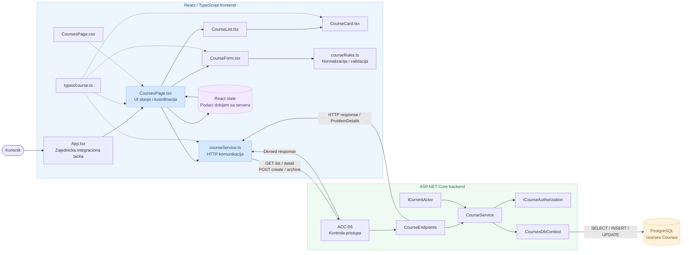

# ACC-01 | Component Architecture Diagram

Dijagram prikazuje implementiranu arhitekturu React/TypeScript
frontenda za upravljanje kursevima i njegovu komunikaciju
sa Team21 ACC-01 backendom.

## Napomene

- App.tsx je zajednicka integraciona tacka platforme.
- CoursesPage koordinira ucitavanje, kreiranje, pretragu,
  filtriranje i arhiviranje kurseva.
- CourseForm koristi courseRules za klijentsku validaciju.
- courseService komunicira sa backendom preko HTTP zahteva.
- Servis implementira GET pojedinacnog kursa, ali ga
  trenutna stranica ne poziva direktno.
- React state nije trajno skladiste niti izvor autorizacije.
- Backend je odgovoran za identitet, dozvole, validaciju
  i trajno cuvanje podataka.
- Integracija stvarne autentikacije i autorizacije
  ostaje otvorena zavisnost backend komponenti.
