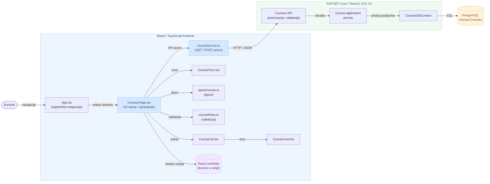

# ACC-01 | Component Architecture Diagram

Dijagram prikazuje glavne React/TypeScript komponente, servis za HTTP pozive, ASP.NET Core slojeve i PostgreSQL bazu.

**Napomena:** `App.tsx` je zajednička integraciona tačka tima. `courseService.ts` sadrži metode za GET i POST zahteve; dostupnost GET endpointa zavisi od implementacije na backendu.
