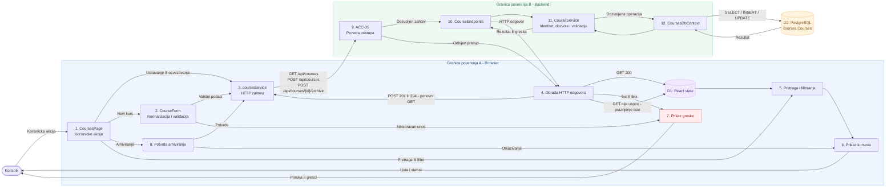

# ACC-01 | Data Flow Diagram (DFD)

Dijagram prikazuje ucitavanje, kreiranje, pretragu,
filtriranje i arhiviranje kurseva, kao i obradu
uspesnih i neuspesnih HTTP odgovora.

## Napomene

- Lista kurseva ucitava se sa servera pri otvaranju stranice.
- Pretraga i filtriranje izvrsavaju se nad ucitanim
  kursevima u React stanju.
- Kreiranje kursa zahteva klijentsku i serversku validaciju.
- Arhiviranje zahteva eksplicitnu potvrdu korisnika.
- Nakon uspesnog kreiranja ili arhiviranja frontend
  ponovo ucitava listu sa servera.
- Arhiviranje predstavlja promenu statusa, a ne brisanje.
- Ako ucitavanje ne uspe, lokalna lista se prazni.
- Klijentska validacija ne zamenjuje serversku autorizaciju.
- Razvojni identitet nije produkcioni mehanizam autentikacije.
