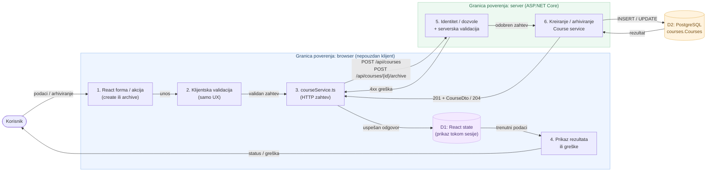

# ACC-01 | Data Flow Diagram (DFD)

Dijagram prikazuje tok podataka za kreiranje i arhiviranje kurseva, uz granicu poverenja između klijenta i servera.

**Napomena:** Validacija u React-u poboljšava korisničko iskustvo, ali serverska validacija i provera ovlašćenja ostaju obavezne. React stanje predstavlja samo kurseve dostupne tokom tekuće sesije; učitavanje pune liste zahteva odgovarajući GET API.
