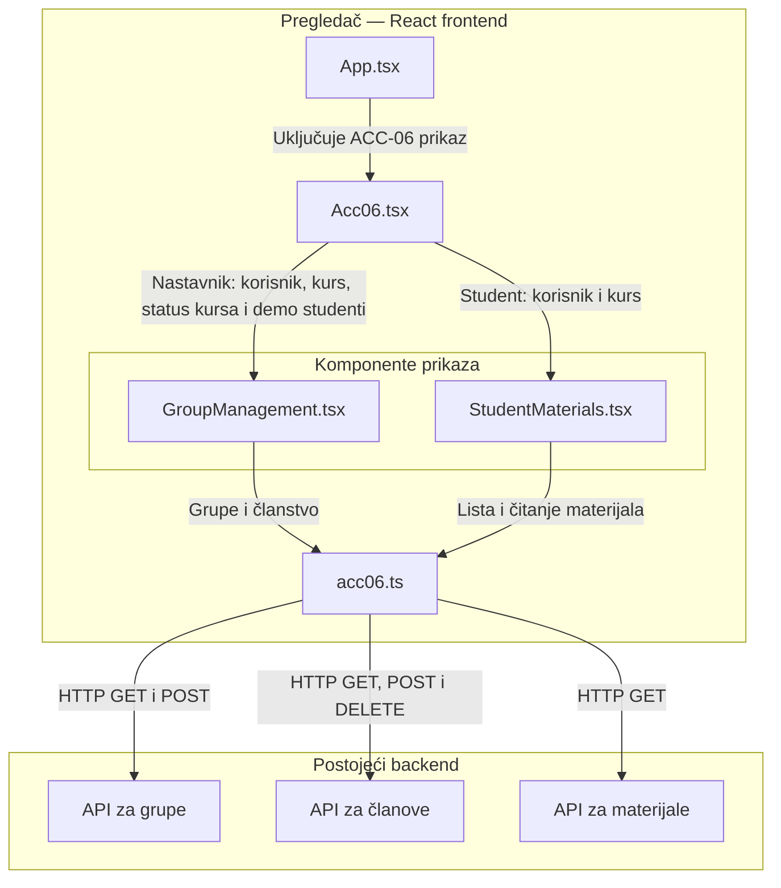

# ACC-06 — Dijagram arhitekture

Dijagram prikazuje komponente ACC-06 frontenda, njihove zavisnosti i vezu sa postojećim backendom, nakon uklanjanja dodele materijala grupi.

`Acc06.tsx` čuva izbor demo korisnika i kursa, a prikazuje se samo u razvojnom režimu. `acc06.ts` šalje zahteve sa zaglavljem `X-Test-User` i obrađuje API greške.

