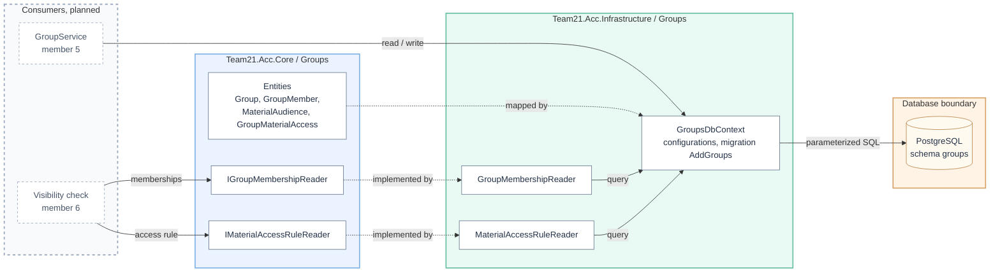
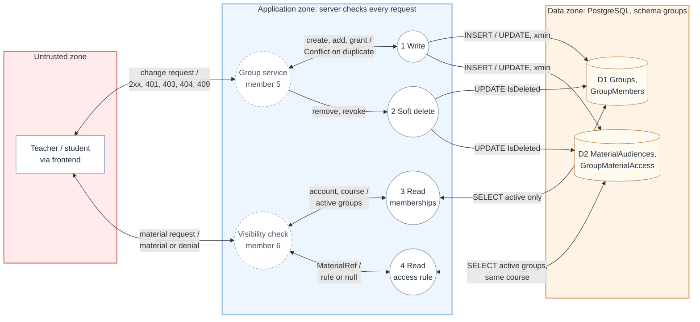

# ACC-06 — Groups data model

- **Team:** 21
- **Student:** Vuk Vranješ, PR 34/2023 (team member 2)
- **Specification requirement:** ACC-06 — Groups and visibility per group (primary); related: ASN-05, ACC-05, ACC-04, SEC-01
- **Work branch:** `feature/acc06-model`

## 1. Responsibilities and boundaries

This component is the persistence layer of ACC-06. It stores groups, group members, material audiences and group access to restricted materials in the `groups` PostgreSQL schema, and exposes two read-only contracts for the server-side visibility check.

| Part | Contents |
| --- | --- |
| Domain entities (Core) | `Group`, `GroupMember`, `MaterialAudience`, `GroupMaterialAccess`, enums `GroupStatus`, `MaterialType`, `MaterialVisibility` |
| Read contracts (Core) | `IGroupMembershipReader`, `IMaterialAccessRuleReader`, read models `GroupMembership`, `MaterialAccessRule`, `MaterialRef` |
| Persistence (Infrastructure) | `GroupsDbContext` / `IGroupsDbContext`, one `IEntityTypeConfiguration` per table, migration `AddGroups` |
| Reader implementations (Infrastructure) | `GroupMembershipReader`, `MaterialAccessRuleReader`, registered in `GroupsModule.AddGroups()` |

- **Processes and user scenarios:** a teacher creates and archives groups, adds and removes students, and restricts materials to selected groups; a student sees a restricted material only through an active membership in an allowed group. This component stores that state; the scenarios themselves run through the group service and the visibility check.
- **Contracts with other modules:** `CourseId` (ACC-01, `courses` schema), `UserId` (IDN) and `MaterialId` (LAB / ASN) are stored as plain columns without foreign keys. Course and enrollment checks go through interfaces, not joins across schemas.
- **Not part of this component:** business rules and endpoints (member 5), the visibility decision (member 6), tests (member 8).
- **Implementation status:** entities, EF Core mapping, first migration and both readers are done. The group service and endpoints are not yet registered (`GroupsModule` has them commented out).

### Tables (schema `groups`)

Every table also has the `BaseEntity` columns: `Id`, `CreatedAt`, `CreatedBy`, `UpdatedAt`, `UpdatedBy`, `IsDeleted`, `DeletedAt`, `DeletedBy`.

| Table | Purpose | Keys and indexes |
| --- | --- | --- |
| `Groups` | Group of a course, `Active` or `Archived` | PK `Id`; index `CourseId`; unique `(CourseId, Name)` for active, non-deleted groups; `xmin` as concurrency token |
| `GroupMembers` | Student in a group; leaving is a soft delete | FK `GroupId` → `Groups`; index `UserId`; unique `(GroupId, UserId)` where not deleted |
| `MaterialAudiences` | Visibility rule of one material: `CourseWide` or `RestrictedToGroups` | index `CourseId`; unique `(MaterialType, MaterialId)` where not deleted; `xmin` as concurrency token |
| `GroupMaterialAccess` | Group allowed to see a restricted material | FK → `MaterialAudiences`; FK → `Groups`; index `GroupId`; unique `(MaterialAudienceId, GroupId)` where not deleted |

All foreign keys use `Restrict`; rows are soft deleted, never removed. The ER diagram is in `docs/team-21/Dijagram za OIB ACC-06.drawio.png`.

## 2. Component architecture

The diagram reads left to right: planned consumers built by other team members (dashed border), the contracts in Core, their implementations in Infrastructure, and the database. Solid arrows represent calls or data access; dashed arrows represent implementation or mapping. Both readers are registered in `GroupsModule.AddGroups()`. The application-to-database link crosses a trust boundary, and the readers are never reached by the client directly.



### Component responsibilities

| Component | Responsibility |
| --- | --- |
| `Group` | Group of one course; name up to 100 characters, `Active` / `Archived` status with archive metadata, `xmin` version. |
| `GroupMember` | Membership of one user in one group. Joining is the row's `CreatedAt` / `CreatedBy`, leaving is the soft delete. |
| `MaterialAudience` | Visibility rule of one material (`Assignment` / `Attachment`): course-wide or restricted to groups. Default is `RestrictedToGroups`. |
| `GroupMaterialAccess` | Grants one group access to one restricted material; revoking is a soft delete. |
| `IGroupsDbContext` / `GroupsDbContext` | `groups` schema, four `DbSet`s; inherits audit stamping, UTC conversion and the soft-delete filter from `TeamDbContextBase`. |
| Configurations | Keys, `Restrict` foreign keys, filtered unique indexes, enum storage and `xmin` concurrency tokens, one class per table. |
| `IGroupMembershipReader` / `GroupMembershipReader` | Active memberships of an account in active groups of a course, ordered by group name. Empty ID returns an empty list without a query. |
| `IMaterialAccessRuleReader` / `MaterialAccessRuleReader` | The visibility rule of a material, or all rules of a course, with allowed group IDs limited to active groups of the same course. Invalid `MaterialRef` returns `null`. |
| `GroupsModule.AddGroups()` | Registers both readers in DI; the group service and endpoints are added here later. |

## 3. Data flow diagram (DFD)

The diagram reads left to right, from the untrusted zone through the application zone to the data zone. Processes 1–4 belong to this component; the group service and the visibility check (dashed) are planned work of other members. A two-way arrow carries a request and its result. The external client never reaches this component directly; every write and every visibility decision passes through a service that checks identity and permissions first. Invalid input to the readers (empty ID, unknown material type) returns an empty list or `null`, which the visibility check treats as no access.



### Data flow details

1. **Write:** The group service, after its own authentication and permission checks, adds or changes rows through `IGroupsDbContext`. `TeamDbContextBase` stamps `CreatedAt` / `UpdatedAt` and keeps `CreatedAt` / `CreatedBy` from being overwritten. A second active group with the same name in a course, a second active membership or a second access row for the same group and material is rejected by a filtered unique index. A concurrent change of the same group or audience fails on the `xmin` check. The service maps both to `Conflict`.
2. **Soft delete:** Removing a member or revoking material access sets `IsDeleted`, `DeletedAt` and `DeletedBy`; the row stays as history. Re-joining or re-granting creates a new row, which the filtered unique indexes allow.
3. **Memberships:** `GroupsOfAsync(accountId, courseId)` returns only active memberships in active groups of that course. Removed members and archived groups never count. An empty ID returns an empty list without touching the database.
4. **Access rule:** `FindAsync(MaterialRef)` returns the material's visibility and the IDs of groups allowed to see it. Only active access rows of active groups of the same course as the material are included. A material without a rule, or an invalid reference (empty ID, unknown type), returns `null`.

**Boundary A:** Requests from the frontend are untrusted. The readers do no access checks themselves and must not be exposed through an endpoint; they only answer the visibility check, which decides inside the backend.

**Boundary B:** The database is reached only through EF Core with parameterized queries. The soft-delete query filter applies to every read unless a query explicitly opts out with `IgnoreQueryFilters([TeamDbContextBase.SoftDeleteFilter])` to read history.

## 4. Security requirements

### Server-side access checks

- This component does not authorize callers; that is done by the group service and the visibility check on every request.
- The model is built for **default deny**: a new `MaterialAudience` defaults to `RestrictedToGroups`, and a restricted material with no active access rows is visible to no student.
- Members of one group cannot gain access through another course's groups: allowed group IDs are limited to groups of the material's own course.
- Archived groups and removed members are excluded at the query level, so a forgotten check in a consumer cannot bring them back.

### Input validation and data integrity

- Group name limited to 100 characters in the model; trimming and character checks belong to the group service.
- Enums are stored with defined values; `FindAsync` rejects an undefined `MaterialType`.
- Filtered unique indexes enforce one active group name per course, one active membership per user and group, one rule per material and one access row per group and material, also under concurrent inserts.
- `Restrict` foreign keys and soft delete keep history; nothing is cascade-deleted.
- `xmin` concurrency tokens on `Groups` and `MaterialAudiences` prevent lost updates.
- No foreign keys across schemas: `CourseId`, `UserId` and `MaterialId` are validated through other modules' interfaces, not trusted as joins.

### Negative scenarios

| Scenario | Expected behavior |
| --- | --- |
| Removed member asks for memberships | Not returned |
| Member of an archived group | Not returned |
| Restricted material with no access rows | Rule with an empty `AllowedGroupIds`; no student sees it |
| Access row pointing to a group of another course | Excluded from `AllowedGroupIds` |
| Empty account, course or material ID | Empty list or `null`, no query |
| Unknown `MaterialType` | `null` |
| Second active membership for the same user and group | Rejected by the unique index |
| Re-joining after removal | Allowed, new row; the old one stays as history |

## 5. Evidence of work

**Implementation:** `feature/acc06-model` → Pull Request into `feature/acc06-groups`.

**Commit:** `b7394a6` — model, ER sketch and first migration.

**Main implementation files:**

- `backend/Team21.Acc.Core/Groups/Group.cs`, `GroupMember.cs`, `MaterialAudience.cs`, `GroupMaterialAccess.cs`
- `backend/Team21.Acc.Core/Groups/GroupStatus.cs`, `MaterialType.cs`, `MaterialVisibility.cs`
- `backend/Team21.Acc.Core/Groups/IGroupMembershipReader.cs`, `IMaterialAccessRuleReader.cs`, `GroupMembership.cs`, `MaterialAccessRule.cs`, `MaterialRef.cs`
- `backend/Team21.Acc.Infrastructure/Groups/Data/GroupsDbContext.cs`, `IGroupsDbContext.cs`, `GroupsDbContextFactory.cs`
- `backend/Team21.Acc.Infrastructure/Groups/Configurations/*.cs`
- `backend/Team21.Acc.Infrastructure/Groups/Data/Migrations/20261101210238_AddGroups.cs`
- `backend/Team21.Acc.Infrastructure/Groups/Services/GroupMembershipReader.cs`, `MaterialAccessRuleReader.cs`
- `backend/Team21.Acc.Api/Groups/GroupsModule.cs`
- `docs/team-21/ACC-06-model.md`

**Run instructions:**

```bash
dotnet build backend/Team21.Acc.slnx
dotnet ef database update --context GroupsDbContext --project backend/Team21.Acc.Infrastructure --startup-project backend/Team21.Acc.Infrastructure
```


**Tests:** ACC-06 tests are member 8's work and not yet in this branch.

**Next steps:** review the ER diagram against the model; confirm with LAB / ASN that ACC-06 stores only material identifiers; group service and endpoints (member 5) and the visibility check (member 6) build on the two readers.
