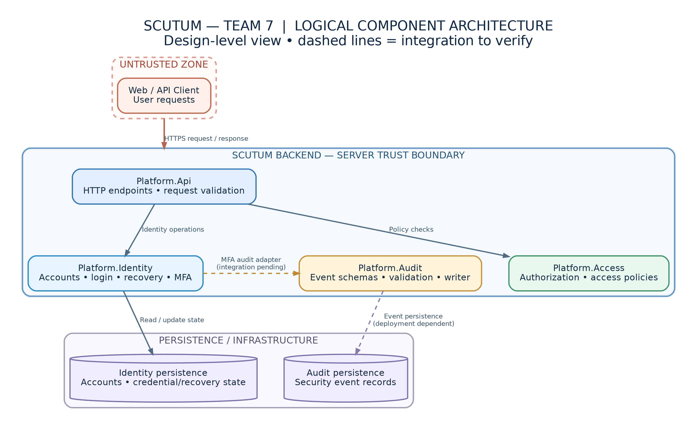
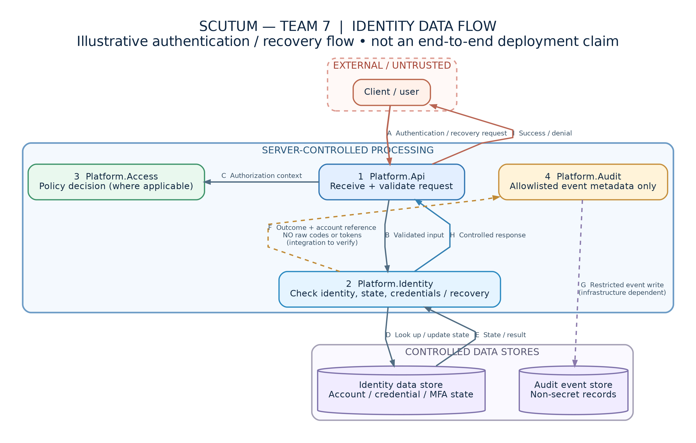

# SCUTUM — Team 7 Technical Documentation

**Project:** SCUTUM — Information Security and Digital Trust Platform  
**Team:** Team 7  
**Subsystem:** Identity and Authentication  
**Document status:** Working technical documentation  
**Version:** 1.0

---

## 1. Project Overview

SCUTUM is a modular platform designed to support information security, identity management, access control, auditing and digital trust.

Team 7 focuses on the identity and authentication capabilities that provide a foundation for other security-sensitive platform operations.

The subsystem is designed around explicit contracts, separation of responsibilities, controlled handling of sensitive information and automated testing.

### 1.1 Objectives

The primary objectives are:

- Reliable identity and account lifecycle management.
- Secure authentication and credential handling.
- Controlled account recovery.
- Multi-factor authentication and backup recovery mechanisms.
- Security event auditing.
- Clear integration contracts with dependent platform components.
- Testable and maintainable implementation.

### 1.2 Scope

Team 7's identity-related development covers the following functional areas:

| Area | Responsibility |
|---|---|
| Identity management | Account identity and lifecycle |
| Authentication | Login, logout and authentication validation |
| Account status | Account activation, suspension and status controls |
| Password recovery | Reset token generation and validation |
| Multi-factor authentication | Additional authentication factor support |
| MFA backup codes | Recovery code generation, redemption and storage |
| Security auditing | Audit contracts and events for identity operations |
| Integration | Controlled interaction with dependent platform modules |

This table describes the functional scope. Completion and integration status must be verified against the corresponding branches, pull requests and tests.

---

## 2. System Architecture

SCUTUM uses a modular backend architecture with clearly separated responsibilities.

Relevant components include:

- **Platform.Api:** HTTP-facing application layer.
- **Platform.Identity:** Identity, authentication and account recovery functionality.
- **Platform.Access:** Authorization and access policy infrastructure.
- **Platform.Audit:** Security event contracts, validation and auditing.
- **Persistence infrastructure:** Storage mechanisms used by individual modules.
- **External clients:** Applications or services consuming supported APIs.

The boundaries between modules are intended to reduce coupling and prevent security-critical responsibilities from becoming distributed across unrelated parts of the system.

### 2.1 Architecture Principles

The design follows these principles:

1. Separation of concerns.
2. Explicit interfaces and contracts.
3. Dependency injection.
4. Server-side security validation.
5. Least privilege.
6. Secure handling of credentials and recovery artifacts.
7. Predictable error handling.
8. Automated validation of successful and unsuccessful operations.

### 2.2 Architecture Diagram

The architecture diagram documents the logical components and their relationships, including the boundaries between clients, API processing, identity logic, persistence and auditing.

---

## 3. Identity and Authentication

### 3.1 Identity Lifecycle

Identity management maintains the relationship between a logical user identity and the account through which that identity accesses the platform.

Security-sensitive account states must be enforced on the server side.

A disabled or suspended account must not be treated as eligible for normal authentication solely because previously issued credentials exist.

### 3.2 Authentication

Authentication establishes whether the presented credentials satisfy the applicable security requirements.

The intended authentication process includes:

1. Receiving an authentication request.
2. Validating the request structure.
3. Identifying the account.
4. Checking the account state.
5. Validating credentials.
6. Applying additional authentication requirements where configured.
7. Producing a controlled authentication result.
8. Recording relevant security events.

The exact API routes and response contracts are defined by the implementation and must be verified during integration.

### 3.3 Account Recovery

Account recovery must be designed to prevent unauthorized password replacement and misuse of recovery tokens.

Required security properties include:

- Cryptographically secure token generation.
- Limited token validity.
- Controlled token consumption.
- Validation before credential modification.
- Protection against token disclosure.
- Tests for invalid, expired and reused tokens.

These are security requirements, not a claim that every property has already passed end-to-end testing.

---

## 4. Multi-Factor Authentication

Multi-factor authentication provides additional protection beyond the primary authentication mechanism.

### 4.1 Backup Codes

Backup codes are recovery credentials intended for situations where the normal additional authentication factor is unavailable.

The security design requires:

- Unpredictable code generation.
- Secure server-side representation.
- Protection of raw backup code values.
- One-time redemption semantics.
- Atomic handling of concurrent redemption attempts.
- Controlled revocation or replacement.
- Security auditing without disclosure of backup codes.

### 4.2 Backup Code Operations

The subsystem defines the following conceptual operations:

| Operation | Expected behavior |
|---|---|
| Generate | Produce a new backup code set |
| Redeem | Validate and consume an eligible backup code |
| Reject | Reject an invalid or ineligible redemption attempt |
| Revoke | Invalidate an applicable backup code set |

Generation, redemption, persistence and audit capabilities may be implemented in separate development branches.

Their combined behavior must be confirmed through integration testing before being considered fully operational.

---

## 5. Audit and Security Events

The audit subsystem is responsible for representing significant security outcomes in a controlled and consistent format.

Four MFA backup code audit event types have been defined:

| Event | Meaning |
|---|---|
| `auth.mfa.backup_codes.generated` | Backup codes generated |
| `auth.mfa.backup_code.redeemed` | Backup code successfully redeemed |
| `auth.mfa.backup_code.rejected` | Backup code redemption rejected |
| `auth.mfa.backup_codes.revoked` | Backup codes revoked |

The corresponding audit adapter uses explicit event types, outcomes and account resource references.

Audit records must not contain:

- Raw backup codes.
- Passwords.
- Authentication tokens.
- Credential hashes.
- Other unnecessary sensitive values.

Audit contract tests and adapter tests verify event construction and permitted metadata.

Persistent audit delivery and event emission from the actual MFA workflows must be confirmed separately during integration.

---

## 6. Data Flow and Trust Boundaries

The data flow model identifies how security-sensitive information moves between components.

The main logical boundaries are:

1. **Client to API:** Untrusted external requests enter server-controlled processing.
2. **API to Identity:** Requests are validated and interpreted by the identity subsystem.
3. **Identity to Persistence:** Security-sensitive records are read or updated using controlled storage operations.
4. **Identity to Audit:** Security outcomes are converted into restricted audit events.
5. **Identity to Access:** Authenticated identity information supports authorization decisions where applicable.

### 6.1 Data Flow Diagram

The diagram illustrates authentication and recovery-related processing and the transfer of relevant information between components.

### 6.2 Sensitive Data Handling

Authentication and recovery information must be processed according to its sensitivity.

Sensitive data should be limited to the components that require it. Logs, audit payloads, diagnostic output and user-facing error messages must not reveal credential material.

---

## 7. Threat Model

The following threats are relevant to the Identity subsystem.

| Threat | Security requirement |
|---|---|
| Credential guessing | Authentication throttling and controlled failures |
| Account enumeration | Restrict unnecessary disclosure of account existence |
| Reset token theft | Unpredictable, time-limited recovery tokens |
| Recovery token reuse | Enforce token consumption rules |
| MFA backup code guessing | Strong code generation and controlled redemption |
| Concurrent backup code reuse | Atomic one-time consumption |
| Unauthorized account operations | Server-side authorization and ownership checks |
| Sensitive data leakage | Restricted logging and audit schemas |
| Dependency misconfiguration | Dependency injection and startup validation |
| Audit evidence loss | Explicit handling of audit write outcomes |

These threats guide security implementation, code review and negative test scenarios.

### 7.1 Residual Risk

Residual risks include incomplete integration between independently developed modules, unavailable persistence infrastructure during tests and unverified behavior in deployment-specific configurations.

Risks remain open until supported by suitable test evidence or a documented operational mitigation.

---

## 8. Testing and Verification

Team 7 follows an automated testing approach that includes:

- Unit tests for domain rules and services.
- Negative tests for invalid operations.
- Authentication and account recovery tests.
- Security contract validation.
- Dependency injection verification.
- Concurrency tests for one-time operations.
- Integration tests where persistence or cross-module behavior is involved.

### 8.1 Audit Test Evidence

During development of the MFA backup code audit work, the following Audit project test result was observed:

| Metric | Result |
|---|---:|
| Discovered tests | 228 |
| Passed | 211 |
| Failed | 0 |
| Skipped | 17 |

The skipped tests require additional database-related configuration and must not be represented as successfully executed.

This result applies to the tested development state, not necessarily to every future merge or deployment configuration.

### 8.2 Verification Criteria

Each feature should have:

1. Documented expected behavior.
2. At least one successful scenario.
3. Relevant negative scenarios.
4. Security-focused assertions.
5. A clear integration boundary.
6. A reviewable pull request.
7. Evidence of test execution.

---

## 9. Integration Contracts

The Identity subsystem interacts with other platform components through explicitly defined interfaces and data contracts.

Integration must preserve:

- Contract compatibility.
- Ownership of security decisions.
- Clear handling of authentication failures.
- Correct resource identification.
- Consistent audit outcomes.
- Transactional guarantees for one-time recovery operations.

The exact interfaces, API endpoints and contract versions are maintained in the corresponding implementation files and should be referenced before a release.

---

## 10. Local Development

The backend uses the .NET development environment.

From the repository root, solution restoration can be initiated with:

`dotnet restore backend/SecurityLab.slnx`

A build can be initiated with:

`dotnet build backend/SecurityLab.slnx`

Individual test projects should be executed using their corresponding `.csproj` paths.

Database-backed and deployment-dependent tests may require additional local configuration.

Secrets, credentials, live authentication tokens and production connection strings must never be committed to version control.

---

## 11. Security Design Decisions

Important security decisions should be recorded as Architecture Decision Records (ADRs), particularly when they affect:

- Credential storage.
- Recovery token lifecycle.
- MFA backup code storage and consumption.
- Trust boundaries.
- Authorization responsibility.
- Audit data minimization.
- Failure handling.
- Persistence and concurrency guarantees.

Every ADR should describe the decision, its rationale, security consequences and known trade-offs.

---

## 12. Delivery and Responsibilities

Each development contribution should be traceable through:

- An identified feature or task.
- A dedicated Git branch.
- Relevant implementation changes.
- Automated tests.
- A pull request.
- Code review and integration checks.

Team 7 maintains the Identity subsystem's responsibilities while coordinating shared dependencies with other platform teams.

A merged contract or isolated unit test does not automatically prove that the complete cross-module workflow is operational.

---

## 13. Known Limitations and Next Steps

Before final acceptance, the following require verification:

- Integration of independently developed MFA backup code components.
- Actual audit emission from production-facing MFA workflows.
- Persistence-backed test execution.
- Complete end-to-end authentication and recovery scenarios.
- Deployment-specific configuration and secret management.
- Alignment between diagrams, implementation and integrated runtime behavior.

Documentation should be updated whenever implementation or security boundaries change.

---

## 14. Conclusion

Team 7's SCUTUM Identity subsystem provides the architectural foundation for reliable identity management, authentication and account recovery.

Its security design emphasizes explicit contracts, data minimization, predictable behavior, modular development and testable security requirements.

The final acceptance of the subsystem depends on successful integration, completed security testing and consistency between the implementation and its technical documentation.